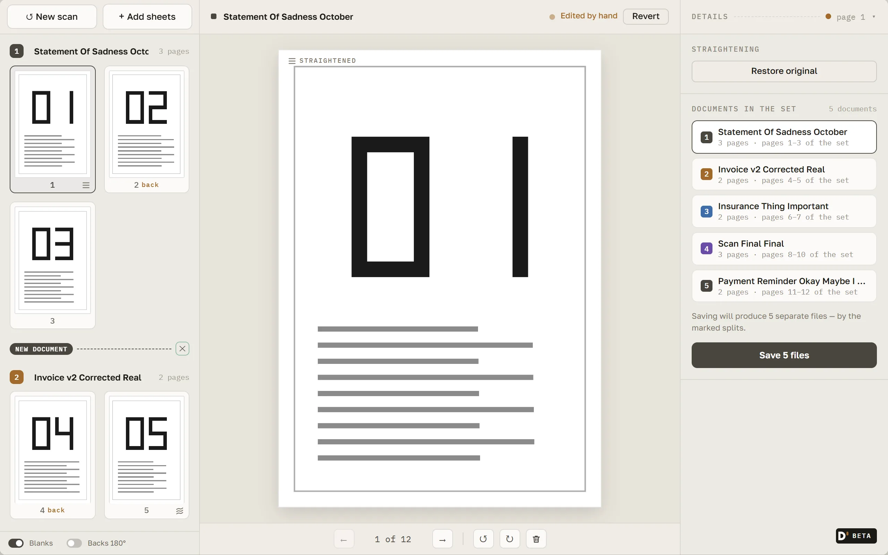

# Duplexn't

English · [Русский](README.ru.md)

**Duplex scanning on a simplex scanner.** Duplexn't gets both sides of every page out of a scanner
with a one-sided document feeder: scan the fronts, flip the stack, scan the backs, and get one PDF
with the pages in the right order. Along the way it detects blank backs, straightens crooked pages,
and lets you split one stack into several documents before saving.

Project page: <https://gyuiltylizard.github.io/duplexnt/>



## Download

Builds are published only on the **[Releases](https://github.com/gyuiltylizard/duplexnt/releases)**
page of this repository. Each release carries two files:

- `duplexnt-<version>-setup.exe` — the Windows installer;
- `SHA256SUMS.txt` — its checksum.

The app is in beta: releases are marked _pre-release_ until `1.0.0`.

**The installer is not code-signed.** Windows SmartScreen will warn you the first time you run it:
choose _More info_, then _Run anyway_. If Windows shows a _named_ publisher for a Duplexn't
installer, that file did not come from this project — do not run it.

To verify the download, compare its checksum with the line in `SHA256SUMS.txt` (letter case does
not matter):

```powershell
Get-FileHash .\duplexnt-<version>-setup.exe -Algorithm SHA256
```

## Requirements

- Windows 10 or 11, x64.
- A scanner with an automatic document feeder that speaks **eSCL** over the network (the protocol
  behind AirScan / Mopria Scan). Duplexn't talks to the scanner directly; no vendor software is
  needed.
- Tested on an **Epson EcoTank ET-3850**. Other eSCL devices should work, but have not been
  verified — reports from other models are welcome in Issues.

## Run from source

Node.js 22.18 or newer.

```
npm install
npm run dev
```

Electron is downloaded lazily on the first run, and `dev` waits for it silently; to fetch it ahead
of time: `npx install-electron --no`. The Windows installer is built with `npm run dist` into
`release/`. Quality gates: `npm run typecheck`, `npm run lint`, `npm run format:check`,
`npm run test`, `npm run test:integration` (`npm run test:all` runs both test suites).

## Project documentation

The documentation is in Russian. (Yes, I realised that way too f\*\*king late. If you need it,
an AI agent will make sense of it just fine.) Start with the specification and development rules
in [`docs/duplexnt.md`](docs/duplexnt.md); technical notes on eSCL and the behaviour verified on
hardware are in [`docs/duplexnt-tech.md`](docs/duplexnt-tech.md), and architecture decisions in
[`docs/decisions/`](docs/decisions/).

## Contributing

This project does not accept unsolicited pull requests. Please use
[Issues](https://github.com/gyuiltylizard/duplexnt/issues) to report bugs, suggest improvements,
or discuss potential changes — in English or Russian. See [CONTRIBUTING.md](CONTRIBUTING.md).

## Security

Please report vulnerabilities privately through the repository's **Security** tab (_Report a
vulnerability_), not in public Issues.

## License

Duplexn't is free software, licensed under the **GNU General Public License, version 3 only**
(`GPL-3.0-only`) — see [LICENSE](LICENSE). Third-party components shipped with the installer are
listed in [THIRD-PARTY-NOTICES.txt](THIRD-PARTY-NOTICES.txt).

**Name and branding.** The name "Duplexn't" and its logo are not part of the license. You may fork
and modify the code freely under the GPL, but please give your modified version a different name.
