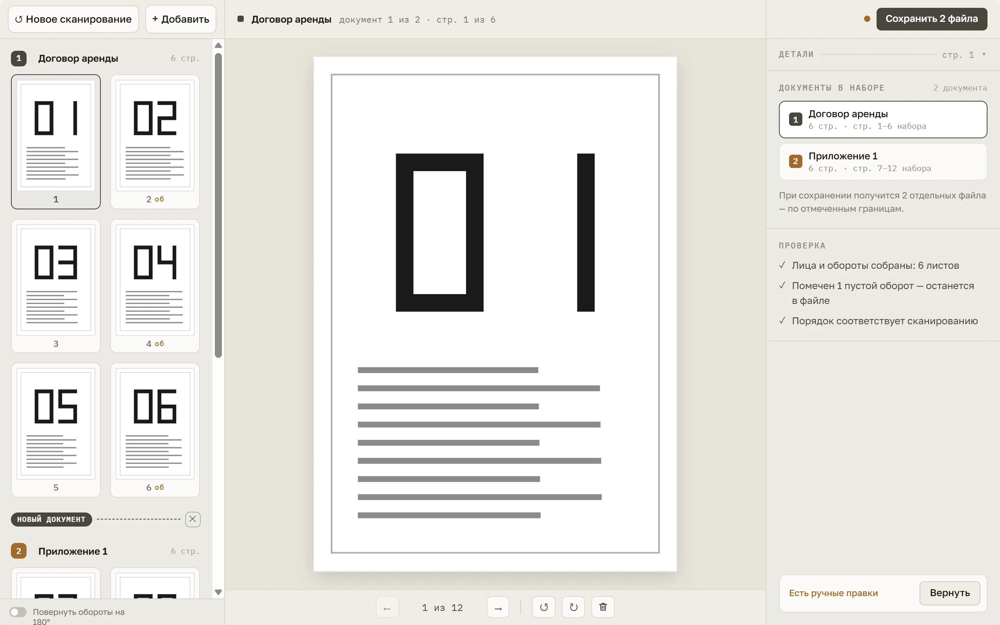

# Duplexn't

[English](README.md) · Русский

**Двустороннее сканирование на одностороннем сканере.** Duplexn't вытаскивает обе стороны каждого
листа из сканера с односторонним автоподатчиком: сканируете лицевые стороны, переворачиваете стопку,
сканируете обороты — и получаете один PDF со страницами в правильном порядке. По дороге приложение
находит пустые обороты, выравнивает косые страницы и даёт разделить одну стопку на несколько
документов перед сохранением.

Страница проекта: <https://gyuiltylizard.github.io/duplexnt/>



## Скачать

Сборки публикуются только на странице
**[Releases](https://github.com/gyuiltylizard/duplexnt/releases)** этого репозитория. В каждом
релизе два файла:

- `duplexnt-<версия>-setup.exe` — установщик для Windows;
- `SHA256SUMS.txt` — его контрольная сумма.

Приложение в бете: до `1.0.0` релизы помечены как _pre-release_.

**Установщик не подписан.** При первом запуске Windows SmartScreen покажет предупреждение:
нажмите _Подробнее_, затем _Выполнить в любом случае_. Если Windows показывает у установщика
Duplexn't _именованного_ издателя — этот файл не из этого проекта, не запускайте его.

Чтобы проверить скачанное, сравните контрольную сумму со строкой в `SHA256SUMS.txt` (регистр букв
не важен):

```powershell
Get-FileHash .\duplexnt-<версия>-setup.exe -Algorithm SHA256
```

## Требования

- Windows 10 или 11, x64.
- Сканер с автоподатчиком, который умеет **eSCL** по сети (протокол, стоящий за AirScan / Mopria
  Scan). Duplexn't общается со сканером напрямую, программы производителя не нужны.
- Проверено на **Epson EcoTank ET-3850**. Другие eSCL-устройства должны работать, но не
  проверялись — отчёты о других моделях приветствуются в Issues.

## Запуск из исходников

Node.js 22.18 или новее.

```
npm install
npm run dev
```

Бинарник Electron качается лениво при первом запуске, и `dev` в это время молча ждёт; скачать
заранее — `npx install-electron --no`. Установщик для Windows собирает `npm run dist` в
`release/`. Проверки качества: `npm run typecheck`, `npm run lint`, `npm run format:check`,
`npm run test`, `npm run test:integration` (`npm run test:all` — оба набора тестов).

## Документация проекта

Документация на русском (да, я понял это слишком поздно). Начинать со спеки и правил разработки
в [`docs/duplexnt.md`](docs/duplexnt.md); техническая база по eSCL и проверенному на железе — в
[`docs/duplexnt-tech.md`](docs/duplexnt-tech.md), архитектурные решения — в
[`docs/decisions/`](docs/decisions/).

## Участие

Проект не принимает pull request'ы со стороны. Ошибки, предложения и обсуждение изменений — через
[Issues](https://github.com/gyuiltylizard/duplexnt/issues), по-русски или по-английски. Подробнее —
[CONTRIBUTING.md](CONTRIBUTING.md).

## Безопасность

Об уязвимостях сообщайте приватно через вкладку **Security** репозитория (_Report a
vulnerability_), а не в публичных Issues.

## Лицензия

Duplexn't — свободное программное обеспечение под **GNU General Public License, версия 3 и только
она** (`GPL-3.0-only`) — см. [LICENSE](LICENSE). Сторонние компоненты, которые едут в установщике,
перечислены в [THIRD-PARTY-NOTICES.txt](THIRD-PARTY-NOTICES.txt).

**Имя и знак.** Название «Duplexn't» и логотип в лицензию не входят. Форкать и менять код под GPL
можно свободно, но изменённой версии, пожалуйста, дайте другое имя.
