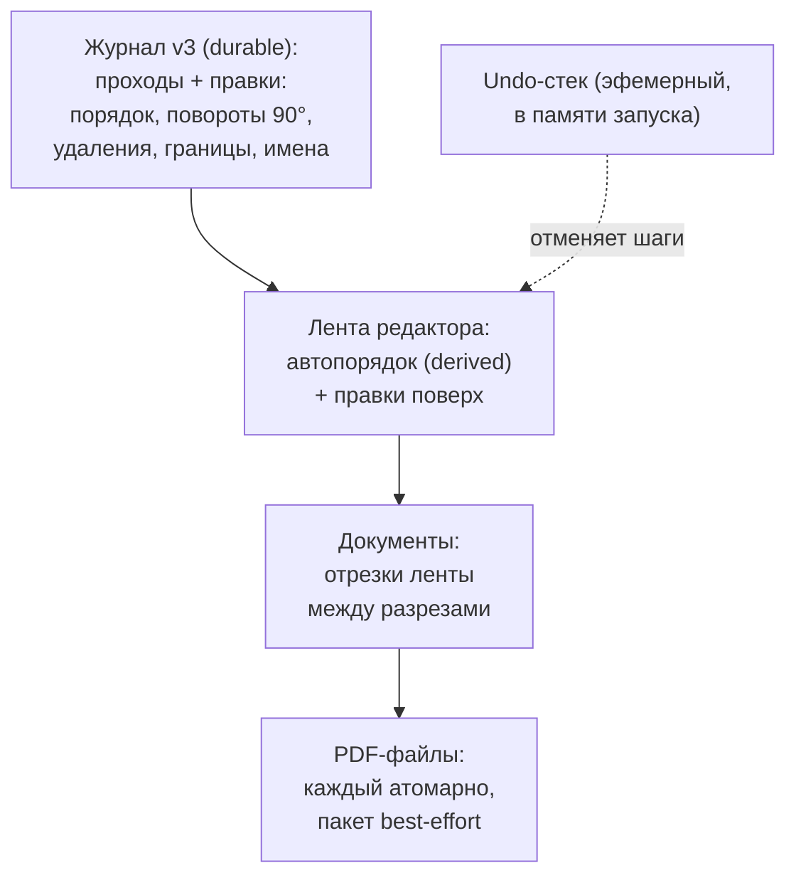

# M3: модель ручных правок и документов — требования

## Summary

Журнал сессии поднимается до версии 3 и хранит итоговое состояние ручных правок редактора — порядок, повороты 90°, удаления-пометки, границы документов с именами, — так что после перезапуска редактор выглядит ровно как до закрытия. Поверх состояния — эфемерный undo-стек в рамках запуска и «Вернуть» как полный откат к первоначальному виду с подтверждением. Сохранение нескольких документов — каждый файл атомарно, пакет best-effort с честным итогом.

---

## Problem Frame

M2 оставила редактор почти без правок: единственная ручная правка — аварийный тумблер 180°, живущий флагом прохода. M3 приносит весь набор ручных правок из макета, и каждой нужно место в данных: ADR 0004 зарезервировал нишу («правки страниц — отдельная коллекция в журнале по ключу страницы», «любое новое поле — новая версия формата»), но форму не определил. Без решения о форме — как правки переживают перезапуск, что откатывается и когда, что происходит при сбое посреди пакета файлов — планирование M3 изобретало бы поведение продукта на ходу.

Отдельно повис «Добавить» (досканирование недостающего листа): UI_SPEC помечает его «M3+», но ни одна веха роадмапа его не несёт.

---

## Key Decisions

- **Журнал v3 — итоговое состояние правок, не лог операций.** Открыл приложение — видишь свои правки; историю шагов журнал не хранит. Лог операций понадобился бы только персистентному undo, от которого отказались. Точная форма записей (расширение существующего механизма пометок `deletions` до страниц или новая коллекция) — за планированием; версия формата становится 3, чтение v1/v2 сохраняется.
- **Undo — эфемерный стек в памяти редактора.** Ctrl+Z отменяет любые правки в рамках запуска, без лимита глубины. После перезапуска стек пуст, правки целы, полный откат доступен — осознанная цена за простую схему и тесты.
- **«Вернуть» — полный откат, плашка — при любой правке.** Одна кнопка на всё: сброс порядка, поворотов, удалений, границ и имён, возврат удалённых страниц, включение автосортировки; выполняется после подтверждения и сама отменяема через Ctrl+Z. Это меняет обещание UI_SPEC §6.4 («Вернуть» восстанавливала только автопорядок) — спека правится вслед.
- **Граница документа — разрез между позициями ленты, не свойство страницы.** Перенос страницы через разрез меняет её документ, разрез остаётся на месте. Лента режется на отрезки; документ — отрезок с именем.
- **Пакет файлов — best-effort.** Сбой одного файла не прерывает запись остальных; в конце честный итог с повтором только неудавшихся. Уже записанные файлы не трогаем — «всё или ничего» потребовало бы удалять свежезаписанные файлы пользователя.
- **Коллизии имён — авто-суффикс.** Занятое имя получает « (2)» как при скачивании в браузере; существующие файлы не перезаписываются и вопросами пользователя не прерываем.
- **«Добавить» — отдельная веха после M3.** Роадмап получает новую веху; журнал v3 проектируется так, чтобы add не блокировать (правки по ключу страницы не зависят от числа проходов).

Схема данных целиком (что durable, что derived):

---

## Requirements

**Журнал и восстановление**

- R1. Ручные правки — порядок, поворот 90°, удаление, границы документов, имена — переживают перезапуск: редактор после открытия показывает то же состояние, что до закрытия.
- R2. Журнал — версия 3, хранит итоговое состояние правок; чтение журналов v1 и v2 сохраняется.
- R3. Исходники страниц не меняет ни одна правка; удаление — пометка в журнале, файл страницы жив до «Нового сканирования» (по ADR 0004).
- R4. Правки живут до «Нового сканирования»; сохранение PDF их не стирает и не мешает править дальше.

**Правки и undo**

- R5. Каждая правка редактора отменяема через Ctrl+Z в рамках запуска; глубина стека не ограничена.
- R6. После перезапуска undo-стек пуст, правки на месте, полный откат доступен.
- R7. Ручной перенос отключает автосортировку — порядок фиксируется явным; поворот, удаление, границы и имена порядок не фиксируют.
- R8. Любая ручная правка показывает плашку с кнопкой «Вернуть» и снимает отметку «сохранено» у сессии.

**Полный откат**

- R9. «Вернуть» после подтверждения сбрасывает все правки: порядок, повороты, удаления (страницы возвращаются), границы и имена; автосортировка включается обратно, плашка исчезает.
- R10. Полный откат — операция в undo-стеке: Ctrl+Z возвращает состояние до отката.

**Документы и границы**

- R11. Граница — разрез между соседними позициями ленты; перенос страниц разрезы не двигает. Граница невозможна перед первой позицией (UI_SPEC §6.7).
- R12. Имя документа привязано к разрезу; снятие границы удаляет имя (UI_SPEC §6.7).
- R13. Документ, оставшийся без страниц после удалений, исчезает из сводки; возврат страниц (Ctrl+Z, откат) возвращает его.

**Сохранение**

- R14. Модалка `save`: «один файл / отдельные файлы», сводка перед сохранением — по UI_SPEC §7.3; каждый файл пишется атомарно (temp → fsync → rename).
- R15. Сбой записи одного файла не прерывает запись остальных; итог называет, что записано и что нет, и предлагает повторить только неудавшиеся.
- R16. Отметка «сохранено» у сессии появляется только когда записаны все файлы пакета.
- R17. Занятое имя в папке получает авто-суффикс (« (2)»); существующие файлы не перезаписываются; фактические имена видны в итоге.

**Документация вслед решениям**

- R18. UI_SPEC §6.4 правится: плашка — при любой ручной правке, «Вернуть» — полный откат с подтверждением; формулировка плашки уточняется в макете.
- R19. Роадмап получает отдельную веху «Добавить» после M3.

---

## Key Flows

- F1. Правки переживают перезапуск
  - **Trigger:** пользователь повернул страницу, перетащил другую, закрыл приложение.
  - **Steps:** запуск → восстановление сессии из журнала v3 → лента с правками, плашка видна, undo-стек пуст.
  - **Covers:** R1, R2, R6, R8.
- F2. Случайное удаление
  - **Trigger:** пользователь удалил страницу (без подтверждения, тост по UI_SPEC §6.8).
  - **Steps:** страница исчезает из ленты, в журнале — пометка → Ctrl+Z → страница на прежнем месте в своём документе.
  - **Covers:** R3, R5.
- F3. Полный откат
  - **Trigger:** нажата «Вернуть» на плашке.
  - **Steps:** подтверждение → все правки сброшены, удалённые страницы вернулись, автопорядок, плашка исчезла → Ctrl+Z возвращает всё как до отката.
  - **Covers:** R9, R10.
- F4. Сохранение отдельными файлами со сбоем
  - **Trigger:** в модалке `save` выбраны «отдельные файлы», документов пять, на четвёртом — ошибка записи.
  - **Steps:** остальные пишутся → итог «сохранено 4 из 5, не записался …» → повтор пишет только неудавшийся → после успеха отметка «сохранено».
  - **Covers:** R14, R15, R16.

---

## Acceptance Examples

- AE1. **Covers R1, R6, R8.** Повернул страницу 3, перетащил страницу 7, закрыл приложение. После запуска: лента в том же порядке, страница 3 повёрнута, плашка видна, Ctrl+Z ничего не отменяет.
- AE2. **Covers R3, R5.** Удалил страницу 5 — тост «Страница удалена», файла из папки сессии не исчез. Ctrl+Z — страница 5 снова на своей позиции.
- AE3. **Covers R7, R8.** Только повернул страницу (порядок не трогал): плашка видна, автосортировка осталась включённой, отметка «сохранено» снята.
- AE4. **Covers R9, R10, R12.** Две границы, имена набраны, три страницы удалены. «Вернуть» → подтверждение → один документ без имени, все страницы на месте, автопорядок. Ctrl+Z → границы, имена и удаления вернулись.
- AE5. **Covers R11.** Перетащил страницу из первого документа за разрез — она стала последней страницей второго документа; разрез остался между теми же позициями.
- AE6. **Covers R13.** Удалил обе страницы второго документа — в сводке перед сохранением второго документа нет. Ctrl+Z дважды — документ снова в сводке.
- AE7. **Covers R15, R16, R17.** Пять документов, в папке занято имя второго, на четвёртом сбой: записаны четыре файла (второй — с « (2)»), чужой файл цел, итог называет незаписанный (четвёртый), отметки «сохранено» нет. Повтор дописывает четвёртый файл — отметка появилась.
- AE8. **Covers R4.** Сохранил один файл, затем удалил страницу: отметка «сохранено» снята, плашка видна; правки живут дальше до «Нового сканирования».

---

## Scope Boundaries

- «Добавить» (досканирование недостающего листа) — не в M3: отдельная веха после M3 (R19); модалка `mismatch` до неё живёт без кнопки «Добавить», как в M2.
- Персистентный undo (переживающий перезапуск) — не делаем; эфемерного стека и полного отката достаточно.
- «Полка удалённых страниц» как отдельная зона UI — не делаем: возврат — Ctrl+Z или полный откат.
- Анимации и плавность переходов — бэклог «Доделки UI», не часть модели правок.

---

## Dependencies / Assumptions

- ADR 0004 остаётся рамкой: исходники неизменяемы, правки — в журнале, производное не пишет в источник правды. Схема журнала v3 — архитектурная развилка: при принятии формы на планировании пишется ADR (амендмент 0004 или новый).
- Поворот 90° компонуется с аварийным тумблером 180° прохода: в отображении и PDF применяется сумма поворотов страницы.
- Форма подтверждения полного отката и формулировка плашки — макет/handoff M3, поведение зафиксировано здесь.

---

## Outstanding Questions

**Deferred to Planning**

- Форма записей v3: расширить существующий механизм пометок `deletions` на страницы или завести отдельную коллекцию правок по ключу страницы; точный состав полей.
- Redo (Ctrl+Y / Ctrl+Shift+Z): при эфемерном стеке почти бесплатен — по умолчанию включаем, подтвердить при планировании.
- Место вехи «Добавить» в роадмапе — сразу после M3 или после M4 «Пустые обороты»; решается при правке роадмапа (R19).
