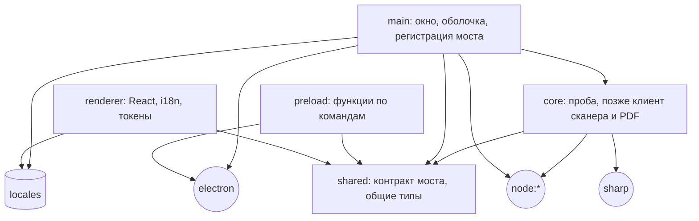
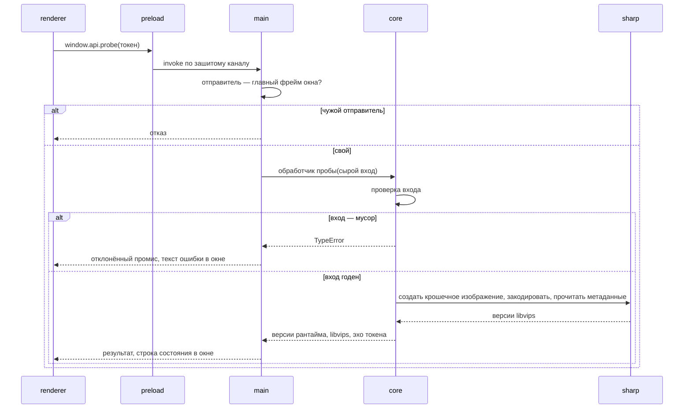
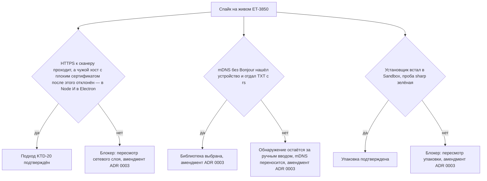

# feat: Каркас и фундамент (M0)

## Summary

M0 заводит проект на Electron + TypeScript strict + React: слои с границами под линтером, команды
качества с pre-commit hook, каркас локализации и токенов, шрифты в поставке, канонические фикстуры
ET-3850 и установщик NSIS. Через все слои проходит один сквозной срез — команда-проба, которая
заодно доказывает, что `sharp` жив. Три риска из ADR 0003 снимаются спайком на живом устройстве:
mDNS без Bonjour, HTTPS с самоподписанным сертификатом, установщик на чистой машине. Блокеры
поставки и сети идут раньше внешнего вида.

Входы: [брейншторм по стеку](../brainstorms/2026-09-17-stack-requirements.md), ADR
[0001](../decisions/0001-test-framework.md), [0002](../decisions/0002-language.md),
[0003](../decisions/0003-shell-build-delivery.md), [роадмап](../roadmap.md) → M0.

---

## Problem Frame

В репозитории только документация: кода, `package.json` и команд нет. Спека держит хвосты
`<не определено: …>`, которые закрываются только фактом, — пути каталогов, расположение локалей,
конвенция фикстур, имя команды установщика. ADR 0001 оставил открытым вопрос, нужен ли
`test:integration` запуск под electron-as-node. ADR 0003 назвал три допущения, на которых стоит
сетевой слой и поставка, и потребовал снять их живым репро до M1.

Прецедент того же тулчейна — Shelfory. Его конфиги не копируются, но уроки перенесены: там
пожалели о независимых tsconfig без solution-style, о позднем pre-commit hook и не закрыли упаковку
`sharp` под asar. M0 учитывает первое и второе сразу, а третье делает отдельным юнитом с гейтом.

Репозиторий станет публичным, а спайк снимает с устройства данные, которые его идентифицируют.
Поэтому приватность — часть каркаса: сырое живёт вне git, а за отслеживаемыми файлами следит страж.

Вопросы брейншторма, отложенные на планирование, и чем они сняты здесь:

- **Библиотека mDNS** — выбирается спайком (U8, U11), фиксируется амендментом ADR 0003.
- **Валидатор входа моста** — в M0 ручная проверка одной команды; библиотека и ADR — в M1, когда
  появятся богатые payload'ы. Способ отдачи изображений страниц — тоже M1.
- **Библиотека PDF, перетаскивание миниатюр, переживание сессией перезапуска** — не M0 (M2, M3,
  брейншторм по модели данных перед M1).

---

## Requirements

В скобках — требования и примеры origin, которые пункт закрывает.

**Платформа и слои**

- R1. Приложение на Electron с TypeScript strict во всех процессах и React в renderer собирается
  и открывает окно на Windows. (origin R1, R2)
- R2. Слой ядра не импортирует Electron и вышележащие слои; нарушение роняет `lint`. Остальные
  границы слоёв закрыты тем же механизмом. (origin R3, AE1)
- R3. Интерфейс достаёт ядро только через `preload`-мост с типизированной картой «канал ↔ тип»;
  вход валидируется на стороне ядра, мусор даёт явную ошибку. (origin R4)
- R4. Оболочка безопасна по умолчанию: `contextIsolation`, sandbox, без `nodeIntegration`, строгий
  CSP в сборке, запрет навигации, новых окон и веб-разрешений. Настройки закрыты тестом. (origin
  R4, R14)

**Качество**

- R5. Заведены команды `typecheck`, `lint`, `format`, `format:check`, `test`, `test:integration`,
  `test:all`, `dev`, `build` и команда установщика `dist`. (origin R15)
- R6. Pre-commit hook форматирует застейдженное; концы строк в репозитории — LF; фикстуры
  форматер и git не трогают. (origin R15)
- R7. `test` не требует сети, сканера и окна; `test:integration` идёт под обычным Node. (origin
  R16, AE3; закрывает открытый хвост ADR 0001 в части `sharp`)

**Локализация и внешний вид**

- R8. Строки идут через `i18next` с первого экрана; локаль русская, плюрализация по правилам
  локали, ключи типизированы; вторая локаль добавляется без перестройки кода. (origin R12, R13)
- R9. Токены дизайн-системы закодированы один раз как CSS-переменные; расхождение с
  `docs/design/DESIGN_SYSTEM.md` ловит тест. (ADR 0003)
- R10. Шрифты макета едут в сборке; обращений к внешним хостам нет. (origin R14)

**Фикстуры и приватность**

- R11. В репозитории лежат канонические `ScannerCapabilities` и `ScannerStatus` ET-3850 с
  заменёнными идентификаторами; конвенция каталога записана; это единственный источник ответов
  устройства для будущих тестов и эмулятора. (origin R18)
- R15. В фикстурах, журналах, ADR и скриптах спайка нет идентификаторов устройства и домашней сети;
  незачищенный файл не проходит ни `test`, ни коммит.

**Поставка и спайк**

- R12. `dist` даёт установщик NSIS с деинсталлятором, без подписи и автообновления; деинсталляция
  не трогает пользовательские данные; `sharp` работает в установленном приложении. (origin R21)
- R13. По трём критериям спайка ADR 0003 есть записанный результат; провал оформлен амендментом
  по правилам самого ADR. (origin R6, R7, R8, AE2)

**Процесс**

- R14. Журнал `docs/solutions/0001-m0-scaffold.md` ведётся с первой сессии; хвосты спеки, которые
  M0 закрывает фактом, дописаны; веха вливается только после приёмки автором.

---

## Key Technical Decisions

**Каркас и версии**

- KTD-1. **Каркас собирается вручную**, без скаффолдера и пресетов `@electron-toolkit/*`:
  скаффолдер интерактивен и зависает у агента, пресеты не дают контроля над границами слоёв.
- KTD-2. **Связку версий ведёт `electron-vite`**: сначала его peerDependencies, потом остальное.
  Версии в плане не пинятся; фактические правки идут в журнал. `electron-builder` ставится точной
  версией: идёт миграция на v27 с другой схемой конфига. `package-lock.json` коммитится, `dist`
  собирается с чистой установки по lock-файлу — для неподписанного установщика это единственный
  якорь состава.
- KTD-3. **Критерий размещения зависимости механический:** нативное и небандлящееся — в
  `dependencies` (сейчас только `sharp`); чистый JS — в `devDependencies`, его бандлит Vite. Так
  правило экстернализации `electron-vite` однозначно, а место XML-парсера и mDNS в M1 определяется
  без обсуждения. Аудит зависимостей идёт по всем, а не только по «продакшен»: React и i18next
  едут в бандле.
- KTD-27. **Ядро бандлится в выход main**; с диска в рантайме резолвятся только `sharp` и `@img/*`.
  Ядро не ищет файлы относительно собственного исходника. Тесты гоняют ядро из исходников под
  Node, продакшен — забандленным под Electron.

**Раскладка и TypeScript**

- KTD-4. **Пять корней под `src/`**: `shared` (контракт моста и общие типы — это контракт, а не
  пятый слой), `core`, `main`, `preload`, `renderer`. Рядом в корне — `locales/`, `test/`,
  `types/`, `spikes/`, `scripts/`, `tooling/`. Для эмулятора M1 зарезервирован `test/emulator/`:
  он импортирует только `node:*` и фикстуры, не `src/core`, иначе проверка «клиент против
  эмулятора» замыкается на себя.
- KTD-5. **Корневой `tsconfig.json` — solution-style**; проекты пересекаются по `include` и не
  ссылаются друг на друга. Состав:
  - `shared` — только `src/shared`, без Node- и DOM-типов;
  - `core` — `src/core` и `src/shared`; доказывает, что ядро компилируется без main, preload и DOM.
    Это не дубль правила линтера: линтер видит только импорты, а ambient-типы DOM и глобалы
    протекают в ядро без единого импорта — их ловит только отдельная компиляция;
  - `node` — main, preload, ядро, `shared`, `locales`, `types/`;
  - `web` — renderer, `shared`, `locales`, `types/`;
  - `test` — `test/**`, корневые конфиги, `scripts/`, `tooling/`, ядро и `shared`, с Node-типами.

  Порядок ссылок в корне — от строгого к широкому: файл из нескольких проектов редактор относит
  к первому совпадению. `types/` не входит в `shared` и `core`. Тесты рядом с кодом остаются в
  проекте своего слоя; у vitest выключены глобалы, поэтому продуктовым проектам не нужны его
  ambient-типы. Shelfory начал с независимых конфигов и получил тысячу ложных ошибок в редакторе
  при зелёном `typecheck`.
- KTD-28. **Таблица алиасов — один экспортируемый модуль**; его читают конфиги `electron-vite` и
  vitest. Ещё два места, где алиасы повторяются, — `paths` в tsconfig и паттерны ESLint.
- KTD-6. **Границы слоёв — базовый `no-restricted-imports`** отдельным блоком на каждый каталог, с
  сообщением «куда вместо этого». Начиная с ESLint 9.37 базовое правило видит `import type`, плагин
  не нужен. Ядру запрещены `electron` и вышележащие слои, но **не `node:*`**: сеть и файлы — его
  работа. Блоки границ экспортируются из конфига отдельным массивом: тест собирает из них свой
  экземпляр ESLint с парсером без типовой информации. Типизированный линт синтетический файл не
  примет — он не входит ни в один проект.

**Мост и сквозной срез**

- KTD-7. **Контракт моста — const-объект и типы в `src/shared/`.** Preload выставляет по функции
  на команду с зашитым каналом; сквозного `invoke(канал, …)`, `ipcRenderer` и объектов событий
  наружу нет. Обёртка регистрации в main — единственная точка входа, и она отклоняет вызов не из
  главного фрейма окна приложения. Тип `Api` выводится из контракта и экспортируется из `shared`;
  объявление `window.api` лежит в дереве renderer — так нет пары `index.ts` / `index.d.ts`, из
  которой glob забирает только `.ts`.
- KTD-29. **В контракте только типы из ES-библиотеки, переживающие structured clone**:
  `Uint8Array` и `ArrayBuffer` можно, `Buffer`, `Blob` и потоки нельзя. Это держит `shared`
  изолированным и совпадает с тем, во что IPC превращает `Buffer`. Обратное направление (события
  main → renderer для счётчика страниц) добавляется в M1 секцией контракта с подпиской,
  возвращающей отписку. Как по мосту едут доменные ошибки — конвертом результата или отказом
  промиса — решение M1, рядом с ADR про валидатор: отказ `invoke` теряет класс ошибки.
- KTD-8. **Один сквозной срез — команда-проба.** Renderer → preload → main → ядро → `sharp`:
  возвращает версии рантайма и libvips после настоящей операции над изображением. Проба остаётся
  диагностическим каналом и после M1: ею проверяется каждый установщик. M0 строит границы и одного
  их потребителя, не вторых.
- KTD-9. **Окно M0 — технический proof-shell без мока и handoff'а.** Это не экран из
  `docs/design/UI_SPEC.md`; исключение из правила «сначала мок» утверждено автором. В M1 его
  заменяет экран `setup`.
- KTD-10. **Вход пробы валидируется вручную**, мусор даёт `TypeError` под тестом. Библиотека
  валидации — M1, своим ADR.

**Оболочка**

- KTD-30. **`webPreferences` и CSP — чистые модули без импорта Electron**, закрытые тестом:
  регресс вроде `sandbox: false` «чтобы preload заработал» иначе пройдёт молча. CSP собирается
  билдером с двумя профилями и явными списками; в сборочном профиле `base-uri`, `form-action` и
  `object-src` закрыты отдельно — `default-src` их не покрывает.
- KTD-31. **Preload собирается в один CJS-файл** с вбандленным `shared`: под sandbox нет ни ESM,
  ни `require` произвольных модулей. Поэтому в `package.json` нет поля `type`: `electron-vite`
  выводит формат main и preload из него, и при `module` preload вышел бы ESM. Скрипты, которым
  нужен ESM, несут расширение `.mjs` или `.mts`.
- KTD-32. **Renderer в сборке грузится с диска**, как по умолчанию у `electron-vite`; в Shelfory
  это пережило hardening. Изображения страниц в M1 идут отдельной схемой по своему ADR. Перевод
  самого приложения на собственную схему связан с fuse `GrantFileProtocolExtraPrivileges` и
  оценивается в hardening.
- KTD-33. **DevTools в сборках M0 доступны**: диагностика у знакомых важнее. Пересматривается в
  hardening вместе с меню.

**Тесты**

- KTD-11. **Три проекта vitest**: `node`, `jsdom`, `integration`. `test` перечисляет первые два
  явно, иначе дефолтный прогон затянет интеграционные. `integration` — слой с `sharp` сейчас и ядро
  против эмулятора с M1.
- KTD-12. **`sharp` не требует electron-as-node**: prebuilt N-API ABI-стабилен между Node и
  Electron. Нужен ли прогон под рантаймом Electron регрессионному TLS-тесту M1, решает результат U8:
  там Node и Electron сравниваются напрямую. Амендмент ADR 0001 формулируется так же узко.
- KTD-13. **Хелпер opt-in прогона против живого устройства заводит M1** вместе с первым тестом,
  которому он нужен. В M0 потребителя нет.

**Внешний вид и локализация**

- KTD-14. **Блок `:root` из дизайн-системы переносится целиком** в файл токенов renderer. Источник
  правды — документ; тест сравнивает разобранные пары «имя — значение», а не текст, и при
  расхождении говорит править CSS. Контраст текстовых токенов остаётся пунктом бэклога.
- KTD-15. **Шрифты — статические пакеты Fontsource**, импорт по начертаниям 400 / 500 / 600 со
  всеми подмножествами: IBM Plex Mono не бывает вариативным, а имена документов пользователя могут
  выйти за кириллицу и базовую латиницу.
- KTD-16. **Локали — корневой `locales/<язык>/`**, общий для обоих процессов: main понадобятся
  строки файловых диалогов. Плюрализуемые ключи — плоские листья с суффиксами `_one` / `_few` /
  `_many` / `_other`. Augmentation типов i18next лежит в `types/`.

**Гигиена репозитория**

- KTD-17. **Концы строк закрыты тремя слоями**: `.gitattributes`, `endOfLine` в prettier,
  `files.eol` в настройках редактора. В `.gitattributes` общее правило идёт первым, исключения —
  после: выигрывает последнее совпадение. Фикстуры помечены `-text` и внесены в `.prettierignore`.
- KTD-18. **Pre-commit hook форматирует и запускает стража приватности — больше ничего.** `lint`,
  `typecheck` и тесты — гейт юнита и вехи. Страж — исключение: он текстовый и быстрый, а утечка в
  публичный репозиторий необратима.

**Спайк, фикстуры, приватность**

- KTD-19. **Код спайка — одноразовые скрипты в `spikes/`**, вне сборки и вне продуктового кода.
  Итог спайка — журнал и амендмент ADR 0003. Клиент сканера M1 пишется заново. Библиотеки, нужные
  только спайку, удаляются в U11.
- KTD-20. **TLS ослабляется выделенным `https.Agent` только для профиля сканера.** Вариант с
  `undici`-dispatcher на глобальном `fetch` отклонён: встроенный и npm-овский `undici` расходятся
  по версиям. Инварианты записываются сейчас, реализуются в M1:
  - агент один на профиль, приватен модулю транспорта и не экспортируется;
  - агент цепляется, только когда схема, хост и порт запроса равны origin профиля;
  - редиректы не выполняются автоматически;
  - `Location` из ответа на создание задания — данные: берётся только путь и переносится на origin
    профиля, чужой хост — ошибка;
  - любое ослабление версии протокола или шифров живёт на том же агенте, не глобально;
  - глобальные механизмы запрещены линтером по всему `src/`: `NODE_TLS_REJECT_UNAUTHORIZED`,
    `setCertificateVerifyProc`, обработчик `certificate-error`, `rejectUnauthorized`. M1 открывает
    исключение ровно для одного файла.
- KTD-21. **Негативный случай TLS автоматизирован внутри спайка** и идёт в двух рантаймах — Node
  слинкован с OpenSSL, main-процесс Electron с BoringSSL. В том же процессе, после успешного
  запроса к сканеру, локальный сервер с плохим сертификатом обязан быть отклонён через агент по
  умолчанию и глобальный `fetch`, а в Electron ещё и через сетевой стек Chromium. Тем же путём
  проверяется сам сканер: без выделенного агента он тоже обязан быть отклонён — это самое прямое
  доказательство, что ослабление не стало глобальным. Сертификат делается на лету, ключ не
  коммитится. Постоянный регрессионный тест приходит в M1 с клиентом.
- KTD-22. **Сырое — вне git, в репозитории — зачищенное.** Правило покрывает и фикстуры, и вывод
  спайка: сырые ответы, TXT-записи и отпечаток сертификата лежат в `local-test-data/`; в журнал
  идёт выдержка без идентификаторов — версия TLS, шифр, тип и размер ключа, форма субъекта
  сертификата, регистр ключей TXT. Плейсхолдеры берутся из документационных диапазонов.
- KTD-34. **Страж приватности — один модуль с двумя входами**: тест в `test` и проверка
  застейдженных файлов в pre-commit. Паттерны работают в области `test/fixtures/`,
  `docs/solutions/`, `docs/decisions/`, `spikes/`. Второй механизм — git-игнорируемый список
  настоящих значений: он ловит то, у чего нет узнаваемой формы, — серийный номер, отпечаток и
  субъект сертификата, имя хоста без `.local`. По списку проверяются все отслеживаемые файлы в
  тесте и все застейдженные файлы в hook'е, без ограничения областью. Пока сырых снимков нет,
  проверка по списку пропускается; как только в `local-test-data/` появились сырые данные, а
  списка нет — страж падает.

**Поставка**

- KTD-23. **NSIS — assisted, per-user по умолчанию**, `deleteAppDataOnUninstall` выключен. Без
  подписи это даёт меньше трения с UAC.
- KTD-24. **`sharp` и `@img/*` распаковываются из asar явными паттернами** — рецепт самого `sharp`;
  автоопределение `electron-builder` ненадёжно.
- KTD-25. **Технические имена — ASCII** (`duplexnt`: appId, имя exe, имя артефакта); апостроф
  остаётся только в отображаемом названии, и то после проверки установщиком.
- KTD-26. **Чистая машина — Windows Sandbox, прогон делает автор руками** (U16 — сразу после
  первого установщика, и ещё раз на приёмке). mDNS и файрвол
  проверяются отдельно на основной машине из установленного exe: правило файрвола привязано к пути
  исполняемого файла, а виртуальная сеть Sandbox может не пропустить multicast.
- KTD-35. **Установщик M0 не публикуется.** Fuse `runAsNode` включён только до конца U11: на нём
  стоит проверка файрвола. Пересборка в U12 его выключает, и принимается установщик уже в этой
  конфигурации. Fuses, которые спайку не мешают, выставляются в U10. Состояние остальных fuses и
  чистота идентификаторов — гейт первого публичного релиза, записанный в роадмапе, а не только в
  бэклоге.
- KTD-36. **В установщик попадает только белый список**: выход сборки и `package.json`;
  production-зависимости `electron-builder` добавляет сам. По умолчанию он пакует весь каталог
  проекта и `.gitignore` не читает — без списка в установщик уехали бы `docs/`, `spikes/` и сырые
  данные устройства из `local-test-data/`, мимо стража.

---

## High-Level Technical Design

### Слои и разрешённые импорты

Стрелка — «может импортировать». Всё, чего на схеме нет, запрещено линтером. Отдельное правило:
файлы `src/**`, кроме тестов, не импортируют из `test/`.



### Сквозной срез: команда-проба



### Спайк: критерии и развилки



### Провал блокера

Критерии 2 и 3 — блокеры. При провале любого из них агент записывает в журнал дословный исход
(по правилам KTD-22), коммитит, останавливает юнит и докладывает автору. Замену подхода он сам не
выбирает и в амендмент не вписывает: это смена архитектуры, её решает автор. Так же
оформляется «условный проход» — TLS заработал только с ослабленной версией протокола или шифрами:
это не чистый проход, а решение автора с записью в ADR.

| Что провалилось                 | Что переоткрывается                                           | Что можно делать дальше      |
| ------------------------------- | ------------------------------------------------------------- | ---------------------------- |
| TLS в Electron при успехе в Node | KTD-20, KTD-27 (ядро в выходе main), связка main → ядро из U5, U10 | U9, сессия 5 (U6, U13, U7)   |
| TLS в обоих рантаймах            | KTD-20 и сетевой слой ADR 0003                                | U9 через `curl.exe -k`, сессия 5 |
| Установщик или `sharp` в Sandbox | KTD-24, KTD-36, U10                                           | U15, U8, U9, сессия 5        |

Закрытие вехи (U12) при проваленном блокере — решение автора на точке остановки: роадмап допускает
закрытие с амендментом, но амендмент обязан назвать замену, выбранную автором.

### Прогоны тестов

| Проект vitest | Окружение | Что гоняет в M0                                                                          | Команда            |
| ------------- | --------- | ---------------------------------------------------------------------------------------- | ------------------ |
| `node`        | node      | проверка входа пробы, граница слоёв, `webPreferences` и CSP, дрейф токенов, страж приватности | `test`             |
| `jsdom`       | jsdom     | proof-shell, русская плюрализация                                                        | `test`             |
| `integration` | node      | проба `sharp` настоящей операцией                                                        | `test:integration` |

`test:all` — оба прогона подряд; гейт вехи.

---

## Output Structure

Имена файлов внутри каталогов — ориентир; авторитетны списки файлов в юнитах.

```
.gitattributes  .prettierrc  .prettierignore
.husky/pre-commit
.vscode/settings.json  .vscode/markdown-preview.css
package.json  package-lock.json
electron.vite.config.ts  electron-builder.yml
eslint.config.ts  vitest.config.ts
tsconfig.json  tsconfig.base.json
tsconfig.shared.json  tsconfig.core.json  tsconfig.node.json
tsconfig.web.json  tsconfig.test.json
build/                      ресурсы установщика
locales/ru/common.json
scripts/                    страж приватности
tooling/                    таблица алиасов
spikes/                     одноразовые скрипты спайка и шаблон конфига Sandbox, вне сборки
src/
  shared/                   контракт моста, общие типы
  core/                     без Electron; в M0 — проба
  main/                     окно, оболочка (webPreferences, CSP, гварды), регистрация моста
  preload/                  функции по командам
  renderer/                 index.html, React, i18n, стили и токены, объявление window.api
test/
  fixtures/escl/et-3850/    канонические ответы устройства
  fixtures/README.md        конвенция каталога
  integration/              прогон test:integration
  lint/  design/  guards/   тесты правил, дрейфа токенов, стража приватности
  emulator/                 зарезервировано для M1, в M0 не создаётся
types/                      augmentation i18next, объявления окружения
```

Юнит-тесты кода лежат рядом с кодом (`*.test.ts`, `*.test.tsx`); под `test/` — то, что тестирует
не модуль, а репозиторий.

---

## Implementation Units

Гейт каждого юнита: `typecheck` + `lint` + `format:check` + `test:all` зелёные в том объёме,
который к этому юниту уже заведён; коммит с U-ID в теме (`feat(m0): U5 …`). Работа идёт в ветке
`feat/m0` от `main`. Юниты стоят в порядке выполнения; номера — стабильные идентификаторы, а не
порядок.

### Фаза A — тулчейн

### U1. Гигиена репозитория и форматер

- **Goal:** репозиторий с LF, prettier и pre-commit hook до первой строки кода; журнал вехи
  заведён.
- **Requirements:** R5, R6, R14
- **Dependencies:** нет
- **Files:** `package.json`, `.gitattributes`, `.prettierrc`, `.prettierignore`,
  `.husky/pre-commit`, `.vscode/settings.json`, `.vscode/markdown-preview.css`,
  `docs/solutions/0001-m0-scaffold.md`
- **Approach:** `package.json` — приватный, с `engines` по минимуму тулчейна и без поля `type`
  (KTD-31); это решение больше не меняется. `.gitattributes`: общее правило LF первым, затем бинарные
  типы и `test/fixtures/** -text`. `.prettierignore`: `docs/design/mock/`, `test/fixtures/`, выходы
  сборки. Существующий `.vscode/settings.json` дополняется format-on-save и `files.eol`, каталог
  коммитится. Первый полный прогон форматера — отдельным коммитом-базой: он перепишет и
  минифицированный блок `:root` в дизайн-системе, это ожидаемо. Журнал — по
  `docs/templates/solution.md`, с картой сессий из этого плана.
- **Patterns to follow:** три слоя защиты концов строк — опыт Shelfory (KTD-17).
- **Test scenarios:** Test expectation: none — конфигурация без поведения.
- **Verification:** `git check-attr text eol` на markdown-файле даёт LF, на пути под
  `test/fixtures/` — `text: unset`. Коммит файла с кривым форматированием проходит hook и попадает
  в историю отформатированным. `format:check` зелёный по всему репозиторию. Hook отрабатывает при
  пути проекта с апострофом.

### U2. Проекты TypeScript, electron-vite, окно

- **Goal:** `dev` открывает окно, `build` собирает три процесса, `typecheck` проходит по всем
  проектам.
- **Requirements:** R1, R5
- **Dependencies:** U1
- **Files:** `tsconfig.json`, `tsconfig.base.json`, `tsconfig.shared.json`, `tsconfig.core.json`,
  `tsconfig.node.json`, `tsconfig.web.json`, `tsconfig.test.json`, `tooling/aliases.ts`,
  `electron.vite.config.ts`, `src/shared/index.ts`, `src/core/index.ts`, `src/main/index.ts`,
  `src/preload/index.ts`, `src/renderer/index.html`, `src/renderer/src/main.tsx`,
  `src/renderer/src/App.tsx`, `types/env.d.ts`, `package.json`, `package-lock.json`
- **Approach:** версии ставятся от peerDependencies `electron-vite` (KTD-2), фактическая связка —
  в журнал. Состав проектов TypeScript — по KTD-5; `src/shared` и `src/core` получают минимальные
  входные файлы сразу, иначе проект без входов роняет `typecheck`. Конфиг `electron-vite` —
  статические объекты; `externalizeDepsPlugin` не используется: в пятой версии это поведение по
  умолчанию. Алиасы берутся из общей таблицы (KTD-28). Preload собирается одним CJS-файлом
  (KTD-31). `tsBuildInfoFile` уводится из корня. Окно пока без усиления — оно в U14.
- **Patterns to follow:** solution-style tsconfig — вывод журнала Shelfory о tsconfig (KTD-5).
- **Test scenarios:** Test expectation: none — каркас; первый тест приходит в U3.
- **Verification:** `dev` открывает окно с заглушкой. `build` кладёт выход в `out/`, и собранное
  приложение открывается: preload грузится под sandbox не только в `dev`. `typecheck` зелёный;
  открытый в редакторе `.tsx` не даёт ложных ошибок JSX. Запуск проверен при снятой
  `ELECTRON_RUN_AS_NODE` (см. Risks).

### U3. Харнес vitest

- **Goal:** три проекта vitest и команды `test`, `test:integration`, `test:all`.
- **Requirements:** R5, R7
- **Dependencies:** U2
- **Files:** `vitest.config.ts`, `src/renderer/src/App.test.tsx`, `package.json`
- **Approach:** проекты `node`, `jsdom`, `integration` в одном конфиге; `test` называет первые два
  явно. Алиасы — из общей таблицы: конфиг `electron-vite` vitest не читает. Глобалы выключены
  (KTD-5). `jsdom` ставится отдельной dev-зависимостью — vitest даёт только адаптер. Проект
  `integration` до U5 пуст и проходит без тестов; в U5 это послабление снимается.
- **Test scenarios:**
  - Happy path: корневой компонент монтируется в jsdom и отдаёт непустую разметку.
- **Verification:** `test` зелёный без сети и без окна; `test:all` зелёный; запуск `test` не
  подхватывает файлы из `test/integration/`.

### U14. Усиление оболочки и CSP

- **Goal:** окно с безопасными настройками, которые нельзя тихо ослабить.
- **Requirements:** R4
- **Dependencies:** U3
- **Files:** `src/main/shell/web-preferences.ts`, `src/main/shell/web-preferences.test.ts`,
  `src/main/shell/csp.ts`, `src/main/shell/csp.test.ts`, `src/main/shell/guards.ts`,
  `src/main/index.ts`
- **Approach:** `webPreferences` и билдер CSP — модули без импорта Electron (KTD-30). Гварды
  вешаются на каждое новое `webContents`: навигация и редиректы запрещены, `window.open` и
  `webview` отклоняются, обработчики веб-разрешений отвечают отказом на всё — приложению они не
  нужны. Профиль CSP для разработки ослаблен под HMR и не может попасть в сборку. Способ доставки
  CSP — мета-тег или заголовок — выбирается при реализации.
- **Test scenarios:**
  - Happy path: `webPreferences` содержит `sandbox` и `contextIsolation` включёнными,
    `nodeIntegration` выключенным, `webSecurity` не выключен.
  - Happy path: сборочный профиль CSP начинается с `default-src 'none'`, разрешает скрипты, стили
    и шрифты только с `'self'`, закрывает `base-uri`, `form-action`, `object-src`.
  - Error path: в сборочном профиле нет `unsafe-eval`, нет `unsafe-inline` для скриптов, нет `ws:`,
    `http:` и `localhost`.
  - Edge case: профиль разработки отличается от сборочного только источниками для HMR.
- **Verification:** `test` зелёный; в консоли окна `dev` и собранного приложения нет нарушений
  CSP; попытка навигации из консоли окна отклоняется.

### U4. ESLint и границы слоёв

- **Goal:** `lint` с типизированными правилами и границами слоёв, закрытыми тестом.
- **Requirements:** R2, R5
- **Dependencies:** U3
- **Files:** `eslint.config.ts`, `test/lint/layer-boundaries.test.ts`, `package.json`
- **Approach:** flat config на `tseslint.config()` — `defineConfig` из ESLint ломает типы
  flat-плагинов. Строгий типизированный пресет typescript-eslint плюс правила хуков React. Проекты
  TypeScript перечисляются поимённо: по `references` линтер не ходит. Блоки границ — отдельный
  экспорт (KTD-6); паттерны покрывают и алиасы, и относительные пути. Flat config не сливает опции
  одного правила между блоками — побеждает последний совпавший, поэтому каждый блок несёт полный
  набор паттернов, а собирает их один хелпер. В тех же блоках: `locales`
  разрешены только renderer и main; `src/**` вне тестов не импортирует `test/`; глобальные
  механизмы ослабления TLS запрещены по всему `src/` (KTD-20). `spikes/` и `docs/design/mock/` из
  типизированного линта исключены.
- **Test scenarios:**
  - Covers AE1. Файл под `src/core/` с `import { app } from 'electron'` → ошибка правила границ,
    в сообщении названо, куда класть адаптеры.
  - Edge case: тот же файл с `import type { App } from 'electron'` → ошибка.
  - Edge case: файл под `src/core/` с относительным импортом из `src/main/` → ошибка.
  - Happy path: файл под `src/core/` с импортом `node:https` и из `src/shared/` → чисто.
  - Error path: файл под `src/renderer/` с импортом `electron`, `node:fs` или из `src/core/` →
    ошибка.
  - Happy path: файл под `src/main/` с импортом `electron`, из `src/core/` и из `locales/` → чисто.
  - Error path: файл под `src/core/` с импортом из `locales/` или из `test/` → ошибка; тот же
    импорт из `test/` в файле `*.test.ts` → чисто.
  - Error path: файл под `src/` с `rejectUnauthorized` или `NODE_TLS_REJECT_UNAUTHORIZED` → ошибка.
  - Edge case: файл `src/core/x.test.ts` с импортом `electron` → ошибка: исключение для тестов
    открывает только `test/`, а не границы слоя.
- **Verification:** `lint` зелёный на текущем коде; все сценарии теста зелёные.

### Фаза B — блокеры поставки и сети

Критерии 2 и 3 ADR 0003 — блокеры, поэтому срез, установщик и спайк идут раньше внешнего вида.
Перед запросами сканер будят кнопкой на панели.

### U5. Контракт моста и команда-проба

- **Goal:** один вызов проходит renderer → preload → main → ядро → `sharp` и обратно; мусорный
  вход отклоняется в ядре, чужой отправитель — в main.
- **Requirements:** R3, R7, R12
- **Dependencies:** U4, U14
- **Files:** `src/shared/bridge.ts`, `src/shared/index.ts`,
  `src/core/probe/validate-probe-request.ts`, `src/core/probe/validate-probe-request.test.ts`,
  `src/core/probe/imaging-probe.ts`, `src/core/probe/handle-probe.ts`, `src/core/index.ts`,
  `src/main/bridge.ts`, `src/main/bridge.test.ts`, `src/main/index.ts`, `src/preload/index.ts`,
  `src/renderer/src/window-api.d.ts`, `src/renderer/src/App.tsx`,
  `test/integration/imaging-probe.test.ts`, `package.json`
- **Approach:** контракт и правила моста — по KTD-7 и KTD-29. Обёртку регистрации зовёт
  `src/main/index.ts` и передаёт ей окно: без него нечем проверить отправителя. Сама проверка —
  функция от события, без импорта Electron, чтобы тестироваться подставным событием. Объявление
  `window.api` — модуль с хотя бы одним импортом, иначе augmentation молча не сработает. Обработчик в ядре принимает
  `unknown`, проверяет, зовёт пробу. Проба делает настоящую операцию: создать крошечное
  изображение, закодировать в JPEG, прочитать метаданные. `sharp` встаёт в `dependencies` (KTD-3).
  Окно показывает результат пробы сырым текстом; оформление — в U7.
- **Technical design:** форма результата — ориентир, не спецификация: версии Electron, Node и
  Chromium, версия libvips, эхо входного токена.
- **Test scenarios:**
  - Happy path: строковый токен обычной длины → проверка возвращает его же.
  - Error path: `undefined`, число, объект, массив → `TypeError` с названием поля.
  - Edge case: пустая строка и строка длиннее лимита → `TypeError`.
  - Integration: проба под обычным Node возвращает непустую версию libvips и корректные размеры
    закодированного изображения.
  - Integration: обработчик целиком с годным входом → результат содержит эхо и версию libvips; с
    мусором → `TypeError`, `sharp` не вызван.
  - Error path: событие с отправителем не из главного фрейма окна → отказ, обработчик ядра не
    вызван; событие из главного фрейма → вызов проходит.
- **Verification:** `test:all` зелёный; послабление «проходить без тестов» у проекта `integration`
  снято; в окне `dev` виден результат пробы, мусорный вызов из консоли окна даёт отклонённый
  промис; вызов с чужим отправителем отклоняется; в `window` нет ни `ipcRenderer`, ни функции с
  произвольным каналом.

### U10. Установщик NSIS

- **Goal:** `dist` собирает установщик с деинсталлятором и работающим `sharp` внутри.
- **Requirements:** R5, R12
- **Dependencies:** U5
- **Files:** `electron-builder.yml`, `build/`, `package.json`
- **Approach:** `electron-builder` точной версией (KTD-2); выход — `release/`, уже в `.gitignore`.
  Состав установщика — белый список (KTD-36). NSIS по KTD-23; asar включён, `sharp` и `@img/*`
  распакованы явными паттернами (KTD-24); технические имена ASCII (KTD-25). Fuses по KTD-35:
  выключаются переменная `NODE_OPTIONS` и аргументы инспектора, включается загрузка приложения
  только из asar; `runAsNode` остаётся до конца U11. Иконка — дефолтная Electron, своя отложена.
  Если NSIS ломается на апострофе в пути проекта, сборка идёт с подставного диска или junction.
- **Test scenarios:** Test expectation: none — конфигурация упаковки; проверяется установкой здесь
  и в U16.
- **Verification:** `dist` даёт exe-установщик; установка на основной машине проходит, приложение
  открывается, проба показывает версию libvips; в распакованном каталоге приложения лежат бинарники
  `@img/sharp-win32-x64`; деинсталлятор отрабатывает. В листинге `app.asar` нет `docs/`, `src/`,
  `spikes/`, `test/` и `local-test-data/`. Установщик и приложение запускаются из Проводника или
  меню «Пуск»: при включённом `runAsNode` запуск из терминала наследует `ELECTRON_RUN_AS_NODE`, и
  окно не откроется — это сначала диагностируется как переменная, и только потом как упаковка.

### U16. Спайк поставки: чистая машина

- **Goal:** записанный результат по критерию 3 ADR 0003 — сразу после первого установщика, без
  ожидания сканера.
- **Requirements:** R12, R13
- **Dependencies:** U10
- **Files:** `spikes/sandbox.template.wsb`, `spikes/README.md`, `docs/solutions/0001-m0-scaffold.md`
- **Approach:** Sandbox получает только каталог с установщиком, на чтение. Конфигу нужен
  абсолютный путь хоста, поэтому в git идёт шаблон, а рабочий файл генерируется в `release/`.
  Автор ставит приложение в Sandbox по чеклисту (`docs/templates/smoke-checklist.md`, сам чеклист —
  в `docs/output/`). Предупреждение SmartScreen возможно, но у локально собранного файла нет
  метки «из интернета», и оно может не появиться — и то и другое норма. При провале — процедура
  из «Провал блокера».
- **Execution note:** прогон в Sandbox — ручное действие автора; агент готовит установщик, конфиг
  и чеклист и ждёт результата.
- **Test scenarios:** Test expectation: none — ручная проверка на чистой машине.
- **Verification:** в журнале: установка в Sandbox прошла, окно открылось, проба `sharp` зелёная;
  после деинсталляции каталог пользовательских данных на месте.

### U15. Страж приватности

- **Goal:** идентификаторы устройства и сети не попадают в отслеживаемые файлы — ни через тест,
  ни через коммит.
- **Requirements:** R15
- **Dependencies:** U1, U3
- **Files:** `scripts/privacy-guard.ts`, `test/guards/privacy-guard.test.ts`, `package.json`,
  `.husky/pre-commit`, `test/fixtures/README.md`
- **Approach:** страж по KTD-34. Паттерны: строки формата UUID, кроме плейсхолдера; IPv4 и IPv6
  вне документационных диапазонов и вне явного списка неидентифицирующих адресов; MAC-адреса;
  имена вида `EPSON` + шесть шестнадцатеричных знаков и `.local`. Неидентифицирующие адреса —
  `127.0.0.0/8`, `0.0.0.0`, группа mDNS `224.0.0.251`, `::1`, `ff02::fb`: они нужны скриптам спайка
  и журналу, и без списка первый же коммит U8 упрётся в стража при авторе у сканера. Плейсхолдеры —
  заведомо фальшивый UUID и адрес из RFC 5737. Список настоящих значений лежит в
  `local-test-data/` и работает по KTD-34. `docs/duplexnt-tech.md` до решения автора стоит в явном
  списке исключений с комментарием (см. Open Questions). README фикстур получает раздел о
  приватности: что заменяется и на что, и что список значений заполняется первым шагом после
  любого снятия данных с устройства.
- **Execution note:** сначала тесты стража на синтетических утечках, потом сам страж — ошибка
  здесь необратима.
- **Test scenarios:**
  - Happy path: текст с плейсхолдерным UUID и адресом из RFC 5737 → чисто.
  - Error path: синтетический UUID, частный IPv4, link-local IPv4, IPv6, MAC, `EPSON1A2B3C.local` —
    каждый отдельно → нарушение с именем файла и строкой.
  - Happy path: `127.0.0.1`, `0.0.0.0`, `224.0.0.251`, `::1`, `ff02::fb` — каждый отдельно → чисто.
  - Edge case: номера версий вида `2.63` и `1.4`, а также четырёхчастные вроде `3.0.4.1` в
    контексте версии не принимаются за адрес.
  - Integration: при наличии списка значений строка из него в любом отслеживаемом файле, в том
    числе вне области паттернов, → нарушение.
  - Integration: списка нет и сырых данных нет → проверка по списку пропущена, а не упала; списка
    нет, а в каталоге сырых данных есть файлы → страж падает.
  - Integration: файл из списка исключений не даёт нарушения, и исключение видно в выводе.
- **Verification:** `test` зелёный; коммит файла под `docs/solutions/` с синтетическим частным
  адресом отклоняется hook'ом; коммит без нарушений проходит.

### U8. Спайк сети: TLS и mDNS

- **Goal:** записанный результат по критериям 1 и 2 ADR 0003.
- **Requirements:** R13
- **Dependencies:** U2, U4, U15
- **Files:** `spikes/README.md`, `spikes/tls-capabilities.mjs`, `spikes/tls-electron-main.cjs`,
  `spikes/mdns-discover.mjs`, `package.json`, `docs/solutions/0001-m0-scaffold.md`
- **Approach:** первым шагом после любого снятия данных с устройства заполняется список настоящих
  значений (KTD-34): UUID, серийный номер, адреса, MAC, имя хоста, отпечаток и субъект сертификата —
  до того, как написана хоть строка журнала. TLS — выделенный `https.Agent` (KTD-20): запрос
  `ScannerCapabilities` у сканера, затем негативные проверки в том же процессе (KTD-21). Сценарий
  гоняется обычным Node и из main-процесса Electron; коды ошибок рукопожатия пишутся дословно.
  Скрипт для Electron запускается со снятой `ELECTRON_RUN_AS_NODE` и громко падает, если оказался
  не в настоящем main-процессе: иначе строка «Electron» в журнале опишет режим Node. Параметры
  `minVersion` и `ciphers` заранее не трогаются — только по факту отказа и только на агенте.
  Сертификат для локального сервера — `openssl` из поставки Git for Windows по явному пути: в
  `PATH` PowerShell его нет. mDNS — сначала `bonjour-service`, при неудаче `multicast-dns`
  напрямую; `reuseAddr` включён; AAAA-записи игнорируются. На машине автора служба Bonjour
  установлена и запущена, поэтому перед прогоном mDNS её состояние записывается, а сама служба
  останавливается на время проверки и запускается после — иначе критерий «без Bonjour» не
  проверен. Весь сырой вывод идёт в `local-test-data/`; в журнал — выдержка по KTD-22. Если отладка
  TLS затягивается, сессия режется после TLS-части: mDNS и остальные юниты уходят в следующую.
- **Execution note:** спайк — исследование, а не поставка: код не рефакторится и тестами не
  покрывается, ценность — запись в журнале.
- **Test scenarios:** Test expectation: none — одноразовый код вне сборки; автоматическая
  негативная проверка TLS живёт внутри самого скрипта.
- **Verification:** в журнале по каждому критерию — «прошёл / не прошёл» и способ запуска без
  адреса устройства. Для TLS есть обе строки, Node и Electron, и в каждой перечислены пути, по
  которым отклонены чужой хост и сам сканер без агента. Для mDNS записаны набор и регистр ключей
  TXT, тип интерфейса, на котором пришёл ответ, и пометка «Bonjour остановлен». Список настоящих
  значений заполнен; страж на журнале зелёный.

### U9. Канонические фикстуры ET-3850

- **Goal:** зачищенные ответы устройства в репозитории и записанная конвенция каталога.
- **Requirements:** R11, R15
- **Dependencies:** U15; доступ к устройству
- **Files:** `test/fixtures/README.md`, `test/fixtures/escl/et-3850/ScannerCapabilities.xml`,
  `test/fixtures/escl/et-3850/ScannerStatus.xml`, `test/guards/fixtures-content.test.ts`
- **Approach:** ответы снимаются скриптом U8 или `curl.exe -k` по техбазе; сырые файлы — в
  `local-test-data/`, и список настоящих значений пополняется сразу после снятия. Заменяются: UUID, серийный номер, хост или адрес во всех URI, включая
  административную ссылку и ссылку на иконку. `ScannerStatus` снимается в покое; секция заданий,
  если прошивка её отдаёт, вырезается целиком. Остальное — байт в байт. Конвенция в README:
  раскладка `протокол/устройство/`; вторая ось на M1 — ответы устройства, изображения страниц,
  ответы с ошибками; доступ к фикстурам из кода — через один хелпер путей, который заведёт M1;
  правило «фикстуру заводит веха, чей код первым её читает»; запрет форматера. Разбор XML — M1;
  тесты здесь работают по тексту и парсер не тянут.
- **Test scenarios:**
  - Happy path: в `ScannerCapabilities` UUID и серийный номер равны плейсхолдерам; в
    `ScannerStatus`, где этих полей обычно нет, — просто ни одного неплейсхолдерного идентификатора.
  - Happy path: `ScannerCapabilities` содержит `AdfSimplexInputCaps` — зачистка не съела содержимое.
  - Edge case: в `ScannerStatus` нет секции заданий.
- **Verification:** `test` зелёный, включая стража на новых файлах; `format` не меняет файлы
  фикстур; `git check-attr` на них даёт `text: unset`.

### U11. Файрвол и итоги спайка

- **Goal:** проверка mDNS из установленного exe и амендменты ADR по итогам всего спайка.
- **Requirements:** R13
- **Dependencies:** U8, U10, U16
- **Files:** `spikes/README.md`, `package.json`, `package-lock.json`,
  `docs/solutions/0001-m0-scaffold.md`, `docs/decisions/0003-shell-build-delivery.md`,
  `docs/decisions/0001-test-framework.md`
- **Approach:** установленный exe запускается в режиме Node со скриптом mDNS из U8 — путь
  исполняемого файла тот же, что у приложения; здесь `ELECTRON_RUN_AS_NODE` выставляется намеренно.
  Проверяются обе ветки запроса файрвола, «разрешить» и «отклонить»; между ветками и после спайка
  правила файрвола для этого пути удаляются, иначе вторая ветка не спросит, а забытый запрет молча
  сломает обнаружение в M1. Итоги оформляются амендментами: ADR 0003 — результаты трёх критериев,
  выбранная библиотека mDNS и уточнение про размещение зависимостей (KTD-3); ADR 0001 — по KTD-12.
  Библиотеки, нужные только спайку, удаляются из `package.json`; `spikes/README.md` записывает,
  что поставить, чтобы перезапустить скрипты в M1. Библиотека mDNS проверена небандленной — как она
  ведёт себя внутри бандла main, выяснит M1.
- **Execution note:** ответы на запросы файрвола — ручные действия автора; агент готовит команды и
  ждёт результата.
- **Test scenarios:** Test expectation: none — ручная проверка.
- **Verification:** в журнале описано поведение mDNS при разрешённом и отклонённом запросе
  файрвола; правил файрвола для пути exe не осталось. Амендменты ADR записаны; `test:all` зелёный
  после удаления библиотек спайка.

### Фаза C — внешний вид и локаль

### U6. Каркас локализации

- **Goal:** `t()` с типизированными ключами и русской плюрализацией; вторая локаль добавляется
  файлом и строкой в карте ресурсов.
- **Requirements:** R8
- **Dependencies:** U4
- **Files:** `locales/ru/common.json`, `src/renderer/src/i18n.ts`, `src/renderer/src/i18n.test.tsx`,
  `types/i18next-resources.d.ts`, `package.json`
- **Approach:** ресурсы импортируются как JSON, без backend'а; `escapeValue` выключен — React
  экранирует сам. Русская локаль — источник правды типов ключей. Плюрализация — встроенный
  `Intl.PluralRules`, без ICU-плагина. Переключателя языка нет. Опции, удалённые в i18next 26
  (`initImmediate`, монолитный `interpolation.format`), не используются.
- **Test scenarios:**
  - Happy path: счётчик листов для 1, 2, 5 → «1 лист», «2 листа», «5 листов».
  - Edge case: 0, 11, 21, 101 → «0 листов», «11 листов», «21 лист», «101 лист».
  - Error path: обращение к несуществующему ключу не проходит `typecheck` — закрыто типами, не
    рантайм-тестом.
- **Verification:** `test` зелёный; опечатка в ключе ломает `typecheck`.

### U13. Токены и шрифты

- **Goal:** токены дизайн-системы и шрифты макета доступны renderer; дрейф токенов ловится.
- **Requirements:** R9, R10
- **Dependencies:** U3, U4
- **Files:** `src/renderer/src/styles/tokens.css`, `src/renderer/src/styles/fonts.ts`,
  `src/renderer/src/styles/base.css`, `src/renderer/src/main.tsx`, `electron.vite.config.ts`,
  `test/design/tokens-drift.test.ts`, `types/env.d.ts`, `package.json`
- **Approach:** блок `:root` из `docs/design/DESIGN_SYSTEM.md` переносится целиком (KTD-14). Тест
  дрейфа разбирает блок из документа и файл токенов в пары и сравнивает их. Шрифты — начертания
  400, 500, 600 обоих семейств (KTD-15); объявления модулей шрифтов — поимённо, без wildcard,
  который затирает типы asset-импортов. Стили и шрифты подключает точка входа renderer — иначе в
  выход сборки они не попадут. Инлайн мелких ассетов у renderer выключен: Vite превращает файлы
  меньше 4 КБ в `data:`-URI, а `font-src 'self'` их заблокирует — как раз на редких подмножествах,
  где это всплывёт не сразу.
- **Test scenarios:**
  - Happy path: файл токенов и блок `:root` дизайн-системы совпадают по набору имён и значениям.
  - Edge case: разное форматирование одного значения (пробелы, перенос строки) не считается
    расхождением.
  - Error path: при расхождении тест называет имя токена и говорит править CSS — проверяется на
    подставленной паре строк, не порчей файлов.
- **Verification:** `test` зелёный; в собранном CSS renderer нет внешних URL; файлы шрифтов лежат в
  выходе сборки.

### U7. Proof-shell

- **Goal:** окно собрано из токенов и шрифтов макета, все строки через `t()`, результат пробы
  виден.
- **Requirements:** R8, R9, R10
- **Dependencies:** U5, U6, U13
- **Files:** `src/renderer/src/App.tsx`, `src/renderer/src/App.test.tsx`,
  `src/renderer/src/app.css`, `locales/ru/common.json`
- **Approach:** proof-shell: название, строка состояния пробы, счётчик листов с плюрализацией;
  значения стилей — только переменные, строки — только через `t()`.
- **Test scenarios:**
  - Happy path: proof-shell с подменённым `window.api` показывает версию libvips из ответа.
  - Error path: `window.api.probe` отклоняет промис → в окне строка об ошибке через `t()`, без
    необработанного исключения.
  - Happy path: счётчик в окне для 1, 2 и 5 даёт три разные формы слова.
- **Verification:** `test` зелёный; в окне `dev` текст набран Golos Text, моноширинные фрагменты —
  IBM Plex Mono; в консоли окна сборки нет нарушений CSP.

### Фаза D — закрытие

### U12. Доки-хвосты и приёмка

- **Goal:** спека, роадмап и журнал отражают факт; веха остановлена на точке приёмки.
- **Requirements:** R14
- **Dependencies:** все остальные юниты
- **Files:** `docs/duplexnt.md`, `docs/roadmap.md`, `README.md`, `docs/backlog.md`,
  `docs/solutions/0001-m0-scaffold.md`,
  `docs/plans/2026-09-19-001-feat-m0-scaffold-foundation-plan.md`
- **Approach:** перечень правок — в Documentation / Operational Notes. Установщик пересобирается с
  головы ветки, уже с выключенным `runAsNode` (KTD-35): с U10 в сборку добавились шрифты, стили и
  локаль, а lock-файл менялся дважды. Принимается именно этот установщик, поэтому автор ещё раз
  ставит его в Sandbox в рамках приёмки. Страж приватности прогоняется по всем отслеживаемым
  файлам: hook обходится флагом `--no-verify`, и этот прогон — последняя проверка перед тем, как
  ветка когда-либо уйдёт в публичный remote. После этого агент сообщает автору, что из DoD требует
  ручного действия, и ждёт явного добра; merge `feat/m0` → `main` — только после него.
- **Test scenarios:** Test expectation: none — документация.
- **Verification:** поиск по `<не определено` в спеке не находит хвостов, закрытых M0; `test:all`,
  `typecheck`, `lint`, `format:check` зелёные на голове ветки; полный прогон стража зелёный; в
  листинге `app.asar` финального установщика нет ничего сверх белого списка; приёмочный смоук по
  Acceptance Examples пройден автором, включая установку в Sandbox.

---

## План по сессиям

| Сессия | Юниты         | Граница                                                                               |
| ------ | ------------- | ------------------------------------------------------------------------------------- |
| 1      | U1, U2, U3    | окно открывается, `typecheck` и `test:all` зелёные, журнал заведён                    |
| 2      | U14, U4, U5   | оболочка и границы под тестом, проба `sharp` видна в окне, `lint` зелёный             |
| 3      | U10, U16, U15 | установщик собран, критерий 3 закрыт в Sandbox (нужен автор); страж приватности в hook'е |
| 4      | U8, U9, U11   | сеть, фикстуры, файрвол, амендменты ADR; нужен автор у сканера                        |
| 5      | U6, U13, U7   | локаль, токены, шрифты, proof-shell                                                   |
| 6      | U12           | доки-хвосты, финальный установщик, приёмка с Sandbox, merge после добра               |

Каждая сессия кончается зелёным коммитом с U-ID в теме; возобновление — `git log` + журнал.
Сессия 5 не зависит от спайка и может идти раньше четвёртой, если сканер или автор недоступны.
Сессия 4 — самая плотная: точка разреза — после TLS-части U8.

**До сессии 2 — один вызов, снимающий самый дорогой риск.** `openssl s_client` из поставки Git
for Windows к сканеру показывает версию TLS, шифр, тип и размер ключа; по KTD-22 эти четыре
значения неидентифицирующие и идут в журнал. Современный результат закрывает риск «прошивке нужен
TLS, которого нет в BoringSSL» до начала работ. Устаревший — поднимает TLS-часть U8 выше U14, U5 и
U10: на ней держится решение ADR 0003 о ядре в main-процессе.

---

## Open Questions

### Решение автора, срок — до первого push в публичный remote

- **Чистка техбазы.** `docs/duplexnt-tech.md` содержит настоящий UUID тестового устройства и его
  адрес, и они уже в двух коммитах. Remote у репозитория нет, поэтому переписать историю сейчас
  бесплатно, а после публикации почти невозможно. Варианты: заменить значения плейсхолдерами и
  переписать историю; заменить только в голове и принять след в истории; оставить как есть. До
  решения файл стоит в исключениях стража (U15).

### Deferred to Implementation

- Значение `npmRebuild`: Shelfory держит включённым, документация советует выключить — prebuilt
  N-API пересборки не требует. Решает факт сборки в U10.
- Может ли скрипт `dev` сам снять `ELECTRON_RUN_AS_NODE`, или остаётся ручное снятие и строка в
  спеке.
- Способ доставки CSP: мета-тег или заголовок ответа.
- Форма запуска стража из hook'а: TypeScript через встроенное в Node снятие типов или отдельный
  JS-вход.
- Поддерживает ли закреплённая версия `electron-builder` настройку fuses в конфиге; если нет —
  fuses выставляются отдельным шагом сборки.
- Чем гоняется `typecheck` по пересекающимся composite-проектам: режимом сборки `tsc` или
  отдельным вызовом на проект. От этого зависят `noEmit` и `composite` в базовом конфиге.
- Сработает ли `runAsNode` в установленном exe; при отказе проверка файрвола переезжает в M1.

---

## Scope Boundaries

Вне M0 — продуктовое поведение: клиент сканера, эмулятор, сборка проходов, PDF, экраны из
`docs/design/UI_SPEC.md`. Нумерация требований у плана и у брейншторма своя; ниже — номера
брейншторма. M0 не закрывает: origin R5 (нечему блокировать интерфейс), origin R6 (в продуктовом
коде — M1; здесь только спайк), origin R9–R11 (JPEG в PDF, библиотека PDF, обработка без OpenCV —
M2 и M4), origin R17–R20 (эмулятор — M1), примеры origin AE4–AE6.

Не делаются: переключатель языка и перевод на вторую локаль; своя иконка приложения; подпись кода
и автообновление; сборка под мак; рантайм-библиотека валидации; правка значений токенов;
собственное меню приложения; публикация установщика.

### Deferred to Follow-Up Work

- Хелпер opt-in прогона против живого устройства и первый такой тест — M1 (KTD-13).
- Постоянный регрессионный тест TLS-изоляции на продуктовом коде — M1, вместе с клиентом; там же
  реализуются инварианты KTD-20.
- Библиотека валидации входа моста, транспорт доменных ошибок, события main → renderer и способ
  отдачи изображений страниц — M1, своим ADR (KTD-29).
- Требования к разбору ответов устройства — в ADR M1 про XML-парсер. Сканер — единственный
  недоверенный удалённый вход, и идёт он в main без sandbox: без DTD и раскрытия сущностей,
  с потолком размера ответа, `limitInputPixels` у `sharp` не ослабляется, ослабленный агент
  привязан к профилю, подтверждённому пользователем, а не к любому ответившему по mDNS.
- Остальные fuses, собственная схема для renderer, DevTools и меню — финальный hardening; пункт во
  «Входящие» бэклога и гейт первого публичного релиза в роадмапе (KTD-35). `runAsNode` сюда не
  входит: он выключается уже в U12.
- Своя иконка приложения и установщика — пункт во «Входящие» бэклога.
- Контраст текстовых токенов — уже во «Входящих» бэклога, не меняется.

---

## System-Wide Impact

- **Спека** получает факты вместо хвостов: пути каталогов, расположение локалей, конвенцию
  фикстур, команду `dist`, первые «подводные камни стека». Таблица архитектуры получает реальные
  пути; `shared` описывается как контракт, а не пятый слой.
- **ADR 0001 и 0003** получают амендменты по итогам спайка; новых ADR M0 не заводит — развилок
  порога ADR в каркасе нет, они сняты ADR 0001–0003.
- **CSP будет расширяться**: с M1 появятся изображения страниц. Это ожидаемая эволюция, а не
  переделка; каждое расширение — узкой дельтой в билдере, под тем же тестом.
- **Правило «сначала мок и handoff»** получает одно утверждённое исключение — proof-shell M0. На
  экраны M1 и дальше оно не распространяется.
- **Порядок работы с данными устройства** закрепляется на все вехи: сырое — вне git, в
  репозитории — только зачищенное, под стражем в тестах и в hook'е.
- **Контракт моста** задаёт правила для всех будущих каналов: функция на команду, проверка
  отправителя, только clone-безопасные типы.

---

## Risks & Dependencies

| Риск                                                                                          | Чем снимается                                                                                                   |
| --------------------------------------------------------------------------------------------- | --------------------------------------------------------------------------------------------------------------- |
| `ELECTRON_RUN_AS_NODE=1` унаследована процессами из терминала редактора: Electron стартует как Node, окна нет — в `dev`, в спайке под Electron и в установленном приложении, пока включён `runAsNode` | U2: запуск при снятой переменной, по возможности её снимает сам скрипт `dev`; U8: скрипт падает, если он не в main-процессе; U10, U16, U12: запуск из Проводника, строка в смоук-чеклисте |
| Апостроф в пути проекта и в названии продукта ломает кавычки в скриптах, hook или NSIS          | Проверка hook в U1; ASCII-имена в U10 (KTD-25); запасные варианты — отображаемое имя без апострофа, сборка с подставного диска |
| Установщик пакует весь каталог проекта вместе с сырыми данными устройства                       | Белый список состава (KTD-36); листинг `app.asar` в проверке U10 и U12                                           |
| На машине автора работает Bonjour: критерий «без Bonjour» пройден только на бумаге              | U8 записывает состояние службы и останавливает её на время прогона                                              |
| Каскад несовместимых версий в экосистеме Vite                                                  | KTD-2: связка от `electron-vite`, фактические версии в журнал                                                    |
| Идентификаторы устройства и сети утекают в публичный репозиторий через журнал спайка            | KTD-22 и страж в hook'е (U15) до первого запуска спайка; сырой вывод только в `local-test-data/`; список значений — первым шагом после снятия данных |
| Hook обойдён флагом `--no-verify`, незачищенное осталось в истории                             | Полный прогон стража по отслеживаемым файлам в U12 — условие закрытия вехи и первого push                        |
| Идентификаторы уже лежат в техбазе и в истории                                                 | Open Questions: решение автора до первого push                                                                  |
| TLS проходит под Node и падает в Electron: разные библиотеки                                   | U8 гоняет оба рантайма; провал — блокер по ADR 0003                                                              |
| Прошивка сканера требует устаревший TLS, которого BoringSSL не даёт                            | Один вызов `openssl s_client` до сессии 2 (см. План по сессиям); окончательно — U8; ослабление только на выделенном агенте и оформляется как условный проход |
| Ослабленный агент в M1 случайно обслужит чужой хост: редирект, `Location`, переиспользование    | Инварианты KTD-20 записаны сейчас; запрет глобальных механизмов уже в линтере (U4)                               |
| Виртуальные адаптеры (Hyper-V, WSL, VPN) уводят multicast не в ту сеть                          | U8 фиксирует интерфейс ответа; при промахе — явный перебор физических интерфейсов                                |
| Запрос файрвола отклонён — обнаружение молча пустое; забытое правило ломает M1                 | U11 проверяет обе ветки и чистит правила; текст для интерфейса — задача M1                                       |
| `runAsNode` в установленном exe не сработал                                                    | Проверка файрвола для установленного приложения переезжает в M1, хвост записывается в журнал                     |
| Бинарники `sharp` не попали в установщик или не читаются из asar                               | KTD-24; проба в окне; чистая машина в U16 ловит «работает только у разработчика» — в сессии 3, без ожидания сканера |
| Sandbox не видит сканер из-за виртуальной сети                                                 | Критерий 3 сети не требует; mDNS проверяется на основной машине (KTD-26)                                         |
| Блокер спайка провален, а агент сам выбирает замену архитектуры                                | Процедура «Провал блокера»: запись, коммит, остановка, решение автора                                           |
| Первый установщик уходит знакомым с fuses по умолчанию                                         | KTD-35: установщик M0 не публикуется; `runAsNode` выключен с U12; остальные fuses — гейт первого релиза          |
| Усиление оболочки тихо ослаблено ради удобства                                                 | Тесты на `webPreferences` и CSP (U14)                                                                           |
| Первый прогон форматера даёт большой дифф доков                                               | Отдельный коммит-база в U1                                                                                      |
| Приватный ключ тестового сертификата в публичном репозитории                                   | Сертификат делается на лету, ключ не коммитится (KTD-21)                                                         |

Зависимости: живой ET-3850 в сети и автор рядом — сессия 4 и разовый вызов `openssl` до сессии 2;
включённый Windows Sandbox и автор — сессии 3 и 6 (на машине есть); право остановить службу Bonjour
на время прогона mDNS — сессия 4.

---

## Acceptance Examples

Для приёмочного смоука на закрытии вехи.

- AE1. **Covers R2.** В файл под `src/core/` добавлен импорт из `electron` → `lint` падает с
  сообщением о границе слоя.
- AE2. **Covers R1, R3, R4, R9, R10.** `dev` при снятой `ELECTRON_RUN_AS_NODE` → окно со шрифтами
  макета, строка состояния показывает версию libvips; в консоли окна нет нарушений CSP. То же — в
  установленном приложении.
- AE3. **Covers R8.** В окне счётчик для 1, 2 и 5 → «1 лист», «2 листа», «5 листов».
- AE4. **Covers R6.** Застейджен файл с кривым форматированием → после коммита в истории он
  отформатирован, концы строк LF.
- AE5. **Covers R7.** Сеть отключена, сканер выключен → `test:all` зелёный.
- AE6. **Covers R12.** Финальный установщик поставлен в свежем Windows Sandbox и запущен из
  Проводника → приложение открывается, проба `sharp` зелёная; после деинсталляции каталог
  пользовательских данных на месте.
- AE7. **Covers R13.** В журнале по каждому из трёх критериев спайка есть результат; для TLS —
  отдельно Node и Electron; амендменты ADR 0001 и 0003 записаны.
- AE8. **Covers R11, R15.** В фикстурах ET-3850 стоят плейсхолдеры; подстановка синтетического
  UUID или частного адреса в фикстуру роняет `test`.
- AE9. **Covers R15.** Застейджен журнал с синтетическим частным адресом → коммит отклонён с именем
  файла и строкой.
- AE10. **Covers R15.** В листинге `app.asar` финального установщика нет `docs/`, `src/`, `spikes/`,
  `test/` и `local-test-data/`; полный прогон стража по отслеживаемым файлам зелёный.

---

## Documentation / Operational Notes

На закрытии (U12), в ветке вехи, до приёмки:

- `docs/duplexnt.md`: плашка стадии; «Архитектура» — реальные пути слоёв и `shared` как контракт;
  «Локализация» — расположение локалей; «Тестовые фикстуры» — каталог, конвенция и правило
  приватности; «Команды» — `dist` и оговорка про `ELECTRON_RUN_AS_NODE`; «Слои и стек» — подводные
  камни стека со ссылками на журнал и правила моста; таблица стека — строка «обнаружение» с
  выбранной библиотекой.
- `docs/roadmap.md`: M0 помечен `✅ (реализовано YYYY-MM-DD)`, цитата «Входы» заменена ссылками на
  план, журнал и ADR; добавлен гейт первого публичного релиза — fuses и чистота идентификаторов.
- `README.md`: раздел «Запуск» по факту, команда `dist`.
- `docs/backlog.md` → «Входящие»: hardening оболочки (fuses, схема renderer, DevTools, меню); своя
  иконка.
- `docs/solutions/0001-m0-scaffold.md`: `status: done`, «Закрытие вехи».
- Этот план: `status: done`.
- `docs/docmap.md` перегенерируется локально — файл вне git.

---

## Sources / Research

- Origin: `docs/brainstorms/2026-09-17-stack-requirements.md`; ADR `docs/decisions/0001`–`0003`;
  `docs/duplexnt-tech.md` — транспорт, диагностика `curl.exe -k`, параметры ET-3850.
- Shelfory (внешний проект автора, конфиги не копируются) — уроки: журнал M0 (ручной каркас,
  `tseslint.config`, augmentation i18next вне `shared`, `ELECTRON_RUN_AS_NODE`), журнал о
  solution-style tsconfig (пересечение проектов по `include`, ловушка пары `index.ts` /
  `index.d.ts`, порядок ссылок), журнал обложек (`sharp` — prebuilt N-API, пересборка не нужна;
  упаковка под asar там не закрыта), поздний pre-commit hook и цена дрейфа форматирования.
- Окружение, выверено 2026-09-18 и 2026-09-19: Node 24.17, npm 11.13, git 2.52,
  `core.autocrlf=true`, remote не задан; `ELECTRON_RUN_AS_NODE=1` задана на уровне процесса
  терминала, в переменных пользователя и машины её нет; `WindowsSandbox.exe` присутствует; служба
  Bonjour установлена и запущена (автозапуск), `dns-sd.exe` в системе; `openssl.exe` есть в
  поставке Git for Windows, в `PATH` PowerShell его нет.
- Реестр npm, по ресерчу 2026-09-18, подлежит сверке на установке: electron 44, electron-vite 5,
  electron-builder 26 (v27 — alpha), vitest 5, eslint 10, typescript-eslint 8, i18next 26,
  react-i18next 17, sharp 0.35, husky 9, lint-staged 17.
- Документация: [electron-vite — миграция и зависимости](https://electron-vite.org/guide/migration),
  [sharp — установка под Electron](https://sharp.pixelplumbing.com/install#electron),
  [electron-builder — NSIS](https://www.electron.build/docs/nsis/),
  [vitest — projects](https://vitest.dev/guide/projects),
  [ESLint — no-restricted-imports](https://eslint.org/docs/latest/rules/no-restricted-imports),
  [i18next — формат JSON и плюралы](https://www.i18next.com/misc/json-format),
  [Electron — безопасность](https://www.electronjs.org/docs/latest/tutorial/security),
  [Electron — sandbox](https://www.electronjs.org/docs/latest/tutorial/sandbox),
  [Windows Sandbox — конфигурация](https://learn.microsoft.com/en-us/windows/security/application-security/application-isolation/windows-sandbox/windows-sandbox-configure-using-wsb-file).
- BoringSSL в Node внутри Electron:
  [electron#20204](https://github.com/electron/electron/issues/20204). Не подтверждено ресерчем и
  проверяется спайком: поведение запроса файрвола при отклонении, multicast через сеть Sandbox,
  TLS-особенности прошивки ET-3850, регистр ключей TXT у Epson, зависимость модульных скриптов Vite
  от привилегий протокола `file`.
