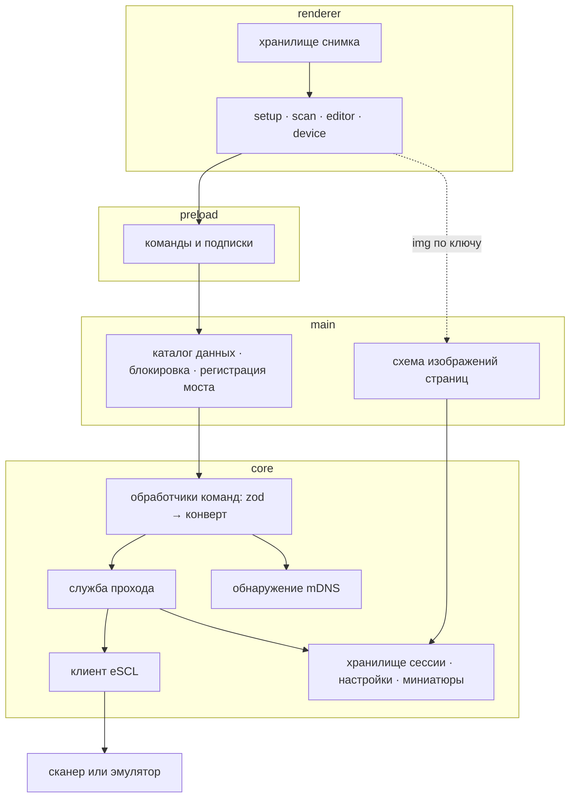
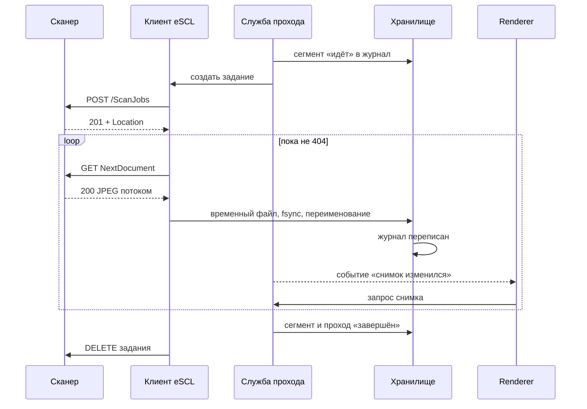
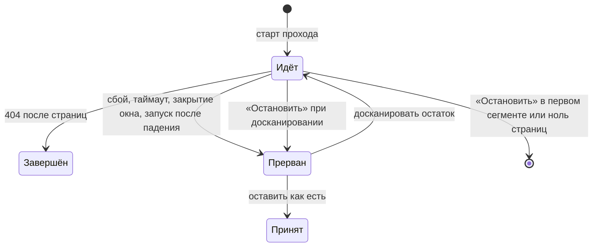

# feat: Подключение и один проход (M1)

## Summary

M1 подключает приложение к сканеру и проводит один проход автоподачи от нажатия кнопки до страниц
на экране. Ядро получает клиент eSCL и хранилище сессии на диске: страница записывается в момент
получения, приложение открывается там, где закрылось. Всё ядро проверяется без сети на эмуляторе
сканера; живой ET-3850 снимает факты в первом юните и подтверждает результат в последнем.
Интерфейс — экраны `setup` и `scan`, модалка `device` и каркас `editor` только для просмотра.

Входы: [требования по модели данных](../brainstorms/2026-10-02-data-model-requirements.md), ADR
[0004](../decisions/0004-data-model.md) с амендментом,
[0005](../decisions/0005-bridge-validation-errors-events-images.md),
[0006](../decisions/0006-device-xml-parsing.md), [роадмап](../roadmap.md) → M1,
[UI_SPEC](../design/UI_SPEC.md), [техбаза](../duplexnt-tech.md).

---

## Problem Frame

После M0 в репозитории есть каркас, мост из одной команды-пробы и два зачищенных ответа ET-3850.
Нет ни клиента сканера, ни кода хранения, ни одного продуктового экрана. Спайк M0 доказал три
вещи по отдельности — TLS к устройству, mDNS без Bonjour, установщик с `sharp`, — но задание
сканирования от `POST` до `DELETE` продуктовым кодом не проходило ни разу.

У протокола есть место, где документы молчат. Техбаза знает одно правило конца прохода: `404` на
`NextDocument`. Что отвечает ET-3850 при замятии, вытащенном листе или пустом лотке, не снято: в
фикстурах секция заданий вырезана, статус записан с пустым лотком. От этого зависит, отличит ли
клиент короткий проход от оборванного, поэтому веха начинается с живой съёмки, а не с кода.

Вопросы, отложенные на планирование, и чем они сняты:

- **Формат журнала, раскладка каталога, устойчивый ключ, корень данных** — амендмент ADR 0004.
- **Валидация входа моста, транспорт ошибок, события, изображения страниц** — ADR 0005.
- **XML-разборщик и правила недоверенного входа** — ADR 0006.
- **Что видно после прохода** — каркас `editor` только для просмотра (ответ автора).
- **Прерванный проход** — три действия: досканировать остаток, оставить как есть, новая пачка;
  «Остановить» при досканировании удаляет только досканированное (ответ автора, амендмент 0004).
- **Состояния устройства** — в M1 четыре простых: занят, не отвечает, в лотке нет бумаги, проход
  прерван; причины не выясняются (ответ автора).
- **Дизайн-вход** — экраны из макета делаются по макету и `UI_SPEC.md`; handoff нужен только
  тому, чего в макете нет (ответ автора).

---

## Requirements

В скобках — требования origin, которые пункт закрывает или уточняет.

**Подключение**

- R1. Сканер подключается по адресу, введённому вручную; схема, порт и путь доступны под
  «Дополнительно» и по умолчанию равны HTTPS, 443, `/eSCL`.
- R2. Сканеры в сети находятся по mDNS; одно устройство показано в списке один раз; устройство
  без автоподачи приглушено и не выбирается.
- R3. Устройство без `AdfSimplexInputCaps` или без `image/jpeg` отклоняется при подключении
  понятным сообщением.
- R4. Списки цветовых режимов, разрешений и размеров листа строятся из capabilities устройства.
- R5. Последний сканер и параметры сканирования запоминаются между запусками; другое устройство
  на том же адресе не подменяет запомненное молча.

**Проход**

- R6. Проход автоподачи идёт по протоколу `POST /ScanJobs` → `NextDocument` до `404` → `DELETE`;
  `DELETE` отправляется всегда, включая отмену и сбой.
- R7. Занятость устройства (`503`) переживается повтором с видимым состоянием «сканер занят» и
  возможностью отменить ожидание.
- R8. Регион сканирования задаётся в 1/300 дюйма одной функцией под тестом.
- R9. Перед проходом читается состояние лотка; пустой лоток сообщается до запуска задания. Проход
  без единой страницы не создаёт ни прохода, ни сессии.
- R10. Во время прохода виден счётчик полученных страниц и лента последних пяти.
- R11. Проверка сертификата ослаблена только для соединения с подтверждённым сканером; это
  закрыто регрессионным тестом на продуктовом коде.
- R28. Отпечаток сертификата сканера запоминается при подключении; задание не начинается, если
  сертификат на адресе сменился.

**Сессия**

- R12. Страница записывается на диск байт в байт до запроса следующей и после записи не меняется.
  (origin R6, R7, R8)
- R13. Приложение открывается в том состоянии, в каком закрылось; сессия одна. (origin R1, R2,
  R5)
- R14. Сессию удаляет только «Новая пачка» после подтверждения. (origin R3)
- R15. «Остановить» удаляет страницы, снятые текущим запуском прохода, и возвращает на экран, с
  которого он запущен. (origin R4, амендмент ADR 0004)
- R16. Оборванный проход сохраняет страницы и помечается прерванным; пользователь выбирает:
  досканировать остаток, оставить как есть или начать новую пачку. Закрытие окна во время прохода
  — обрыв, а не отмена. (origin R17)
- R17. Сверка при запуске идемпотентна: страница без записи возвращается в свой проход по ключу,
  запись без файла показывается потерянной страницей, недописанный файл страницей не считается,
  начатое удаление доводится до конца. (origin R16, R18, R19)
- R18. Журнал и настройки несут маркер версии; данные более новой версии не открываются на запись
  и не переписываются. (origin R20)
- R19. Миниатюры — производное: перестраиваются из исходников и никогда не пишут в каталог
  сессии. (origin R11, R12, R13)
- R20. `dev` и установленное приложение используют разные каталоги данных; приложение работает в
  одном экземпляре; тесты не касаются настоящего каталога данных. (origin R21, R22, R23)

**Интерфейс**

- R21. Экраны `setup` и `scan` и модалка `device` соответствуют макету и `UI_SPEC.md` с
  поправками техбазы.
- R22. После прохода открыт каркас `editor`: лента миниатюр и крупное превью, без правок, границ
  документов и сохранения.
- R23. Каждая доменная ошибка и каждое состояние устройства показаны человеческим текстом через
  `t()`; интерфейс собран из токенов.

**Мост**

- R24. Каждая команда моста проверяет вход схемой и возвращает результат-конверт; ход работы
  приходит событиями с отпиской; изображения страниц идут собственной схемой по ключу страницы;
  проба `probe` остаётся рабочей. (ADR 0005)

**Тесты и процесс**

- R25. Эмулятор сканера говорит по настоящему HTTP на фикстурах репозитория, не импортирует код
  приложения и подключается к приложению ручным вводом адреса.
- R26. `test:all` зелёный без сети и сканера; тесты против живого устройства включаются
  переменной окружения.
- R27. Журнал `docs/solutions/0002-m1-connect-single-pass.md` ведётся с первой сессии; веха
  вливается только после приёмки автором.

Требования origin, которые M1 не реализует: правки поверх исходников и обратимое удаление
страницы (origin R9, R10) — M3; сохранённый PDF (origin R15) — M2. Деинсталляция (origin R24)
проверяется приёмочным смоуком без нового кода.

---

## Key Technical Decisions

**Порядок и процесс**

- KTD-1. **Живая съёмка идёт первой.** U1 снимает с ET-3850 след задания и поведение при сбоях;
  клиент пишется по наблюдённому. Отклонено «строить по документам и проверить в конце»: три
  поправки M0 были одного рода — правдоподобное объяснение, записанное фактом до проверки.
- KTD-2. **Экраны из макета идут по макету и `UI_SPEC.md`; handoff пишется только на
  отсутствующее.** В M1 это один handoff (U19) на состояния, которых в макете нет.
- KTD-3. **Имена слоёв зарезервированы.** Каталог с именем `shared`, `core`, `main`, `preload`,
  `renderer` или `locales` глубже первого уровня `src/` запрещён тестом. Отклонено правило на
  основе резолвера: новая зависимость и переписывание работающего правила ради случая, который
  дешевле запретить.
- KTD-4. **Эмулятор изолирован линтером.** `test/emulator/` не импортирует `src/` и алиасы слоёв:
  иначе проверка «клиент против эмулятора» замыкается на себя (план M0, KTD-4).
- KTD-5. **Новые зависимости — `saxes`, `zod`, `bonjour-service`, все в `devDependencies`.**
  Чистый JS бандлится в main (план M0, KTD-3). Версии сверяются при установке.

**Клиент сканера**

- KTD-6. **Транспорт — `node:https` и `node:http` с выделенным агентом на профиль.** Он работает
  одинаково под Node в тестах и в main; `fetch` с диспетчером потребовал бы пакет `undici`,
  модуль `net` Electron недоступен тестам. Инварианты агента — план M0, KTD-20: приватен модулю,
  привязан к origin профиля, без автоматических переходов. Исключение линтера — ровно один файл.
- KTD-7. **Пути устройства проходят один проверяющий модуль.** Базовый путь из ручного ввода, `rs`
  из mDNS и `Location` разбираются разборщиком URL, из результата берётся только нормализованный
  путь; запрос, фрагмент, закодированные слэши и управляющие символы отклоняются. `Location`
  перебазируется на origin профиля и обязан лежать строго под `<база>/ScanJobs/` по границе
  сегмента; схема, хост и порт из заголовка отбрасываются (ADR 0006). `Location` без годного пути
  — ошибка протокола с исходом «задание не закрыть».
- KTD-8. **HTTPS первым; переход на HTTP — только при интерактивном подключении без явной схемы.**
  Он срабатывает на отказ соединения и на сбой рукопожатия, не на таймаут. Выбранная схема
  записывается в профиль и видна в интерфейсе. Запомненный профиль, проверка при запуске и старт
  прохода схему не меняют. Тип сервиса mDNS схему не определяет: ET-3850 объявляет оба сервиса на 443.
- KTD-9. **Конец и обрыв прохода.** `404` после хотя бы одной страницы — конец; `404` на первой —
  пустой проход; любой другой отказ или таймаут — обрыв. Если U1 покажет, что замятие даёт тот же
  `404`, после него читается `ScannerStatus`; правило уточняется в журнале по наблюдённому.
- KTD-10. **`503` повторяется раз в секунду с потолком по времени.** `POST`, уже ушедший в сеть,
  при «Остановить» не обрывается: клиент дожидается ответа и закрывает задание. Оборванный `POST`
  оставил бы на устройстве задание с неизвестным адресом.
- KTD-11. **`DELETE` — best-effort и терпим к `404`.** Адрес задания записывается сразу после
  ответа `201`. Незакрытые задания лежат в отдельном файле в корне данных вместе с идентичностью
  сканера и переживают удаление сессии. Перед следующим `POST` закрываются только задания
  текущего сканера; путь заново проходит проверку KTD-7. Чужому сканеру `DELETE` не уходит.
- KTD-12. **Обнаружение строит список по TXT-записям.** Capabilities запрашиваются только у
  выбранного устройства: ослабленный TLS не ходит к устройствам, которые пользователь не выбирал.
  Записи сливаются, когда совпадают и `UUID`, и адрес с портом; один UUID с двух адресов даёт две
  записи с видимым адресом. Ключи TXT сравниваются без учёта регистра. Строки из TXT — только
  текст для показа, с потолком длины и без управляющих символов; число записей ограничено.
  Интерфейс передаёт ядру непрозрачный идентификатор найденного устройства, а не адрес. В слияние
  и в профиль идёт IPv4-адрес; адреса IPv6 из объявления в M1 не используются.
- KTD-13. **Запомненный параметр, которого у устройства нет, заменяется дефолтом, затем первым
  доступным.** Дефолты — оттенки серого, 300 dpi, A4.
- KTD-14. **Пределы и таймауты — стартовые значения, уточняются по следу U1:** соединение 5 с,
  XML-запрос 10 с, тишина при приёме страницы 90 с, ожидание занятости 60 с, `DELETE` 5 с,
  XML-ответ не больше 1 МБ, «ничего не нашлось» через 10 с при продолжающемся поиске.
- KTD-31. **Враждебное или сломанное устройство ограничено со всех сторон.** У задания есть
  потолок числа страниц, у страницы — потолок размера по сосчитанным байтам и общий срок приёма,
  а не только таймаут тишины. Страница принята, когда тело дочитано по своему обрамлению и
  начинается и кончается маркерами JPEG; пустой ответ `200` и не-JPEG — обрыв. `Content-Type`
  не считается доказательством, сжатие тела не запрашивается и не раскрывается, `Retry-After`
  игнорируется. Обрамление, которым пользуется ET-3850, записывается в U1.
- KTD-40. **Отпечаток сертификата запоминается при подключении и сверяется перед каждым
  заданием** (амендмент ADR 0003). SHA-256 сертификата сканера записывается в профиль и в запись
  прохода в журнале. Сверка — явный шаг транспорта на каждом новом соединении: при ослабленной
  проверке Node сам идентичность сервера не проверяет. Несовпадение даёт состояние «по адресу
  другое устройство»; повторное подключение в модалке `device` запоминает новый отпечаток.
  Профиль на HTTP отпечатка не имеет, и это видно по показанной схеме. UUID из mDNS защитой не
  является: он объявляется в сеть открыто.
- KTD-32. **Разбор XML защищён сверх ADR 0006:** строгая расшифровка UTF-8, отказ на событии
  DOCTYPE разборщика, потолки глубины и числа узлов в сборщике дерева, имена элементов устройства
  не становятся ключами обычных объектов.

**Хранилище**

- KTD-15. **Раскладка каталога и ключ страницы** — раздел «Каталог данных» ниже. Ключ
  `p<проход>-s<сегмент>-<номер>` стоит в имени файла; сессия пересобирается по именам. Номера
  проходов и сегментов внутри сессии не переиспользуются: счётчик лежит в журнале, после
  пересборки он равен наибольшему номеру в именах файлов плюс один.
- KTD-16. **Проход состоит из сегментов, по одному на задание eSCL** (амендмент ADR 0004). Номер
  страницы в проходе — порядок получения через все сегменты; потерянная страница сохраняет место.
- KTD-17. **Упреждающая запись.** Начало сегмента попадает в журнал до `POST`; сегмент в состоянии
  «идёт» при запуске считается прерванным. Сегмент не начинается на префиксе, под которым есть
  файлы или пометка об удалении. Состояние «завершён» пишется до `DELETE`.
- KTD-18. **Порядок записи страницы:** временный файл → `fsync` → переименование → перезапись
  журнала. Сбой между шагами даёт страницу без записи, которую сверка возвращает по ключу.
- KTD-19. **Атомарная запись — один помощник.** Переименование файла и каталога повторяется с
  отступом при `EPERM`, `EBUSY`, `EACCES` (антивирус, индексатор) до потолка в несколько секунд;
  `ENOSPC` не повторяется. `fsync` каталога на Windows не выполняется.
- KTD-20. **Удаление переживает сбой и не опережает журнал.** Порядок: пометка в журнале →
  удаление файлов по префиксу ключа → снятие пометки. Файлы удаляются только после успешной
  записи пометки; не записалась — «Остановить» превращается в «прерван», файлы целы. Пометка
  снимается, когда листинг не находит файлов с префиксом; неудаляемый файл оставляет пометку и не
  мешает запуску. Любая остановка, после которой в сессии нет страниц, идёт путём закрытия сессии.
- KTD-33. **Закрытие сессии — переименование каталога, затем очистка.** Перед переименованием
  ядро перестаёт выдавать пути и дожидается идущих чтений; читатели страниц и миниатюр берут файл
  в буфер и закрывают дескриптор. Если переименование не удалось в пределах повторов, сессия
  остаётся целой и рабочей, пользователь видит отказ; пофайлового удаления взамен нет. Если это
  случилось на пути «Остановить», проход остаётся прерванным со своими страницами. Ошибка
  очистки при запуске не мешает новой сессии; посторонний файл оставляет каталог на месте. Пока
  сегмент идёт, ядро отклоняет закрытие сессии, «оставить как есть» и второй старт.
- KTD-34. **Нечитаемый журнал — четыре случая:** файла нет при наличии страниц, файл пуст, не
  JSON, не проходит схему текущей версии по причине, отличной от неизвестного поля. Журнал, в
  котором есть хотя бы одно неизвестное поле, несовместим по KTD-35 и не отодвигается, даже когда
  есть и другие ошибки. В четырёх случаях журнал отодвигается под уникальным именем, а
  сессия пересобирается по именам файлов: пропуски в нумерации становятся потерянными страницами,
  проходы помечаются прерванными с признаком «параметры неизвестны», и досканирование для них
  недоступно. Отклонён файл-спутник с параметрами на каждый проход: он чинит редкий случай внешней
  порчи ценой второго источника правды.
- KTD-35. **Данные более новой версии блокируют запись целиком.** Маркер читается отдельным
  терпимым шагом до проверки схемы; путь журнала и имя поля маркера заморожены навсегда. Схема
  строгая: неизвестное поле при текущей версии — тоже несовместимость. Эта строка сверки идёт
  первой и отменяет остальные: ни временные файлы, ни пометки, ни пустой каталог не трогаются.
  Хранилище переходит в режим отказа и отклоняет любую изменяющую операцию; ни прохода, ни «Новой
  пачки» нет. Файл настроек новой версии не переписывается, приложение работает с дефолтами в
  памяти и сообщает об этом.
- KTD-36. **Нехватка места не теряет полученного.** Перед проходом проверяется свободное место с
  запасом по замеру U1. Отказ записи страницы или журнала оставляет прежний журнал и страницу,
  которую сверка вернёт по ключу; состояние в памяти помечается несохранённым, следующая
  перезапись его доводит.
- KTD-21. **Корень данных — подкаталог `data` в `userData`;** кэши Chromium остаются рядом и не
  смешиваются с данными приложения. Порядок в main: каталог `dev` → блокировка экземпляра → всё
  остальное. Ядро получает корень параметром.
- KTD-22. **Миниатюры строятся по требованию и кэшируются вне каталога сессии, под
  идентификатором сессии.** Кэш чужой сессии удаляется сверкой. Модуль миниатюр получает только
  корень кэша и чтение страницы по ключу; пишет временным файлом с переименованием; для
  потерянной страницы отказывает даже при тёплом кэше.
- KTD-37. **`sharp` видит только JPEG.** Маркеры JPEG проверяются при получении и перед
  построением миниатюры; декодированный формат, отличный от JPEG, — отказ. Предел пикселей
  выводится из capabilities при начале прохода — наибольший регион автоподачи при наибольшем
  разрешении — и записывается в журнал: миниатюры строятся и при выключенном сканере. Для прохода
  с признаком «параметры неизвестны» действует фиксированный потолок в коде. libvips
  выбирает загрузчик по содержимому, и без этого под видом страницы в main попал бы любой его
  формат.

**Мост и интерфейс**

- KTD-23. **Истина о состоянии — снимок из ядра.** Renderer своей копии состояния сессии не
  ведёт: экран выводится из снимка, событие только сообщает номер нового снимка (ADR 0005).
- KTD-24. **Без библиотеки состояния и роутера.** Один модуль-хранилище снимка и вывод экрана из
  него; экранов четыре, модалка одна.
- KTD-25. **Интерфейс M1 не обещает того, чего веха не делает.** Строка «Пустые обороты» и
  значение «Авто» не показываются. Тексты `setup` и `scan` говорят об одном проходе: заголовок,
  лид, кнопка запуска и тег прохода не упоминают два прохода и лицевые стороны, колонка «Как это
  работает» скрыта; полные тексты макета возвращаются в M2 вместе с разворотом. Каркас `editor`
  показывает ленту, крупное превью, счётчик страниц и одну кнопку «Новая пачка»; инспектор,
  «Сохранить», «Добавить», границы документов, поворот, удаление, пересканирование и
  переключатель пустых скрыты, а не стоят неработающими. Неработающий элемент врёт так же, как
  кнопка 1200 dpi на автоподаче.
- KTD-26. **Закрытие окна во время прохода:** ядро обрывает задание, помечает проход прерванным,
  отправляет `DELETE` с ограничением по времени, затем приложение выходит.
- KTD-27. **Продолжение прохода использует параметры и сканер прохода.** Они записаны в журнале;
  досканировать на другом устройстве нельзя.
- KTD-38. **Схема изображений получает минимум привилегий и жёсткий контракт ответа.** Включено
  только `standard`; `bypassCSP`, `supportFetchAPI`, `corsEnabled`, `allowServiceWorkers`,
  `stream`, `codeCache`, `allowExtensions` выключены. Набор лежит чистым модулем с литеральными
  типами под тестом, как `src/main/shell/web-preferences.ts`. Обработчик принимает только `GET`;
  адрес несёт идентификатор сессии, вид из перечисления и ключ по заякоренному шаблону, без
  запроса и лишних сегментов. Путь берётся у ядра по страницам текущей сессии, а не склейкой
  ключа. Ответ всегда несёт `image/jpeg`, `nosniff` и `no-store`. Чужая сессия, неизвестный ключ и
  потерянная страница — 404. Навигация на адрес схемы запрещена стражами оболочки.
- KTD-39. **Вход команд — строгие схемы без приведения типов.** Хост — имя или IP-литерал с
  потолком длины и без userinfo, порт 1–65535, схема из перечисления, путь через проверку KTD-7.
  Одновременно идёт одно подключение; новое отменяет прежнее. «Подтверждённый сканер» — адрес,
  отправленный явным действием пользователя в модалке `device`; проба идёт временным транспортом
  с теми же инвариантами и уничтожается при отказе. `openDataFolder` не принимает аргументов: main
  сам выводит каталог из корня данных. Снимок не несёт абсолютных путей и адресов заданий.

**Тесты и фикстуры**

- KTD-28. **Страницы-фикстуры — синтетические пронумерованные JPEG,** сгенерированные скриптом и
  лежащие в репозитории байт в байт. Статус с бумагой в лотке и след задания — живые снимки U1,
  зачищенные по процедуре `test/fixtures/README.md`.
- KTD-29. **HTTPS эмулятора — сертификат на лету, ключ не хранится,** как в спайке M0. Способ
  генерации выбирается в U8: тест изоляции TLS нуждается в нём раньше эмулятора. HTTPS — режим
  эмулятора по умолчанию.
- KTD-30. **Тесты против живого устройства включает `DUPLEXNT_SCANNER_HOST`;** без неё они
  пропускаются с предупреждением и не входят в `test:all`.

---

## High-Level Technical Design

### Слои и новые модули



### Одна страница: от сканера до экрана



### Состояния прохода



«Остановить» при досканировании удаляет только идущий сегмент и возвращает проход в «прерван».
«Остановить» в первом сегменте, после которого каталог сессии не удалось закрыть, тоже оставляет
проход прерванным.

### Каталог данных

```
<userData>/data/
  settings.json               настройки и запомненный сканер, маркер версии
  unclosed-jobs.json          незакрытые задания с идентичностью сканера, маркер версии
  session/                    текущая сессия — источник правды
    session.json              журнал, маркер версии; путь и имя поля маркера заморожены
    pages/
      p01-s01-0001.jpg        ключ: проход, сегмент, номер в сегменте
  session.closing-<id>/       закрываемая сессия, дочищается при запуске
  derived/
    <id сессии>/thumbs/       производное: удаляется без потерь
```

### Сверка при запуске

Строки применяются сверху вниз. Вторая строка отменяет все нижние.

| Найдено                                             | Действие                                                             |
| --------------------------------------------------- | -------------------------------------------------------------------- |
| каталога сессии нет                                 | сессии нет                                                           |
| маркер версии новее понятного                       | ничего не трогается; режим отказа, экран несовместимых данных        |
| `session.closing-*`                                 | очистка доводится до конца; не удалось — запуск продолжается         |
| журнал не читается (четыре случая KTD-34)           | файл отодвигается, сессия пересобирается по ключам, проходы прерваны |
| журнала нет, страниц нет                            | каталог убирается; отодвинутая копия журнала, если есть, остаётся    |
| пометка об удалении сегмента                        | удаление доводится до конца; неудаляемый файл оставляет пометку      |
| временный файл страницы или журнала                 | удаляется: страницей не считается                                    |
| страница без записи                                 | возвращается в проход и сегмент по ключу                             |
| страница, у прохода или сегмента которой нет записи | проход и сегмент создаются прерванными                               |
| запись без файла или файл нулевой длины             | страница помечается потерянной, место сохраняется                    |
| сегмент или проход «идёт»                           | помечается прерванным; сегмент досканирования без страниц остаётся   |
| все страницы потеряны                               | сессия остаётся: записи есть                                         |
| ни файлов страниц, ни записей о страницах           | каталог убирается: пустая сессия равна отсутствию                    |
| производный кэш чужой сессии                        | удаляется                                                            |
| незакрытое задание                                  | закрывается перед следующим `POST` на том же сканере                 |

Повторная сверка того же каталога ничего не меняет.

### Команды и события моста

Имена — ориентир, окончательные выбираются в U2 и U18.

| Команда                            | Назначение                                             |
| ---------------------------------- | ------------------------------------------------------ |
| `probe`                            | диагностика установщика (M0)                           |
| `getSnapshot`                      | снимок: сканер, параметры, сессия, уведомления запуска |
| `startDiscovery` / `stopDiscovery` | поиск устройств                                        |
| `connectScanner`                   | подключение: идентификатор найденного или адрес        |
| `setScanParams`                    | параметры сканирования                                 |
| `startPass`                        | новый проход или досканирование прерванного            |
| `stopPass`                         | «Остановить»                                           |
| `acceptPass`                       | оставить прерванный проход как есть                    |
| `closeSession`                     | «Новая пачка»                                          |
| `openDataFolder`                   | открыть каталог данных при несовместимой версии        |

События: изменился список найденных устройств; изменился снимок.

---

## Output Structure

Ориентир; авторитетны списки файлов в юнитах.

```
src/shared/           bridge.ts (команды, события, конверт) · errors.ts · snapshot.ts
src/core/
  escl/               transport.ts · xml.ts · capabilities.ts · status.ts · region.ts
                      scan-settings.ts · scan-job.ts · connect.ts
  discovery/          mdns.ts · txt.ts
  storage/            atomic-file.ts · layout.ts · journal.ts · session-store.ts
                      reconcile.ts · settings-store.ts · thumbnails.ts
  scan/               pass-service.ts
  commands/           schemas.ts · handlers.ts
src/main/             index.ts · data-root.ts · single-instance.ts · page-protocol.ts
                      events.ts · window-close.ts
src/preload/          index.ts
src/renderer/src/     state/ · screens/ · modals/ · components/
test/emulator/        server.ts · scenarios.ts · cli.ts
test/support/         fixtures.ts · live-device.ts · temp-data-root.ts
test/integration/     тесты ядра против эмулятора, TLS-изоляция, живое устройство
test/fixtures/escl/   et-3850/ (новые снимки, pages/) · no-adf/
spikes/               escl-job-trace.mjs
```

---

## Implementation Units

Гейт каждого юнита: `typecheck` + `lint` + `format:check` + `test:all` зелёные, коммит с U-ID в
теме (`feat(m1): U6 …`). Работа идёт в ветке `feat/m1`. Номера юнитов — устойчивые идентификаторы;
порядок выполнения — порядок перечисления.

### Фаза A — факты и фундамент

### U1. Живой след задания ET-3850

- **Goal:** снять с устройства то, чего нет в фикстурах, и записать наблюдённое в журнал.
- **Requirements:** R6, R7, R9, R26, R27.
- **Dependencies:** нет. Нужен автор у сканера.
- **Files:** `spikes/escl-job-trace.mjs`, `spikes/README.md`, `spikes/sanitize-escl.mjs`,
  `test/fixtures/escl/et-3850/` (новые снимки), `test/fixtures/README.md`,
  `test/guards/fixtures-content.test.ts`, `docs/solutions/0002-m1-connect-single-pass.md`.
- **Approach:** скрипт принимает адрес аргументом и ведёт настоящее задание автоподачи, сохраняя
  каждый ответ с заголовками и временем в `local-test-data/device/`. Список настоящих значений
  пополняется до первой строки журнала. Сценарии: бумага в лотке (статус до, во время и после
  задания, заголовки `POST` и страниц, финальный `404`, `DELETE`); пустой лоток; лист вытащен
  посреди подачи; `DELETE` посреди задания и поведение подачи; занятость, если воспроизводится
  печатью; размер страницы A4 при 200, 300 и 600 dpi в сером и в цвете. Сверх этого:
  - брошенное задание без `DELETE` — что отвечает следующий `POST`, что показывает секция заданий
    статуса, через сколько устройство отпускает задание;
  - пауза 30–60 с между запросами `NextDocument` — подаёт ли устройство следующий лист до запроса
    и отвечает ли `503`, пока страница не готова;
  - первый запрос к уснувшему устройству — время до ответа;
  - замятие — попытка воспроизвести придержанным листом; не вышло — правило для замятия остаётся
    в журнале помеченной гипотезой;
  - лист A4 с метками у боковых краёв при смещении региона 0 и 70 — какой скан содержит лист
    целиком;
  - по каждой снятой странице — первые и последние байты, байты после маркера конца, размеры из
    заголовка JPEG против запрошенного региона, чтение метаданных через `sharp`;
  - тело `ScanSettings`, на которое устройство ответило `201`, сохраняется фикстурой.

  Зачищенные копии идут в фикстуры, конвенция второй оси каталога записывается в README.

- **Test scenarios:**
  - Happy path: новые фикстуры проходят проверку целостности разметки и стража приватности.
  - Edge case: файл фикстуры со следом задания не содержит UUID задания устройства.
- **Verification:** в журнале записаны наблюдённые ответы по каждому сценарию; гипотезы помечены
  гипотезами; правило KTD-9, значения KTD-14, правило приёма страницы KTD-31 и предел KTD-37
  подтверждены или исправлены по настоящим ответам; правило смещения региона для U7 записано.

### U2. Мост: конверт, схемы, события

- **Goal:** привести мост к ADR 0005 до первой продуктовой команды.
- **Requirements:** R24.
- **Dependencies:** нет.
- **Files:** `src/shared/bridge.ts`, `src/shared/errors.ts`, `src/shared/index.ts`,
  `src/core/commands/schemas.ts`, `src/core/commands/schemas.test.ts`,
  `src/core/probe/handle-probe.ts`, `src/core/probe/validate-probe-request.ts`,
  `src/main/bridge.ts`, `src/main/bridge.test.ts`, `src/main/events.ts`,
  `src/main/events.test.ts`, `src/preload/index.ts`, `src/renderer/src/App.tsx`,
  `src/renderer/src/App.test.tsx`, `package.json`.
- **Approach:** карта команд получает тип результата-конверта; рядом появляется карта событий.
  Preload отдаёт подписку на каждое событие с отпиской и не выпускает объект события. Отправка
  событий проверяет, что окно не разрушено. Проба переезжает на `zod` и конверт; рукописный
  валидатор удаляется.
- **Patterns to follow:** `src/main/bridge.ts` — структурные типы вместо импорта Electron;
  `src/main/bridge.test.ts` — поддельный `ipcMain`.
- **Test scenarios:**
  - Happy path: проба возвращает успех в конверте; подписчик получает событие с номером.
  - Error path: мусор на входе пробы даёт отказ с кодом неверного входа, а не исключение.
  - Error path: запрос от чужого фрейма отклоняется исключением, как в M0.
  - Edge case: после отписки обработчик не вызывается; отправка в разрушенное окно не бросает.
- **Verification:** proof-shell M0 показывает зелёную пробу через новый конверт.

### U3. Каталог данных и единственный экземпляр

- **Goal:** развести данные `dev` и установленного приложения и не допустить второго процесса.
- **Requirements:** R20.
- **Dependencies:** нет.
- **Files:** `src/main/data-root.ts`, `src/main/data-root.test.ts`,
  `src/main/single-instance.ts`, `src/main/single-instance.test.ts`, `src/main/index.ts`.
- **Approach:** первым действием main неупакованный запуск получает соседний каталог `userData`,
  затем берётся блокировка, затем всё остальное. Второй запуск разворачивает и активирует окно
  первого и завершается. Ядру передаётся путь корня данных; `app.getPath` до переопределения не
  вызывается.
- **Patterns to follow:** структурные аргументы вместо импорта Electron, как в
  `src/main/bridge.ts`.
- **Test scenarios:**
  - Happy path: упакованный запуск даёт корень в стандартном `userData`, неупакованный — в
    соседнем каталоге.
  - Happy path: при занятой блокировке приложение завершается, не создавая окна.
  - Integration: событие второго экземпляра восстанавливает свёрнутое окно и даёт ему фокус.
- **Verification:** `dev` и установленное приложение работают одновременно и не видят данных
  друг друга; второй `dev` активирует первое окно.

### U4. Атомарная запись и удаление

- **Goal:** один помощник записи и удаления, на котором стоит всё хранилище.
- **Requirements:** R12, R17.
- **Dependencies:** нет.
- **Files:** `src/core/storage/atomic-file.ts`, `src/core/storage/atomic-file.test.ts`,
  `test/support/temp-data-root.ts`.
- **Approach:** запись из буфера и из потока через временный файл, `fsync` и переименование с
  ограниченными повторами (KTD-19). Имя временного файла отличимо от страницы по шаблону.
  Удаление по префиксу ключа трогает только файлы, подходящие под шаблон ключа.
- **Execution note:** сценарии сбоя пишутся до реализации.
- **Test scenarios:**
  - Happy path: файл после записи побайтово равен источнику; временного файла не осталось.
  - Error path: сбой до переименования оставляет прежний файл нетронутым.
  - Error path: переименование, дважды отказавшее с `EPERM`, проходит с третьей попытки; отказ
    сверх потолка возвращает ошибку записи.
  - Error path: `EBUSY` и `EACCES` повторяются так же; `ENOSPC` отказывает без повторов.
  - Error path: переименование каталога повторяется; отказ сверх потолка оставляет каталог целым.
  - Error path: файл, который не удалось удалить, попадает в отчёт удаления, а не проглатывается.
  - Edge case: поток, оборванный посередине, не даёт файла с конечным именем.
  - Edge case: удаление по префиксу не трогает файл с посторонним именем в том же каталоге.
  - Edge case: префикс `p01-s01-` не совпадает с `p01-s011-`.
  - Edge case: имена временных файлов двух одновременных записей различаются.
  - Integration: порядок вызовов «запись → `fsync` → закрытие → переименование» проверен через
    подменённую файловую систему.
- **Verification:** тесты идут во временном каталоге и не касаются настоящего корня данных.

### U5. Гигиена линта и тестовых прогонов

- **Goal:** закрыть находки ревью M0, которые мешают M1.
- **Requirements:** R25, R26.
- **Dependencies:** нет.
- **Files:** `eslint.config.ts`, `test/lint/layer-boundaries.test.ts`,
  `test/guards/layer-names.test.ts`, `test/guards/test-projects.test.ts`, `vitest.config.ts`,
  `test/support/fixtures.ts`, `test/support/live-device.ts`, `docs/backlog.md`.
- **Approach:** тест запрещает вложенные каталоги с именами слоёв (KTD-3). Блок линтера запрещает
  `test/emulator/` импортировать `src/` и алиасы слоёв (KTD-4). Тест перечисляет все тестовые
  файлы репозитория и требует, чтобы каждый попадал в проект vitest. Заводятся помощник путей к
  фикстурам и помощник opt-in прогона против живого устройства.
- **Test scenarios:**
  - Error path: синтетический файл в `test/emulator/` с импортом из ядра роняет `lint`.
  - Error path: синтетический каталог `src/renderer/src/main/` роняет тест имён слоёв.
  - Error path: тестовый файл вне всех проектов vitest роняет тест прогонов.
  - Happy path: без переменной окружения живой тест пропускается с предупреждением.
- **Verification:** три пункта «Входящих» бэклога закрыты или переписаны по факту.

### Фаза B — клиент сканера

### U6. Разбор XML: capabilities и status

- **Goal:** превратить ответы устройства в типизированные структуры по правилам ADR 0006.
- **Requirements:** R3, R4, R9.
- **Dependencies:** U1, U5.
- **Files:** `src/core/escl/xml.ts`, `src/core/escl/xml.test.ts`, `src/core/escl/capabilities.ts`,
  `src/core/escl/capabilities.test.ts`, `src/core/escl/status.ts`,
  `src/core/escl/status.test.ts`, `test/fixtures/escl/no-adf/ScannerCapabilities.xml`,
  `package.json`.
- **Approach:** сборщик дерева поверх `saxes` сопоставляет элементы по URI пространства имён.
  Разбор capabilities выдаёт идентичность устройства, источники, режимы, разрешения, форматы и
  пределы региона автоподачи; неизвестные значения пропускаются. Разбор статуса выдаёт состояние
  устройства и лотка. Из capabilities выводятся варианты для интерфейса: размеры листа, которые
  помещаются в регион автоподачи.
- **Test scenarios:**
  - Happy path: фикстура ET-3850 даёт автоподачу без дуплекса, разрешения 100–600, три цветовых
    режима, JPEG среди форматов.
  - Happy path: статус с пустым лотком и статус с бумагой различаются.
  - Edge case: тот же документ с другими префиксами пространств имён разбирается так же.
  - Edge case: диапазон разрешений вместо списка даёт пригодный набор значений.
  - Error path: ответ с `<!DOCTYPE` отклоняется до разбора; тот же документ в UTF-16 — тоже.
  - Error path: ответ больше потолка размера отклоняется.
  - Error path: глубоко вложенный документ упирается в потолок глубины, а не в переполнение стека.
  - Edge case: элемент с именем `__proto__` не меняет прототип результата.
  - Error path: capabilities без автоподачи и capabilities без JPEG дают разные коды отказа.
  - Error path: документ не eSCL даёт код «не сканер eSCL».
- **Verification:** остальной клиент не видит XML — только типизированные структуры.

### U7. Регион в 1/300 дюйма и ScanSettings

- **Goal:** собрать запрос задания без ошибок единиц.
- **Requirements:** R6, R8.
- **Dependencies:** U6.
- **Files:** `src/core/escl/region.ts`, `src/core/escl/region.test.ts`,
  `src/core/escl/scan-settings.ts`, `src/core/escl/scan-settings.test.ts`.
- **Approach:** одна функция переводит размер листа в регион в 1/300 дюйма независимо от DPI и
  проверяет его по пределам автоподачи. Запрос собирается шаблоном; каждое значение сверяется с
  capabilities перед подстановкой. Смещение региона при юстировке вправо берётся по наблюдению U1.
- **Execution note:** функция региона пишется от тестов.
- **Test scenarios:**
  - Happy path: A4 даёт 2480 × 3507 при 200, 300 и 600 dpi.
  - Happy path: Letter даёт 2550 × 3300.
  - Edge case: лист шире предела автоподачи отклоняется, а не обрезается молча.
  - Error path: разрешение или режим, которых нет в capabilities, отклоняются.
  - Happy path: собранный XML разбирается сборщиком дерева U6 и несёт источник автоподачи и JPEG.
  - Happy path: для тех же параметров сборщик даёт запрос, эквивалентный принятому устройством
    (фикстура U1).
- **Verification:** регион не зависит от выбранного DPI ни в одном тесте.

### U8. Транспорт и изоляция TLS

- **Goal:** сетевой слой клиента с инвариантами KTD-6 и KTD-7.
- **Requirements:** R11.
- **Dependencies:** U5.
- **Files:** `src/core/escl/transport.ts`, `src/core/escl/transport.test.ts`,
  `eslint.config.ts`, `test/lint/layer-boundaries.test.ts`,
  `test/integration/tls-isolation.test.ts`, `test/support/self-signed-cert.ts`.
- **Approach:** транспорт создаётся под профиль и держит свой агент. Запрос к другому origin
  отклоняется до сети. Ответы 3xx не исполняются. Тело XML читается с потолком размера, страница
  отдаётся потоком. Таймауты соединения и тишины и отмена сигналом — на каждом запросе. Отпечаток
  сертификата сверяется явным шагом на каждом новом соединении (KTD-40). Исключение правила TLS в
  линтере открывается ровно для этого файла и сохраняет запреты слоя. Способ генерации тестового
  сертификата выбирается здесь и записывается в журнал; помощник отдаёт сертификат на лету, ключ
  живёт только в памяти.
- **Test scenarios:**
  - Happy path: запрос к серверу с самоподписанным сертификатом через транспорт профиля проходит.
  - Integration: после него тот же процесс отклоняет этот сервер через агент по умолчанию и через
    глобальный `fetch`. Тест утверждает факт отказа, не код ошибки.
  - Error path: запрос к чужому origin отклоняется без обращения к сети.
  - Error path: ответ 302 не приводит к запросу по новому адресу.
  - Error path: идентификатор ослабления TLS в любом другом файле `src/` роняет `lint`.
  - Edge case: `Location` с чужим хостом, с `http://` и относительный приводятся к пути под
    базой.
  - Error path: `Location` с `..`, `%2e%2e`, `%2f`, обратным слэшем, запросом, фрагментом,
    соседним префиксом (`/eSCLx/`), равный самой коллекции, отсутствующий и сверхдлинный —
    отклоняется.
  - Error path: потолок XML держится при chunked-ответе и при лживом `Content-Length`.
  - Error path: сменившийся сертификат на том же origin отклоняется до отправки тела запроса.
  - Happy path: первое подключение без запомненного отпечатка возвращает отпечаток вызывающему.
- **Verification:** ослабление TLS встречается в `src/` в одном файле.

### U9. Эмулятор сканера

- **Goal:** устройство для тестов и ручного смоука без бумаги.
- **Requirements:** R25, R26.
- **Dependencies:** U1, U5, U8.
- **Files:** `test/emulator/server.ts`, `test/emulator/scenarios.ts`, `test/emulator/cli.ts`,
  `test/emulator/server.test.ts`, `scripts/generate-page-fixtures.ts`,
  `test/fixtures/escl/et-3850/pages/`, `package.json`, `.gitattributes`.
- **Approach:** сервер на loopback отдаёт фикстуры capabilities и статуса и ведёт задание по
  протоколу. Сценарий задаётся параметром: число страниц; занятость с последующим успехом;
  занятость без конца; медленная страница; обрыв между страницами и посреди тела; пустой лоток;
  задание без страниц; `DELETE`, который не отвечает; варианты `Location`; устройство без
  автоподачи; страница больше потолка; бесконечные страницы; тело по байту в минуту;
  `Content-Length` короче и длиннее тела; тело, оборванное закрытием соединения; тело не JPEG;
  пустой ответ `200`. HTTPS с сертификатом из помощника U8 — режим по умолчанию: сбои идут по
  той же ветке транспорта, что и настоящий сканер. HTTP включается параметром — для теста перехода
  KTD-8. Команда `npm run emulator` поднимает его на фиксированном порту. Страницы —
  синтетические пронумерованные JPEG (KTD-28). Поведение незакрытого задания повторяет запись
  журнала U1.
- **Test scenarios:**
  - Happy path: задание на N страниц отдаёт N ответов `200` и затем `404`.
  - Happy path: `DELETE` закрывает задание; следующее создаётся без занятости.
  - Edge case: незакрытое задание делает следующий `POST` занятым — как на устройстве.
  - Happy path: файл фикстуры отдаётся побайтово.
- **Verification:** эмулятор не импортирует ничего из `src/`; `lint` это подтверждает.

### U10. Задание автоподачи

- **Goal:** провести задание от `POST` до `DELETE` при любом исходе.
- **Requirements:** R6, R7, R9.
- **Dependencies:** U6, U7, U8, U9.
- **Files:** `src/core/escl/scan-job.ts`, `src/core/escl/scan-job.test.ts`,
  `test/integration/scan-job.emulator.test.ts`, `test/integration/scan-job.live.test.ts`.
- **Approach:** задание отдаёт страницы по одной в приёмник, который должен завершить запись до
  запроса следующей. Исход — завершено, пусто, прервано или отменено — с адресом задания и
  признаком, удалось ли его закрыть. Занятость повторяется по KTD-10, конец и обрыв различаются
  по KTD-9, `DELETE` идёт в любой ветке.
- **Test scenarios:**
  - Happy path: N страниц приходят в порядке и побайтово равны фикстурам; `DELETE` отправлен.
  - Happy path: занятость, затем успех — задание проходит, вызывающий видит состояние ожидания.
  - Error path: занятость без конца заканчивается отказом «занят» после потолка ожидания.
  - Error path: обрыв между страницами и обрыв посреди тела дают «прервано» с числом целых
    страниц; недописанная страница в приёмник не попадает.
  - Error path: тишина дольше таймаута даёт «прервано».
  - Error path: страница больше потолка — «прервано», файла с конечным именем нет, временный
    убран.
  - Error path: бесконечные страницы упираются в потолок числа страниц задания.
  - Error path: тело по байту в минуту упирается в общий срок приёма страницы.
  - Error path: тело короче `Content-Length`, тело, оборванное закрытием соединения, тело не
    JPEG и пустой ответ `200` дают «прервано» и не становятся страницей.
  - Edge case: `404` на первой странице даёт «пусто», `DELETE` отправлен.
  - Edge case: отмена во время ожидания занятости без запроса в полёте не создаёт задания.
  - Edge case: отмена при `POST` в полёте дожидается ответа и закрывает задание.
  - Edge case: `DELETE` с ответом `404` считается успехом; молчащий `DELETE` возвращает
    незакрытый адрес.
  - Integration: следующая страница не запрашивается, пока приёмник не завершил запись.
  - Integration: opt-in тест на живом устройстве — один лист в лотке, продуктовый код проводит
    `POST` → страница → `404` → `DELETE`.
- **Verification:** в каждом сценарии эмулятор видел `DELETE` или тест знает незакрытый адрес.
  Живой тест прогнан автором в конце сессии, результат записан в журнал.

### U11. Подключение по адресу

- **Goal:** превратить введённый адрес в проверенный профиль сканера.
- **Requirements:** R1, R3, R4, R5.
- **Dependencies:** U6, U8, U9.
- **Files:** `src/core/escl/connect.ts`, `src/core/escl/connect.test.ts`,
  `test/integration/connect.emulator.test.ts`.
- **Approach:** разбор ввода принимает хост, хост с портом и полный URL; путь нормализуется.
  Схема без указания пробуется по KTD-8. Подключение запрашивает capabilities, проверяет
  автоподачу и JPEG и возвращает профиль с идентичностью устройства и вариантами параметров.
  Отказы различаются кодами: хост не найден, нет ответа, соединение отклонено, не eSCL, нет
  автоподачи, нет JPEG.
- **Test scenarios:**
  - Happy path: адрес эмулятора даёт профиль с вариантами из фикстуры.
  - Happy path: адрес без схемы подключается к HTTP-эмулятору после отказа HTTPS.
  - Edge case: `/eSCL`, `/eSCL/` и пустой путь дают один базовый путь.
  - Error path: каждый код отказа воспроизводится своим сценарием эмулятора или закрытым портом.
  - Error path: устройство без автоподачи отклоняется и не становится профилем.
  - Error path: адрес с userinfo, путь с `?`, `#` или `..`, порт вне диапазона и сверхдлинный
    хост дают код неверного входа без обращения к сети.
  - Edge case: явная схема `https` никогда не повторяется по HTTP.
  - Edge case: второе подключение отменяет первое; позднее завершение первого профиль не создаёт.
- **Verification:** профиль создаётся только после успешной проверки capabilities.

### U12. Обнаружение по mDNS

- **Goal:** список сканеров в сети без службы Bonjour.
- **Requirements:** R2.
- **Dependencies:** U5.
- **Files:** `src/core/discovery/mdns.ts`, `src/core/discovery/txt.ts`,
  `src/core/discovery/txt.test.ts`, `src/core/discovery/mdns.test.ts`, `package.json`.
- **Approach:** условия амендмента ADR 0003 — `reuseAddr` и по экземпляру на каждый внешний
  IPv4-интерфейс. Библиотека спрятана за узким интерфейсом, тесты подменяют его. Чистые функции
  разбирают TXT без учёта регистра ключей, выводят признак автоподачи и сливают записи по
  KTD-12. Найденное устройство получает непрозрачный идентификатор; профиль хранит разрешённый
  адрес, а не имя, которое разрешается заново. Ссылки из TXT и capabilities не запрашиваются и не
  показываются ссылками. Поиск останавливается по команде и освобождает сокеты.
- **Test scenarios:**
  - Happy path: два объявления одного устройства от двух сервисов дают одну запись.
  - Happy path: то же устройство на двух интерфейсах даёт одну запись.
  - Edge case: ключ `UUID` в верхнем регистре и буквальный ключ `note=` разбираются.
  - Edge case: устройство без `adf` в TXT помечено как без автоподачи.
  - Edge case: объявление без UUID схлопывается по хосту и порту.
  - Edge case: один UUID с двух разных адресов даёт две записи с видимым адресом.
  - Error path: поток объявлений упирается в потолок числа записей.
  - Error path: имя с управляющими символами и сверхдлинное имя очищаются и обрезаются.
  - Error path: `rs` с запросом или `..` не становится базовым путём.
  - Error path: ошибка сокета отличается от пустого результата.
- **Verification:** `test` не открывает сетевых сокетов; работа библиотеки в бандле main
  проверяется сборкой и живым смоуком U25.

### Фаза C — сессия на диске

### U13. Хранилище сессии

- **Goal:** журнал, страницы, проходы и сегменты по ADR 0004.
- **Requirements:** R12, R14, R15, R16, R18.
- **Dependencies:** U4.
- **Files:** `src/core/storage/layout.ts`, `src/core/storage/journal.ts`,
  `src/core/storage/journal.test.ts`, `src/core/storage/session-store.ts`,
  `src/core/storage/session-store.test.ts`, `src/core/storage/unclosed-jobs.ts`,
  `src/core/storage/unclosed-jobs.test.ts`, `src/shared/snapshot.ts`.
- **Approach:** строгая схема журнала на `zod` с маркером версии: идентификатор сессии, счётчики
  номеров, сканер прохода с отпечатком сертификата, параметры прохода, предел пикселей (KTD-37),
  проходы и сегменты с состоянием, страницы, пометки об удалении. Незакрытые задания лежат в своём файле в корне данных (KTD-11). Операции: начать
  сегмент, записать адрес задания, принять страницу, завершить, прервать, принять как есть,
  удалить идущий сегмент, закрыть сессию. Порядок записи — KTD-17, KTD-18, KTD-20; закрытие —
  KTD-33; режим отказа — KTD-35. Операции идут строго по очереди, недопустимые в текущем
  состоянии отклоняются.
- **Execution note:** сценарии порядка записи пишутся до реализации.
- **Test scenarios:**
  - Happy path: проход на N страниц даёт N файлов с ключами по порядку и журнал «завершён».
  - Happy path: запись и чтение журнала дают равные структуры.
  - Edge case: досканирование начинает второй сегмент с номером в проходе N+1.
  - Edge case: удаление идущего сегмента при досканировании оставляет страницы первого.
  - Edge case: удаление единственного сегмента без страниц убирает сессию целиком.
  - Error path: журнал с маркером версии новее понятного не открывается и не меняется.
  - Error path: ошибка записи страницы оставляет сегмент прерванным, прежние страницы целы.
  - Error path: журнал не записался после переименования страницы — состояние в памяти помечено
    несохранённым, следующая перезапись его доводит.
  - Error path: пометка об удалении не записалась — ни один файл не удалён, сегмент прерван.
  - Error path: хранилище в режиме отказа отклоняет каждую изменяющую операцию.
  - Error path: закрытие сессии, «оставить как есть» и второй старт при идущем сегменте
    отклоняются.
  - Error path: закрытие с неудавшимся переименованием каталога оставляет сессию рабочей.
  - Edge case: досканирование после «Остановить» получает третий номер сегмента, а не второй.
  - Edge case: адрес задания записан сразу после `201`, до первой страницы.
  - Edge case: незакрытое задание переживает удаление сессии.
  - Edge case: журнал с неизвестным полем при текущей версии считается несовместимым.
  - Integration: закрытие сессии переименовывает каталог и очищает его; файл с посторонним
    именем в каталоге сессии не удаляется.
- **Verification:** ни один тест не меняет файл страницы после записи.

### U14. Сверка при запуске

- **Goal:** идемпотентное восстановление по таблице «Сверка при запуске».
- **Requirements:** R13, R17, R18.
- **Dependencies:** U13.
- **Files:** `src/core/storage/reconcile.ts`, `src/core/storage/reconcile.test.ts`.
- **Approach:** сверка читает каталог и журнал, применяет таблицу и возвращает сессию вместе с
  уведомлениями запуска: пересобранный журнал, потерянные страницы, несовместимая версия.
- **Execution note:** каждая строка таблицы — тест до реализации.
- **Test scenarios:**
  - Covers AE2. Сегмент «идёт» с 17 файлами и 16 записями даёт 17 страниц и прерванный проход.
  - Covers AE2. Повторная сверка того же каталога не меняет ни журнал, ни файлы.
  - Covers AE8. Запись без файла даёт потерянную страницу на своём месте.
  - Covers AE9. Маркер версии новее понятного: каталог побайтово не изменился.
  - Edge case: файл страницы нулевой длины считается потерянной страницей.
  - Edge case: пометка об удалении с частью оставшихся файлов доводится до конца, страницы не
    возвращаются.
  - Edge case: `session.closing-*` очищается, новая сессия не создаётся.
  - Edge case: нечитаемый журнал отодвинут, сессия пересобрана по ключам, проходы прерваны.
  - Edge case: временные файлы удалены и страницами не стали.
  - Edge case: каталог сессии без страниц убран.
  - Edge case: каждый из четырёх случаев нечитаемого журнала; пересобранный проход несёт признак
    «параметры неизвестны», пропуск в нумерации стал потерянной страницей.
  - Edge case: сбой между отодвиганием журнала и записью нового — повторная сверка доводит.
  - Edge case: маркер новее понятного вместе с временными файлами, пометкой и закрываемым
    каталогом — всё побайтово на месте.
  - Edge case: журнал текущей версии с неизвестным полем и ошибкой типа в другом поле — каталог
    побайтово на месте, режим отказа.
  - Edge case: все страницы потеряны — сессия остаётся.
  - Edge case: производный кэш чужой сессии удалён.
  - Integration: табличный тест сбоя на каждом шаге записи U13 — после каждого сбоя сверка
    проводится дважды; ни одна полученная страница не потеряна, ни одна удалённая не вернулась,
    второй прогон ничего не меняет.
- **Verification:** каждая строка таблицы покрыта тестом с тем же названием.

### U15. Настройки и запомненный сканер

- **Goal:** помнить последний сканер и параметры между запусками.
- **Requirements:** R5, R18.
- **Dependencies:** U4, U11.
- **Files:** `src/core/storage/settings-store.ts`, `src/core/storage/settings-store.test.ts`.
- **Approach:** файл настроек с маркером версии хранит адрес, имя, идентичность сканера, отпечаток
  сертификата (KTD-40) и параметры. При запуске запомненный сканер проверяется запросом
  capabilities: готов, не отвечает или по адресу другое устройство — по UUID или по отпечатку.
  Другое устройство профиль не подменяет. Параметры сверяются с capabilities по KTD-13.
- **Test scenarios:**
  - Happy path: параметры и сканер переживают повторное открытие хранилища.
  - Edge case: запомненное разрешение, которого нет у устройства, заменяется дефолтом.
  - Edge case: устройство с другим UUID на том же адресе даёт состояние «другое устройство»,
    файл настроек не меняется.
  - Error path: файл настроек с маркером новее понятного не переписывается; приложение работает
    с дефолтами в памяти.
  - Error path: нечитаемый файл настроек отодвигается, а не удаляется.
  - Edge case: запомненный профиль HTTPS с закрытым портом даёт «не отвечает» без запроса по
    HTTP.
  - Edge case: тот же UUID с другим отпечатком сертификата даёт «другое устройство», файл
    настроек не меняется; повторное подключение запоминает новый отпечаток.
- **Verification:** настройки и сессия живут в разных файлах; закрытие сессии настройки не
  трогает.

### U16. Миниатюры

- **Goal:** производные миниатюры для ленты и каркаса редактора.
- **Requirements:** R10, R19.
- **Dependencies:** U13.
- **Files:** `src/core/storage/thumbnails.ts`, `test/integration/thumbnails.test.ts`.
- **Approach:** миниатюра строится `sharp` по требованию из исходника и кладётся в производный
  кэш сессии под тем же ключом (KTD-22). Вход проверяется по KTD-37. Одновременных построений —
  ограниченное число. Закрытие сессии и удаление сегмента чистят соответствующие миниатюры.
- **Test scenarios:**
  - Happy path: миниатюра строится из страницы-фикстуры и берётся из кэша при втором запросе.
  - Covers AE11. Стёртый кэш перестраивается, исходники не изменились.
  - Error path: потерянная страница даёт отказ, а не пустое изображение, даже при тёплом кэше.
  - Error path: SVG, PNG и TIFF под видом страницы отклоняются до декодирования.
  - Error path: изображение больше предела пикселей отклоняется.
  - Edge case: миниатюра прошлой сессии с тем же ключом не отдаётся.
  - Edge case: сканер не отвечает, кэш стёрт — миниатюры строятся по пределу из журнала.
  - Edge case: пересобранный журнал — действует фиксированный потолок.
  - Integration: после построения миниатюр в каталоге сессии не появилось новых файлов.
- **Verification:** каталог сессии побайтово одинаков до и после работы с миниатюрами.

### Фаза D — сквозной срез

### U17. Служба прохода

- **Goal:** связать клиент, хранилище и события в один сценарий прохода.
- **Requirements:** R6, R7, R9, R10, R12, R15, R16.
- **Dependencies:** U10, U13, U14, U15, U16.
- **Files:** `src/core/scan/pass-service.ts`, `src/core/scan/pass-service.test.ts`,
  `test/integration/pass.emulator.test.ts`.
- **Approach:** служба держит текущее состояние и выдаёт снимок. Старт прохода: закрыть
  незакрытые задания, прочитать лоток, начать сегмент, вести задание с приёмником-хранилищем,
  сообщать об изменении снимка на каждую страницу. Исходы задания переводятся в состояния
  прохода по диаграмме. Досканирование использует параметры и сканер прохода (KTD-27).
  «Остановить» встаёт в очередь за идущей записью страницы; после перехода в «прерван» оно
  отклоняется. Прерывание по закрытию окна — отдельная операция с ограничением по времени.
- **Test scenarios:**
  - Covers AE1. Проход на N страниц против эмулятора: N файлов побайтово равны фикстурам, проход
    «завершён», снимок менялся на каждую страницу.
  - Covers AE4. «Остановить» в первом сегменте: файлов нет, сессии нет.
  - Covers AE4. «Остановить» при досканировании: страницы первого сегмента целы, проход прерван.
  - Covers AE5. Обрыв на 17-й странице, досканирование 13: тридцать страниц по порядку.
  - Covers AE6. Занятость: снимок показывает ожидание, затем проход идёт.
  - Edge case: отмена во время ожидания занятости не оставляет ни прохода, ни сессии.
  - Edge case: пустой лоток по статусу — отказ «нет бумаги» без задания.
  - Edge case: ноль страниц — отказ «нет бумаги», сессия не создана.
  - Edge case: второй обрыв при досканировании — третий сегмент не появляется, выбор тот же.
  - Edge case: «Остановить», пришедшее после обрыва, отклоняется и ничего не удаляет.
  - Error path: ошибка записи страницы — проход прерван, номер последней целой страницы в снимке.
  - Error path: незакрытое задание закрывается перед следующим стартом на том же сканере.
  - Error path: незакрытое задание сканера A не порождает запроса к сканеру B.
  - Error path: досканирование на другом устройстве и на пересобранном журнале отклоняется кодом.
  - Error path: старт прохода в режиме отказа оставляет каталог побайтово прежним.
  - Error path: нехватка места перед проходом — отказ без задания.
  - Edge case: сбой между переименованием страницы и журналом, перезапуск, досканирование —
    тридцать страниц по порядку.
  - Edge case: «Остановить» при досканировании и новое досканирование — номера сегментов не
    повторяются, отброшенные страницы не возвращаются.
  - Edge case: «Остановить», пока миниатюра читает страницу, — страница удалена или пометка
    осталась, обратно не принята.
  - Edge case: процесс убит после `404` до закрытия задания — проход «завершён».
  - Edge case: «Остановить» в первом сегменте при неудавшемся закрытии каталога — проход прерван,
    страницы целы.
  - Error path: сертификат сканера сменился между подключением и стартом — отказ «другое
    устройство», задание не создано.
  - Integration: прерывание по закрытию окна оставляет страницы и состояние «прерван».
- **Verification:** все сценарии идут против эмулятора по HTTPS во временном корне данных.

### U18. Команды моста и схема изображений

- **Goal:** отдать службу интерфейсу и показать страницы.
- **Requirements:** R20, R24.
- **Dependencies:** U2, U3, U12, U17.
- **Files:** `src/shared/bridge.ts`, `src/core/commands/schemas.ts`,
  `src/core/commands/handlers.ts`, `src/core/commands/handlers.test.ts`, `src/core/index.ts`,
  `src/main/index.ts`, `src/main/page-protocol.ts`, `src/main/page-protocol.test.ts`,
  `src/main/window-close.ts`, `src/main/window-close.test.ts`, `src/main/bridge.test.ts`,
  `src/preload/index.ts`, `tooling/csp.ts`, `test/tooling/csp.test.ts`.
- **Approach:** команды из таблицы моста получают строгие схемы входа и обработчики в ядре
  (KTD-39). Main при старте проводит сверку, создаёт службу с корнем данных и связывает события с
  окном. Схема изображений регистрируется до `ready` с привилегиями и контрактом ответа KTD-38.
  CSP получает схему только в `img-src`, в обоих профилях; `connect-src` и `default-src` не
  меняются. Закрытие окна во время прохода идёт по KTD-26.
- **Test scenarios:**
  - Happy path: каждая команда с верным входом возвращает успех в конверте.
  - Error path: каждая команда с мусором возвращает код неверного входа.
  - Error path: доменный отказ службы доходит кодом, а не исключением.
  - Error path: адрес изображения с обходом каталога, закодированным обходом и неизвестным ключом
    даёт 404.
  - Error path: не `GET`, лишний сегмент, строка запроса, ключ потерянной страницы и адрес с
    идентификатором прошлой сессии дают 404.
  - Happy path: объект привилегий схемы равен ожидаемому; ответ несёт `image/jpeg`, `nosniff` и
    `no-store`.
  - Error path: навигация окна на адрес схемы предотвращена.
  - Error path: `openDataFolder` с любым аргументом отклоняется.
  - Edge case: снимок не содержит абсолютных путей и адресов заданий.
  - Happy path: CSP сборки содержит схему изображений в `img-src` и нигде больше.
  - Integration: закрытие окна во время прохода вызывает прерывание до выхода.
- **Verification:** в `dev` против эмулятора команды вызываются из консоли окна и проводят проход.

### Фаза E — интерфейс

### U19. Handoff состояний, которых нет в макете

- **Goal:** утверждённый дизайн-вход для нового UI.
- **Requirements:** R16, R23.
- **Dependencies:** нет. Нужно утверждение автора.
- **Files:** `docs/design/handoffs/2026-10-m1-states.md`, `docs/design/UI_SPEC.md`.
- **Approach:** один handoff по шаблону `docs/templates/handoff.md` из готовых рецептов
  дизайн-системы. Состояния: прерванный проход с тремя действиями и номером последней страницы;
  потерянная страница в ленте и превью; запомненный сканер проверяется, не отвечает, другое
  устройство; ожидание занятости на `scan`; «в лотке нет бумаги»; пустое обнаружение с
  упоминанием файрвола; подключение в модалке; подтверждение «Новая пачка» без пункта сохранения;
  экран несовместимых данных; счётчик при досканировании. Сверх этого:
  - тексты `setup` и `scan` для одного прохода и состав каркаса `editor` (KTD-25);
  - миниатюра и превью строятся; миниатюра не построилась — плашка, отличная от потерянной
    страницы;
  - уведомления запуска: журнал восстановлен по файлам, настройки новой версии заменены
    значениями по умолчанию; досканирование недоступно для прохода с неизвестными параметрами —
    с причиной;
  - «Останавливаем…» на кнопке, пока отмена идёт; не удалось закрыть сессию;
  - пометка схемы в строке устройства, когда сканер подключён по HTTP;
  - отдельный текст для ошибки сети при обнаружении.

  В `UI_SPEC.md` — временное ребро `scan → editor` до M2 и единое название действия «Новая
  пачка».

- **Test expectation:** none — документ.
- **Verification:** автор утвердил handoff; до утверждения юниты U21–U24 эти состояния не
  реализуют.

### U20. Каркас renderer

- **Goal:** основа, на которую встают экраны.
- **Requirements:** R23.
- **Dependencies:** U18.
- **Files:** `src/renderer/src/App.tsx`, `src/renderer/src/App.test.tsx`,
  `src/renderer/src/state/snapshot-store.ts`, `src/renderer/src/state/snapshot-store.test.ts`,
  `src/renderer/src/state/screen.ts`, `src/renderer/src/state/screen.test.ts`,
  `src/renderer/src/components/`, `src/renderer/src/app.css`, `src/renderer/src/i18n.ts`,
  `locales/ru/`, `types/i18next-resources.d.ts`.
- **Approach:** хранилище снимка подписывается на событие, запрашивает снимок и отбрасывает
  устаревшие по номеру. Чистая функция выводит экран из снимка. Общие компоненты по рецептам
  дизайн-системы: кнопки, сегменты, модалка, тост, статусная точка, миниатюра. Тексты ошибок
  выбираются по коду. Proof-shell M0 уходит; проба остаётся доступной как команда.
- **Test scenarios:**
  - Happy path: вывод экрана — нет сессии даёт `setup`, идущий проход `scan`, сессия со
    страницами `editor`, несовместимые данные — свой экран.
  - Edge case: снимок с меньшим номером, пришедший позже, отбрасывается.
  - Edge case: размонтирование отписывает от события.
  - Error path: код ошибки без строки в локали роняет `typecheck`.
- **Verification:** окно открывается на `setup`; консоль без нарушений CSP.

### U21. Модалка device

- **Goal:** подключение сканера из списка или по адресу.
- **Requirements:** R1, R2, R3, R21.
- **Dependencies:** U19, U20.
- **Files:** `src/renderer/src/modals/DeviceModal.tsx`,
  `src/renderer/src/modals/DeviceModal.test.tsx`, `src/renderer/src/modals/device-modal.css`,
  `locales/ru/`.
- **Approach:** по `UI_SPEC.md` 7.1 с поправками техбазы: дефолты HTTPS, 443, `/eSCL`; схема —
  переключатель на два положения. Открытие запускает поиск, закрытие останавливает его и отменяет
  идущее подключение. Выбор в списке и ввод адреса исключают друг друга. Позднее завершение
  отменённого подключения ничего не меняет. Модалка — диалог с ловушкой фокуса и возвратом фокуса
  на вызвавший элемент; Esc и клик вне окна остаются без действия, как в `UI_SPEC.md` 7.
- **Test scenarios:**
  - Happy path: выбор устройства и «Подключить» закрывают модалку и показывают тост.
  - Happy path: ввод адреса снимает выбор в списке и наоборот.
  - Edge case: устройство без автоподачи приглушено и не выбирается.
  - Edge case: пустой результат после ожидания показывает текст «ничего не нашлось».
  - Error path: каждый код отказа подключения показан своим текстом в статусной строке.
  - Error path: пустой ввод без выбора даёт подсказку, а не запрос.
  - Edge case: Tab не выходит за пределы модалки; после закрытия фокус возвращается на кнопку,
    которая её открыла.
- **Verification:** в `dev` модалка подключается к эмулятору по адресу.

### U22. Экран setup

- **Goal:** настройка и запуск прохода.
- **Requirements:** R4, R5, R21.
- **Dependencies:** U19, U20, U21.
- **Files:** `src/renderer/src/screens/SetupScreen.tsx`,
  `src/renderer/src/screens/SetupScreen.test.tsx`, `src/renderer/src/screens/setup-screen.css`,
  `locales/ru/`.
- **Approach:** по `UI_SPEC.md` раздел 2. Строка устройства показывает состояния запомненного
  сканера. Ряды параметров строятся из вариантов профиля и недоступны, пока сканер не
  подтверждён. «Сбросить параметры» возвращает дефолты по KTD-13. Запуск без сканера открывает
  модалку. Строки «Пустые обороты» и «Авто» отсутствуют, тексты говорят об одном проходе,
  колонка «Как это работает» скрыта (KTD-25). Сканер, подключённый по HTTP, помечен в строке
  устройства.
- **Test scenarios:**
  - Happy path: варианты разрешения равны набору из снимка, а не константам.
  - Happy path: смена параметра уходит командой и переживает перерисовку.
  - Edge case: запуск без сканера открывает модалку и не начинает проход.
  - Edge case: сканер не отвечает — строка устройства предлагает повторить или сменить.
  - Error path: отказ «нет бумаги» показан текстом на экране, проход не начат.
- **Verification:** в `dev` против эмулятора параметры показывают четыре разрешения автоподачи.

### U23. Экран scan

- **Goal:** видимый ход прохода.
- **Requirements:** R7, R10, R15, R21.
- **Dependencies:** U19, U20.
- **Files:** `src/renderer/src/screens/ScanScreen.tsx`,
  `src/renderer/src/screens/ScanScreen.test.tsx`, `src/renderer/src/screens/scan-screen.css`,
  `locales/ru/`.
- **Approach:** по `UI_SPEC.md` раздел 3: тег прохода, иллюстрация подачи, счётчик, строка
  параметров, лента последних пяти миниатюр, «Остановить». Ожидание занятости — состояние этого
  экрана. При досканировании счётчик продолжает нумерацию прохода, лента начинается с прежних
  страниц. Тег прохода не упоминает лицевые стороны (KTD-25). Счётчик и текст занятости лежат в
  живом регионе и озвучиваются. После нажатия «Остановить» кнопка блокируется и показывает
  «Останавливаем…». Анимации учитывают `prefers-reduced-motion`.
- **Test scenarios:**
  - Happy path: счётчик следует за снимком; плюрализация по правилам локали.
  - Happy path: лента показывает не больше пяти последних страниц.
  - Edge case: миниатюра, которая ещё строится, показана заглушкой; не построившаяся — плашкой.
  - Edge case: состояние ожидания занятости показывает текст и оставляет «Остановить».
  - Edge case: досканирование с 17 страниц показывает 18 на первой новой.
  - Happy path: «Остановить» отправляет команду один раз, кнопка блокируется до ответа.
- **Verification:** в `dev` проход эмулятора с медленной страницей показывает счётчик вживую.

### U24. Каркас editor и состояния сессии

- **Goal:** страницы после прохода и всё, что видно при запуске с сессией.
- **Requirements:** R13, R14, R16, R17, R18, R22.
- **Dependencies:** U19, U20.
- **Files:** `src/renderer/src/screens/EditorScreen.tsx`,
  `src/renderer/src/screens/EditorScreen.test.tsx`, `src/renderer/src/screens/editor-screen.css`,
  `src/renderer/src/modals/NewBatchModal.tsx`, `src/renderer/src/modals/NewBatchModal.test.tsx`,
  `src/renderer/src/screens/IncompatibleDataScreen.tsx`, `locales/ru/`.
- **Approach:** состав каркаса — KTD-25: лента, крупное превью, счётчик и кнопка «Новая пачка»;
  остального из макета `editor` в разметке нет. Прерванный проход, потерянная страница,
  уведомления запуска и состояния миниатюр — по handoff U19. «Новая пачка» подтверждается
  модалкой, которая называет число удаляемых страниц; начальный фокус в ней стоит на «Отмена».
  Экран несовместимых данных предлагает открыть каталог и выйти.
- **Test scenarios:**
  - Happy path: лента показывает все страницы снимка, выбор меняет превью.
  - Happy path: подтверждение «Новая пачка» отправляет закрытие сессии; отмена ничего не шлёт.
  - Edge case: прерванный проход показывает три действия и номер последней страницы.
  - Edge case: потерянная страница занимает своё место в ленте.
  - Edge case: принятый как есть проход больше не предлагает досканировать.
  - Error path: досканирование при неотвечающем сканере показывает отказ и путь к модалке.
  - Edge case: скрытых элементов макета — «Сохранить», «Добавить», инспектора, поворота,
    удаления — в разметке нет.
  - Edge case: уведомление «журнал восстановлен» показано один раз; досканирование для прохода с
    неизвестными параметрами недоступно, причина названа.
  - Edge case: начальный фокус подтверждения «Новая пачка» — на «Отмена».
  - Edge case: не построившаяся миниатюра отличима от потерянной страницы.
- **Verification:** в `dev` после прохода эмулятора страницы видны; перезапуск открывает тот же
  экран.

### Фаза F — закрытие

### U25. Живой смоук, ревью, доки-хвосты, приёмка

- **Goal:** подтвердить веху на устройстве и закрыть её по правилам проекта.
- **Requirements:** R26, R27.
- **Dependencies:** все. Нужен автор у сканера и в Windows Sandbox.
- **Files:** `test/integration/live-device.test.ts`,
  `docs/output/2026-10-smoke-checklist-m1-acceptance.md`,
  `docs/solutions/0002-m1-connect-single-pass.md`, `docs/duplexnt.md`, `docs/duplexnt-tech.md`,
  `docs/roadmap.md`, `docs/backlog.md`, `docs/design/UI_SPEC.md`, `README.md`,
  `test/fixtures/README.md`.
- **Approach:** opt-in тест против живого устройства читает capabilities и статус. Ревью вехи —
  simplify и code-review, каждая находка подтверждается исполнением до правки. Смоук по чеклисту:
  обнаружение, подключение, проход, перезапуск, обрыв, новая пачка, установщик в Sandbox,
  деинсталляция. После «Новой пачки» в `userData` и во временном каталоге системы не остаётся
  ничего узнаваемого от прошлой сессии. Полный прогон стража приватности. Остановка на точке
  приёмки.
- **Test scenarios:**
  - Covers AE12. Живой тест: capabilities устройства разбираются, автоподача найдена.
  - Covers AE14. `test:all` при отключённой сети зелёный.
- **Verification:** чеклист пройден автором; merge — отдельным явным добром.

---

## План по сессиям

| Сессия | Юниты              | Граница                                                                              |
| ------ | ------------------ | ------------------------------------------------------------------------------------ |
| 1      | U1                 | факты с устройства в журнале, новые фикстуры зачищены; нужен автор у сканера         |
| 2      | U2, U3, U4, U5     | мост на конверте, каталог данных и блокировка, атомарная запись, гигиена             |
| 3      | U6, U7, U8         | разбор, регион, транспорт; тест изоляции TLS зелёный                                 |
| 4      | U9, U10, U11, U12  | эмулятор; задание и подключение проходят против него; живой тест задания — с автором |
| 5      | U13, U14, U15, U16 | хранилище, сверка, настройки, миниатюры                                              |
| 6      | U17, U18, U19      | проход идёт командами моста в `dev`; handoff отдан автору                            |
| 7      | U20, U21, U22      | каркас, модалка `device`, экран `setup`                                              |
| 8      | U23, U24           | экран `scan`, каркас `editor`, состояния сессии                                      |
| 9      | U25                | смоук с автором, ревью, доки-хвосты, приёмка                                         |

Каждая сессия кончается зелёным коммитом с U-ID в теме; возобновление — `git log` и журнал.
Самые плотные сессии — 4 и 6; точки разреза — после U10 и после U17. U19 не зависит от кода и
может быть написан раньше, чтобы утверждение не задержало сессию 7. Сессия 1 требует автора у
сканера; если устройство недоступно, первыми идут юниты без зависимости от U1 — U2–U5, U8, U12,
U13, U14, U16 и U19, — а U6, U7, U9, U10, U11, U15 и U17 ждут U1. Автор нужен у сканера трижды:
в сессии 1, в конце сессии 4 (один лист, живой тест задания) и в сессии 9.

---

## Open Questions

### Решение автора

- **Утверждение handoff U19** — до начала сессии 7.

### Deferred to Implementation

- Окончательные таймауты и потолки (KTD-14) и правило конца прохода (KTD-9) — по следу U1.
- Способ генерации тестового сертификата (KTD-29) — в U8: пакет в `devDependencies` или `openssl`
  из Git, как в спайке. Второй вариант привязывает `test:all` к внешнему бинарнику.
- Потолок размера страницы и потолок числа страниц задания — по замеру U1; лоток можно догрузить
  посреди прохода, поэтому потолок числа страниц выше ёмкости лотка.
- Порт при переходе на HTTP (KTD-8), когда введён только хост.
- Выход из состояния «задание с неизвестным адресом» после сбоя между `POST` и записью адреса:
  ожидание занятости или закрытие по секции заданий статуса — по наблюдению U1.
- Имена команд, событий и схемы изображений; раскладка строк по пространствам локали.
- Размер миниатюры и число одновременных построений.
- Запуск эмулятора напрямую Node: нужен ли каталогу свой `package.json`, как у `scripts/`.

---

## Scope Boundaries

Вне M1:

- Разворот, второй проход, сборка, сохранение в PDF — M2.
- Правки страниц, границы документов, модалки `save` и полный `newscan` — M3.
- Пустые обороты — M4.
- Поиск запомненного сканера по UUID при смене адреса — M5.
- Словарь причин сбоя устройства, опрос статуса, точка «занят» вне прохода, подсветка по
  `AdfState`, планшет, модалка `add` — пост-MVP.
- Показ отпечатка сертификата пользователю и управление доверенными устройствами — пост-MVP; в
  M1 только запоминание и сверка (KTD-40).
- Клавиатурное управление сверх того, что даёт браузер, — дырка `UI_SPEC.md`, не закрывается.

### Deferred to Follow-Up Work

- Hardening оболочки, иконка, страж в git worktree, контраст текстовых токенов — «Входящие»
  бэклога.
- Декодирование изображений в отдельном процессе — новый пункт hardening во «Входящие» бэклога.
- Вопрос деинсталлятора «удалить и данные?» — «Входящие» бэклога, к первому публичному релизу.
- Чистка настоящих идентификаторов из `docs/duplexnt-tech.md` и истории — гейт первого push в
  роадмапе.

---

## System-Wide Impact

- **Данные пользователя.** Впервые появляются файлы, которые нельзя потерять. Вся запись идёт
  через один помощник; тесты работают во временном корне.
- **Каталог данных.** `dev` получает свой каталог; прежний общий `%APPDATA%\duplexnt` остаётся
  установленному приложению.
- **Мост.** Проба меняет форму ответа на конверт; чеклист проверки установщика читает её через
  интерфейс и не меняется.
- **CSP.** Политика расширяется одной схемой в `img-src`.
- **Сеть.** Приложение впервые открывает сокеты: HTTPS к сканеру и mDNS на 5353. Первый запуск
  обнаружения вызывает запрос файрвола Windows.
- **Установщик.** В бандл main входят три новые библиотеки; состав проверяется сборкой в U25.
- **Приватность репозитория.** Новые фикстуры и журнал проходят стража; адреса в тестах и
  эмуляторе — только loopback.
- **Сканы на диске.** Страницы лежат открытыми файлами под защитой прав профиля пользователя;
  «Новая пачка» — обычное удаление, а не затирание. Байты страниц не живут вне `data/`: ответы
  схемы изображений не кэшируются, диагностика не пишет на диск ни ответы устройства, ни
  содержимое страниц.

---

## Risks & Dependencies

| Риск                                                                          | Чем де-рискуется                                                                         |
| ----------------------------------------------------------------------------- | ---------------------------------------------------------------------------------------- |
| Замятие неотличимо от конца прохода                                           | U1 снимает факт; запасной ход — чтение статуса после `404` (KTD-9)                       |
| Эмулятор расходится с устройством                                             | след U1 в фикстурах; живой тест задания в U10; живой смоук U25 обязателен                |
| `bonjour-service` не работает в бандле main                                   | сборка и живой смоук; ручной адрес — равноправный путь                                   |
| Обнаружение пустое без видимой причины, как в одном прогоне M0                | текст пустого результата с упоминанием файрвола; ручной адрес                            |
| Антивирус держит файл при переименовании                                      | повторы с отступом (KTD-19); отказ сверх потолка — прерванный проход, не потеря          |
| Отключение питания откатывает переименование последней страницы               | принято: пропасть может только она; проход прерван, лист подаётся заново                 |
| Незакрытое задание блокирует следующий проход                                 | адрес в журнале, закрытие перед `POST` (KTD-11)                                          |
| Автор недоступен у сканера в начале вехи                                      | U2–U5, U8, U12–U14, U16 и U19 не зависят от U1 и идут первыми                            |
| Handoff U19 не утверждён к сессии 7                                           | U19 пишется заранее; экраны из макета не ждут                                            |
| Веха велика: девять сессий                                                    | точки разреза названы; каждая сессия кончается зелёным коммитом                          |
| Устройство в сети выдаёт себя за сканер и читает сканы                        | отпечаток сертификата сверяется перед заданием (KTD-40); первое подключение — на доверии |
| Враждебный ответ устройства бьёт по разбору в main                            | потолки и сроки KTD-31, правила XML KTD-32, только JPEG для `sharp` KTD-37               |
| Схема изображений расширяет возможности renderer                              | минимум привилегий и контракт ответа под тестом (KTD-38)                                 |
| Скомпрометированный renderer гоняет main по чужим адресам                     | строгий вход, одно подключение, только `GET` capabilities с потолком (KTD-39)            |
| Неудаляемый файл возвращает отброшенные страницы                              | пометка снимается по листингу, номера не переиспользуются (KTD-15, KTD-20)               |
| Закрытие сессии упирается в открытый дескриптор                               | чтение в буфер, повторы, сессия остаётся целой при отказе (KTD-33)                       |
| Место на диске кончилось посреди прохода                                      | проверка перед проходом, отказ записи не теряет полученного (KTD-36)                     |
| DevTools и отладочный порт в упакованном приложении ведут к мосту со сканером | остаётся за гейтом hardening первого публичного релиза                                   |

Зависимости: ET-3850 в сети автора; Windows Sandbox для проверки установщика; Node 22.18+.

---

## Acceptance Examples

- AE1. **Covers R6, R12, R22.** Дано: эмулятор со сценарием на 12 страниц подключён по адресу.
  Когда запущен проход. Тогда открыт каркас редактора с 12 страницами, файлы на диске побайтово
  равны фикстурам.
- AE2. **Covers R16, R17.** Дано: идёт проход, получено 17 страниц. Когда процесс убит и
  приложение запущено снова. Тогда 17 страниц на месте, проход прерван. Когда приложение
  перезапущено ещё раз. Тогда страниц по-прежнему 17. (origin AE2)
- AE3. **Covers R13.** Дано: проход завершён. Когда процесс убит и приложение запущено снова.
  Тогда открыт каркас редактора с теми же страницами. (origin AE1)
- AE4. **Covers R15.** Дано: идёт первый запуск прохода. Когда нажато «Остановить». Тогда открыт
  `setup`, файлов страниц нет. Дано: идёт досканирование прерванного прохода. Когда нажато
  «Остановить». Тогда прежние страницы на месте, проход прерван. (origin AE3)
- AE5. **Covers R16.** Дано: проход прерван на 17 страницах. Когда выбрано «досканировать» и
  получено ещё 13. Тогда в проходе 30 страниц по порядку получения.
- AE6. **Covers R7.** Дано: эмулятор отвечает занятостью, затем принимает задание. Когда запущен
  проход. Тогда виден текст «сканер занят», затем проход идёт без действий пользователя.
- AE7. **Covers R2, R3.** Дано: эмулятор со сценарием без автоподачи. Когда введён его адрес.
  Тогда показано сообщение «нет автоподачи», сканер не подключён.
- AE8. **Covers R17.** Дано: приложение закрыто, файл одной страницы удалён вручную. Когда
  приложение запущено. Тогда страница показана потерянной на своём месте. (origin AE7)
- AE9. **Covers R18.** Дано: журнал с маркером версии новее понятного. Когда приложение
  запущено. Тогда показан экран несовместимых данных, файлы сессии не изменены. (origin AE8)
- AE10. **Covers R20.** Дано: у установленного приложения есть сессия. Когда запущен `dev`.
  Тогда `dev` её не видит. Когда приложение запущено второй раз. Тогда активируется открытое
  окно. (origin AE9, AE10)
- AE11. **Covers R19.** Дано: приложение закрыто, производный кэш стёрт. Когда приложение
  запущено. Тогда миниатюры построены заново, каталог сессии не изменился. (origin AE6)
- AE12. **Covers R1, R2, R4, R6.** Дано: ET-3850 в сети, пачка в лотке. Когда сканер найден
  поиском, подключён и запущен проход в сером при 300 dpi. Тогда устройство в списке одно,
  разрешений в параметрах четыре, все листы пачки видны в приложении.
- AE13. **Covers R11.** Дано: клиент выполнил запрос к сканеру. Когда тот же процесс обращается
  к постороннему хосту с самоподписанным сертификатом. Тогда запрос отклонён.
- AE14. **Covers R26.** Дано: сеть физически отключена. Когда запущен `test:all`. Тогда прогон
  зелёный.
- AE15. **Covers R14.** Дано: сессия со страницами. Когда «Новая пачка» подтверждена. Тогда
  файлов сессии на диске нет, открыт `setup`. Когда приложение удалено деинсталлятором. Тогда
  каталог данных на месте. (origin AE4, origin R24)

---

## Documentation / Operational Notes

Доливается в ветку до приёмки:

- `docs/duplexnt.md`: «Правила моста» по ADR 0005; «Команды» — запуск эмулятора и переменная
  живого теста; «Подводные камни стека» — наблюдённое в вехе; «Архитектура» — модули ядра;
  «Возможности — MVP» — четыре состояния устройства и запоминание сканера; стадия.
- `docs/duplexnt-tech.md`: наблюдённое поведение устройства из U1.
- `docs/design/UI_SPEC.md`: временное ребро `scan → editor`, состояния M1, «Новая пачка».
- `test/fixtures/README.md`: вторая ось каталога, страницы, сценарии эмулятора.
- `docs/roadmap.md`: M1 помечена; `docs/backlog.md`: закрытые находки ревью M0.
- `README.md`: запуск эмулятора.
- Журнал `docs/solutions/0002-m1-connect-single-pass.md` — по `docs/templates/solution.md`, с
  картой сессий и блоком «Не проверено агентом» в итоге каждой.
- Чеклист смоука — по `docs/templates/smoke-checklist.md`, в `docs/output/`.

Операционное: процессы Electron закрываются только по PID своего дерева; настоящие значения
устройства попадают в `local-test-data/privacy-values.txt` до первой строки журнала; адрес
сканера передаётся скриптам аргументом.

---

## Sources / Research

- План M0 `docs/plans/2026-09-19-001-feat-m0-scaffold-foundation-plan.md`: KTD-3, KTD-4, KTD-8,
  KTD-13, KTD-19, KTD-20, KTD-27, KTD-29, KTD-31 — что M0 оставил M1.
- Журнал `docs/solutions/0001-m0-scaffold.md`: U5 (мост), U8 (TLS и mDNS на устройстве), U11
  (файрвол), ревью вехи.
- `docs/decisions/0001-test-framework.md` и `0003-shell-build-delivery.md` с амендментами:
  эмулятор, прогоны, условия mDNS, инварианты TLS.
- `src/shared/bridge.ts`, `src/main/bridge.ts`, `src/main/index.ts`, `tooling/csp.ts`,
  `eslint.config.ts`, `vitest.config.ts` — текущая форма моста, оболочки, границ и прогонов.
- `spikes/tls-capabilities.mjs`, `spikes/mdns-discover.mjs` — наблюдения спайка; код не
  переиспользуется.
- sane-airscan, `airscan-escl.c` (github.com/alexpevzner/sane-airscan): повторы `503`,
  перебазирование `Location`, `404` как конец автоподачи, особенности устройств. Лицензия GPL —
  источник поведения, не кода.
- NAPS2, issue 906 (github.com/cyanfish/naps2): устройство остаётся занятым без `DELETE` после
  обычного завершения.
- Документация Electron: `protocol.handle` и привилегированные схемы, `requestSingleInstanceLock`,
  `app.setPath`, IPC.
- graceful-fs, `polyfills.js`: повторы переименования на Windows при `EPERM`, `EBUSY`, `EACCES`.
- Обзор библиотек XML и валидации — вторичные источники на 2026-10-02; advisories и версии
  сверяются при установке.
- Не проверено по первичным источникам: привязка блокировки экземпляра к `userData`, атомарность
  переименования на NTFS при отключении питания, порядок события относительно ответа `invoke`.
  План на них не опирается: порядок в main задан явно, сверка закрывает сбой переименования,
  события несут номер.
