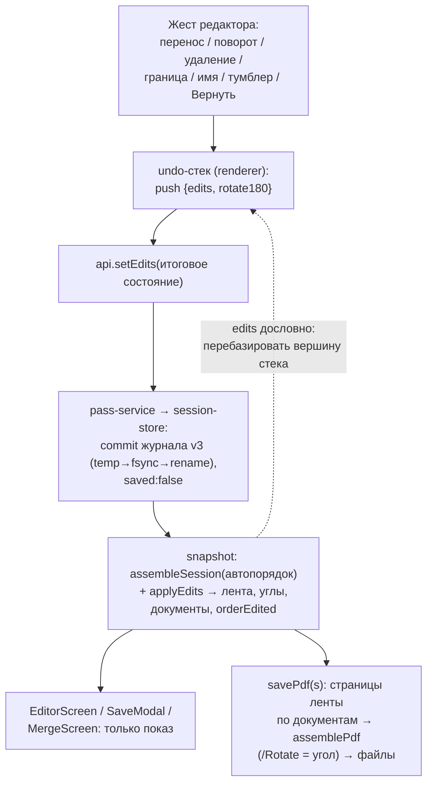

# feat: Редактор и сохранение (M3)

## Summary

Журнал сессии поднимается до версии 3 и несёт итоговое состояние ручных правок (порядок,
повороты 90°, удаления-пометки, разрезы документов с именами); ядро применяет правки к
автопорядку и отдаёт в снимке готовую ленту с документами. Поверх — эфемерный undo-стек в
renderer, плашка с «Вернуть» (полный откат), редактор по макету (мультивыделение, DnD,
split-бар), модалки `save` (один файл / отдельные файлы, best-effort пакет) и полная
`newscan`. Форма журнала v3 зафиксирована амендментом ADR 0004 от 2026-10-06.

## Problem Frame

M2 оставила редактор почти без правок: единственная ручная правка — аварийный тумблер 180°.
Правки M3 обязаны переживать перезапуск, откатываться и не конфликтовать с уже существующими
механизмами — досканированием прерванного прохода, несовпадением пар, пометками `deletions`
(это префиксы сегментов, по которым сверка физически удаляет файлы, — страницы туда класть
нельзя). Развилки сняты в брейншторме (origin) и ответами автора при планировании:
новые страницы при ручном порядке дописываются в конец ленты с тостом; веха «Добавить»
встаёт в роадмап сразу после M3; форма v3 — амендмент ADR 0004.

---

## Requirements

**Журнал и ядро**

- R1. Журнал v3 хранит итоговое состояние правок коллекцией `edits`; undo в журнал не
  пишется (origin R1–R3; ADR 0004, амендмент 2026-10-06).
- R2. Чтение версий 1 и 2 — цепочкой дефолтов, запись — всегда v3; сверка при запуске
  переписывает старый файл (origin R2).
- R3. Лента с правками — порядок, углы, без удалённых, с документами и непарностью —
  считается в ядре и приходит в снимке; каждая живая страница ровно один раз (origin R1).
- R4. Досканирование при ручном порядке дописывает новые страницы в конец ленты (в последний
  документ) и показывает тост; автосортировка не включается (решение автора).
- R5. Правки с исчезнувшими ключами отбрасываются при сборке и вычищаются при отбросе
  сегментов и закрытии сессии.

**Правки и undo**

- R6. Каждая правка отменяема Ctrl+Z в рамках запуска, глубина не ограничена; Redo —
  Ctrl+Y/Ctrl+Shift+Z, очищается новой правкой (origin R5, R6).
- R7. Групповая операция (поворот, удаление, перенос выделения) — один шаг undo.
- R8. Ручной перенос отключает автосортировку; любая правка, включая тумблер 180°,
  показывает плашку и снимает отметку «сохранено» (origin R7, R8).
- R9. «Вернуть» — полный откат с подтверждением: сбрасывает правки и тумблер, возвращает
  удалённые, включает автосортировку; сам откат отменяем Ctrl+Z (origin R9, R10).

**Документы**

- R10. Разрез — позиция между соседями видимой ленты; перенос через разрез меняет документ
  страницы, разрез остаётся; пустой документ схлопывается с именем; граница невозможна перед
  первой позицией; постановка границы фокусирует поле имени (origin R11–R13; UI_SPEC §6.7).

**Сохранение**

- R11. Модалка `save`: «Отдельные файлы / Один файл», имена и папка задаются в модалке,
  сводка перед сохранением (origin R14; UI_SPEC §7.3).
- R12. Пакет best-effort: сбой одного файла не прерывает остальные; при частичном сбое
  модалка остаётся с итогом и повтором только неудавшихся (origin R15).
- R13. «Сохранено» ставится только при записи всех файлов пакета; ревизия журнала защищает
  отметку от гонки с правками во время записи (origin R16).
- R14. Занятое имя — авто-суффикс « (2)», существующие файлы не перезаписываются; имена
  файлов санитизируются под Windows (origin R17).
- R15. «Один файл» игнорирует границы при выводе; разрезы и имена остаются в журнале.

**Модалка нового сканирования**

- R16. Полная `newscan`: кикер по состоянию (пуст / сохранён / есть несохранённое — включая
  правки без новых страниц), карточки «Закрыть и начать новое» и «Сначала сохранить текущий»;
  предупреждение учитывает возвращаемые Ctrl+Z страницы; пустая сессия без правок — без
  модалки (UI_SPEC §7.4).

**Редактор**

- R17. Лента группами по документам, мультивыделение (клик/Shift/Ctrl, панель выделения),
  split-бар, превью со статус-баром (←/→, ↻, удалить), пустое состояние с подсказкой
  возврата, клавиатура (Delete, Ctrl+Z/Y) — по утверждённому handoff.
- R18. Несовпадение пар и отчёт `mismatch` считаются по проходам; правки на них не влияют и
  показ модалки не перезапускают.

**Доки**

- R19. UI_SPEC §6.4, §6.8, §7.3, §7.4, §8, §11 приведены к принятым решениям; роадмап
  получает веху «Добавить» сразу после M3 (origin R18, R19).

---

## Key Technical Decisions

- KTD-1. **Форма журнала v3 — `edits: {order, rotations, deleted, cuts, names}`.** Решение и
  отклонённые альтернативы — ADR 0004, амендмент 2026-10-06 (не дублируется здесь).
- KTD-2. **Ленту считает только ядро.** `assembleSession` + применение правок живут в ядре;
  `Snapshot.assembly` несёт готовую ленту: `AssembledPage` получает угол (0/90/180/270) и
  признак непарности, сборка — список документов и флаги `orderEdited`/`hasEdits`. Renderer
  ничего не пересчитывает; зеркальная фикстура сборки в тестах renderer усыхает до
  конструктора снимков. Закрывает отложенные с M2 пункты «общий модуль сборки» и «непарность
  из ядра» без переноса кода в `src/shared`. Отклонено: общий модуль в `src/shared` — сдвиг
  границы слоёв ради тестовой фикстуры.
- KTD-3. **Одна команда `setEdits({edits, rotate180})` с итоговым состоянием правок.** Каждый
  жест редактора строит новое состояние и шлёт его целиком, тумблер 180° — тем же вызовом
  (один commit журнала, один атомарный шаг undo); команда `setRotateBacks` из M2 убирается —
  её единственный потребитель редактор. Undo-стек в renderer хранит пары `{edits, rotate180}`,
  Ctrl+Z шлёт предыдущее, «Вернуть» — пустое с выключенным тумблером. Снимок остаётся
  единственным источником правды (KTD-23 M1) и несёт `edits` дословно (как записаны в журнал,
  после нормализации ядром) рядом с собранной лентой; оптимистичных веток нет, кроме
  визуального DnD-превью. Отклонено: команда на каждый жест — лог операций по мосту,
  которому нечего делать в журнале-состоянии.
- KTD-3a. **Жест строится от вершины undo-стека, нормализует только ядро.** Renderer берёт
  вершину стека (она же — `edits` последнего снимка), применяет чистую функцию жеста и шлёт
  результат; разрезы, мёртвые ключи и схлопывание пустых документов нормализует только ядро.
  Пришёл снимок — вершина стека перебазируется на его `edits` (замена, не новый шаг): так
  стек не расходится с журналом ни после нормализации, ни после изменений ленты вне правок
  (досканирование, отброс сегмента). Нижние записи стека могут нести устаревшие ключи — ядро
  отбросит их при Ctrl+Z, как при любой сборке.
- KTD-4. **Повороты складываются в ядре.** Угол страницы = (поворот 90°-правки + 180°
  прохода оборотов) mod 360 — одна функция для превью, миниатюры и `/Rotate` в PDF
  (`setRotation` градусами вместо булевого `rotate180`). Миниатюра и превью поворачиваются
  CSS-трансформом; файлы страниц и миниатюр не трогаются.
- KTD-5. **Сохранение без ОС-«Сохранить как».** Папка выбирается диалогом
  `showOpenDialog(openDirectory)` в main (`askSaveDirectory` в контексте команд), имена
  приходят из модалки; занятость имён, авто-суффикс и санитизацию считает ядро через
  `StorageFs`. Ревизия журнала берётся на весь пакет; повтор неудавшихся пересобирает
  документы по текущему состоянию. Отклонено: ОС-диалог на каждый файл — пять модалок подряд
  и подтверждение перезаписи, которое мы заменили авто-суффиксом.
- KTD-6. **Итог пакета живёт в модалке `save`.** Полный успех — модалка закрывается, тост
  6 с с кнопкой «Новое сканирование»; частичный сбой — модалка остаётся: список записанных и
  неудавшихся, кнопка «Повторить». UI_SPEC §7.3 правится под это (R19).
- KTD-7. **`mismatch` — отчёт о сканировании, не о ленте.** Пары и непарные листы считаются
  по проходам до применения правок; удаление «лишнего» оборота пометку в отчёте не снимает
  (лента при этом его уже не показывает). Отклонён пересчёт по ленте: отчёт перестал бы
  отвечать на вопрос «что пришло со сканера».
- KTD-8. **DnD — HTML5 drag-события, как в моке.** Вся решающая логика — «куда вставить»,
  перенос группы с сохранением внутреннего порядка, нормализация разрезов — чистые функции
  ядра/`state` под табличными тестами; jsdom-тесты жмут `fireEvent` с самодельным
  `dataTransfer`. Группа перетаскивается целиком; бросок внутрь выделения — no-op.
- KTD-9. **Правки блокируются на время записи пакета и идущего прохода.** Пока служба в
  `saving`, `setEdits` отклоняется конфликтом `saving` (как повторное сохранение в M2); пока
  идёт проход — конфликтом `passRunning`. Тумблер 180° идёт через `setEdits` (KTD-3) и
  блокируется тем же правилом. UI дизейблит операции. Отклонено «разрешить и сбросить
  отметку»: повтор неудавшихся стал бы гонкой с лентой.
- KTD-10. **Разрез сдвигается вместе с лентой при изменениях вне правок.** Когда состав живых
  ключей меняется не через `setEdits` (досканирование вставило страницы в автопорядок,
  отброс сегмента, сверка), хранилище пересчитывает `cuts` чистой функцией ядра `remapCuts`:
  разрез остаётся перед той же страницей, что шла за ним; если её нет — перед следующей
  живой; затем обычная нормализация. В модели «позиция в ленте» без этого граница молча
  переехала бы на чужую страницу. Хвостовая дописка при ручном порядке разрезы не двигает.
- KTD-11. **Имена файлов — по правилам NTFS.** Сравнение занятости в папке и дублей внутри
  пакета — без учёта регистра; санитизация убирает запрещённые символы, хвостовые точки и
  пробелы, резервирует `CON`/`PRN`/`AUX`/`NUL`/`COM1–9`/`LPT1–9` и обрезает длину. Иначе
  «Документ.pdf» и «документ.pdf» в одном пакете перезаписали бы друг друга.

## High-Level Technical Design

Поток данных правки — от жеста до диска и обратно:

Ключевые инварианты: каждая неудалённая страница встречается в ленте ровно один раз; правки
с мёртвыми ключами отбрасываются молча при сборке и вычищаются при отбросе сегментов; разрезы
нормализуются при каждой правке (не перед первой позицией, пустых документов нет) и
переносятся `remapCuts` при изменении ленты вне правок (KTD-10); пустой `order` означает
«автосортировка включена».

## Implementation Units

### U1. Журнал версии 3: коллекция правок

- **Что:** v3-схема с `edits` по ADR-амендменту 2026-10-06; `journalV2Schema` + `upgradeToV3`
  (чтение v1 → v2 → v3 цепочкой); `JOURNAL_VERSION = 3`; методы хранилища: запись правок
  (`commit('must')`, `saved: false`) вместе с `rotate180` одним commit'ом (KTD-3), чистка
  правок при `discardSegment`, `beginPass` новой сессии и сверке; `reconcile` отбрасывает
  правки с мёртвыми ключами; при изменении состава живых ключей вне правок (запись страницы
  прохода, отброс сегмента, сверка) — `remapCuts` из U2 (KTD-10). Завести журнал вехи
  `docs/solutions/0004-m3-editor-save.md` по шаблону.
- **Файлы:** `src/core/storage/journal.ts`, `src/core/storage/session-store.ts`,
  `src/core/storage/reconcile.ts`; тесты рядом.
- **Тесты:** табличные на схему (чтение v1 и v2 с дефолтами, запись v3, маркер v4+ и
  неизвестное поле — несовместимость); правки переживают перезапись сверкой; `discardSegment`
  вычищает правки отброшенных ключей; правка снимает `saved`; `deletions` сегментов не
  пересекается с `edits.deleted` (AE из KTD-20 M2 остаются зелёными); отброс сегмента
  в середине ленты — разрез остался перед той же страницей.
- **Гейт:** typecheck + lint + test зелёные; коммит `feat(m3): U1 …`.

### U2. Ядро: лента с правками и документы

- **Что:** модуль применения правок (`src/core/scan/edits.ts`): видимая лента из автопорядка
  и `edits` (явный порядок, хвост новых ключей, без удалённых, углы суммой с `rotate180`
  прохода), документы по разрезам, нормализация разрезов и переносов (перенос группы,
  «куда вставить»), схлопывание пустых документов, `remapCuts` (KTD-10). `AssembledPage` →
  угол + `unpaired`; `SessionAssembly` → `documents`, `orderEdited`, `hasEdits`, счётчик
  удалённых; снимок несёт `edits` дословно (KTD-3). Отчёт пар не меняется (KTD-7).
  Нормализация живёт только здесь; функции жестов renderer'а (U6) её не повторяют (KTD-3a).
- **Файлы:** `src/core/scan/edits.ts` (+ тест), `src/core/scan/assembly.ts`,
  `src/shared/snapshot.ts`; правки потребителей типов: `src/renderer/src/screens/MergeScreen.tsx`,
  `src/renderer/src/state/assembly-outcome.ts`, `src/renderer/src/state/assembly-fixture.ts`.
- **Тесты:** табличные в `edits.test.ts` — каждая живая страница ровно один раз; явный
  порядок + новые ключи в конец; мёртвые ключи отброшены; разрез не перед первой позицией;
  перенос через разрез меняет документ (AE5); пустой документ схлопнулся (AE6); углы
  0/90/180/270 с тумблером и без; `remapCuts`: вставка в середину автопорядка, исчезновение
  страницы за разрезом, хвостовая дописка — разрезы на месте; `assembly.test.ts` — отчёт пар
  не зависит от правок.
- **Гейт:** как U1; коммит `feat(m3): U2 …`.

### U3. Служба, мост и команда правок

- **Что:** `setEdits({edits, rotate180})` по цепочке M2: тип запроса и канал в
  `src/shared/bridge.ts`, строгая схема (пределы длины имён, валидация углов и позиций) в
  `src/core/commands/schemas.ts`, обработчик, метод службы (отклонение при `saving` и при
  идущем проходе — KTD-9), preload, регистрация в main. `setRotateBacks` убирается по всей
  цепочке (KTD-3). Снимок несёт ленту/документы из U2 и `edits` дословно.
- **Файлы:** `src/shared/bridge.ts`, `src/core/commands/{schemas,handlers}.ts`,
  `src/core/scan/pass-service.ts`, `src/preload/api.ts`, `src/main/index.ts`; тесты рядом
  (`handlers.test.ts`, `schemas.test.ts`, `pass-service.test.ts`, `api.test.ts`,
  `bridge.test.ts`).
- **Тесты:** мусорный вход → `invalidInput`; правка пишется и переживает перезапуск службы
  (посеянная сессия); правка при `saving` → конфликт `saving`, при идущем проходе →
  `passRunning`; тумблер и правки одним вызовом — один commit; снимок отдаёт нормализованные
  `edits` (разрез перед первой позицией — снят); правка снимает `saved`; досканирование
  прерванного прохода при ручном порядке — новые страницы в конце ленты (AE9).
- **Гейт:** как U1; коммит `feat(m3): U3 …`.

### U4. Пакетное сохранение PDF

- **Что:** `assemblePdf` принимает угол в градусах; новый модуль пакета
  (`src/core/pdf/save-batch.ts`): имена из имён документов (санитизация по KTD-11, дубли
  внутри пакета без учёта регистра), проверка занятости в папке без учёта регистра +
  авто-суффикс « (2)», запись
  каждого файла атомарно, best-effort с отчётом (записанные с фактическими именами,
  неудавшиеся с причинами). Служба: `saveDocuments({mode, names…})` — «один файл» через
  прежний `askSavePdfPath`, «отдельные» через новый `askSaveDirectory`
  (`showOpenDialog(openDirectory)` в main); ревизия на пакет, `markSaved` при полном успехе;
  повтор неудавшихся. Тип отчёта — в `src/shared`.
- **Файлы:** `src/core/pdf/{assemble.ts,save-batch.ts}` (+ тесты),
  `src/core/scan/pass-service.ts`, `src/core/commands/{schemas,handlers}.ts`,
  `src/shared/{bridge,snapshot,errors}.ts`, `src/preload/api.ts`, `src/main/index.ts`.
- **Тесты:** `/Rotate` 90/180/270 в готовом PDF; табличный на санитизацию (запрещённые
  символы, `CON`, хвостовые точки, длина) и регистр («Документ» vs «документ» в пакете и в
  папке → суффикс); AE7 дословно: пять документов, имя второго занято, сбой на четвёртом
  (`interceptFs`) — записаны четыре (второй с « (2)»), чужой файл байт-в-байт цел, отчёт
  называет четвёртый, `saved` не ставится; повтор пишет только четвёртый и ставит `saved`;
  «один файл» при границах — один PDF со всеми страницами (AE12); правка между записью и
  отметкой — `saved` не ставится (ревизия).
- **Гейт:** как U1; коммит `feat(m3): U4 …`.

### U5. Handoff состояний M3 и утверждение автора

- **Что:** handoff `docs/design/handoffs/2026-10-m3-states.md` по шаблону: лента группами по
  документам, панель мультивыделения, split-бар, инспектор (детали / документы / проверка),
  плашка правок с «Вернуть» (формулировка вместо «Порядок изменён») и подтверждение отката,
  статус-бар превью, пустое состояние редактора, поворот миниатюры 90° (компоновка в рамке),
  модалки `save` (выбор, идёт запись, полный успех → тост, частичный сбой, повтор, отмена
  диалога папки, режим «Один файл» недоступен при одном документе) и `newscan` (три кикера +
  предупреждение о возвращаемых Ctrl+Z страницах), тосты с действием (сохранено → «Новое
  сканирование», удалено N, добавлено N в конец), блокировка правок на время записи (KTD-9),
  сохранение недоступно при пустой ленте, тумблер 180° как правка (плашка), поле имени
  документа (фокус при постановке границы, фиксация по blur/Enter, Esc — отмена ввода),
  клавиатура (§11: Delete, Ctrl+Z/Y, стрелки, фокус-порядок — естественный, как M2),
  Copy-секция без «пачка/стопка». Дырки мока закрывает dev-агент сам (прецедент M2);
  реализация UI — только по утверждённому handoff.
- **Файлы:** `docs/design/handoffs/2026-10-m3-states.md`.
- **Тесты:** нет (док); **Гейт:** явное «утверждаю» автора; коммит `feat(m3): U5 …`.

### U6. Renderer: undo/redo и состояние редактора

- **Что:** чистые модули без React: undo/redo-редьюсер (стек состояний `{edits, rotate180}`,
  пределов нет, redo очищается новой правкой), операции над выделением (якорь, Shift-диапазон,
  Ctrl-переключение, «только подряд» для выделения в документ), построение нового состояния
  правок для каждого жеста от вершины стека (KTD-3a), перебазирование вершины на `edits`
  пришедшего снимка (замена, не новый шаг). Обновить фикстуру снимков под новые поля.
- **Файлы:** `src/renderer/src/state/{history.ts,edits.ts}` (+ тесты),
  `src/renderer/src/state/assembly-fixture.ts`.
- **Тесты:** табличные: undo/redo последовательности (вкл. «Вернуть» как один шаг и его
  отмену); групповой поворот/удаление — один шаг (R7); выделение после Ctrl+Z указывает на
  затронутые страницы; redo сбрасывается новой правкой; снимок с нормализованными `edits`
  заменяет вершину, глубина стека не растёт; тумблер + «Вернуть» — один шаг.
- **Гейт:** как U1; коммит `feat(m3): U6 …`.

### U7. Редактор: документы, выделение, операции

- **Что:** лента группами по документам (заголовки с именем и счётчиком, пилюля «НОВЫЙ
  ДОКУМЕНТ»), мультивыделение с панелью (`aria-multiselectable`, roaming tabindex поверх
  набора выделения), поворот ↻ и удаление для текущей страницы и выделения (тосты), превью
  со статус-баром, углы на миниатюре/превью (CSS), пустое состояние с подсказкой Ctrl+Z /
  «Вернуть», тумблер 180° как правка (через undo-стек), клавиатура: Delete, Ctrl+Z/Y.
  Тексты — из handoff; `Thumb` остаётся на примитивных пропсах.
- **Файлы:** `src/renderer/src/screens/EditorScreen.tsx` (+ вынос подкомпонентов рядом при
  росте), `editor-screen.css`, `locales/ru/common.json`, тесты `EditorScreen.test.tsx`.
- **Тесты:** jsdom: группировка по документам из снимка; выделение кликами/Shift/Ctrl;
  групповое удаление — один вызов `setEdits` и один шаг undo; поворот меняет угол класса;
  пустое состояние (AE10); Ctrl+Z шлёт предыдущее состояние; счётчики и плюрализация;
  смоук-тест локали на «пачк/стопк» зелёный.
- **Гейт:** как U1; коммит `feat(m3): U7 …`.

### U8. Редактор: перетаскивание, границы, плашка

- **Что:** DnD по KTD-8 (полупрозрачность, маркер «до/после» по половине миниатюры, группа
  целиком, no-op внутрь выделения), отключение автосортировки броском, split-бар постановки
  и снятия границы, «Выделить в документ» (подряд — две границы одним шагом; иначе тост),
  фокус в поле имени при постановке, редактирование имён (ввод локален, `setEdits` — по blur
  или Enter, один шаг undo на фиксацию; Esc — отмена ввода; Ctrl+Z в поле — текстовый, не
  ленточный), плашка правок с «Вернуть» → подтверждение → полный откат (сам в undo-стеке),
  тост «добавлено N страниц в конец» при досканировании с ручным порядком.
- **Файлы:** `src/renderer/src/screens/EditorScreen.tsx` и подкомпоненты, `editor-screen.css`,
  `locales/ru/common.json`, тесты.
- **Тесты:** jsdom с самодельным `dataTransfer`: бросок до/после; группа сохраняет внутренний
  порядок; бросок включает `orderEdited` и плашку (AE3 — поворот без переноса плашку
  показывает, автосортировку не трогает); границы: постановка/снятие, фокус имени, снятие
  удаляет имя; ввод имени по буквам — ни одного `setEdits` до blur/Enter, Esc — ни одного;
  «Вернуть» → подтверждение → пустые правки + тумблер выключен, Ctrl+Z возвращает всё (AE4);
  перенос через разрез (AE5).
- **Гейт:** как U1; коммит `feat(m3): U8 …`.

### U9. Модалки `save` и `newscan`, тост с действием

- **Что:** `SaveModal`: сегменты «Отдельные файлы / Один файл» (недоступность при <2
  документов — тост-подсказка), список имён с метаданными, папка + «Выбрать…», сводка;
  запись через `saveDocuments`; полный успех — закрытие + тост 6 с с кнопкой «Новое
  сканирование» (добавить действие в `Toast`); частичный сбой — итог в модалке + «Повторить
  неудавшиеся» (KTD-6). Полная `NewScanModal`: кикеры трёх состояний (включая «есть
  несохранённые правки» без новых страниц и возвращаемые Ctrl+Z страницы), карточки,
  «Сначала сохранить текущий» → `save` → закрытие сессии после полного успеха; единое
  состояние `modal: 'save' | 'newscan' | null` в редакторе.
- **Файлы:** `src/renderer/src/modals/SaveModal.tsx` (+ css, тест),
  `src/renderer/src/modals/NewScanModal.tsx` (+ тест),
  `src/renderer/src/components/Toast.tsx`, `src/renderer/src/screens/EditorScreen.tsx`,
  `locales/ru/common.json`.
- **Тесты:** jsdom: сегменты и недоступность; сводка по снимку; частичный сбой держит
  модалку и перечисляет файлы; повтор шлёт только неудавшиеся; `newscan` кикеры по
  состояниям (сохранён / правки / страницы), «Сначала сохранить» ведёт в `save` и закрывает
  сессию после успеха (AE11); фокус-ловушка и возврат фокуса (паттерн `Modal`).
- **Гейт:** как U1; коммит `feat(m3): U9 …`.

### U10. Интеграция: эмулятор и смоук

- **Что:** интеграционный тест полного пути: два прохода эмулятором → правки через службу
  (перенос, поворот, удаление, границы, имена) → перезапуск службы (правки на месте) →
  пакетное сохранение с занятым именем и сбоем записи → повтор. CDP-смоук M3 (локальный,
  `temp/`): правки кликами и DnD, перезапуск приложения на журнале v3, сохранение в папку;
  чеклист ручной приёмки по шаблону.
- **Файлы:** `test/integration/editor-save.emulator.test.ts`, `temp/smoke-m3.mjs`
  (вне git), `docs/output/<дата>-smoke-checklist-m3-acceptance.md` (вне git).
- **Тесты:** сам юнит; плюс AE1, AE7, AE9 в интеграции.
- **Гейт:** `test:all` зелёный; коммит `feat(m3): U10 …`.

### U11. Доки и закрытие вехи

- **Что:** правки UI_SPEC (§6.4 — плашка при любой правке, «Вернуть» = полный откат с
  подтверждением; §6.8 — поворот на миниатюре; §7.3 — имена/папка в модалке, итог частичного
  сбоя; §7.4 — кикер правок; §8 — тост с действием; §11 — снять закрытые дырки), роадмап —
  веха «Добавить» сразу после M3 (R19), `docs/duplexnt.md` и бэклог — хвосты, журнал вехи —
  закрытие. Ручной смоук и приёмка автора; merge `feat/m3` → `main` — только после явного ОК
  отдельным вопросом.
- **Файлы:** `docs/design/UI_SPEC.md`, `docs/roadmap.md`, `docs/duplexnt.md`,
  `docs/backlog.md`, `docs/solutions/0004-m3-editor-save.md`.
- **Тесты:** нет (доки); **Гейт:** веха зелёная целиком, приёмка пройдена; коммит
  `docs(m3): U11 …`.

## План по сессиям

| Сессия | Юниты   | Граница                                                                      |
| ------ | ------- | ---------------------------------------------------------------------------- |
| 1      | U1–U2   | журнал v3 и лента с правками в ядре; `test:all` зелёный; журнал вехи заведён |
| 2      | U3–U4   | команда правок и пакетное сохранение сквозь мост; эмуляторные юниты зелёные  |
| 3      | U5–U6   | handoff утверждён автором; undo/redo-логика под тестами                      |
| 4      | U7–U8   | редактор целиком (документы, DnD, плашка); jsdom зелёный                     |
| 5      | U9      | модалки `save`/`newscan`, тост с действием                                   |
| 6      | U10–U11 | интеграция, CDP-смоук, чеклист, доки, приёмка, merge по явному ОК            |

Каждая сессия кончается зелёным коммитом с U-ID в теме; возобновление — `git log` + журнал
вехи.

---

## Scope Boundaries

Вне M3:

- «Добавить» (досканирование недостающего листа) — отдельная веха сразу после M3 (R19);
  `mismatch` живёт без кнопки «Добавить», кнопки «+ Добавить» и «Пересканировать» в тулбаре
  не рисуются (как в M2).
- Персистентный undo и «полка удалённых страниц» — отклонены брейнштормом (origin, Scope
  Boundaries).
- Перестановка страниц с клавиатуры (альтернатива DnD, напр. Alt+←/→) — решение автора при
  разборе ревью плана: бэклог «Доделки UI»; в M3 перенос только мышью.
- Пустые обороты (детектор, переключатель показа, «ПУСТО») — M4; слот тумблера в подвале
  ленты пока остаётся за тумблером 180°.

### Deferred to Follow-Up Work

- Анимации появления/сдвига миниатюр, плавные переходы, редизайн `merge` — бэклог «Доделки
  UI» (уже заведён).
- Виртуализация ленты на тысячах страниц и превью-перфоманс — бэклог «Перфоманс-находки M1»,
  условие возврата — замеченные тормоза.
- `PassProgress.role` из main — остаётся отложенным кандидатом журнала M2: редактору M3 роль
  в текущем виде не нужна.

## System-Wide Impact

- **Форматы:** журнал v3; файл v1/v2 переписывается текущей версией при первой сверке —
  отката на старую сборку приложения после этого нет (допустимо: релиза ещё не было).
- **Shared-типы:** `AssembledPage` (угол, непарность) и `SessionAssembly` (документы, флаги)
  затрагивают `MergeScreen`, `assembly-outcome`, фикстуры и тесты — обновляются в U2 одним
  коммитом, дальше typecheck держит.
- **Локаль:** новые ключи с четырьмя формами плурализации (файлы, документы, страницы);
  смоук-тест «пачк/стопк» распространяется на все новые тексты.
- **Ошибки:** новые коды (занятость папки, отчёт пакета) — строки в `errors.*` обязательны,
  иначе красный `i18n.test`.

## Risks & Dependencies

- **Широкое изменение `AssembledPage`** → ломается много потребителей разом. Де-риск: U2
  делает все правки типов одним юнитом, остальной код меняется только через новые поля.
- **DnD в jsdom не тестируется честно** → вся решающая логика в чистых функциях (KTD-8),
  jsdom проверяет только проводку событий; живое поведение — CDP-смоук U10.
- **Гонка правок и записи пакета** → KTD-9 (блок `setEdits` при `saving`) + ревизия на пакет
  (R13); тест в U4.
- **Имена файлов на Windows** (запрещённые символы, длина, дубли в пакете) → санитизация и
  суффиксы в ядре под табличным тестом (U4), пределы длины на мосте (U3).
- **Память пакета** (несколько PDF подряд) → сборка последовательная; порог
  `test/integration/pdf-worst-case.test.ts` остаётся контрольным.
- **StrictMode / двойной mount** → undo-стек и keydown-подписки идемпотентны; регресс App в
  `<StrictMode>` расширяется сценарием правок (U7).

## Acceptance Examples

Сквозные — для чеклиста приёмки (origin AE1–AE8 действуют дословно; здесь — сводка и новое):

- AE1. Повернул и перетащил → перезапуск → всё на месте, undo пуст, плашка видна (origin AE1).
- AE2. Удаление → тост, файл жив → Ctrl+Z возвращает на место (origin AE2).
- AE3. Только поворот: плашка есть, автосортировка включена, «сохранено» снято (origin AE3).
- AE4. «Вернуть» → подтверждение → всё сброшено (включая тумблер 180°), Ctrl+Z отменяет откат
  (origin AE4 + тумблер).
- AE5. Перенос через разрез: страница сменила документ, разрез на месте (origin AE5).
- AE6. Документ опустел (удалением или переносом) — исчез из сводки; возврат возвращает
  (origin AE6).
- AE7. Пакет 5 файлов: занятое имя → « (2)», сбой → итог «4 из 5» в модалке, повтор дописывает,
  «сохранено» после полного успеха (origin AE7).
- AE8. Правка после сохранения: отметка снята, правки живут до «Нового сканирования»
  (origin AE8).
- AE9. Ручной порядок + «Досканировать»: новые страницы в конце ленты, тост «добавлено N»,
  ручная расстановка не тронута.
- AE10. Удалены все страницы: пустой редактор с подсказкой, сохранение недоступно, `newscan`
  предупреждает о возвращаемых страницах.
- AE11. `newscan` при сохранённом наборе с правками — кикер про несохранённые правки;
  «Сначала сохранить» → `save` → после полного успеха сессия закрыта.
- AE12. «Один файл» при двух границах: один PDF со всеми страницами по порядку ленты; разрезы
  и имена в журнале целы.

## Documentation / Operational Notes

- Журнал вехи `docs/solutions/0004-m3-editor-save.md` заводится в сессии 1, дописывается на
  границе каждой сессии («на чём встали»).
- ADR-амендмент формы v3 уже в `docs/decisions/0004-data-model.md` (2026-10-06); если при
  реализации форма `edits` поменяется — амендмент правится в той же сессии.
- Закрытие вехи — по правилу CLAUDE.md: зелёный гейт, доки-хвосты (U11), ручной смоук и
  приёмка, merge только после явного ОК отдельным вопросом; код-ревью + simplify по
  прецеденту M2 перед приёмкой.
- Адрес сканера в вывод тестов и чата не попадает; живые тесты M3 не требуются
  (сканирование покрыто M2), `DUPLEXNT_SCANNER_HOST` не нужен.

## Sources / Research

- Origin: `docs/brainstorms/2026-10-05-m3-edits-model-requirements.md` (R1–R19, AE1–AE8).
- ADR: `docs/decisions/0004-data-model.md` (амендменты 2026-10-04 и 2026-10-06),
  `docs/decisions/0007-pdf-library.md` (`/Rotate`, JPEG без перекодирования).
- Паттерны: `docs/plans/2026-10-04-001-feat-m2-two-passes-merge-plan.md` (форма вехи),
  `docs/solutions/0003-m2-two-passes-merge.md` (цепочка команды, миграция v1→v2, грабли
  renderer, отложенные кандидаты), `src/core/storage/journal.ts` (паттерн версий),
  `src/core/scan/assembly.ts`, `src/renderer/src/screens/EditorScreen.tsx`.
- UI: `docs/design/UI_SPEC.md` §6–§8, §11; мок `docs/design/mock/Сканер ADF.dc.html`
  (DnD, split-бар, выделение — прототип поведения); handoff-прецедент
  `docs/design/handoffs/2026-10-m2-states.md`.
