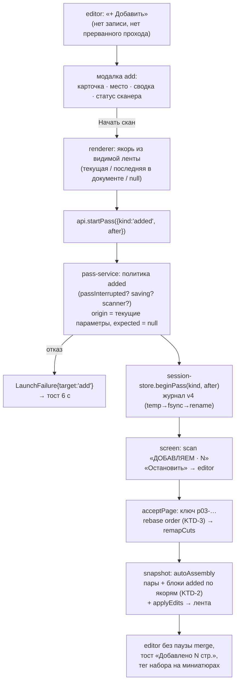

# feat: Добавить — досканирование наборов к готовому документу (M3.5)

## Summary

Журнал поднимается до версии 4: у прохода появляются явная роль (`fronts` / `backs` / `added`)
и якорь вставки `after` (амендмент ADR 0004 от 2026-10-07). Ядро собирает добавленные
однопроходные наборы на место по якорю и одним правилом вставляет новые ключи в ручной порядок.
Поверх — кнопка «+ Добавить» в тулбаре, модалка `add` (две карточки: «Односторонние листы» и
«Один лист»; «В конец документа» / «После текущей страницы»), экран `scan` и плашка прерванного
прохода для добавленного набора, тег набора на миниатюре, честный текст `mismatch` с подсказкой
в инспекторе — и шесть поведенческих доделок редактора с приёмки M3. Новый UI — по handoff'у,
утверждённому автором.

## Problem Frame

После M3 пропущенный в проходе оборотов лист никак не досканировать: модалка `mismatch` только
сообщает, а политика прохода запрещает третий проход (`backsPresent` / `backsDeclined`). Роль
прохода в ядре и renderer выводится по позиции среди уцелевших — третий проход при «обороты не
нужны» стал бы оборотами. Развилки сняты ответами автора при планировании (2026-10-07):

- кнопки «Досканировать» в `mismatch` не будет: при слипшихся листах приложение не знает, какой
  лист пропущен, и предвыбор «после текущей» закреплял бы ложную уверенность; вместо неё —
  честный текст модалки и подсказка в пункте «Проверка» инспектора, лист ставит пользователь;
- в M3.5 только однопроходные наборы; «двусторонние» — отдельная веха (бэклог);
- место вставки — свойство прохода в журнале v4, не правка порядка;
- одно правило вставки новых страниц при ручном порядке для всех проходов (пересмотр R4 M3).

---

## Requirements

**Журнал и ядро**

- R1. Журнал v4 несёт на проходе `kind` и `after`; чтение v1–v3 цепочкой дефолтов (роль по
  позиции), запись — всегда v4, сверка переписывает старый файл (ADR 0004, амендмент
  2026-10-07).
- R2. Роль прохода везде читается из `kind`: пары и отчёт, `rotate180`, `expected`, форма `flip`,
  тумблер 180°, плашки — ни одного `surviving[1]` в коде.
- R3. Автосборка ставит добавленный набор сразу после якоря, перед наборами, прикреплёнными к
  нему раньше; якоря нет в сессии — в конец ленты; удалённый правкой якорь работает через
  автопорядок. Роль и место получают только проходы хотя бы с одной страницей.
- R4. При ручном порядке новый ключ любого прохода вставляется в `order` после ближайшего
  предшественника по автопорядку, присутствующего в `order`; без шага undo и плашки. Тост
  `toast.appended` уходит (пересматривает R4 M3).
- R5. Отчёт пар и несовпадения — по-прежнему о проходах `fronts`/`backs` (KTD-7 M3); добавленные
  страницы в него не входят, `unpaired` не снимают.
- R6. Сверка раздаёт роли усыновлённым проходам после сборки списка, по возрастанию номера:
  первый при отсутствии `fronts` — `fronts`; следующий при отсутствии `backs` и
  `backsDeclined === false` — `backs`; остальные — `added` с `after: null`. Пересобранный журнал
  теряет якоря — наборы в конце ленты.

**Запуск добавленного прохода**

- R7. `startPass` принимает намерение `{kind: 'added', after}`; без намерения работает как
  раньше (досканирование / обороты). Для `added` обходятся `backsDeclined` и `backsPresent`;
  без сессии — конфликт `noSession`, до сети.
- R8. Добавление запрещено, пока последний проход прерван (плашка S17): кнопка недоступна, ядро
  отвечает конфликтом `passInterrupted`. Прерванный добавленный проход досканируется и
  принимается той же плашкой с собственным текстом.
- R9. `after` валидируется в ядре: формат ключа и принадлежность сессии, иначе `invalidInput`;
  ключ прохода с номером не меньше нового — размещение в конец.
- R10. Отказ запуска из `add` (лоток пуст, сканер не готов, занят, идёт запись, предел проходов)
  — модалка закрыта, тост 6 с с текстом причины; плашка S17 не задействуется.
- R11. «Остановить» на добавленном проходе возвращает в `editor` (UI_SPEC §3); отброс первого
  сегмента убирает проход целиком, лента и правки прежние.

**Редактор и модалка `add`**

- R12. Тулбар: «+ Добавить» слева от центра (UI_SPEC §6.1); недоступна при записи, правке в
  полёте и прерванном последнем проходе; при пустой ленте доступна («После текущей» выключена).
- R13. Модалка `add`: карточки «Односторонние листы» / «Один лист», сегменты «В конец документа»
  / «После текущей страницы», сводка выбора, строка состояния сканера, «Отмена» / «Начать скан»
  (недоступна без готового сканера). Copy без «пачки» и «стопки»; у «Одного листа» — как
  положить лист оборотом.
- R14. Якорь берётся из видимой ленты: «После текущей» — ключ текущей страницы (при
  мультивыделении — та, что в превью); «В конец документа» — последняя видимая страница
  текущего документа; пустая лента — `null`. Сводка модалки называет страницу-якорь до запуска.
- R15. Экран `scan` для добавленного прохода: тег «ДОБАВЛЯЕМ», счётчик без «из M»; после
  завершения — сразу `editor` без паузы `merge`, текущей становится первая добавленная страница,
  лента прокручена к ней, тост «Добавлено N стр.». «Остановить» с уже принятыми страницами —
  тот же тост по факту; обрыв — плашка S17 без тоста.
- R16. Миниатюра добавленной страницы несёт тег набора — порядковый номер набора от 1,
  независимо от номера прохода (буква и форма — по handoff'у), и цвет `--color-pass-3`; превью
  и «Детали» не называют её «лицом листа N». Номер стабилен: набор исчезает только до первой
  страницы.
- R17. Undo-стек очищается при любом запуске добавления, включая отказ до первой страницы
  (экран `editor` размонтируется) — известное поведение, записывается в UI_SPEC §6.8.

**Несовпадение проходов**

- R18. Текст `mismatch` не называет пропущенный лист: пары сопоставлены от начала, какой лист
  не прошёл — приложение не знает; добавить его — через «+ Добавить». Пометка непарного листа в
  ленте остаётся с подписью «у этого листа не нашлось пары».
- R19. Пункт «Пар "лицо + оборот": N из M» при несовпадении получает подсказку про «+ Добавить»,
  пока в сессии нет добавленного прохода; при его наличии подсказка снимается, модалка
  `mismatch` после перезапуска не показывается.

**Доделки редактора (бэклог «Доделки редактора», приёмка M3)**

- R20. Split-бар не показывается при зажатом Ctrl/Shift и при выделении из нескольких страниц;
  клик с модификатором по верхнему краю миниатюры — выделение, не граница.
- R21. Клик вне ленты (превью, инспектор, тулбар) сбрасывает мультивыделение до текущей
  страницы, как Esc.
- R22. Поворот в обе стороны: «↺» и «↻» в статус-баре превью и для выделения; групповой поворот
  — один шаг undo.
- R23. Enter в поле имени документа фиксирует имя и снимает фокус.
- R24. Тост «Сохранено…» несёт действие «Открыть папку» (папка последнего пакета, известная
  ядру); «Новое сканирование» остаётся в тулбаре (пересмотр S18 handoff M3).
- R26. Подсказка в «Документах в наборе» упоминает выделение Ctrl/Shift и «Выделить в
  документ».

**Процесс**

- R25. Эмулятор получает сценарии добавленных наборов той же вехой (лотки 3+, пустой лоток,
  замятие, перезапуск); интеграционный тест полного пути; CDP-смоук в `built` и `dev`; живой
  opt-in тест «один лист после двух проходов»; чеклист приёмки с пунктом про ориентацию листа,
  досканированного оборотом (на железе не проверена).

---

## Key Technical Decisions

- KTD-1. **Журнал v4: `kind` и `after` на проходе.** Форма, правило размещения, миграция и
  усыновление — ADR 0004, амендмент 2026-10-07 (не дублируется). Схема проверяет: `after` только
  у `added`; `fronts`/`backs` — не больше одного каждого.
- KTD-2. **Размещение считает только ядро, в `autoAssembly`.** Основа — пары `fronts`/`backs`;
  затем блоки добавленных проходов по возрастанию номера: блок встаёт буквально сразу за якорем
  — перед наборами, прикреплёнными к нему раньше; якорь внутри чужого блока — сразу за ним;
  якоря нет — в конец. Досканированный сегмент — в конец блока своего прохода. Отклонено
  правило «после всех ранее прикреплённых блоков»: цепочка прикрепления расходится с видимой
  лентой, как только первый набор отрезали в отдельный документ или перетащили, и второй набор
  уезжал бы в чужой документ. Цена буквального правила: два добавления подряд с той же текущей
  идут в обратном порядке; чтобы продолжить за набором, выбирают его последнюю страницу.
  Renderer-фикстура `assemblyOf` повторяет правило: renderer не импортирует ядро (граница
  слоёв), а jsdom-тестам нужна лента; расхождение ловит табличный тест против ядра на одних
  данных.
- KTD-3. **Одно правило rebase `order` для всех проходов.** Хранилище при коммите вставляет
  каждый новый ключ в `order` после ближайшего предшественника по новому автопорядку, который
  есть в `order` (нет — ключ не размещается); несколько новых ключей за один коммит (сверка
  усыновила сегмент) вставляются по одному в порядке автопорядка, каждый следующий видит уже
  вставленные; затем `rebaseEdits`/`remapCuts` как раньше. Пересматривает R4 M3 и снимает тост
  `toast.appended`. Отклонено: вставка «после якоря» — якорь может быть не в `order`, а для
  досканированных проходов якоря нет.
- KTD-4. **Роль по `kind` — один помощник на слой, только проходам со страницами.** В ядре
  `passesByKind(journal)` → `{fronts, backs, added[]}` заменяет `survivingPassesOf`/`backsPassOf`
  по позиции; в renderer — такой же помощник в `state/screen.ts` (единственное место правила,
  как в M2). Пустой проход роли не имеет при любом `kind` — иначе прерванный до первой страницы
  проход оборотов блокировал бы «Обороты не нужны». `PassSnapshot` несёт `kind` и `after`,
  `PassProgress` — `kind` (закрывает отложенный с M2 `PassProgress.role`). Тег набора — номер
  набора от 1 среди `added` со страницами, не номер прохода (номера не переиспользуются, а при
  «обороты не нужны» «П3» читалось бы как «второй проход потерян»).
- KTD-5. **Политика `startPass` с намерением.** Запрос `null | {kind: 'added', after: string |
null}`. `added`: обходит `backsDeclined`/`backsPresent`; без сессии или при пустом журнале —
  `noSession` (добавлять не к чему, UI такого запуска не даёт, но вход валидирует ядро);
  отказывает `passInterrupted`, если последний проход прерван (иначе `resumable()`/`acceptPass`
  смотрят на последний проход, и лицевые застрянут прерванными навсегда); `origin` — текущий
  сканер и параметры; `expected = null`. Досканирование прерванного `added` — тем же
  `resumeTarget` (тот же сканер). «Один лист» — только Copy: в журнал не пишется, `expected` не
  ставится.
- KTD-6. **Отказ запуска из `add` — тост, не плашка.** «Начать скан» закрывает модалку всегда;
  синхронный отказ (нет сканера, запись) и отказ после старта (лоток пуст, занятость, предел) идут
  одним каналом — `LaunchFailure{target: 'add'}` → тост 6 с текстом `errorTextInline`. Модалку
  держать открытой нельзя: экран уходит на `scan` раньше `prepare`.
- KTD-7. **`merge`-пауза, тост и `mismatch` — по намерению запуска.** App запоминает запрос
  последнего `startPass` (намерение из модалки `add` известно до первого снимка и не зависит от
  того, дошёл ли кадр `scan`: снимки приходят пачкой): после `added` — сразу `editor`, текущая —
  первая добавленная, тост «Добавлено N стр.»; иначе — пауза `merge` по `assemblyLanded`, как в
  M2. `mismatchDue` принимает проходы сессии и даёт `false` при наличии `added` со страницами
  (добавление — ответ человека); подсказка в инспекторе — тем же условием. Отчёт пар не меняется
  (KTD-7 M3).
- KTD-8. **Якорь выбирает renderer из видимой ленты, проверяет ядро.** «В конец документа» =
  последняя видимая страница текущего документа (не `null`: так будущие разрезы в конце не
  уводят набор в чужой документ); «После текущей» = текущая. Разрез стоит «перед ключом», поэтому
  вставка за последней страницей документа остаётся в нём (`remapCuts`).
- KTD-9. **«Открыть папку» — команда без входа.** Ядро помнит папку последнего полностью или
  частично записанного пакета в памяти процесса (между запусками не живёт: тост к тому времени
  давно ушёл); main открывает её `shell.openPath` по образцу «Открыть каталог данных». Путь от
  renderer не принимается (KTD-39 M1).
- KTD-10. **Split-бар уступает выделению.** Бар скрыт, пока зажат Ctrl/Shift (`keydown`/`keyup`
  на ленте + проверка модификаторов в самом клике) и пока выделено больше одной страницы; клик по
  зоне бара с модификатором уходит в `onPick` как клик по миниатюре.
- KTD-11. **Поворот с направлением.** `rotated(edits, keys, direction)` в `state/edits.ts`
  (+90 / −90 по модулю 360); кнопки «↺»/«↻» в статус-баре; групповой поворот — один `setEdits`.

## High-Level Technical Design

Поток добавления — от кнопки до ленты:

Размещение на примере: пары `1л 1о 2л 2о 3л 3о`, набор Д1 (`after = 2л`, две страницы), затем
набор Д2 (`after = 2л`, одна страница), затем Д3 (`after = Д1.2`):
`1л 1о 2л Д2.1 Д1.1 Д1.2 Д3.1 2о 3л 3о`. Якорь `2л` удалён правкой — видимая лента начинается
с `1л 1о Д2.1 …`. Ручной порядок `[3л, 1л, 2л, 1о, 2о, 3о]` при приходе Д1 становится
`[3л, 1л, 2л, Д1.1, Д1.2, 1о, 2о, 3о]` без шага undo; если Д1 потом перетащили в начало ленты
и добавили Д2 после `2л`, предшественник Д2.1 по автопорядку — `2л`, и Д2 встаёт за ним, а не
рядом с Д1.

Инварианты: каждая живая страница в ленте ровно один раз; отчёт пар не зависит от `added`;
`after` не входит в `edits` и не трогается «Вернуть»; роль читается только из `kind`.

## Implementation Units

### U1. Журнал версии 4: роль прохода и якорь

- **Что:** `kind`/`after` в схеме прохода с проверками (ADR-амендмент 2026-10-07);
  `JOURNAL_VERSION = 4`, `journalV3Schema` + `upgradeToV4` (роль по позиции, `after: null`);
  `passesByKind(journal)` вместо `survivingPassesOf`/`backsPassOf` по позиции — роли только
  проходам со страницами (KTD-4); `beginPass(origin, intent)` пишет `kind`/`after`; `setEdits`
  кладёт `rotate180` только в `backs` (иначе `noBacksPass`); `declineBacks` отказывает по
  `passesByKind(journal).backs !== null`; сверка раздаёт роли усыновлённым проходам по номерам
  после сборки списка (R6), независимо от порядка обхода каталога; пересобранный журнал — якоря
  `null`. Завести журнал вехи `docs/solutions/0005-m3-5-add-pages.md` по шаблону.
- **Файлы:** `src/core/storage/journal.ts`, `src/core/storage/session-store.ts`,
  `src/core/storage/reconcile.ts`, `src/shared/snapshot.ts` (`PassSnapshot.kind/after`); тесты
  рядом (`session-store.test.ts` при касании делится по `describe`).
- **Тесты:** схема: v3 `[1,2,3]` → fronts/backs/added, `[1]` → fronts, `[1,3]` → fronts/backs,
  `rotate180` у второго; `after` у `fronts` — невалидно; два `backs` — невалидно; маркер v5 —
  несовместимость; v1 и v2 читаются цепочкой. Хранилище: `beginPass` с намерением пишет
  `kind`/`after`; `setEdits(rotate180)` при `[fronts, added]` → `noBacksPass`; `declineBacks`
  при `[fronts, added]` — успех; `[fronts completed, backs interrupted, 0 стр.]` →
  `declineBacks` успех, `setEdits(rotate180)` → `noBacksPass`; `discardSegment` первого
  сегмента `added` убирает проход, лента и `edits` прежние; `saved` снимается новой страницей
  `added`. Сверка: файлы прохода 2 без записи при `[fronts]` → `backs`, при `[fronts]` и
  `backsDeclined` → `added`; при `[fronts, backs]` файлы прохода 3 → `added`, `after: null`;
  `journalRebuilt` с файлами `p01, p02, p03` → `fronts/backs/added` и тот же результат при
  обратном порядке обхода; все якоря `null`; идемпотентность.
- **Гейт:** typecheck + lint + test зелёные; коммит `feat(m3.5): U1 …`.

### U2. Ядро: сборка по якорям и одно правило rebase порядка

- **Что:** `autoAssembly` по `kind` (KTD-2): блоки добавленных наборов сразу за якорем, якорь
  внутри блока, отсутствующий якорь, досканированный сегмент — в конец блока; `rotateBacks`
  и отчёт — только `backs`; `rebaseOrder(beforeAuto, afterAuto, order)` в `src/core/scan/edits.ts`
  и его вызов в `withRebasedEdits` перед `remapCuts` (KTD-3); `AssembledPage` получает признак
  добавленной страницы и порядковый номер набора (для тега).
- **Файлы:** `src/core/scan/assembly.ts`, `src/core/scan/edits.ts`,
  `src/core/storage/session-store.ts`, `src/shared/snapshot.ts`; тесты рядом.
- **Тесты:** табличные на размещение (пример из HTD целиком): якорь — лицо при парах; якорь
  удалён правкой; якорь потерян (`lost`); якорь исчез из сессии → в конец; два набора с одним
  якорем — второй сразу за якорем, перед первым; якорь внутри блока; досканированный сегмент;
  пустой проход `added`/`backs` — без роли и места; `[fronts, added]` при `backsDeclined` —
  `added` не в отчёте, `mismatch: false`, `rotate180` не применяется. Rebase: `order` полный /
  неполный / якорь не в `order` / якорь удалён / новый ключ без предшественника в `order`;
  три ключа одним коммитом (усыновлённый сегмент) → подряд в порядке автопорядка, как при трёх
  коммитах; первый набор перетащен в начало ленты, второй добавлен после того же якоря → за
  якорем, не рядом с первым; `cuts` переехали, `rotations`/`deleted` целы; повторный
  `withRebasedEdits` ничего не меняет; досканирование `fronts` при ручном порядке — на своё место
  (замена теста AE9 M3). Разрезы: якорь — последняя страница документа → набор в нём; первый
  набор отрезан в отдельный документ, второй добавлен после того же якоря → в документе якоря;
  якорь — последняя страница ленты → разрезы не тронуты. `revert` после добавления — набор на
  месте.
- **Гейт:** как U1; коммит `feat(m3.5): U2 …`.

### U3. Служба, мост и команды

- **Что:** `startPass(request)` с намерением (KTD-5): схема `startPassRequestSchema`
  (`null | {kind:'added', after}`), валидация `after` в ядре (R9); политика `added` —
  `passInterrupted`, `noSession`, обход `backsDeclined`/`backsPresent`, `expected = null`;
  `PassProgress.kind`; `expected` при досканировании — по `kind === 'backs'`; новые конфликты и
  тексты (`errors.passInterrupted`, переписать `backsPresent`/`backsDeclined` — они больше не
  «тупик»); запрос `startPass` меняет тип с `NoRequest` на `null | {…}` — все вызовы
  (`App.tsx`, `withoutRequest` в `handlers.ts`) переписываются на явный `null`.
- **Файлы:** `src/core/scan/pass-service.ts`, `src/core/commands/{schemas,handlers}.ts`,
  `src/shared/bridge.ts`, `src/shared/snapshot.ts`, `src/preload/api.ts`,
  `locales/ru/common.json`; тесты рядом (тесты `pass-service.test.ts` и
  `session-store.test.ts` про «при двух уцелевших третий не начинается» — искать по названию —
  переписываются под новую политику).
- **Тесты:** посеянные сессии с подставным транспортом: `added` при `[fronts, backs]` → проход 3
  `kind: added`, `after` в журнале; при `backsDeclined` → проход 2 `added`; без сессии и при
  пустом журнале → `noSession`, сеть не трогается; при прерванном последнем →
  `passInterrupted`, `resumable()` прежний; `after` чужого формата / не из сессии →
  `invalidInput`; `after: null` → в конец; при `saving` → `saving`, при идущем проходе →
  `passRunning`; обрыв `added` с страницами → `interrupted`, `canResume`, досканирование — в тот
  же проход; обрыв с нулём страниц → проход отброшен; `expected` при досканировании `added` —
  `null`; схема запроса отвергает лишние поля; `buildApi` знает новый запрос; `i18n.test`
  зелёный на новых кодах.
- **Гейт:** как U1; коммит `feat(m3.5): U3 …`.

### U4. Handoff состояний M3.5 и утверждение автора

- **Что:** `docs/design/handoffs/2026-10-m3-5-states.md` по шаблону: кнопка «+ Добавить» и её
  недоступные состояния; модалка `add` (карточки, сегменты, сводка, строка состояния сканера,
  «После текущей» без текущей, пустая лента, Copy без «пачки», инструкция «Один лист оборотом —
  как положить»); экран `scan` для `added` (тег, счётчик, «Остановить» → `editor`, досканирование);
  плашка S17 для прерванного `added`; тег набора на миниатюре (номер от 1, буква и форма —
  здесь) цветом `--color-pass-3` без правок токенов; превью/«Детали»/«Проверка» для
  добавленной страницы; текущая страница и прокрутка ленты после добавления (R15); три исхода
  прохода (успех, «Остановить» с принятыми страницами, обрыв) и что показывается в каждом;
  честный Copy `mismatch` (три исхода) и подпись пометки непарного листа; подсказка в пункте
  «Пар N из M» и её снятие; тосты «Добавлено N», «Не удалось начать», «Сохранено» с «Открыть
  папку»; `title` на недоступной «+ Добавить» с причиной; доделки редактора (split-бар vs
  модификаторы, сброс выделения кликом мимо, «↺»/«↻», Enter в имени, подсказка R26); раздел
  «Клавиатура и доступность» (порядок Tab, начальный фокус модалки — «Отмена», стрелки в
  карточках и сегментах, `aria-label` у «↺»/«↻» и у тега набора); раздел «Известное
  поведение»: undo-стек очищается при любом запуске добавления, включая отказ, точка «не
  сохранено» после отменённого добавления. Дырки мока закрывает dev-агент сам (прецедент
  M2–M3).
- **Файлы:** `docs/design/handoffs/2026-10-m3-5-states.md`.
- **Тесты:** нет (док); **Гейт:** явное «утверждаю» автора; коммит `feat(m3.5): U4 …`.

### U5. Renderer: роль по `kind`, экраны и App

- **Что:** `state/screen.ts` — помощник ролей по `kind`, `flipForm` без второго уцелевшего,
  `flipBusy` только для `backs`; `state/history.ts` — `rotate180` из `backs`; `assembly-fixture`
  — правила KTD-2 (табличный тест против ядра на одних данных); `assembly-outcome` —
  `mismatchDue(report, passes)` с учётом `added` (KTD-7; фикстуры `assembly-outcome.test.ts`
  обновляются); `App.tsx` — память о намерении последнего `startPass`, пауза `merge` только без
  намерения `added`, после `added` — текущая страница на первой добавленной и тост «Добавлено N»,
  `toast.appended` и его тест убраны, `LaunchFailure{target: 'add'}` → тост (KTD-6);
  `ScanScreen` — тег/счётчик для `added`, досканирование `added`; `EditorPassBanner` — текст для
  `added`.
- **Файлы:** `src/renderer/src/state/{screen,history,assembly-fixture,assembly-outcome}.ts`,
  `src/renderer/src/App.tsx`, `src/renderer/src/screens/{ScanScreen,EditorPassBanner}.tsx`,
  `locales/ru/common.json`; тесты рядом (`App.test.tsx` при касании делится по `describe`).
- **Тесты:** `screenOf`: `pass.kind: added` → сразу `scan`; `[fronts, added]` при
  `backsDeclined` → `editor`; `flipForm` при `[fronts completed]` без `backs` → `flip`;
  `[fronts completed, backs interrupted, 0 стр.]` → `flip`. App: `scan → editor` после `added`
  — без паузы, после `backs` — с паузой (регресс); кадры `scan` пропущены (переход
  `editor → editor` с выросшей лентой после намерения `added`) → тост, не пауза; текущая —
  первая добавленная; тост «Добавлено N» один раз под StrictMode; отказ запуска `added` → тост,
  плашка S17 нетронута; `mismatch` + `added` → модалка не показывается и после сброса
  подтверждения; `assemblyOf` против `assembleSession` на наборе сессий из U2.
- **Гейт:** как U1; коммит `feat(m3.5): U5 …`.

### U6. Редактор: кнопка «+ Добавить», модалка `add`, тег набора, `mismatch` и инспектор

- **Что:** кнопка в тулбаре с гейтингом R12; `modals/AddModal.tsx` по handoff'у (карточки по
  образцу `NewScanModal`, сегменты `Segments`, сводка, состояние сканера, якорь по KTD-8,
  `EditorModal` расширяется `'add'`); `EditorThumb` — тег набора и цвет (новый примитив для
  `memo`); превью/«Детали» — форма для добавленной страницы; тумблер 180° — по `backs`;
  `MismatchModal` — честный Copy (R18), `title` пометки непарного; `EditorInspector` — подсказка
  в пункте пар (R19).
- **Файлы:** `src/renderer/src/screens/{EditorScreen,EditorRail,EditorThumb,EditorPreview,
EditorInspector}.tsx`, `src/renderer/src/modals/{AddModal,MismatchModal}.tsx`,
  `src/renderer/src/styles/*.css`, `locales/ru/common.json`; тесты рядом
  (`modals/AddModal.test.tsx` по образцу `NewScanModal.test.tsx`).
- **Тесты:** кнопка недоступна при `saving`, в полёте правки, при прерванном последнем проходе;
  доступна при пустой ленте с выключенной «После текущей»; выбор карточки и места меняет сводку;
  сводка называет страницу-якорь; при мультивыделении якорь — страница из превью; «Начать скан»
  зовёт `startPass` с якорем текущей / последней страницы документа / `null`; «Начать скан»
  недоступна без готового сканера; «Отмена» и ловушка фокуса; один `startPass` на клик под
  StrictMode; тег набора нумеруется от 1 (и при `backsDeclined` — с 1), `aria-label` есть;
  тумблер только при `backs`; `mismatch` три исхода без названного листа; подсказка в инспекторе
  есть без `added` и снята с ним; `title` недоступной кнопки называет причину; смоук локали
  «пачк|стопк» на новых текстах.
- **Гейт:** как U1; коммит `feat(m3.5): U6 …`.

### U7. Доделки редактора: поворот, имя, «Открыть папку»

- **Что:** «↺»/«↻» с направлением (KTD-11), `aria-label` у кнопок; Enter в `DocName` →
  `commit` + `blur`; команда `openSaveFolder` без входа (KTD-9): ядро помнит папку последнего
  пакета, main открывает `shell.openPath`, проводка через `BridgeCommands`, `BRIDGE_CHANNELS`,
  `buildApi`, `handlers`; тост «Сохранено» с действием «Открыть папку»; подсказка в «Документах
  в наборе» (R26).
- **Файлы:** `src/renderer/src/screens/{EditorScreen,EditorRail,EditorInspector}.tsx`,
  `src/renderer/src/state/edits.ts`, `src/core/commands/{schemas,handlers}.ts`,
  `src/shared/bridge.ts`, `src/preload/api.ts`, `src/main/index.ts`, `locales/ru/common.json`;
  тесты рядом.
- **Тесты:** `rotated` влево: 0 → 270 → 180; группа из трёх → один шаг undo; Enter в имени →
  имя записано, поле без фокуса; `openSaveFolder` без пакета → `ok: false` с кодом, после
  пакета → `shell.openPath` с папкой пакета; `buildApi` знает команду; тост после записи несёт
  «Открыть папку», клик зовёт команду, отказ команды → тост ошибки; подсказка R26 в DOM.
- **Гейт:** как U1; коммит `feat(m3.5): U7 …`.

### U10. Split-бар и выделение (первым делом с приёмки M3)

- **Что:** split-бар уступает выделению (KTD-10); сброс мультивыделения кликом вне ленты
  (`onMouseDown` превью/инспектора/тулбара → `collapsed`). Не зависит от `kind` и якорей —
  идёт в сессии 2, по приоритету роадмапа.
- **Файлы:** `src/renderer/src/screens/{EditorScreen,EditorRail,EditorThumb}.tsx`; тесты
  рядом.
- **Тесты:** Ctrl-клик по верхнему краю миниатюры — страница в выделении, границы нет; бар не
  рендерится при двух выделенных и при зажатом Shift; отпустили Shift — бар снова есть; клик по
  превью при трёх выделенных → одна текущая; Esc по-прежнему работает.
- **Гейт:** как U1; коммит `feat(m3.5): U10 …`.

### U8. Интеграция: эмулятор, живой тест, смоук

- **Что:** сценарии эмулятора через `trays`: `add-one-sheet` `[[1,2,3],[6,5],[7]]`,
  `add-many`, `add-twice`, `add-empty-tray` (третий лоток пуст → `scanNoPaper`), `add-jam`
  (замятие в третьем задании → `reload` → досканирование), `add-after-declined`; интеграционный
  тест полного пути (два прохода → `mismatch` → добавление после текущей → лента по месту →
  перезапуск службы → якорь жив → ручной порядок + добавление → PDF с добавленной страницей на
  месте); живой opt-in тест «один лист после двух проходов» (`DUPLEXNT_SCANNER_HOST`, адрес в
  вывод не попадает); CDP-смоук `temp/smoke-m3-5.mjs` в `built` и `dev` (кнопка → модалка →
  проход эмулятора → тег → «Открыть папку» подменой `shell.openPath`); чеклист приёмки по
  шаблону с пунктом про ориентацию листа оборотом и «Известным поведением» (undo, точка
  «не сохранено»).
- **Файлы:** `test/emulator/scenarios.ts`, `test/integration/add-pages.emulator.test.ts`,
  `test/integration/add-pages.live.test.ts` (по образцу `test/integration/two-pass.live.test.ts`), `temp/smoke-m3-5.mjs` (вне git),
  `docs/output/<дата>-smoke-checklist-m3-5-acceptance.md` (вне git).
- **Тесты:** сам юнит; AE1–AE3, AE5, AE7, AE8, AE11 в интеграции.
- **Гейт:** `test:all` зелёный; коммит `feat(m3.5): U8 …`.

### U9. Доки и закрытие вехи

- **Что:** UI_SPEC — §3 («Остановить» из `add`), §6.1 (кнопка), §6.2 (тег набора), §6.4
  (подсказка в «Проверке», «Детали» добавленной страницы), §6.8 (undo при добавлении; поворот в
  обе стороны), §7.2 (две карточки, строка сканера, отказ тостом; двусторонние — отложены), §7.5
  (честный текст, кнопки нет — принятое решение), §8 (тосты «Добавлено», «Открыть папку»), §11
  (снять закрытые дырки; «Список наборов» — отложен явно); `docs/duplexnt.md` — правило вставки
  новых страниц (R4 M3 пересмотрен), стадия; `docs/duplexnt-tech.md` — итог живой проверки
  ориентации одного листа; роадмап — M3.5 ✅ со ссылками, M4 — заметка про панель выделения;
  бэклог — закрыть доделки редактора R20–R24 и R26, завести «Двусторонние добавленные наборы»,
  «Список наборов» и расхождение цветов проходов DESIGN_SYSTEM ↔ код;
  журнал вехи — закрытие. Ручной смоук и приёмка автора; merge `feat/m3.5` → `main` — только
  после явного ОК отдельным вопросом.
- **Файлы:** `docs/design/UI_SPEC.md`, `docs/duplexnt.md`, `docs/duplexnt-tech.md`,
  `docs/roadmap.md`, `docs/backlog.md`, `docs/solutions/0005-m3-5-add-pages.md`.
- **Тесты:** нет (доки); **Гейт:** веха зелёная целиком, приёмка пройдена; коммит
  `docs(m3.5): U9 …`.

## План по сессиям

| Сессия | Юниты       | Граница                                                                      |
| ------ | ----------- | ---------------------------------------------------------------------------- |
| 1      | U1–U2       | журнал v4 и сборка по якорям в ядре; `test:all` зелёный; журнал вехи заведён |
| 2      | U3, U10, U4 | политика и мост; split-бар и выделение; handoff утверждён автором            |
| 3      | U5–U6       | роль по `kind` в renderer, экраны, модалка `add`, `mismatch`; jsdom зелёный  |
| 4      | U7–U8       | поворот, имя, «Открыть папку»; эмулятор, интеграция, живой тест, CDP-смоук   |
| 5      | U9          | доки, приёмка на живом ET-3850 и упакованном приложении, merge по явному ОК  |

Каждая сессия кончается зелёным коммитом с U-ID в теме; возобновление — `git log` + журнал
вехи. Ревью (simplify + код-ревью) — по парам сессий, как в M3.

---

## Scope Boundaries

Вне M3.5:

- **Двусторонние добавленные наборы** (карточка «Двусторонняя пачка» макета): пара проходов со
  своим `flip`, тумблером и несовпадением — отдельная веха; журнал v4 оставляет для неё ссылку
  на парный проход новой версией (ADR 0004, «что пересматривает»).
- **Кнопка «Досканировать» в `mismatch`** — отклонена автором: приложение не знает, какой лист
  пропущен. UI_SPEC §7.5 закрывается как принятое решение.
- **Связь добавленной страницы с непарным листом** в отчёте — нет: отчёт о сканировании
  (KTD-7 M3); пометка непарного остаётся как факт сборки.
- **Планшет** как утилита досканирования, «Пересканировать» — пост-MVP (спека).
- **Перенос панели выделения в подвал ленты и «Выделить в документ» для страниц не подряд** —
  M4 (раскладка подвала решается вместе с переключателем пустых).

### Deferred to Follow-Up Work

- Персистентный undo / перебазирование стека вместо очистки при изменении ленты — бэклог
  (уже заведён, условие возврата — «очистка мешает»).
- «Список наборов» (UI_SPEC §11 п.5: удаление набора целиком) — бэклог «Входящие»; в M3.5
  набор убирается только «Остановить» на первом сегменте или удалением страниц.
- Предупреждение о расхождении параметров (DPI, цвет) добавленного набора с основным — бэклог;
  PDF и так берёт DPI по странице.
- Подсветка готовности лотка по `AdfState` в модалке `add` — пост-MVP (спека).
- Расхождение DESIGN_SYSTEM §«пары проходов» (`pass-1/2/3` = проходы 1–2, 3–4, 5+) с кодом
  (тег «об» красится `--color-pass-2`) — бэклог «Доделки UI»; M3.5 берёт `--color-pass-3`
  для добавленных как есть, токены не трогает.

## System-Wide Impact

- **Форматы:** журнал v4; файл v1–v3 переписывается при первой сверке — отката на старую сборку
  после этого нет (релиза ещё не было).
- **Shared-типы:** `PassSnapshot.kind/after`, `PassProgress.kind`, `AssembledPage` (признак
  добавленной страницы, порядковый номер набора), запрос `startPass` — затрагивают `ScanScreen`,
  `MergeScreen`, фикстуры и тесты; меняются в U1–U3 и U5, дальше typecheck держит.
- **Поведение M3:** правило вставки при ручном порядке (R4 M3) заменено; тост `toast.appended`
  и его тесты уходят; тост «Сохранено» получает другое действие (S18 handoff M3).
- **Локаль:** новые ключи с плурализацией (стр., листы); коды `passInterrupted`,
  `openSaveFolder`; смоук «пачк|стопк» на всех новых текстах; `backsPresent`/`backsDeclined`
  переписаны.
- **Эмулятор:** новые сценарии с третьим лотком; CLI `reload` для ручного смоука уже есть.

## Risks & Dependencies

- **Роль по позиции спрятана в шести местах двух слоёв** → пропущенное место даст тихий баг при
  `backsDeclined`. Де-риск: U1/U5 заводят по одному помощнику на слой, `grep` по
  `survivingPasses` / `[1]` — пункт гейта; тест `[fronts, added]` при `backsDeclined` в ядре и
  renderer.
- **Rebase `order` вместо «в конец» меняет поведение M3** → старые тесты AE9 заменяются
  осознанно (U2, U5), спека и UI_SPEC правятся в U9; тост уходит.
- **Якорь «в конец документа» и разрезы** → правило KTD-8 под табличным тестом с разрезами
  (U2); CDP-смоук проверяет вставку в середину при двух документах.
- **Отказ запуска из `add` после ухода на `scan`** → один канал `LaunchFailure{target:'add'}`
  (KTD-6), тест App на оба пути (U5).
- **Ориентация одного листа оборотом на железе не проверена** → живой тест + пункт чеклиста;
  страховка — поворот страницы на 180° правкой («↺»/«↻» дважды).
- **Тупик прерванного лицевого прохода** при добавлении → `passInterrupted` в ядре и гейт
  кнопки (KTD-5), тест U3.
- **Большие тестовые файлы** (`session-store.test.ts`, `App.test.tsx`) → делятся по `describe`
  при касании (правило спеки).
- **StrictMode** → один `startPass` на клик, один тост «Добавлено» — тесты в U5/U6.

## Acceptance Examples

- AE1. Два прохода, 12 и 11 листов → `mismatch` без названного листа → «Понятно» → в
  «Проверке» точка и подсказка про «+ Добавить» → текущая — лицо нужного листа → «+ Добавить»
  → «Один лист · После текущей» (сводка называет якорь) → «Начать скан» → `scan` «ДОБАВЛЯЕМ» →
  `editor` без `merge`, тост «Добавлено 1 стр.», страница сразу после лица с тегом набора,
  она текущая и видна в ленте, плашки правок нет, подсказка снята, точка непарного осталась.
- AE2. «Обороты не нужны» → «+ Добавить» «Односторонние листы · В конец документа» → набор в
  конце, тумблера 180° нет, отчёт без несовпадения.
- AE3. Ручной порядок (страница перетащена) → добавление после текущей → набор на месте,
  расстановка не тронута, тоста «в конце ленты» нет, плашка правок как была.
- AE4. «Остановить» на первом листе добавленного прохода → `editor`, лента и правки прежние,
  undo-стек пуст (известное поведение).
- AE5. Замятие на втором листе набора → `editor` с плашкой «Добавление прервано» →
  перезапуск приложения → плашка на месте → «Досканировать остаток» → страницы в конец блока
  набора; «Оставить как есть» — набор принят.
- AE6. «Вернуть» после добавления → правки сброшены, набор остался у якоря.
- AE7. Два добавления «После текущей» с одной текущей → второй набор сразу за якорем, перед
  первым (буквальное правило KTD-2), теги набора 1 и 2; выбрав последнюю страницу первого
  набора, третий набор встаёт за ним.
- AE8. Пустой лоток при «Начать скан» → `editor`, тост «Не удалось начать: лоток пуст…»,
  модалка закрыта.
- AE9. После AE1 перезапуск → `mismatch` не показывается, точка непарного и пункт «Пар 11 из 12»
  остались без подсказки.
- AE10. Ctrl-клик по верхнему краю миниатюры — страница в выделении, границы нет; при двух
  выделенных бара нет; клик по превью снимает выделение; «↺» поворачивает влево; Enter закрывает
  имя; тост «Сохранено» → «Открыть папку» открывает папку пакета; подсказка в «Документах в
  наборе» говорит про Ctrl/Shift.
- AE11. Сохранение после AE1 — PDF с добавленной страницей на её месте; «Отдельные файлы» при
  якоре на последней странице документа — страница в том же документе.
- AE12. Живой ET-3850: один лист оборотом вверх после двух проходов — страница приходит, её
  ориентация записана в `duplexnt-tech.md`; при необходимости — правка поворота.

## Documentation / Operational Notes

- Журнал вехи `docs/solutions/0005-m3-5-add-pages.md` заводится в сессии 1, дописывается на
  границе каждой сессии («на чём встали»).
- ADR-амендмент v4 уже в `docs/decisions/0004-data-model.md` (2026-10-07); если форма
  `kind`/`after` поменяется при реализации — амендмент правится в той же сессии.
- Ветка `feat/m3.5` от `main`; план и амендмент коммитятся на `main` до старта (прецедент M2).
- Закрытие — по CLAUDE.md: зелёный гейт, доки-хвосты (U9), CDP-смоук `built` + `dev`, ручной
  смоук и приёмка на живом сканере, merge только после явного ОК отдельным вопросом; прогон
  `node scripts/privacy-guard.ts`; адрес сканера в вывод не попадает.

## Sources / Research

- Origin: `docs/roadmap.md` §M3.5; `docs/brainstorms/2026-10-05-m3-edits-model-requirements.md`
  (R19, Scope); `docs/backlog.md` «Доделки редактора»; решения автора 2026-10-07 (этот план,
  Problem Frame).
- ADR: `docs/decisions/0004-data-model.md` (амендменты 2026-10-04, 2026-10-06, 2026-10-07),
  `docs/decisions/0005-bridge-validation-errors-events-images.md`.
- Паттерны: `docs/plans/2026-10-06-001-feat-m3-editor-save-plan.md` (форма вехи, KTD-3/3a/7/
  10), `docs/solutions/0004-m3-editor-save.md` (ревью по сессиям, CDP-грабли, StrictMode),
  `docs/solutions/0003-m2-two-passes-merge.md` (политика прохода, живой прогон ориентации),
  `src/core/storage/journal.ts` (версии), `src/core/scan/{assembly,edits,pass-service}.ts`,
  `src/renderer/src/{App.tsx,state/screen.ts,modals/NewScanModal.tsx}`,
  `test/emulator/scenarios.ts` (`trays`), `test/integration/editor-save.emulator.test.ts`.
- UI: `docs/design/UI_SPEC.md` §3, §6, §7.2, §7.5, §8, §11; мок `docs/design/mock/Сканер
ADF.dc.html` (модалка `add`); handoff-прецеденты `docs/design/handoffs/2026-10-m{2,3}-states.md`.
- Железо: `docs/duplexnt-tech.md` (один лист через ADF, пустой лоток → `404`, ориентация
  оборотов после разворота).
