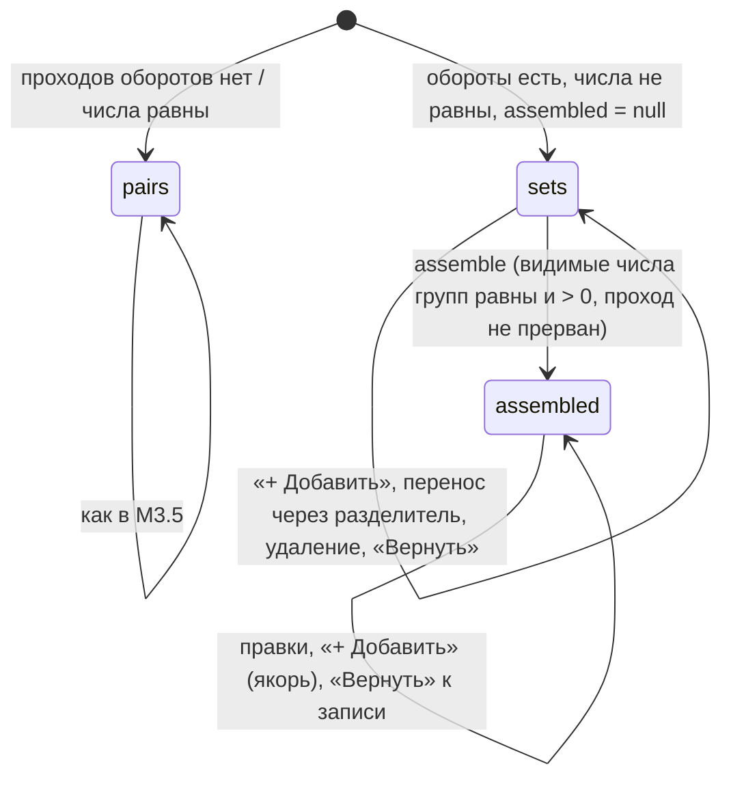
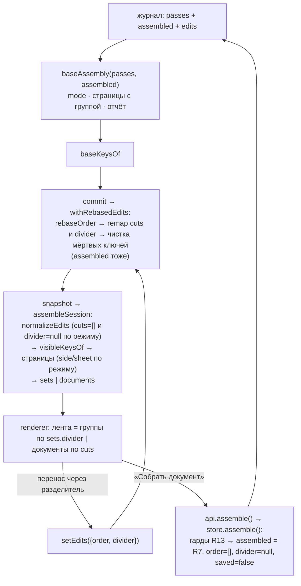

# feat: Несовпадение проходов — раздельные наборы (M3.6)

## Goal Capsule

- **Objective:** при несовпадении числа страниц в проходах пользователь видит два набора — лица
  и обороты в порядке будущего документа, — досканирует недостающее, уравнивает числа и
  собирает документ без перепутанных пар; после сборки редактор обычный, решение переживает
  перезапуск. При совпадении проходов ничего не меняется.
- **Means:** журнал v5 с записью сборки и границей наборов; одна функция базового порядка в
  ядре с тремя режимами (KTD1, KTD2); команда «Собрать документ» (KTD5); лента из двух групп по
  утверждённому handoff'у (KTD8).
- **Product authority:** origin — `docs/brainstorms/2026-10-19-m3-6-separate-sets-requirements.md`
  (R1–R24, F1–F4, AE1–AE11, Key Decisions с пометками `session-settled`); сверху — решения
  автора при планировании 2026-10-21 (Problem Frame). Спека `docs/duplexnt.md` и `CLAUDE.md` —
  неизменные правила.
- **Product Contract preservation:** changed: R2 — режим включается при любом состоянии
  прохода оборотов со страницами, не только `completed|accepted` (решение автора 2026-10-21;
  уточнение ревью: кроме идущего прохода `running`);
  R17 — модалка `mismatch` показывается, пока режим активен, в том числе при добавленных
  наборах; R18 — числа в тулбаре и причина недоступности «Собрать» — живые счётчики групп, не
  числа проходов. Остальные требования origin — без изменения смысла.
- **Stop conditions:** любое изменение, при котором исходники страниц правятся или сессия
  удаляется без явного действия; второй путь сохранения в обход гарда ядра; разрезы или имена
  документов до сборки; merge в `main` без явного ОК автора.
- **Execution profile:** ветка `feat/m3.6` от `main`; план, амендмент ADR и журнал вехи
  коммитятся на `main` до старта (прецедент M3.5); каждый юнит — зелёный коммит с U-ID; ревью
  (simplify + код-ревью) по парам сессий.
- **Tail ownership:** закрытие вехи — U8: доки-хвосты, CDP-смоук, ручной смоук на живом
  ET-3850, приёмка и merge по явному ОК.

---

## Product Contract

### Summary

Журнал поднимается до версии 5: на сессии появляется запись сборки — зафиксированная
последовательность ключей страниц, — а в правках граница наборов. Ядро получает одну функцию
базового порядка с тремя режимами — пары, раздельные наборы, собрано — и команду «Собрать
документ»; сохранение до сборки отказывает в ядре. Поверх — лента из двух групп с разделителем,
тулбар с живыми счётчиками и кнопкой «Собрать документ», честная модалка `mismatch`, «Проверка»
без пар и непарных, эмулятор со сценариями полного пути. Новый UI — по handoff'у, утверждённому
автором.

### Problem Frame

При несовпадении проходов приложение собирает документ по парам от начала прохода оборотов:
после первого пропущенного листа лицо одного листа встаёт рядом с оборотом другого, и вся лента
дальше неверна. Модалка `mismatch` только сообщает числа, пометка «не нашлось пары» стоит на
листах, посчитанных от начала, — не на том, которого нет. «Один лист · После текущей» (M3.5) в
такой ленте теряет смысл. Замечено автором на приёмке M3.5 (2026-10-09). Подробно — origin,
Problem Frame.

Развилки планирования сняты ответом автора 2026-10-21: режим раздельных наборов включается,
как только числа не сошлись, независимо от состояния прохода оборотов — при прерванном и не
принятом проходе лента уже показывает два набора под плашкой досканирования, а «Собрать» и
«+ Добавить» недоступны, пока проход прерван. Отклонены «пары до решения по плашке» (два
предиката и скачок ленты после «Оставить как есть»).

Исследование репозитория показало три стыка, которые план решает явно: `withRebasedEdits` и
сборка читают автопорядок из одной функции — после сборки её источником становится запись
журнала (KTD2); undo-стек редактора чистится по подписи ленты `tapeOf` — запись сборки входит
в подпись (KTD5); тест журнала «порядок сборки схемой не принимается» кодирует старое правило и
переписывается на амендмент ADR от 2026-10-19 (U1).

### Requirements

**Журнал и миграция**

- R1. Журнал v5 несёт на сессии `assembled` — зафиксированную последовательность ключей
  страниц или `null`, — и в `edits` поле `divider` — позицию границы наборов в видимой ленте или
  `null`; чтение v1–v4 цепочкой дефолтов (`assembled: null`, `divider: null`), запись — всегда
  v5, сверка переписывает старый файл; файл v6+ или с неизвестным полем — несовместимость (ADR
  0004, амендмент 2026-10-19; origin R22).
- R2. Миграции данных нет: релиза не было; сессия v4 с несовпадением после обновления
  открывается в режиме раздельных наборов, её `cuts` и `names` обнуляются нормализацией
  (KTD10).
- R3. Новая сессия (`newJournal`, сброс при `beginPass` на пустом журнале) начинает с
  `assembled: null` и `divider: null`.

**Базовый порядок и режимы (ядро)**

- R4. Режим сессии выводится ядром из снимка, отдельно не хранится: `assembled` — режим
  «собрано»; иначе есть проход оборотов со страницами и число его страниц не равно числу
  страниц прохода лиц — «раздельные наборы», при любом состоянии прохода оборотов, кроме
  идущего (`running`: числа меняются с каждой страницей, режим — «пары» до остановки прохода);
  иначе — «пары», как в M2–M3.5 (origin R1, R2 с уточнением автора).
- R5. В режиме раздельных наборов базовый порядок — страницы прохода лиц в порядке сканирования,
  затем страницы прохода оборотов в обратном порядке подачи; добавленные наборы встают по якорю
  (правило M3.5) и принадлежат группе якоря; якорь `null` или исчезнувший — в конец ленты, то
  есть в конец группы оборотов. Каждая страница несёт группу (origin R5, R7).
- R6. В режиме «собрано» базовый порядок — `assembled` без исчезнувших ключей; ключи, которых в
  записи нет: добавленный проход — по якорю (правило M3.5), страница досканированного сегмента
  прохода лиц или оборотов — сразу за предыдущей страницей своего прохода, иначе — в конец
  (origin R23).
- R7. Запись сборки строится ядром: чередование _лицо i, оборот i_ по видимым страницам групп в
  их текущем порядке, а каждая удалённая правкой страница — сразу после ближайшего видимого
  предшественника в полном порядке ленты (с удалёнными); группа удалённой — позиционная, как
  у видимых: по числу видимых перед ней против границы, а не по проходу; без предшественника —
  перед первой страницей последовательности (KTD4).
- R8. Правки нормализуются против базового порядка своего режима в одной точке хранилища
  (`commit` → `withRebasedEdits`): мёртвые ключи вычищаются из `order`, `deleted`, `rotations` и
  `assembled`; `cuts` и `names` в режиме раздельных наборов — как в пустых правках
  (`cuts: []`, `names: ['']` — схема требует имён на одно больше, чем разрезов); `divider` вне
  режима раздельных наборов — всегда `null`, в режиме — в пределах `[0, число видимых]` и `null`,
  когда равен автоматическому (KTD3).
- R9. При изменении состава ленты не через правку (досканирование, отброс сегмента, сверка)
  `divider` переезжает как разрез — остаётся перед той же страницей; ручной перенос его не
  тащит, а задаёт явно (KTD3, KTD8).
- R10. Отчёт сборки несёт `mode`, числа страниц проходов лиц и оборотов, состояние прохода
  оборотов, `backsDeclined` и в режиме раздельных наборов `groups` — видимые счётчики групп и
  позицию границы; поля `pairs`, `unpairedSheets`, `extraBacks` и признак `unpaired` страницы
  уходят вместе с экранами (U6), до того ядро отдаёт их рядом с `mode`/`groups`; `mismatch`
  равно «режим раздельных наборов» (origin R19).
- R11. До сборки страница несёт сторону по группе и номер по позиции в видимой группе от 1;
  после сборки — сторону и номер листа по позиции в видимом чередовании записи сборки;
  страницы добавленных наборов и удалённые на момент сборки — без номера листа; тег «об» и
  «Д1» — происхождение страницы, не группа (origin R20, R21; KTD9).

**Команда «Собрать документ» и сохранение**

- R12. Команда `assemble` без входа: ядро строит запись по R7 и одним атомарным коммитом пишет
  `assembled`, обнуляет `edits.order` и `edits.divider`, снимает `saved`; повороты, удаления —
  остаются (origin R3, R13).
- R13. Ядро отказывает: нет сессии — `noSession`; идёт проход — `passRunning`; идёт запись —
  `saving`; последний проход прерван — `passInterrupted`; режим не «раздельные наборы» —
  `notSeparate`; видимые числа групп не равны или равны нулю — `setsUnequal` (origin R11, R12,
  R15).
- R14. Сборка необратима: обратной команды нет; после неё удаление и перенос — обычные правки;
  undo-стек редактора при сборке очищается — запись сборки входит в подпись ленты (origin
  R15; KTD5).
- R15. «Вернуть» в любом режиме — пустые правки над базовым порядком своего режима: до сборки
  — группы в порядке R5, после — запись сборки с восстановлением удалённых на их местах (origin
  R9, R14).
- R16. Сохранение в режиме раздельных наборов отказывает в ядре — `notAssembled`, до любой
  записи файлов; «Сначала сохранить текущий» в `newscan` в этом режиме не предлагается, текст
  модалки говорит, что документ не собран (origin R4; KTD6).

**Редактор**

- R17. В режиме раздельных наборов лента — две группы «Лицевые стороны» и «Оборотные стороны» с
  видимыми счётчиками и разделителем с подсказкой о переносе; групп документов, полей имён,
  split-бара, «Выделить в документ» и «+ Новый документ с этой страницы» нет; «Документы в
  наборе» сообщает, что документы появятся после сборки (origin R10, R16).
- R18. Перенос через разделитель переносит страницу или выделение в другую группу; это правка
  порядка с явным `divider`, шаг undo и плашка «Есть ручные правки» как у любого переноса;
  перенос внутри группы не меняет группу (origin R8).
- R19. Тулбар в режиме раздельных наборов: по центру — живые счётчики групп («Проходы не
  сошлись: лицевых N, оборотных M»; при равенстве — «Наборы уравнены — соберите документ»);
  справа вместо «Сохранить» — «Собрать документ», недоступная с причиной в `title`: не хватает
  N оборотов или N лиц, наборы пусты, проход прерван, идёт запись, правка в полёте (origin R4,
  R11, R18 с уточнением автора).
- R20. Модалка `mismatch` показывается первым входом в `editor` за процесс, когда режим
  раздельных наборов активен и проход оборотов завершён или принят; при прерванном проходе —
  после решения по плашке; наличие добавленных наборов показ не отменяет; текст — числа
  проходов и три исхода (оборотов меньше, оборотов больше, проход принят коротким) с
  объяснением режима и шагами «+ Добавить» → поставить на место → «Собрать документ»; одна
  кнопка «Понятно» (origin R17 с уточнением).
- R21. Экран `merge` при несовпадении: ряд «документ» не рисуется, статусная строка говорит, что
  лица и обороты лежат отдельными наборами; пауза `merge` — как в M2 (origin F1).
- R22. «Проверка»: в режиме раздельных наборов — точка с видимыми счётчиками и тем, чего не
  хватает, и подсказка про «+ Добавить» и перенос; в режимах «пары» и «собрано» — галочка «Лица
  и обороты собраны: N листов» (N — число пар); без прохода оборотов — «Обороты не сканировали»
  (origin R19).
- R23. «Детали» до сборки: сторона по группе, позиция в группе, происхождение (проход лиц,
  проход оборотов, добавленный набор N); превью и подпись миниатюры — та же логика; после
  сборки — как сегодня, с номером листа по R11 (origin R20, R21).
- R24. «+ Добавить» в режиме раздельных наборов: модалка та же; «После текущей» — за текущей в
  её группе; «В конец документа» — в конец группы текущей страницы, подпись места и сводка
  называют группу; недоступность — как сегодня (origin R6, R7).
- R25. Тумблер 180° — свойство прохода оборотов: крутит страницы этого прохода в любой группе;
  страница другого прохода в группе оборотов с тумблером не поворачивается (origin Key
  Decision; R9).
- R26. Клавиатура: стрелки и Shift-диапазон работают сквозь разделитель как по одной ленте;
  разделитель и заголовки групп озвучены (`aria-label`); фокус не теряется при смене режима.

**Эмулятор, тесты, процесс**

- R27. Эмулятор получает именованные сценарии: недостающий оборот в середине, лишний оборот,
  обрыв прохода оборотов с несовпадением; интеграционный тест полного пути: несовпадение → два
  набора → «Добавить» → перенос через разделитель → «Собрать» → сохранение → перезапуск до и
  после сборки; существующие интеграционные сценарии несовпадения переписываются под новую
  семантику (origin R24).
- R28. CDP-смоук в `built` и `dev` проходит полный путь с настоящим перетаскиванием через
  разделитель; чеклист приёмки по шаблону.

### Key Decisions

Перенесены из origin с пометками `session-settled` (см. там Governs); здесь — только новое и
то, что уточнено при планировании:

**Режим раздельных наборов — при любом состоянии прохода оборотов со страницами.**
(session-settled: user-approved — chosen over «пары до решения по плашке досканирования»: два
предиката и скачок ленты после «Оставить как есть»; перепутанные пары не показываются никогда.)
Governs R4, R20.

**Числа в тулбаре и причина недоступности «Собрать» — живые счётчики групп.** Числа проходов
остаются в модалке `mismatch`; после «Д1» и удалений тулбар не врёт. Governs R19, R22.

**Миграции v4 нет.** Релиза не было (ADR 0004, амендмент о форме v1); dev-сессии автора с
несовпадением откроются как два набора. Governs R2.

### Key Flows

Origin F1–F4 действуют. Дополнительно:

- F5. Обрыв прохода оборотов
  - **Trigger:** замятие в проходе оборотов, 3 лица, 1 оборот получен.
  - **Steps:** `editor` с плашкой «проход прерван» → лента уже два набора (R4) → «Собрать» и
    «+ Добавить» недоступны (R13, R19) → «Оставить как есть» → модалка `mismatch` исход
    «принят коротким» (R20) → дальше как F1; «Досканировать остаток» → страницы встают в группу
    оборотов по R6 правилу сегмента (в режиме наборов — в конец блока прохода, то есть в начало
    отображаемой группы).
  - **Covers:** R4, R13, R19, R20.
- F6. Недостающий оборот первого листа
  - **Trigger:** пропущен оборот листа 1 — в группе оборотов он должен стоять первым.
  - **Steps:** «Один лист · После текущей» ставит лист за любой текущей → перенос в начало
    группы перетаскиванием (R18) → «Собрать». Вставки «в начало набора» в модалке нет —
    известное поведение, кандидат в бэклог.
  - **Covers:** R18, R24.

### Acceptance Examples

Origin AE1–AE11 действуют с уточнениями: AE1 — тулбар «Проходы не сошлись: лицевых 12,
оборотных 11», причина «Не хватает 1 оборота»; AE2 — тулбар «Наборы уравнены — соберите
документ»; AE7 — модалка показана один раз и при наличии «Д1»; AE8 — режим наборов и до
«Оставить как есть», с плашкой сверху. Дополнительно:

- AE12. Обрыв прохода оборотов
  - **Given:** 3 лица, проход оборотов прерван после первой страницы.
  - **When:** вход в `editor`.
  - **Then:** плашка «проход прерван», лента — «Лицевые · 3» и «Оборотные · 1», «Собрать» и
    «+ Добавить» недоступны с причиной про прерванный проход, модалки нет; после «Оставить как
    есть» — модалка «принят коротким», «+ Добавить» доступна. **Covers R4, R13, R19, R20.**
- AE13. Сессия v4 с несовпадением
  - **Given:** журнал v4, 12 лиц, 11 оборотов, разрез и имя документа в `edits`.
  - **When:** запуск.
  - **Then:** журнал переписан v5 с `assembled: null`, лента — два набора, разрезов и имён нет;
    правки порядка, поворотов и удалений живы. **Covers R1, R2, R8.**
- AE14. «Новое сканирование» до сборки
  - **Given:** AE1.
  - **When:** «↺ Новое сканирование».
  - **Then:** модалка `newscan` без карточки «Сначала сохранить текущий», текст про несобранный
    документ; «Остаться» возвращает в два набора. **Covers R16.**
- AE15. Сохранение в обход кнопки
  - **Given:** AE1, команда сохранения вызвана напрямую (тест службы).
  - **When:** `saveDocuments`.
  - **Then:** отказ `notAssembled`, файлов нет, `saved` не менялся. **Covers R16.**
- AE16. Перенос выделения через разделитель
  - **Given:** AE1, выделены два лица подряд.
  - **When:** перетаскивание в группу оборотов после оборота 3.
  - **Then:** «Лицевые · 10», «Оборотные · 13», порядок внутри выделения сохранён, один шаг
    undo, плашка правок; Ctrl+Z возвращает оба. **Covers R18.**
- AE17. Удалённая до сборки страница после «Вернуть»
  - **Given:** AE3, затем удалён оборот 2 и его «сосед» добавлен; «Собрать».
  - **When:** «Вернуть» → подтверждение.
  - **Then:** удалённый оборот вернулся на своё место между лицом 2 и лицом 3, а не в конец.
    **Covers R7, R15.**

### Scope Boundaries

Вне M3.6 (origin, без изменений): синтетическая пустая страница (M4); «Разобрать»; «собрать как
есть»; раскладка «два столбца»; выбор группы в модалке `add`; двусторонние добавленные наборы;
автосборка при равенстве без нажатия.

#### Deferred to Follow-Up Work

- **«В начало набора» в модалке `add`** — вставка перед первой страницей группы сейчас только
  перетаскиванием (F6). Бэклог «Входящие», если приёмка покажет, что случай частый.
- **Редизайн экрана `merge`** — бэклог «Доделки UI» уже содержит; здесь только текст статуса и
  скрытие ряда «документ» при несовпадении (R21).
- **Пометка «откуда страница» на миниатюре в группе** (лицо, перенесённое в обороты) — тег
  происхождения «об»/«Д1» есть; отдельная индикация «перенесена» — пост-MVP.
- **Нумерация статус-бара превью «7 из 24» до сборки** — сквозная, как сегодня; по группам —
  решить в моке, если автор попросит.

---

## Planning Contract

### Key Technical Decisions

- KTD1. **Журнал v5: `assembled` на сессии и `divider` в `edits`.** Форма — ADR 0004,
  амендмент 2026-10-19 (дополнен формой при планировании 2026-10-21; не дублируется).
  Схема: `assembled` — массив `pageKeySchema` без повторов или `null`; `divider` —
  целое ≥ 0 или `null`; `journalV4Schema` сохраняет свои `refine`, `upgradeToV5` добавляет
  дефолты, `parseJournal` получает ветку v4 перед v3. Тест «в журнале нет выводимого» (journal
  test) переписывается: запись сборки — решение пользователя, а не производное.
  (session-settled: user-approved — how-level выбор для решения origin «сборка записывает
  зафиксированную последовательность»; chosen over `assembled: {sequence, at}` и отдельной
  коллекции: одно поле, одна нормализация. Governs R1, R3, R12.)
- KTD2. **Одна функция базового порядка с тремя режимами.** `autoAssembly(passes)` становится
  `baseAssembly(passes, assembled)` и возвращает страницы с группой, `mode` и отчёт; `autoKeysOf`
  становится `baseKeysOf(passes, assembled)` — его читают `withRebasedEdits`, сверка и
  `assembleSession`. Предикат режима — R4, размещение по режимам — R5, R6. Отклонено: второй
  список порядка «по наборам» рядом с `edits.order` (два места, которые расходятся; ADR 0004,
  правило «нет выводимого»). Инвариант: три коммита по одному ключу дают то же, что один (тест
  M3.5 сохраняется и расширяется режимами).
- KTD3. **Граница наборов — позиционное поле `edits.divider`, как разрез.** `null` — авто:
  число видимых страниц группы лиц по базовому порядку; явное значение задаёт renderer при
  переносе через разделитель; `rebaseEdits` переносит его той же функцией, что `remapCuts`
  («перед той же страницей»), но без схлопывания — 0 и «все страницы» допустимы (группа из
  нуля видимых страниц существует); `normalizeEdits` приводит к `null` вне режима и при
  равенстве авто. «Вернуть» (`EMPTY_EDITS`) сбрасывает; `assemble` обнуляет. Отклонено:
  хранить принадлежность на странице (второе место рядом с порядком) и использовать `cuts[0]`
  (разрез схлопывает пустой документ и смешивает семантики).
- KTD4. **Состав записи сборки — R7.** Удалённые ключи в записи нужны, чтобы «Вернуть» и
  Ctrl+Z после сборки вернули страницу на место, а не в конец; номер листа и сторона считаются
  по позиции среди ключей, которые были видимы при сборке (R11): чётная позиция — лицо,
  нечётная — оборот, лист = позиция / 2 + 1; удалённые при сборке и новые ключи — без листа.
  Группа удалённой — позиционная (R7), поэтому функция получает границу:
  `frozenSequenceOf(baseKeys, edits, divider)`. Отклонено: писать только видимые (удалённая
  страница после «Вернуть» уезжала бы в конец).
- KTD5. **Команда `assemble` без входа по образцу `declineBacks`.** Служба: гарды `saving`,
  запуск — `store.assemble()` → `notify()`. Хранилище: гарды R13 в порядке перечисления, запись
  R12 одним `commit('must')`. Мост: `BridgeCommands.assemble` с `NoRequest`, канал
  `duplexnt:assemble`, `buildApi`, `handlers` через `withoutRequest`. Renderer зовёт
  `window.api.assemble()` напрямую из `EditorScreen` (как «Открыть папку»), не через `edit()`:
  сборка — не шаг undo; `tapeOf` в `state/history.ts` включает признак `assembled`, и
  `syncHistory` чистит стек сам. Новые причины `SESSION_CONFLICT_REASONS`: `notSeparate`,
  `setsUnequal`, `notAssembled`.
- KTD6. **Запрет сохранения — в ядре и в renderer.** `writeDocuments` отказывает `notAssembled`
  при `mode === 'sets'` до `nothingToSave`; renderer прячет «Сохранить» (R19) и карточку
  «Сначала сохранить текущий» в `newscan` (R16). Отклонено: только renderer — `saveThenNew` и
  любой будущий путь сохранили бы несобранное.
- KTD7. **Отчёт сборки и классификация — по `mode`.** `AssemblyReport` получает `mode:
'pairs' | 'sets' | 'assembled'` и `groups: {fronts, backs, divider} | null`; `pairs`,
  `unpairedSheets`, `extraBacks` и `AssembledPage.unpaired` удаляются в U6 вместе с экранами
  (до того ядро считает их как сегодня, чтобы каждый юнит был зелёным); `mismatch = mode ===
'sets'`. `assemblyOutcome` ветвится по `backsDeclined` → `backsState === 'accepted'` →
  `mode === 'sets'` (`fewer`/`extra` по числам проходов) → `ok`; `mismatchDue(report)` = `mode
=== 'sets'` и `backsState ∈ {completed, accepted}` — без условия про добавленные наборы (R20);
  `assemblyLanded` без изменений.
- KTD8. **Лента в режиме наборов — те же `visible`, DnD и `moved()`.** Группы — срез `visible`
  по `sets.divider`; разделитель — отдельный узел-цель дропа между группами (та же логика
  «половина по `clientX`», тот же MIME `application/x-duplexnt-pages`, тот же `dragend`);
  после `moved()` helper `dividerAfterMove(visible, divider, keys, index)` считает новый
  `divider`, и `setEdits` уходит с `order` и `divider` одним шагом. Дроп на разделитель и
  перенос крайней страницы в соседнюю группу порядок не меняют (`moved()` счёл бы их no-op),
  поэтому это отдельный жест `movedAcross(keys, side)`: только `divider`. Смешанное выделение
  из обеих групп: все перенесённые берут группу по месту дропа; новая граница = старая −
  перенесённых из лиц + все перенесённые, если дроп в группу лиц. Разрезы, имена и «Выделить в
  документ» — за отдельным флагом `documentsEditable` (`mode !== 'sets'`); `editable` и DnD
  без изменений (флаг включает `draggable`); `starts` не используется. Зеркало `assembly-fixture.ts`
  и табличный guard-тест получают режимы в том же юните, что ядро.
- KTD9. **Подписи до сборки — через `state/page-text.ts`.** `whatOf`/`noteOf`/`thumbLabelOf`
  читают `mode`: в режиме наборов — «лицевая, 3-я в наборе лиц», «оборотная, 4-я в наборе
  оборотов», «добавленный набор 1, в наборе оборотов»; теги «об»/«Д1» — происхождение (R11).
  Сводка `add` берёт те же тексты, поэтому «после стр. 7 (оборот листа 0)» невозможно.
- KTD10. **Миграции нет; v4 → дефолты.** `upgradeToV5` ставит `assembled: null`, `divider:
null`; сессия с несовпадением оказывается в режиме наборов, `cuts`/`names` обнуляет
  нормализация R8. Довод — ADR 0004: до первого выпуска формат меняется без миграции.
- KTD11. **Якорь «В конец документа» в режиме наборов — конец группы текущей.** `anchorsOf`
  получает вместо среза документа срез группы (`sets`), подпись места — `add.place.setEnd`;
  «После текущей» без изменений (KTD8 M3.5). Якорь ядро валидирует как раньше.

### High-Level Technical Design

Режимы сессии и переходы (предикат R4 считает ядро на каждом снимке):

Базовый порядок и правки — один путь для трёх режимов:

Пример. Лица `1л 2л 3л`, обороты по подаче `3о 1о` (пропущен `2о`): режим наборов, лента
`1л 2л 3л | 1о 3о`, `groups = {3, 2, divider: 3}`. «Один лист · После текущей» при текущей `1о`
→ `Д1.1` встаёт за `1о`: `1л 2л 3л | 1о Д1.1 3о`, числа 3 / 3. Пользователь удалил `3л` и
добавил новый лист `Д2.1` за `2л`: `1л 2л Д2.1 [3л] | 1о Д1.1 3о`. «Собрать» → запись
`1л 1о 2л Д1.1 Д2.1 3л 3о` (удалённый `3л` — сразу за своим видимым предшественником по
группе, `Д2.1`), `deleted = [3л]`; лента `1л 1о 2л Д1.1 Д2.1 3о`, листы 1–3 по позициям,
`Д1.1` — «оборот листа 2», `Д2.1` — «лицо листа 3». «Вернуть» снимает удаление — лента
`1л 1о 2л Д1.1 Д2.1 3л 3о`: `3л` вернулся между `Д2.1` и `3о`, а не в конец; номера листов
считаются по видимому при сборке чередованию, поэтому `3л` остаётся «без листа».

Инварианты: каждая живая страница в ленте ровно один раз в любом режиме; `assembled`, `order`,
`deleted`, `rotations` не содержат мёртвых ключей после любого коммита; в режиме наборов `cuts`
пусты; вне режима наборов `divider` равен `null`; три коммита по одному ключу = один коммит.

### Assumptions

- Реальный ET-3850 при обрыве прохода оборотов и досканировании остатка ведёт себя как в M2
  (проверено на живом сканере); новых проверок на железе веха не требует, кроме смоука полного
  пути.
- Сессии v4 есть только у автора (релиза не было); правило R2 принято им.

---

## Implementation Units

### U1. Журнал версии 5: запись сборки и граница наборов

- **Goal:** журнал умеет хранить `assembled` и `edits.divider`, читать v1–v4, отказывать v6+.
- **Requirements:** R1, R2, R3; KTD1, KTD10.
- **Dependencies:** нет.
- **Files:** `src/core/storage/journal.ts`, `src/core/storage/edits-schema.ts`,
  `src/core/storage/session-store.ts` (сброс в `beginPass`, `newJournal`), `src/shared/snapshot.ts`
  (`SessionSnapshot.assembled`), `src/shared/edits.ts` (`SessionEdits.divider`, `sameEdits`
  сравнивает `divider`, `EMPTY_EDITS`), `test/support/session-store.ts` и все
  литералы `Journal`/`JournalPass` в тестах (`journal.test.ts`, `reconcile.test.ts`,
  `session-store.*.test.ts`), `docs/decisions/0004-data-model.md` (форма — уже дописана при
  планировании; при расхождении правится в этом юните), `docs/solutions/0006-m3-6-separate-sets.md`
  (завести по шаблону).
- **Approach:**
  1. `journalV4Schema` = нынешняя схема с `version: 4`, её `refine` и схемой правок v4 без
     `divider` (`editsV4Schema`, промежуточный тип `JournalV4`); текущая схема — v4-поля +
     `assembled` + `edits` с `divider` (`editsSchemaOf` получает поле; `EMPTY_EDITS` —
     `divider: null`; `sameEdits` сравнивает `divider`).
  2. `upgradeToV5`, ветка v4 в `parseJournal`, `JOURNAL_VERSION = 5`, `newJournal` и сброс на
     пустом журнале в `beginPass` — дефолты.
  3. Схема отвергает повторы ключей в `assembled` и отрицательный `divider`; `assembled` при
     `kind`-проверках не участвует.
  4. Переписать тест «порядок сборки схемой не принимается» на «запись сборки принимается как
     решение, выводимые поля — нет» со ссылкой на амендмент 2026-10-19.
- **Patterns to follow:** цепочка `upgradeToV2/3/4` и тесты «чтение прежних версий»
  (`journal.test.ts`); `reconcile.test.ts` — «старый файл переписан текущей версией».
- **Test scenarios:**
  - v4-файл → читается, `assembled: null`, `divider: null`, запись — v5.
  - v1, v2, v3 → цепочка до v5 с теми же дефолтами.
  - Маркер v6 → несовместимость `newerVersion`; v5 с неизвестным полем → `unknownField`.
  - v4-файл с полем `assembled` → ошибка схемы (поле есть только в v5).
  - `assembled` с повтором ключа или `divider: -1` → ошибка схемы.
  - Сверка: v4 на диске → переписан v5; повторная сверка ничего не меняет (идемпотентность).
  - `beginPass` на пустом журнале сбрасывает `assembled` и `divider`.
- **Verification:** typecheck + lint + test зелёные; все тестовые литералы журнала собраны с
  новыми полями; коммит `feat(m3.6): U1 …`.

### U2. Ядро: базовый порядок с тремя режимами, запись сборки, нормализация

- **Goal:** `baseAssembly` считает режим, группы, запись сборки и отчёт; правки нормализуются
  и перебазируются по режиму; зеркало renderer совпадает с ядром.
- **Requirements:** R4–R11, R15; KTD2, KTD3, KTD4, KTD7.
- **Dependencies:** U1.
- **Files:** `src/core/scan/assembly.ts`, `src/core/scan/edits.ts`,
  `src/core/storage/session-store.ts` (`withRebasedEdits`), `src/core/storage/reconcile.ts`,
  `src/shared/snapshot.ts` (`AssemblyReport.mode/groups`, `SessionAssembly.sets`; старые поля
  `unpaired`, `pairs`, `unpairedSheets`, `extraBacks` остаются до U6),
  `src/renderer/src/state/assembly-fixture.ts`,
  `test/guards/assembly-fixture.test.ts`; тесты рядом (`assembly.test.ts`, `edits.test.ts` —
  при касании делятся по `describe`, правило размера).
- **Approach:**
  1. `baseAssembly(passes, assembled)`: предикат R4; ветка «наборы» — R5 с группой на странице;
     ветка «собрано» — R6; ветка «пары» — как сегодня. `AutoPage` получает `group`.
  2. `frozenSequenceOf(baseKeys, edits, divider)` — чистая функция R7 (чередование видимых +
     удалённые за предшественником, группа удалённой — позиционная); живёт в `assembly.ts`,
     зовётся хранилищем в U3.
  3. `normalizeEdits(baseKeys, edits, mode, autoDivider)`: `cuts: []`, `names: ['']` в режиме
     наборов; `divider` по KTD3 (авто-граница передаётся числом видимых лиц); `rebaseEdits`
     переносит `divider` функцией `remapCuts` без схлопывания; `assembled` чистится от мёртвых
     ключей в `withRebasedEdits` **до** раннего выхода при пустых правках (сигнатура
     `baseKeysOf(passes, assembled)`).
  4. `assembleSession`: `sets` (видимые счётчики и позиция границы) в режиме наборов, иначе
     `documents`; `side`/`sheet` по R11; `report.mode/groups`; `mismatch = mode === 'sets'`.
  5. Зеркало `assemblyOf` и таблица guard-теста получают случаи режимов (наборы с «Д1» в
     группе, собрано с удалёнными, новые ключи после сборки).
- **Patterns to follow:** табличные тесты размещения M3.5 (`assembly.test.ts`), `rebaseOrder`
  и `remapCuts` (`edits.ts`), инвариант «три коммита = один».
- **Test scenarios:**
  - Covers AE1. 12/11 → `mode: 'sets'`, лента лица + обороты в обратном порядке, `groups
{12, 11, divider: 12}`, `mismatch: true`.
  - 12/12 → `mode: 'pairs'`, лента как в M3.5 (регресс по фикстурам M2).
  - Обороты прерваны, не приняты, 3/1 → `mode: 'sets'`; `backsDeclined` → `'pairs'`; проход
    оборотов идёт (`running`), 3/1 → `'pairs'`.
  - Covers AE2. «Д1» с якорем в группе оборотов → в группе оборотов, `groups {12, 12}`; якорь
    `null` и якорь исчез → конец группы оборотов; якорь — лицо → группа лиц.
  - Досканированный сегмент прохода оборотов в режиме наборов → в конец блока прохода (начало
    отображаемой группы).
  - `divider`: `null` = число видимых лиц; явный 0 и «все страницы» допустимы; значение,
    равное авто, нормализуется в `null`; вне режима наборов — `null`; при новой странице
    остаётся перед той же страницей; при удалении якоря границы — перед следующей живой.
  - В режиме наборов `cuts: [1]`, `names: ['a','b']` → после нормализации `cuts: []`,
    `names: ['']` (запись проходит схему правок).
  - Удалённая страница, перенесённая через границу до удаления, в записи сборки идёт по
    позиции (за предшественником из новой группы), а не по проходу.
  - Covers AE4. Запись сборки: пример из HTD целиком — чередование, удалённый за
    предшественником, удалённый без предшественника — перед первой.
  - Covers AE17. Режим «собрано»: лента из записи; `deleted` снят → страница на своём месте;
    мёртвый ключ в `assembled` вычищен коммитом; новый `added` после сборки — по якорю; ключ
    сегмента — за предыдущей страницей своего прохода; неизвестный — в конец.
  - `side`/`sheet` по R11 в трёх режимах, в том числе «Д1» в группе и страница без листа.
  - Три коммита по одному ключу = один (режим наборов и режим «собрано»).
  - Зеркало против ядра на всей таблице, включая новые режимы.
- **Verification:** typecheck + lint + test зелёные (старые поля отчёта живут до U6); коммит
  `feat(m3.6): U2 …`.

### U3. Команда «Собрать документ», гарды и запрет сохранения

- **Goal:** `assemble` проходит от renderer до журнала; сохранение до сборки отказывает в ядре.
- **Requirements:** R12, R13, R14 (ядро), R16 (ядро); KTD5, KTD6.
- **Dependencies:** U2.
- **Files:** `src/core/storage/session-store.ts`, `src/core/scan/pass-service.ts`,
  `src/core/commands/{schemas,handlers}.ts`, `src/shared/bridge.ts`, `src/shared/errors.ts`,
  `src/preload/api.ts`, `locales/ru/common.json` (тексты причин, если нужны вне
  `sessionConflict`); тесты рядом (`session-store.*.test.ts`, `pass-service.test.ts`,
  `handlers.test.ts`, `api.test.ts`, `bridge.test.ts` — «ровно каналы контракта»).
- **Approach:**
  1. Причины `notSeparate`, `setsUnequal`, `notAssembled` в `SESSION_CONFLICT_REASONS`.
  2. `store.assemble()`: гарды R13 → `frozenSequenceOf` → `commit({...journal, assembled,
edits: {...edits, order: [], divider: null}, saved: false}, 'must')`.
  3. `service.assemble()`: `refusedSave`-подобный гард `saving`, затем хранилище, `notify()`.
  4. `writeDocuments`: `conflict('notAssembled')` при `mode === 'sets'`.
  5. Мост: `BridgeCommands.assemble`, канал, `buildApi`, `handlers` — по образцу `declineBacks`.
- **Patterns to follow:** `declineBacks` (хранилище и служба), `markSaved` (гард по `revision`),
  `openSaveFolder` (команда без входа в M3.5).
- **Test scenarios:**
  - Covers AE4. 12/12 после «Д1» → `assemble` пишет запись, `order` и `divider` пусты, `saved:
false`, `rotations`/`deleted` целы; повторный `assemble` → `notSeparate`.
  - 12/11 → `setsUnequal`; 0/0 видимых (всё удалено) → `setsUnequal`; режим пар → `notSeparate`;
    нет сессии → `noSession`; идёт проход → `passRunning`; последний проход прерван →
    `passInterrupted`; идёт запись → `saving`.
  - Запись атомарна: журнал на диске — temp → rename (как у `commit`), откат при ошибке записи
    не трогает прежний журнал.
  - Covers AE15. `writeDocuments` в режиме наборов → `notAssembled`, файлов нет; после сборки —
    пишет; в режиме пар — как раньше.
  - Covers AE7. Перезапуск службы до сборки → `mode: 'sets'`, `divider` жив; после сборки →
    `mode: 'assembled'`, запись жива.
  - `buildApi` знает `assemble`; мост регистрирует новый канал; схема отвергает тело запроса.
- **Verification:** typecheck + lint + test зелёные; коммит `feat(m3.6): U3 …`.

### U4. Handoff состояний M3.6 и утверждение автора

- **Goal:** мок и handoff закрывают все новые состояния редактора; автор утвердил.
- **Requirements:** R17–R26 (форма и Copy), R28 (чеклист — заготовка).
- **Dependencies:** U2 (термины отчёта), не блокирует U3.
- **Files:** `docs/design/handoffs/2026-10-m3-6-states.md` (по `docs/templates/handoff.md` и
  образцу `2026-10-m3-5-states.md`), при необходимости мок в `docs/design/mock/`.
- **Approach:** разделы Placement / Anatomy / Tokens / CSS / States / Behaviour / Copy /
  Decisions / «Известное поведение». Состояния: группы ленты с заголовками и счётчиками;
  разделитель как цель дропа с подсказкой; тулбар режима (два текста центра, кнопка «Собрать
  документ» и шесть причин недоступности); пустая группа (заголовок «· 0» и видимая зона
  дропа — иначе последнюю страницу не перенести); модалка `mismatch` — три исхода с новым
  текстом;
  статус `merge` без ряда «документ»; «Проверка» (точка со счётчиками и подсказкой; галочка
  «собраны: N листов»); «Детали» до сборки; подпись миниатюры и превью по группе; сводка и
  подпись места в `add` («В конец набора»); `newscan` без «Сначала сохранить»; плашка
  прерванного прохода поверх двух наборов. «Клавиатура и доступность»: `aria-label`
  разделителя и заголовков, порядок Tab, стрелки сквозь разделитель, фокус после смены
  режима. «Известное поведение»: вставка в начало группы — переносом (F6); undo-стек очищается
  сборкой; dev-сессии v4 открываются как два набора; «Односторонние листы» в группу оборотов
  встают в порядке подачи, а группа показана в обратном. Copy без «пачки» и «стопки». Дырки
  мока закрывает dev-агент сам (прецедент M2–M3.5).
- **Patterns to follow:** `docs/design/handoffs/2026-10-m3-5-states.md`, `UI_SPEC.md` §6, §7.5,
  `DESIGN_SYSTEM.md`.
- **Test scenarios:** `Test expectation: none -- документ`.
- **Verification:** явное «утверждаю» автора; коммит `feat(m3.6): U4 …`.

### U5. Renderer: состояние, классификация, история, тексты

- **Goal:** renderer читает режим из отчёта, чистит историю при сборке, формирует подписи и
  якоря; App показывает модалку по новому предикату.
- **Requirements:** R14 (undo), R20 (предикат), R23 (тексты), R24 (якорь); KTD5, KTD7, KTD9,
  KTD11.
- **Dependencies:** U2, U3.
- **Files:** `src/renderer/src/state/{assembly-outcome,history,page-text,edits,screen}.ts`,
  `src/renderer/src/App.tsx`, `src/renderer/src/modals/AddModal.tsx` (`anchorsOf` по группе),
  `src/renderer/src/modals/NewScanModal.tsx` (вид без «Сначала сохранить»),
  `locales/ru/common.json`; тесты рядом (`App.test.tsx` — при касании по `describe`;
  `assembly-outcome.test.ts`, `history.test.ts`, `page-text.test.ts`, `AddModal.test.tsx`,
  `NewScanModal.test.tsx`).
- **Approach:**
  1. `assemblyOutcome(report)` и `mismatchDue(report)` — по KTD7; `rolesOf` в `mismatchDue`
     больше не нужен.
  2. `tapeOf(session)` — добавить признак `assembled` (например суффикс `|assembled`).
  3. `state/edits.ts`: `dividerAfterMove(visible, divider, keys, index)` по правилу KTD8
     (смешанное выделение: группа по месту дропа); `EditState` несёт `divider` внутри `edits`
     (ничего нового в `REVERTED`).
  4. `page-text.ts`: тексты по режиму (KTD9); `AddModal.anchorsOf` — срез группы (KTD11).
  5. `NewScanModal`: при `mode === 'sets'` карточка «Сначала сохранить» скрыта, текст про
     несобранный документ.
  6. Локаль: ключи `editor.sets.*`, `editor.assemble`, `editor.assembleDisabled.*`,
     `inspector.check.sets*`, `inspector.check.assembled_*`, `mismatch.*` (новые тексты),
     `merge.status.*`, `add.place.setEnd`, `add.summary.setEnd`, `newscan.*`; убрать
     `thumb.unpaired*`, `inspector.check.pairs*`.
- **Patterns to follow:** `assembly-outcome.ts` (единая классификация), `history.ts`
  (`syncHistory`), M3.5 KTD-7 (намерение запуска в App).
- **Test scenarios:**
  - `assemblyOutcome`: `sets` + оборотов меньше → `fewer`; больше → `extra`; `accepted` →
    `accepted`; `assembled` → `ok`; `backsDeclined` → `frontsOnly`.
  - Covers AE7. `mismatchDue`: `sets` + `completed` и «Д1» в сессии → `true`; `sets` +
    `interrupted` → `false`; `assembled` → `false`; `pairs` → `false`.
  - App: модалка один раз за процесс в режиме наборов, снова после сброса подтверждения;
    после сборки — нет; под StrictMode один показ.
  - Covers AE4. `tapeOf` до и после сборки различается → история пуста после сборки; обычная
    правка историю не чистит.
  - `dividerAfterMove`: лицо в обороты → −1; оборот в лица → +1; внутри группы → без
    изменений; выделение из двух через разделитель → ±2; дроп на сам разделитель — по стороне.
  - `page-text`: режим наборов — «3-я в наборе лиц», «Д1 в наборе оборотов»; собрано — «оборот
    листа 2»; страница без листа — без «листа 0».
  - `anchorsOf` в режиме наборов: «В конец документа» = последняя видимая страница группы
    текущей; сводка называет группу.
  - Covers AE14. `NewScanModal` в режиме наборов без карточки «Сначала сохранить».
  - Смоук локали «пачк|стопк» на новых текстах.
- **Verification:** typecheck + lint + test зелёные; коммит `feat(m3.6): U5 …`.

### U6. Экраны: лента из двух групп, тулбар, инспектор, модалки

- **Goal:** редактор в режиме наборов по handoff'у; `merge` и `mismatch` с новыми текстами.
- **Requirements:** R17–R26; KTD8, KTD9.
- **Dependencies:** U4 (утверждён), U5.
- **Files:** `src/renderer/src/screens/{EditorScreen,EditorRail,EditorThumb,EditorPreview,
EditorInspector,MergeScreen}.tsx`, `src/renderer/src/modals/MismatchModal.tsx`,
  `src/renderer/src/styles/base.css`, `locales/ru/common.json`; тесты:
  `EditorScreen.sets.test.tsx` (новый файл — режим наборов), правки в `EditorScreen.test.tsx`
  (снять S6 «точка непарного», добавить «„Собрать“ отсутствует при совпавших проходах»),
  `EditorScreen.dnd.test.tsx` (перенос через разделитель с фикстурой `dragOver`),
  `MergeScreen.test.tsx`, `MismatchModal.test.tsx`, `EditorInspector.test.tsx`.
- **Approach:**
  1. `EditorRail`: при `sets !== null` группы из среза `visible` по `divider`; заголовки и
     счётчики; разделитель — узел с `role`/`aria-label`, цель дропа; разрезы, имена и
     «Выделить в документ» — за `documentsEditable`, `editable` и `draggable` без изменений;
     DnD через те же `latest.current.start/over` и `dragend`; после `moved()` —
     `dividerAfterMove` → `setEdits({order, divider})` одним шагом; дроп на разделитель и
     перенос крайней страницы в соседнюю группу — `movedAcross(keys, side)`, только `divider`
     (KTD8). Пустая группа — заголовок «· 0» и зона дропа.
     1а. Снять старые поля отчёта: `unpaired`, `pairs`, `unpairedSheets`, `extraBacks` уходят из
     `snapshot.ts`, ядра, зеркала и экранов; `grep` по ним в `src/` пуст (гейт).
  2. `EditorThumb`: без `unpaired`; подпись стороны по группе; теги без изменений.
  3. `EditorScreen`: центр тулбара по режиму (R19), первичная кнопка — «Собрать документ» с
     `assembleDisabledReason` по образцу `addDisabledReason`, клик → `window.api.assemble()`;
     «+ Добавить» — гейтинг как сегодня; панель выделения без «Выделить в документ» в режиме
     наборов; статус-бар превью без изменений.
  4. `EditorInspector`: «Проверка» (R22; «собраны: N листов», N = min(лиц, оборотов)),
     «Детали» (R23), «Документы в наборе» (R17).
  5. `MergeScreen`: без ряда «документ» при `mode === 'sets'`, статус по R21.
  6. `MismatchModal`: тексты трёх исходов по handoff'у; одна кнопка.
  7. CSS: группы и разделитель — классы по образцу `.doc-group*`, токены без правок.
- **Patterns to follow:** `EditorRail` группы документов и DnD (M3, KTD-3/10), гейтинг
  `addDisabledReason` (M3.5), фикстура `dragOver` (jsdom).
- **Test scenarios:**
  - Covers AE1. 12/11 → две группы с заголовками и счётчиками, разделитель, нет полей имён и
    split-бара; тулбар с текстом и недоступной кнопкой с причиной «Не хватает 1 оборота»;
    «Документы в наборе» — «появятся после сборки».
  - Covers AE10. 12/12 → кнопки «Собрать» нет, лента как в M3.5, «Проверка» — галочка
    «собраны: 12 листов».
  - Covers AE3 / AE16. Перенос лица через разделитель → `setEdits` с `order` и `divider`;
    счётчики обновились; выделение из двух; клавиатурный обход сквозь разделитель.
  - Covers AE9. 3/4 → причина «Не хватает 1 лица»; после удаления лишнего оборота кнопка
    доступна.
  - Covers AE2. После «Д1» в группе оборотов тулбар «Наборы уравнены — соберите документ»,
    кнопка доступна; клик зовёт `api.assemble` один раз под StrictMode; `busy`/`saving`/прерванный
    проход → недоступна с причиной.
  - Covers AE12. Плашка прерванного прохода над двумя группами; «+ Добавить» и «Собрать»
    недоступны с причиной про прерванный проход.
  - `MismatchModal` три исхода с новым текстом без названного листа; `MergeScreen` без ряда
    «документ» при несовпадении и с рядом при совпадении.
  - «Детали» и подпись миниатюры до сборки; тумблер 180° крутит страницу прохода оборотов,
    перенесённую в группу лиц, и не крутит «Д1» в группе оборотов (R25).
  - Фокус: после сборки фокус на текущей миниатюре; `aria-label` разделителя и заголовков.
- **Verification:** typecheck + lint + test зелёные; jsdom-файлы < 1000 строк; ни одного
  чтения `unpairedSheets`, `extraBacks`, `pairs`, `unpaired` в `src/` (grep — пункт гейта);
  коммит `feat(m3.6): U6 …`.

### U7. Интеграция: эмулятор, полный путь, CDP-смоук

- **Goal:** полный путь вехи проходит на эмуляторе в тестах и в собранном приложении.
- **Requirements:** R27, R28; AE1–AE17 в интеграции.
- **Dependencies:** U3, U6.
- **Files:** `test/emulator/scenarios.ts` (`separate-sets-missing` `[[1,2,3],[6,4],[5]]`,
  `separate-sets-extra` `[[1,2],[6,5,4]]`, `separate-sets-jam` — замятие во втором лотке),
  `test/integration/separate-sets.emulator.test.ts` (новый), правки
  `test/integration/two-pass.emulator.test.ts` (AE3, AE4, AE9 → режим наборов) и
  `test/integration/add-pages.emulator.test.ts` (AE1, AE3, AE5, AE11 → группа якоря вместо
  чередования), `temp/smoke-m3-6.mjs` (вне git, по образцу `smoke-m3-5.mjs`),
  `docs/output/<дата>-smoke-checklist-m3-6-acceptance.md` (вне git).
- **Approach:** интеграция через `connect`/`keysOf`/`journalOnDisk` из `test/support`;
  `expectAssembledFixtures` сравнивает PDF-порядок после сборки с фикстурами `1,4,2,5,3,6`.
  CDP-смоук: `built` и `dev`, изолированный `DUPLEXNT_USER_DATA`, подмена `shell.openPath` и
  диалогов через inspector, настоящий drag через `Input.setInterceptDrags` +
  `dispatchDragEvent`, ошибки консоли валят прогон, проверка перезапуска до и после сборки.
- **Patterns to follow:** `add-pages.emulator.test.ts` (перезапуск службы, якорь жив),
  `docs/solutions/0005` (грабли CDP).
- **Test scenarios:**
  - Covers F1 / AE1–AE4, AE11. Полный путь: 3/2 → режим наборов → «Один лист · После
    текущей» (текущая — оборот 1) → группа 3/3 → перенос страницы через разделитель и обратно →
    «Собрать» → PDF `1,4,2,5,3,6` → `saved` после записи.
  - Covers AE7. Перезапуск службы до сборки — `divider` и правки живы, модалка «уместна»; после
    сборки — запись жива, модалка нет.
  - Covers AE9. Лишний оборот → удаление → «Собрать» → 2 листа.
  - Covers AE12. Замятие в проходе оборотов → режим наборов с прерванным проходом → `reload` →
    досканирование остатка → страницы в группе оборотов → «Собрать».
  - Covers AE5 / AE6. Правки после сборки — обычные; «Вернуть» — к записи.
  - Covers AE13. Журнал v4 с несовпадением и разрезами (фикстура) → v5, режим наборов, разрезов
    нет.
  - «Остановить» на первом листе добавленного прохода в режиме наборов → лента и `divider`
    прежние.
  - CDP: кнопка недоступна → добавление → drag через разделитель → «Собрать» → сохранение →
    перезапуск → обычный редактор; в `built` и `dev`.
- **Verification:** `test:all` зелёный; CDP-смоук пройден в обоих режимах; коммит
  `feat(m3.6): U7 …`.

### U8. Доки и закрытие вехи

- **Goal:** спека, UI_SPEC, роадмап, бэклог и журнал вехи отражают M3.6; приёмка и merge по
  явному ОК.
- **Requirements:** хвосты origin «Dependencies / Assumptions».
- **Dependencies:** U7.
- **Files:** `docs/design/UI_SPEC.md` (§5 статус `merge`; §6.1 тулбар режима; §6.2 группы,
  разделитель, снять пометку непарного; §6.4 «Проверка», «Детали», «Документы в наборе»; §6.8
  undo при сборке; §7.2 «В конец набора»; §7.4 `newscan` без «Сначала сохранить»; §7.5 новый
  текст и предикат; §11 дырки), `docs/duplexnt.md` («Сканирование в два прохода» — пункт о
  несовпадении; «Добавление к документу» — группа якоря; стадия), `docs/roadmap.md` (M3.6 ✅,
  формулировка про «Д1» и перенос), `docs/backlog.md` («В начало набора», индикация
  «перенесена», пометка про редизайн `merge`), `docs/solutions/0006-m3-6-separate-sets.md`
  (закрытие), `docs/decisions/0004-data-model.md` (если форма разошлась с реализацией).
- **Approach:** по CLAUDE.md «Закрытие вехи»: DoD зелёный, доки в ту же ветку, остановка на
  точке приёмки (ручной смоук на живом ET-3850 и упакованном приложении, `node
scripts/privacy-guard.ts`), merge `feat/m3.6` → `main` только после явного ОК отдельным
  вопросом.
- **Test scenarios:** `Test expectation: none -- доки`.
- **Verification:** веха зелёная целиком, приёмка пройдена; коммит `docs(m3.6): U8 …`.

## План по сессиям

| Сессия | Юниты  | Граница                                                                                  |
| ------ | ------ | ---------------------------------------------------------------------------------------- |
| 1      | U1–U2  | журнал v5 и базовый порядок трёх режимов в ядре; `test:all` зелёный; журнал вехи заведён |
| 2      | U3, U4 | команда, гарды, мост; handoff утверждён автором                                          |
| 3      | U5–U6  | renderer: состояние, тексты, лента с группами, тулбар, модалки; jsdom зелёный            |
| 4      | U7     | эмулятор, интеграция, CDP-смоук в `built` и `dev`                                        |
| 5      | U8     | доки, приёмка на живом ET-3850, merge по явному ОК                                       |

Каждая сессия кончается зелёным коммитом с U-ID в теме; возобновление — `git log` + журнал
вехи. Ревью (simplify + код-ревью) — по парам сессий, как в M3.5.

---

## System-Wide Impact

- **Форматы:** журнал v5; файл v1–v4 переписывается при первой сверке — отката на старую
  сборку после этого нет (релиза не было).
- **Shared-типы:** `SessionSnapshot.assembled`, `SessionEdits.divider`, `AssemblyReport.mode/
groups`, `SessionAssembly.sets`, удаление `unpaired`/`pairs`/`unpairedSheets`/`extraBacks`,
  команда `assemble` — typecheck ведёт по всем потребителям (`MergeScreen`, `EditorThumb`,
  `EditorInspector`, фикстуры, тесты).
- **Поведение M2/M3.5:** сборка по парам при несовпадении, пометка непарного листа, строка «Пар
  N из M», условие «модалка не показывается при добавленных наборах» — уходят; спека и UI_SPEC
  правятся в U8.
- **Локаль:** новые ключи с плурализацией («оборота/оборотов», «лица/лиц», «листов»); убраны
  `thumb.unpaired*`, `inspector.check.pairs*`; смоук «пачк|стопк».
- **Эмулятор и смоук:** три новых сценария; CDP-смоук с настоящим drag.

## Risks & Dependencies

- **Два источника автопорядка** (`autoKeysOf` в хранилище и сборка) → при расхождении разрезы и
  `divider` съезжают. Де-риск: одна функция `baseKeysOf` (KTD2), тест «три коммита = один» в
  трёх режимах (U2).
- **Undo после сборки шлёт старый `order`** → лента перемешается. Де-риск: `tapeOf` с признаком
  сборки (KTD5), тест App/history (U5), интеграционный «Ctrl+Z после сборки» (U7).
- **Старые интеграционные тесты несовпадения** кодируют пары «от начала» → переписываются
  осознанно в U7, не удаляются; фикстурный порядок `1,4,2,5,3,6` остаётся эталоном.
- **DnD в jsdom** без `DragEvent` → фикстура `dragOver` (M3); настоящий drag — в CDP (U7).
- **Заголовки групп и разделитель ломают `memo` ленты** при каждом `dragover` → стабильные
  обработчики через `latest.current`, как в M3 (KTD8).
- **Большие тестовые файлы** (`EditorScreen.dnd.test.tsx` 760, `edits.test.ts` 735) → новый
  `EditorScreen.sets.test.tsx`; деление по `describe` при касании.
- **StrictMode** → один `assemble` на клик, один показ модалки — тесты U5/U6.
- **Авторские dev-сессии v4** откроются как два набора (KTD10) — сказано в handoff
  «Известное поведение».

## Documentation / Operational Notes

- Журнал вехи `docs/solutions/0006-m3-6-separate-sets.md` заводится в сессии 1, «На чём
  встали» — на границе каждой сессии.
- Амендмент ADR 0004 от 2026-10-19 дополнен формой v5 при планировании 2026-10-21; если
  форма изменится при реализации — правится в U1 той же сессией.
- Ветка `feat/m3.6` от `main`; план и амендмент — на `main` до старта.
- Закрытие — по CLAUDE.md: зелёный гейт, доки-хвосты (U8), CDP-смоук `built` + `dev`, ручной
  смоук на живом сканере, `node scripts/privacy-guard.ts`, merge только после явного ОК;
  адрес сканера в вывод не попадает.

---

## Verification Contract

| Проверка                | Команда / действие                                             | Когда                         |
| ----------------------- | -------------------------------------------------------------- | ----------------------------- |
| Типы и стиль            | `npm run typecheck`, `npm run lint`, `npm run format:check`    | каждый юнит                   |
| Юниты и jsdom           | `npm test`                                                     | каждый юнит                   |
| Интеграция с эмулятором | `npm run test:integration`                                     | U3, U7                        |
| Гейт вехи               | `npm run test:all`                                             | конец каждой сессии, закрытие |
| Страж приватности       | `node scripts/privacy-guard.ts`                                | закрытие                      |
| CDP-смоук               | `node temp/smoke-m3-6.mjs built` и `… dev`                     | U7, закрытие                  |
| Живой смоук             | чеклист приёмки на ET-3850 и упакованном приложении            | закрытие, автор               |
| Запрет `unpaired` и пар | `grep` по `unpairedSheets\|extraBacks\|unpaired` в `src/` пуст | U6                            |

## Definition of Done

- Все юниты закрыты зелёными коммитами с U-ID; `test:all` зелёный; `format:check` чист.
- Handoff утверждён автором до реализации экранов (U4 → U6).
- CDP-смоук пройден в `built` и `dev`; чеклист приёмки пройден автором на живом сканере.
- Доки-хвосты (U8) в ветке; журнал вехи `status: done`; роадмап M3.6 ✅.
- Брошенных веток кода нет: экспериментальные обработчики, временные флаги и старые пути
  (`unpaired`, `pairsHint`) удалены, а не закомментированы.
- Merge `feat/m3.6` → `main` — только после явного ОК автора отдельным вопросом.

---

## Sources / Research

- Origin: `docs/brainstorms/2026-10-19-m3-6-separate-sets-requirements.md`; решение автора
  2026-10-21 (Problem Frame).
- ADR: `docs/decisions/0004-data-model.md` (амендменты 2026-10-04, 2026-10-06, 2026-10-07,
  2026-10-19).
- Журналы вех: `docs/solutions/0005-m3-5-add-pages.md` (цепочка версий, `rebaseOrder`, CDP),
  `docs/solutions/0004-m3-editor-save.md` (undo-стек и `tapeOf`, DnD в jsdom),
  `docs/solutions/0003-m2-two-passes-merge.md` (`mismatchDue`, пауза `merge`, `rotate180`).
- Код: `src/core/storage/journal.ts` (версии), `src/core/storage/session-store.ts`
  (`withRebasedEdits`, `declineBacks`, `commit`), `src/core/scan/{assembly,edits}.ts`,
  `src/core/scan/pass-service.ts` (`writeDocuments`), `src/shared/{snapshot,bridge,errors}.ts`,
  `src/renderer/src/state/{assembly-outcome,history,page-text,edits}.ts`,
  `src/renderer/src/screens/{EditorScreen,EditorRail,EditorThumb,EditorInspector,MergeScreen}.tsx`,
  `src/renderer/src/modals/{AddModal,MismatchModal,NewScanModal}.tsx`,
  `src/renderer/src/state/assembly-fixture.ts` и `test/guards/assembly-fixture.test.ts`,
  `test/emulator/scenarios.ts`, `test/integration/{two-pass,add-pages}.emulator.test.ts`.
- Паттерн плана: `docs/plans/2026-10-07-001-feat-m3-5-add-pages-plan.md`.
- UI: `docs/design/UI_SPEC.md` §5, §6, §7.2, §7.4, §7.5, §8; `docs/design/handoffs/2026-10-m3-5-states.md`;
  `docs/templates/handoff.md`.
