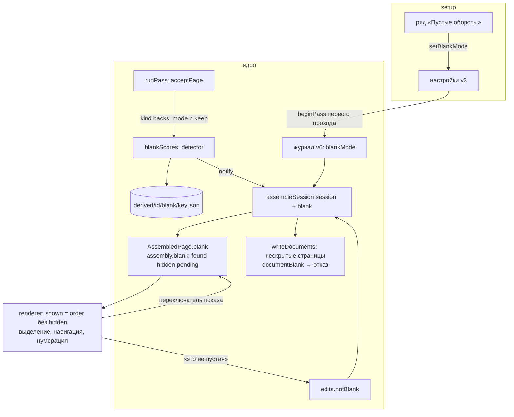

# feat: Пустые обороты — детектор, три режима, подвал ленты (M4)

## Goal Capsule

- **Objective:** пачка со смешанными одно- и двусторонними листами собирается без ручной
  чистки: пустые обороты распознаются и по выбранному режиму скрываются, помечаются или
  остаются; бледный карандаш за пустоту не принимается; ничего не выбрасывается молча —
  скрытое видно по переключателю и счётчику, и любую страницу можно вернуть одной пометкой.
- **Means:** детектор по доле «чернильных» пикселей на фикстурах с живого ET-3850 (KTD2);
  оценки — производное с кэшем по образцу миниатюр (KTD3); режим — настройка и поле сессии в
  журнале v6, пометка «не пустая» — правка (KTD1, KTD5); лента ядра целиком, показ — фильтром
  в renderer, скрытый хвост едет за лицом (KTD4); подвал ленты и «Выделить в документ» для
  страниц не подряд — по handoff'у (KTD7).
- **Product authority:** роадмап M4, спека `docs/duplexnt.md` («Пустые обороты», «Чего не
  делаем»), `docs/design/UI_SPEC.md` §2, §6.2–6.5, §6.9, §7.3, мок (12 листов, пустые на 4, 9,
  12); решения автора при планировании 2026-10-22 (Problem Frame). Брейншторма нет — скоуп
  утверждён в чате.
- **Stop conditions:** страница выброшена из файла без счётчика и способа показать её;
  оценка детектора записана в журнал; скрытие двигает разрезы или границу наборов; второй путь
  сохранения в обход ядра; детектор на лицах или добавленных наборах.

---

## Summary

Ядро получает детектор пустых страниц и считает оценку каждого оборота при приёме, кэшируя её
как производное; режим «Скрывать / Помечать / Оставлять» выбирается в `setup`, замораживается в
сессии и даёт каждой странице ленты флаг «скрыта / помечена / обычная». Renderer показывает
ленту без скрытых, считает документы и сохранение по показанным, а переключатель «добавить
пустые» и пометка «это не пустая страница» возвращают их. Подвал ленты перекладывается: тумблер
180°, переключатель пустых и кнопка «Выделить в документ», которая теперь собирает в документ и
страницы не подряд.

---

## Problem Frame

Двусторонняя пачка почти всегда содержит односторонние листы: их обороты сканируются как белые
страницы и попадают в PDF. Сегодня пользователь чистит их руками в редакторе, а при 30 листах
это десятки кликов и легко пропустить. Спека с M0 обещает три режима и запрещает выбрасывать
страницы молча: бледный карандаш, слабую печать, подпись легко принять за пустоту.

Снимок «до»: ряда «Пустые обороты» в `setup` нет; детектора нет; в журнале v5 нет ни режима, ни
переопределений; лента ядра — порядок с правками минус удалённые; подвал ленты — один тумблер
180°, панель выделения появляется сверху и сдвигает миниатюры; «Выделить в документ» работает
только для страниц подряд. В репозитории нет ни одного настоящего скана: страницы фикстур —
синтетика генератора.

Развилки, закрытые автором 2026-10-22 при планировании:

1. Детектор — только на проходе оборотов; добавленные наборы не трогаются (у них нет роли
   стороны — ADR 0004, амендмент 2026-10-07).
2. «Оставлять» не запускает детектор; «Помечать» ставит метку, страница идёт в файл;
   «Скрывать» исключает из ленты и файла.
3. Автоскрытие — функция от оценки, порога и режима; в журнал пишется только решение «это не
   пустая страница».
4. В режиме раздельных наборов (M3.6) скрытие не применяется — страницы считаются; скрытие
   вступает после «Собрать документ».
5. «Выделить в документ» для страниц не подряд: новый документ встаёт на место первой
   выделенной, остальные подтягиваются к ней.
6. Скрытый пустой оборот «прилипает» к своему лицу: перенос, группировка, удаление и якорь
   «после текущей» захватывают скрытый хвост, пока скрытые не показаны; при включённом
   переключателе выделение буквальное (уточнение по ревью плана).
7. Пометка «не пустая» — обычная правка: шаг undo, плашка, «Вернуть» снимает.

---

## Requirements

**Режим и настройка**

- R1. В `setup` есть ряд «Пустые обороты» с сегментами «Скрывать · Помечать · Оставлять»
  (подсказки — UI_SPEC §2); по умолчанию «Скрывать»; «Сбросить параметры» возвращает его;
  значение помнится между запусками.
- R2. Режим замораживается в сессии при старте первого прохода и не меняется в редакторе;
  сессии журнала v5 читаются как «Оставлять».
- R3. Режим не входит в параметры устройства: не валидируется по capabilities, не уходит в
  `ScanSettings`, не ломает досканирование.

**Детектор**

- R4. Оценка — доля «чернильных» пикселей после приведения к серому и уменьшению, внутри
  обрезки полей; вердикт «пусто» — доля ниже порога. Константы откалиброваны на фикстурах с
  живого ET-3850; алгоритм имеет номер версии.
- R5. На фикстурах детектор считает пустыми чистый лист и оборот с просвечиванием в сером и в
  цвете (`Grayscale8`, `RGB24` — единственные режимы JPEG на ET-3850, журнал M1) и на
  200/300/600 dpi; не считает пустыми бледный карандаш, одну строку текста и подпись.
- R6. Детектор применяется только к страницам прохода оборотов (в том числе досканированного
  после прерывания) и только при режиме, отличном от «Оставлять». Сбой декодирования или
  потерянный файл — «не пусто», без ошибки.

**Данные**

- R7. Оценки — производное: кэш в каталоге производного сессии, с версией алгоритма; в журнал
  не попадают; пересчитываются при отсутствии кэша; чистятся вместе с миниатюрами.
- R8. Журнал v6: поле сессии `blankMode` и коллекция правок `notBlank` (ключи страниц). Чтение
  v5 — дефолты; журнал, пересобранный сверкой по файлам, — `blankMode: 'keep'`; сверка
  переписывает файл; маркер v7+ или неизвестное поле — несовместимость. Амендмент ADR 0004 — до
  старта кода.
- R9. Пометка «это не пустая страница» — правка: один шаг undo, поднимает плашку «Есть ручные
  правки», «Вернуть» её снимает, переживает перезапуск.

**Лента и правки**

- R10. Каждая страница ленты несёт флаг `blank`: «скрыта» (режим «Скрывать», детект, без
  пометки, вне режима наборов), «помечена» (режим «Помечать» или режим «Скрывать» в режиме
  наборов), иначе обычная. Лента ядра, разрезы, граница наборов и нумерация листов считаются по
  полной видимой ленте — скрытие их не двигает.
- R11. Renderer при выключенном переключателе работает по показанной ленте: текущая страница,
  выделение, клавиатура, нумерация «стр. N из M», счётчики документов, якоря «+ Добавить».
  Текущая, ставшая скрытой, переезжает на ближайшую показанную справа; скрытые ключи выпадают из
  выделения.
- R12. Пока скрытые не показаны, скрытый хвост едет за своей показанной страницей при
  переносе, группировке, удалении и якоре «после текущей» («Удалить N стр.» считает только
  показанные, Ctrl+Z возвращает лист целиком); разрез ложится перед показанной страницей,
  хвост остаётся слева. При включённом переключателе выделение буквальное: что выделено, то и
  едет.
- R13. Переключатель «добавить пустые» — состояние показа renderer: не правка, не шаг undo,
  не переживает перезапуск. При включённом — скрытые показаны с меткой «ПУСТО», нумерация
  включает их.
- R14. Оценка, пришедшая после открытия редактора, скрывает страницу с тостом-статусом и
  переносом текущей; стек undo не чистится. Экран `merge` ждёт незавершённые оценки не дольше
  потолка.
- R15. В режиме раздельных наборов ничего не скрыто: счётчики групп и «Собрать документ»
  считают все страницы; после сборки флаги применяются.

**Сохранение и сводки**

- R16. В файл идут только нескрытые страницы документа. Документ, у которого все страницы
  скрыты, не сохраняется: отказ ядра до записи с именем документа; модалка `save` показывает
  причину. Полностью скрытая лента — «нечего сохранять». Пока есть незавершённые оценки
  (режим ≠ «Оставлять»), сохранение отклоняется до их прихода с причиной «оценка N страниц ещё
  идёт».
- R17. Сводка `save`, модалка `newscan`, блок «ПРОВЕРКА» и статус `merge` учитывают пустые:
  «скрыто N» / «помечено N» / «не найдено»; при «Оставлять» пункта нет.

**Подвал ленты и выделение**

- R18. Подвал ленты всегда на месте: тумблер 180° (при проходе оборотов), переключатель пустых
  со счётчиком (при режиме «Скрывать» и проходе оборотов; при нуле — недоступен с подписью) и
  кнопка «Выделить в документ» (при выделении больше одной страницы вне режима наборов).
  Панель сверху ленты уходит.
- R19. «Выделить в документ» для страниц не подряд собирает выделенные в новый документ на
  месте первой выделенной одним шагом undo; для подряд — как раньше, без явного порядка. Тост
  «Выделите подряд идущие страницы» уходит.

**Качество**

- R20. Фикстуры детектора — настоящие сканы ET-3850 в репозитории, без метаданных устройства,
  прошедшие стража приватности; эмулятор умеет отдавать их по имени в сценарии.
- R21. Зеркало сборки в renderer и guard-таблица покрывают режимы пустых; новые тесты — в
  новых файлах; `EditorScreen.tsx` не превышает ~1000 строк (подвал — отдельный компонент).

---

## Key Technical Decisions

- **KTD1. Режим — отдельная настройка и поле сессии, не параметр сканирования.** Shared-словарь
  `BLANK_MODES = ['hide', 'mark', 'keep']`; настройки v3 (`blankMode`, чтение v2 — дефолт
  `hide`); команда `setBlankMode`; текущее значение — в снимке рядом с параметрами сканера.
  При `beginPass` первого прохода (и в ветке повторного использования пустого журнала) режим
  замораживается в `journal.blankMode`; `newJournal` и чтение v5 — `keep`, так что журнал,
  пересобранный сверкой по файлам (`journalRebuilt`), страницы не скрывает. _Довод:_ `ScanParams` валидируются по
  capabilities и пишутся в `origin.params` каждого прохода — режим попал бы на проход, а не на
  сессию, и в `buildScanSettings`. _Отклонено:_ поле в `ScanParams` — дешевле по коду, но
  смешивает параметры устройства и решение приложения.
- **KTD2. Детектор — чистая функция над байтами JPEG с версией алгоритма.** Модуль
  `src/core/detect/blank.ts`: `blankRatio(bytes, pixelLimit)` через `sharp` — проверка
  маркеров как у миниатюр, `greyscale`, уменьшение до рабочего размера (ориентир — длинная
  сторона ~1400 px, чтобы штрих карандаша не растворялся), обрезка полей (ориентир 4 % с каждой
  стороны — тень кромки ADF), оценка белого бумаги по верхнему перцентилю яркости, «чернильный»
  пиксель — темнее белого на дельту (ориентир 40/255, чтобы просвечивание не считалось), доля =
  чернильных / всех. `isBlank(ratio)` — сравнение с порогом; `BLANK_DETECTOR_VERSION` — целое,
  растёт при любой смене констант. Константы — калибровка табличным тестом на фикстурах U1 с
  запасом не меньше двукратного между худшей «пустой» и лучшей «непустой»; если одной долей
  запас не достигается — следующий шаг там же: подавление одиночных точек (морфологическое
  открытие) до усложнения модели. Результат калибровки — в журнале вехи. _Отклонено:_ OpenCV
  (ADR 0002 — не требуется), детект на миниатюре 320×452 (штрих карандаша теряется).
- **KTD3. Оценки — производное по образцу миниатюр, считаются при приёме.** Служба
  `createBlankScores(derivedDir, source, detector)` рядом с `thumbnails.ts`: карта `key → ratio`
  в памяти, кэш `derived/<sessionId>/blank/<key>.json` (`{v, ratio}`; запись атомарная,
  «по возможности»), одно построение на ключ, ограничение параллельности; при `v` ≠ версии —
  пересчёт. Служба проходов считает оценку сразу после `acceptPage` для страницы прохода
  `backs` при режиме ≠ `keep`; приход оценки — `notify()`. При открытии (`openPassService`,
  до возврата службы) кэш страниц прохода `backs` читается целиком: страницы с кэшем текущей
  версии попадают в карту сразу и в `pending` не входят, остальные считаются в фоне после
  открытия. Сбой декодирования и потерянный файл — тоже результат: `{v, ratio: null}` в карте и
  кэше, «не пусто», в `pending` не входит. Детектор инжектируется в службу
  (`options.blankDetector`), в тестах службы — no-op (страницы там не JPEG). _Отклонено:_ считать по требованию из `page-protocol` — лента
  должна знать флаги до показа; считать в renderer — граница слоёв.
- **KTD4. Лента ядра целиком, показ — фильтром в renderer; скрытый хвост едет за лицом.**
  `assembleSession(session, blank)` получает оценки вторым аргументом и ставит
  `AssembledPage.blank: 'hidden' | 'marked' | null`; `SessionAssembly.blank = {mode, found,
hidden, pending}`. `order`, `documents`, `cuts`, `divider`, номера листов — по полной видимой
  ленте, как в M3/M3.6 (урок ревью M3.6 #3–#4: позиционные правки + фильтр = дрейф). Renderer
  строит `shown` один раз и подаёт его в выделение, навигацию, нумерацию, якоря; пока скрытые
  не показаны, перед переносом, группировкой, удалением и якорем «после текущей» расширяет
  ключи скрытыми хвостами (при включённом переключателе — не расширяет). Ядро же фильтрует при
  записи: `writeDocuments` пишет нескрытые страницы документа; незавершённые оценки —
  `sessionConflict('blankPending', {pending})`, пустой документ —
  `sessionConflict('documentBlank', {documents})`, оба до записи, после `notAssembled` и до
  `nothingToSave`. _Отклонено:_ убрать скрытые из
  `visible` в ядре — переключатель показа двигал бы разрезы при каждом щелчке и требовал
  перебазирования при каждой оценке.
- **KTD5. Переопределение — коллекция правок `edits.notBlank`.** Ключи страниц, принятых
  непустыми; нормализация — уникальные живые ключи; входит в `hasEdits` и `sameEdits`;
  `EMPTY_EDITS.notBlank = []`, «Вернуть» снимает (решение автора). Жест в `state/edits.ts` →
  один `setEdits`. Обратной пометки «считать пустой» нет: лишнее удаляется. _Отклонено:_
  `blank: Record<key, 'blank' | 'content'>` — вторая семантика без потребителя.
- **KTD6. Поздние оценки — ждать на `merge`, потом скрывать с тостом.** `App` держит экран
  `merge` пока `assembly.blank.pending > 0`, не дольше 8 с (корректировка при рендере с
  ключом, как прочие эффекты `App`, без `useEffect` без ключа). После потолка и после
  перезапуска без кэша (редкий путь: версия детектора поднялась или кэш потерян) скрытие
  применяется сразу: тост `role="status"` «Скрыто N пустых оборотов — переключатель «добавить
  пустые» покажет их», текущая переезжает по R11; сохранение при `pending > 0` ядро отклоняет
  (KTD4). Оценки не входят в `tapeOf`. _Отклонено:_ экран-пауза после перезапуска (менять
  поток ради редкого случая); «поздние только помечать» (две семантики одного режима).
- **KTD7. Подвал ленты — свой компонент; «Выделить в документ» не подряд — явный порядок.**
  `EditorRailFooter.tsx`: тумблер 180°, переключатель пустых, кнопка группировки; матрица
  показа — R18; панель `rail__top` удаляется. Жест `grouped(edits, keys, visible)`: страницы
  подряд — только разрезы (как `separated`); не подряд — явный `order` (выделенные с хвостами
  встают на позицию первой) плюс разрезы, одним `setEdits`; выделение после — перенесённые.
  _Довод:_ в явном порядке лента уже уходит в ручной режим при любом переносе (M3, R8) —
  группировка не подряд и есть перенос.
- **KTD8. Фикстуры детектора — настоящие сканы в `test/fixtures/escl/et-3850/scans/`.**
  Имена по содержимому и параметрам (`blank-gray-300.jpg`, `pencil-faint-gray-300.jpg`, …),
  каталог «по роду», как `pages/` и `traces/`; байт в байт, если скан без метаданных (ET-3850
  отдаёт baseline JPEG без EXIF/ICC — журнал M1), иначе перекодировать без метаданных.
  Эмулятор: записи `trays` принимают имя скана наряду с номером; помощник
  `pageFixtureNumberOf` получает именованный вариант для сверки PDF. Содержимое сканов —
  правило приватности: страж читает только текст и список значений, содержимое JPEG не видит,
  поэтому подпись и рукописные слова на фикстурах — заведомо вымышленные, без имён, адресов и
  номеров; печатные страницы — из доков проекта; автор проверяет глазами перед импортом.
  _Отклонено:_ синтетика генератора (шум сканера, тень кромки и просвечивание не
  воспроизводятся); хранить вне git (тесты детектора — обязательные по спеке).
- **KTD9. Область детектора — проход `kind: 'backs'`.** Страницы лиц и добавленных наборов
  флага не получают — в том числе оборот, досканированный через «+ Добавить» в группу оборотов
  и после сборки вставший на позицию оборота; после «Досканировать» прерванного прохода
  оборотов новые страницы того же прохода оцениваются. _Довод:_ развилка 1; у добавленного
  набора роли стороны нет (ADR 0004, амендмент 2026-10-07), сторона по позиции появляется
  только после сборки. Граница названа в Scope Boundaries и уходит в спеку (U9).

---

## High-Level Technical Design



Режим страницы по режиму сессии и состоянию ленты:

| Режим сессии | Детект | Режим наборов (до сборки) | После сборки / пары |
| ------------ | ------ | ------------------------- | ------------------- |
| `keep`       | нет    | обычная                   | обычная             |
| `mark`       | да     | помечена                  | помечена            |
| `hide`       | да     | помечена, считается       | скрыта              |

Пометка `notBlank` снимает любой флаг. Оценка не готова (`pending`) — страница обычная.

Показанная лента в renderer:

```
visible (ядро):  1л  1о*  2л  2о  3л  3о*     * — скрыта
shown:           1л       2л  2о  3л          нумерация 1…4
хвосты:          1л→[1о*] 3л→[3о*]            едут за лицом при переносе/группировке
разрез «перед 3л» = перед позицией 3л в visible (2о и хвост 1о остаются слева)
```

---

## Acceptance Examples

- AE1. **Скрыть по умолчанию.** Given 12 листов, пустые обороты у 4, 9, 12, режим «Скрывать»;
  When два прохода собраны; Then лента показывает 21 страницу, подвал — «скрыто 3», ПРОВЕРКА —
  точка «скрыто 3 пустых оборота», PDF — 21 страница в правильном порядке.
- AE2. **Показать скрытые.** Given AE1; When включён переключатель «добавить пустые»; Then в
  ленте 24 страницы, у трёх — метка «ПУСТО», превью — «пустая сторона листа», счётчик «3 в
  наборе», нумерация сквозная; When выключен — снова 21.
- AE3. **Бледный карандаш — не пусто.** Given оборот с фикстуры `pencil-faint-gray-300`;
  When проход оборотов принят; Then страница не скрыта и не помечена; PDF её содержит.
- AE4. **Помечать.** Given AE1 с режимом «Помечать»; Then 24 страницы, три с меткой «ПУСТО»,
  переключателя нет, ПРОВЕРКА — «помечено 3 пустых оборота», PDF — 24 страницы.
- AE5. **Оставлять.** Given режим «Оставлять»; Then детектор не запускался (кэша нет), меток
  нет, пункта в ПРОВЕРКЕ и переключателя нет, PDF — 24 страницы.
- AE6. **Это не пустая страница.** Given AE2, выбрана скрытая страница; When нажато «Это не
  пустая страница»; Then страница обычная, плашка «Есть ручные правки» видна, Ctrl+Z скрывает
  обратно, после перезапуска пометка цела; «Вернуть» снимает.
- AE7. **Наборы не сошлись.** Given 12 лиц, проход оборотов прерван замятием после 11
  страниц, из них 2 пустых, режим «Скрывать»; When «Досканировать» остаток, тулбар — «лицевых
  12, оборотных 11» → «Наборы уравнены», пустые помечены и считаются; When нажато «Собрать
  документ»; Then два оборота скрыты, подвал — «скрыто 2». Оборот, добавленный вместо этого
  через «+ Добавить» в группу оборотов, оценки не получает и после сборки остаётся обычным.
- AE8. **Документ из одних пустых.** Given при включённом переключателе граница поставлена
  перед пустым оборотом, переключатель выключен; When «Сохранить N файлов»; Then ядро
  отказывает до записи, модалка показывает «Документ 2 состоит только из пустых страниц», файлы
  не созданы; граница снимается крестом или страница удаляется через переключатель. Given
  оценки ещё идут; Then «Сохранить» недоступна с причиной «оценка N страниц ещё идёт».
- AE9. **Хвост едет за лицом.** Given лента 1л, 1о (скрыт), 2л, 2о; When 2л перетянут «после
  1л»; Then при включённом переключателе порядок 1л, 1о, 2л, 2о; разрез «перед 2л» оставляет
  1о в первом документе.
- AE10. **Выделить в документ не подряд.** Given показанная лента 1…6; When Ctrl-выделены 2 и 5
  и нажато «Выделить в документ»; Then новый документ на позиции 2 из страниц 2, 5 (с хвостами),
  остальные сдвинуты, один шаг undo, выделение — перенесённые, тост «подряд» не показан.
- AE11. **Поздняя оценка.** Given кэш оценок удалён; When приложение перезапущено и редактор
  открыт; Then пустые скрываются с тостом «Скрыто N…», текущая переезжает, Ctrl+Z работает.
- AE12. **Старый журнал.** Given сессия v5; When запуск; Then файл переписан v6 с
  `blankMode: "keep"`, ничего не скрыто.
- AE13. **Настройка.** Given первый запуск; Then «Скрывать» выбран; When выбрано «Помечать» и
  приложение перезапущено; Then «Помечать»; «Сбросить параметры» → «Скрывать».
- AE14. **Подвал.** Given выделены две страницы; Then кнопка «Выделить в документ» в подвале,
  панели сверху нет, миниатюры не сдвинулись; Given прохода оборотов нет; Then ни тумблера
  180°, ни переключателя пустых.

---

## Implementation Units

### U1. Фикстуры детектора с живого ET-3850

- **Goal:** в репозитории — набор настоящих сканов для калибровки и тестов детектора;
  эмулятор отдаёт их по имени.
- **Requirements:** R5, R20.
- **Dependencies:** нет; требует рук автора у сканера.
- **Files:** `test/fixtures/escl/et-3850/scans/*.jpg` (новые), `test/fixtures/README.md`,
  `test/support/fixtures.ts` (`scanFixture(name)`, именованный `pageFixtureOf`),
  `test/emulator/scenarios.ts` (тип записи лотка `number | string`), `test/emulator/server.ts`,
  `test/guards/fixtures-content.test.ts` (сканы без EXIF/ICC/XMP).
- **Approach:** автор сканирует через приложение (режим «Оставлять» или до U3 — любой) набор:
  чистый оборот (серый 300; тот же лист на 200 и 600; в цвете), оборот листа с плотной печатью
  на лице (просвечивание), бледный карандаш (несколько нейтральных слов; серый и цвет), одна
  строка печатного текста, вымышленная подпись ручкой, страница печатного текста из доков
  проекта, по возможности лист с дырками дырокола. Ч/б-режима в наборе нет: ET-3850 отвергает
  `BlackAndWhite1` с JPEG (журнал M1). Файлы копируются из каталога сессии под именем
  `<содержимое>-<цвет>-<dpi>.jpg` без скрипта: ET-3850 отдаёт baseline JPEG без метаданных;
  guard-тест проверяет, что в `scans/` нет EXIF/ICC/XMP, а если метаданные всё же есть —
  разовая перекодировка `sharp` в журнале вехи. Правило содержимого — KTD8: автор проверяет
  глазами, что на сканах нет настоящей подписи, имён и номеров. Страж приватности прогоняется
  полностью. Эмулятор: запись лотка по имени читает файл из `scans/`, по номеру — из `pages/`
  как прежде.
- **Patterns to follow:** `test/fixtures/README.md` («по роду», «байт в байт», «фикстуру
  заводит веха»), `test/guards/fixtures-content.test.ts` (guard по каталогу фикстур).
- **Test scenarios:**
  - эмулятор отдаёт по имени `blank-gray-300` байты фикстуры из `scans/`;
  - смешанный лоток `[1, 'blank-gray-300', 2]` — страницы в заявленном порядке;
  - неизвестное имя в сценарии — ошибка запуска эмулятора с именем файла;
  - guard: каждый файл `scans/` — JPEG без EXIF/ICC/XMP; текстового разбора `scans/` нет;
  - страж приватности зелёный на новых бинарных файлах.
- **Verification:** фикстуры в репо и перечислены в README с назначением; `npm test` читает
  хотя бы одну (`test/emulator/server.test.ts`, проект `node`); `node
scripts/privacy-guard.ts` зелёный.

### U2. Детектор пустых страниц

- **Goal:** чистая функция оценки и вердикт с откалиброванными константами.
- **Requirements:** R4, R5, R6.
- **Dependencies:** U1.
- **Files:** `src/core/detect/blank.ts` (новый), `src/core/detect/blank.test.ts` (вердикт,
  `npm test`), `test/integration/blank-detector.test.ts` (доля на фикстурах, `sharp`),
  `docs/duplexnt-tech.md` (раздел про детектор — в U9).
- **Approach:** KTD2. Таблица фикстура → ожидаемый класс; тест печатает доли и проверяет и
  класс, и запас между классами. Сбой декодирования → `null`. Предел пикселей — как у миниатюр
  (`decodePixelLimit`).
- **Execution note:** сначала табличный интеграционный тест с ожидаемыми классами, потом
  подбор констант; итоговые доли — в журнал вехи.
- **Test scenarios:**
  - чистые листы (серый 200/300/600, цвет) и просвечивание → пусто;
  - бледный карандаш (серый, цвет), строка текста, подпись, полный текст, дырокол → не пусто;
  - запас: `max(ratio пустых) * 2 <= min(ratio непустых)`;
  - вердикт: доля на границе порога, `null` → не пусто;
  - повреждённый JPEG → `null` без исключения; превышение предела пикселей → `null`;
  - версия алгоритма — целое ≥ 1 и экспортирована.
- **Verification:** оба теста зелёные; константы и доли зафиксированы в журнале вехи.

### U3. Режим пустых оборотов: настройка, команда, ряд `setup`, журнал v6

- **Goal:** режим выбирается в `setup`, помнится, замораживается в сессии; журнал v6 с
  `blankMode` и `notBlank`; амендмент ADR 0004.
- **Requirements:** R1, R2, R3, R8.
- **Dependencies:** нет (параллельно U1–U2).
- **Files:** `docs/decisions/0004-data-model.md` (амендмент — до кода), `src/shared/blank.ts`
  (новый: `BLANK_MODES`, `BlankMode`), `src/shared/index.ts`, `src/shared/edits.ts`
  (`notBlank`, `EMPTY_EDITS`, `sameEdits`), `src/shared/snapshot.ts`, `src/shared/bridge.ts`
  (`setBlankMode`, канал), `src/core/storage/settings-store.ts` (v3), `src/core/storage/
journal.ts` (v6, `upgradeToV6`), `src/core/storage/edits-schema.ts` (`editsV5Schema` для
  чтения), `src/core/storage/session-store.ts` (`beginPass` — заморозка, сброс в ветке пустого
  журнала), `src/core/scan/edits.ts` (`normalizeEdits`, `rebaseEdits` — уникальные живые ключи
  `notBlank`; без этого `tsc -b` падает на новом поле), `src/core/scan/pass-service.ts`
  (`setBlankMode`), `src/core/commands/schemas.ts`, `handlers.ts`, `src/preload/api.ts`,
  `src/main/bridge.ts`, `src/renderer/src/screens/SetupScreen.tsx`,
  `src/renderer/src/state/assembly-fixture.ts` (`EMPTY_EDITS`), `locales/ru/common.json`;
  тесты: `settings-store.test.ts`, `journal.test.ts`, `reconcile.test.ts`,
  `session-store.flags.test.ts`, `src/core/scan/edits.test.ts` (735 строк — новый `describe`
  в `edits.notBlank.test.ts`), `commands/{schemas,handlers}.test.ts`, `preload/api.test.ts`,
  `main/bridge.test.ts`, `SetupScreen.test.tsx`.
- **Approach:** KTD1, KTD5 (схема). Ряд в `setup` — на существующем `Segments`, значения из
  shared-словаря (не из capabilities — это решение приложения; UI_SPEC §12 уточняется в U9).
  Тест «в журнале нет выводимого» (прецедент U1 M3.6) расширяется: поле с оценкой в v6 —
  отказ.
- **Patterns to follow:** амендмент 2026-10-19 (форма v5), `settingsV1Schema → v2`
  (`saveFolder`), команда `declineBacks`/`assemble` (без запроса) и `setScanParams` (с
  запросом).
- **Test scenarios:**
  - настройки v2 читаются с `blankMode: 'hide'`, пишутся v3; v4+ — несовместимость;
  - журнал v5 читается с `blankMode: 'keep'`, `notBlank: []`; v6 с оценкой в правках —
    отказ схемы; v7 — несовместимость; сверка переписывает v5 → v6; журнал, пересобранный по
    файлам, — `blankMode: 'keep'`;
  - `beginPass` первого прохода замораживает текущую настройку; второй проход её не меняет;
    повторное использование пустого журнала перезамораживает;
  - `setBlankMode` с мусором отклоняется схемой; валидный — пишет настройки и шлёт снимок;
  - `setup`: ряд показывает текущее значение, клик уходит командой, «Сбросить параметры»
    возвращает «Скрывать», roving-фокус сегментов;
  - `sameEdits` различает `notBlank`; нормализация выкидывает мёртвые и повторные ключи.
- **Verification:** `test:all` зелёный; амендмент ADR 0004 с JSON-примером v6 закоммичен
  раньше кода.

### U4. Оценки как производное и лента с флагами в ядре

- **Goal:** ядро считает оценки при приёме, кэширует, ставит флаги страницам, фильтрует при
  записи.
- **Requirements:** R6, R7, R9, R10, R15, R16.
- **Dependencies:** U2, U3.
- **Files:** `src/core/storage/blank-scores.ts` (новый), `src/core/storage/layout.ts`
  (`blankDirOf`), `src/core/storage/session-store.ts` (`removeMarked` чистит `blank/`),
  `src/core/storage/reconcile.ts`, `src/core/scan/pass-service.ts` (инъекция детектора, sink,
  открытие, `snapshot()`, `writeDocuments`), `src/core/scan/assembly.ts`
  (`assembleSession(session, blank)`, флаги, `blank`), `src/core/scan/edits.ts` (`hasEdits`),
  `src/shared/snapshot.ts` (`AssembledPage.blank`, `SessionAssembly.blank`),
  `src/shared/errors.ts` (`documentBlank`, `blankPending`; `sessionConflict` получает детали),
  `src/core/pdf/*` (без изменений: получает отфильтрованный список), `src/renderer/src/state/
assembly-fixture.ts` + `test/guards/assembly-fixture.test.ts` (зеркало и таблица); тесты:
  `test/integration/blank-scores.test.ts` (новый, по образцу `thumbnails.test.ts`),
  `src/core/scan/assembly.blank.test.ts` (новый), `pass-service.blank.test.ts` (новый;
  `pass-service.test.ts` 1066 строк — не раздувать), `session-store.assemble.test.ts`.
- **Approach:** KTD3, KTD4, KTD9. Снимок синхронный — оценки из карты в памяти; кэш читается
  при открытии до возврата службы; `pending` = страницы `backs` без результата (включая
  `null`) при режиме ≠ `keep`. Флаг «скрыта» только при `sets === null`. `writeDocuments`:
  `pending > 0` → `blankPending`; документы → нескрытые страницы; пустой документ →
  `documentBlank` с индексами документов; все скрыты → `nothingToSave`; порядок гардов —
  после `notAssembled`. «Остановить» и «Досканировать» — оценки отброшенных ключей снимаются.
- **Patterns to follow:** `thumbnails.ts` (`building`, `limited`, атомарная запись «по
  возможности», race-guard по `sessionId`), `assembly.modes.test.ts` (табличные режимы),
  `test/integration/thumbnails.test.ts` (`makeTempDataRoot`, `dirSnapshot` — в каталог сессии
  ничего не пишется).
- **Test scenarios:**
  - приём страницы `backs` при `hide` → оценка в карте и файл кэша; при `keep` — ни того, ни
    другого; страница `fronts` и `added` — нет;
  - перезапуск: кэш есть → первый `snapshot()` уже с флагами и `pending = 0`, детектор не
    вызван; кэш с другой версией → пересчёт; кэша нет → пересчёт и `pending` до прихода;
  - битый JPEG → `ratio: null` в карте и кэше, страница «не пусто», `pending = 0`;
  - запись при `pending > 0` → `blankPending` с числом, файлов нет;
  - в каталог сессии ничего не записано (`dirSnapshot`); закрытие сессии и `removeMarked`
    удаляют `blank/`;
  - флаги: таблица режим × (sets | pairs | assembled) × (пусто | не пусто | notBlank | pending)
    → ожидаемый `blank`, `found/hidden/pending`;
  - разрезы и `divider` одинаковы при любом наборе оценок (derived не двигает правки);
  - `notBlank` с мёртвым ключом вычищен; `hasEdits` истинен от одной пометки; «Вернуть» (пустые
    правки) снимает;
  - запись: документ с двумя скрытыми из трёх → PDF из одной страницы; документ из одних
    скрытых → `documentBlank` с индексом, файлов нет; при `mark` — все страницы в PDF;
  - зеркало renderer совпадает с ядром на таблице с флагами.
- **Verification:** `test:all` зелёный; guard зеркала расширен; интеграционный тест на
  настоящем `sharp` проходит с фикстурами U1.

### U5. Handoff состояний M4 и утверждение автора

- **Goal:** утверждённый handoff всего нового UI вехи — единственный вход в U6–U7.
- **Requirements:** R11, R13, R17, R18, R19.
- **Dependencies:** U4 (известна форма снимка).
- **Files:** `docs/design/handoffs/2026-10-m4-states.md` (новый, по `docs/templates/
handoff.md`).
- **Approach:** по моку — метка «ПУСТО», текст превью, пункт ПРОВЕРКИ, счётчик; дырки мока
  закрывает dev-агент сам (прецедент M2–M3.6): раскладка подвала (тумблер 180° · переключатель
  пустых со счётчиком · «Выделить в документ»), матрица показа R18, подписи при нуле («пустых не
  найдено» против «нет» мока — свести), действие «Это не пустая страница» (место — статус-бар
  превью или инспектор), строка ПРОВЕРКИ для «Помечать», сводка `save` («Страниц: 9, без 3
  пустых») и причины `documentBlank` / `blankPending`, заголовок документа из одних скрытых,
  состояние «все страницы скрыты, переключатель выключен» (рейл, превью, фокус, доступный
  подвал), поведение скрытых карточек при включённом переключателе (выделение и перенос
  буквальные), тост поздних скрытий, текст `newscan`, статус `merge` («пустых оборотов: N»),
  контраст метки «ПУСТО»
  (`--color-text-faint` ниже WCAG — принять или поднять кегль/токен), `aria-label`
  переключателя, плурализация («скрыт 1 пустой оборот / скрыто 2 пустых оборота / скрыто 5
  пустых оборотов»). Таблица Copy — все ключи локали.
- **Test expectation:** none — документ; гейт — явное «ОК» автора по handoff'у.
- **Verification:** handoff утверждён в чате; решения перенесены в «Decisions and open
  questions».

### U6. Renderer: показанная лента, состояния пустых, пометка, поздние оценки

- **Goal:** редактор живёт по показанной ленте и рисует все состояния пустых.
- **Requirements:** R9, R11, R12, R13, R14, R17 (ПРОВЕРКА), R21.
- **Dependencies:** U4, U5.
- **Files:** `src/renderer/src/state/shown.ts` (новый: `shownOf(order, reveal)`,
  `withHiddenTails(keys, order)`, `relocate(current, shown)`), `src/renderer/src/state/
edits.ts` (`markedNotBlank`), `src/renderer/src/state/selection.ts`, `src/renderer/src/
screens/EditorScreen.tsx` (жесты через `shown` и хвосты; переключатель показа — состояние
  экрана, временно в существующем `footer` рядом с тумблером 180°; сам компонент подвала —
  U7), `EditorRail.tsx`, `EditorThumb.tsx` (`blank` примитивом; метка «ПУСТО»),
  `EditorPreview.tsx`
  (текст пустой страницы, действие «Это не пустая страница»), `EditorInspector.tsx` (пункт
  ПРОВЕРКИ, факт в «ДЕТАЛИ»), `src/renderer/src/App.tsx` (ожидание `merge`, тост поздних),
  `src/renderer/src/screens/editor-screen.css`, `locales/ru/common.json`,
  `src/renderer/src/screens/editor-fixture.tsx`, `app-fixture.ts`; тесты: `src/renderer/src/
state/shown.test.ts` (новый), `screens/EditorScreen.blank.test.tsx` (новый), `App.test.tsx`
  (868 строк — новые случаи в `App.blank.test.tsx`), правки в `EditorScreen.test.tsx` (чекбокс
  тумблера теперь не единственный).
- **Approach:** KTD4, KTD5, KTD6. `shown` считается один раз на снимок и переключатель;
  `keyAt`, `ranged`, `toggled`, `pruned`, `afterRemoval`, `selectionOf`, `onPickDocument`,
  нумерация и `anchorsOf` — по `shown`; `withCut`, `moved`, `separated` получают позиции
  полной ленты после расширения хвостами. Переключатель — состояние экрана, сбрасывается при
  remount (известное поведение в handoff). Текущая, ставшая скрытой, — корректировка при
  рендере (паттерн `afterRemoval`), не эффект.
- **Patterns to follow:** `afterRemoval` и корректировки выделения M3; стабильные обработчики
  через `latest.current` (ленты `memo`); тосты по ключу под StrictMode.
- **Test scenarios:**
  - `shownOf`: скрытые выпадают при выключенном, остаются при включённом; `withHiddenTails`:
    хвост из нескольких скрытых подряд, хвост у последней страницы, без хвоста;
  - навигация: → и End с выключенным переключателем пропускают скрытые; Shift-диапазон не
    захватывает скрытые; «Удалить N стр.» — N без скрытых;
  - текущая стала скрытой (переключатель выключен / Ctrl+Z после пометки) → ближайшая
    показанная справа, фокус на её миниатюре;
  - перенос 2л после 1л с хвостом → `order` содержит 1л, 1о, 2л (AE9); якорь «после текущей»
    в `add` — после хвоста; удаление 1л уносит 1о одним `setEdits`, Ctrl+Z возвращает обоих;
  - переключатель включён: перенос 2л без 2о → `order` без хвоста; выделение и удаление
    буквальные;
  - все страницы скрыты, переключатель выключен: `relocate` на пустом `shown` → текущей нет,
    фокус на подвале, состояние по handoff'у;
  - метка «ПУСТО» и текст превью при `marked` и при показанной `hidden`; `aria-label`
    миниатюры содержит «пусто»;
  - «Это не пустая страница»: один `setEdits` с `notBlank`, плашка видна, Ctrl+Z/Ctrl+Y,
    «Вернуть» снимает; под StrictMode — один вызов;
  - ПРОВЕРКА: «не найдено» / «скрыто N» / «помечено N» / пункта нет при `keep`; в режиме
    наборов — «помечено N, считаются»;
  - поздняя оценка: снимок с новым `hidden` после открытия → тост один раз, текущая переехала,
    стек undo цел; `merge` держится при `pending > 0` и уходит по потолку;
  - нумерация «стр. N из M» по показанной ленте; при включении — пересчёт.
- **Verification:** jsdom зелёный; `EditorScreen.tsx` ≤ ~1000 строк; smoke-строки локали
  («пачк|стопк», «проход N») чистые.

### U7. Подвал ленты и «Выделить в документ» для страниц не подряд

- **Goal:** подвал по handoff'у; группировка не подряд; сводки сохранения и `newscan` с
  учётом пустых.
- **Requirements:** R16 (модалка), R17, R18, R19.
- **Dependencies:** U5, U6.
- **Files:** `src/renderer/src/screens/EditorRailFooter.tsx` (новый: тумблер 180°,
  переключатель пустых, кнопка группировки — весь подвал из `EditorScreen.tsx` переезжает
  сюда), `EditorRail.tsx` (панель `rail__top` удаляется), `editor-screen.css`
  (`.rail__selection*` → подвал), `src/renderer/
src/state/edits.ts` (`grouped`), `state/selection.ts` (`contiguousRange` уходит),
  `EditorScreen.tsx` (`group()`), `src/renderer/src/modals/SaveModal.tsx` (сводка, причина
  `documentBlank`, подсветка строк), `NewScanModal.tsx`, `MergeScreen.tsx` (статус),
  `locales/ru/common.json` (`toast.notContiguous` удалить); тесты: `state/edits.test.ts`
  (таблица `grouped`), `EditorScreen.group.test.tsx` (новый; старые случаи панели из
  `EditorScreen.test.tsx`, `EditorScreen.dnd.test.tsx`, `EditorScreen.sets.test.tsx`
  переносятся), `modals/SaveModal.test.tsx`, `NewScanModal.test.tsx`, `MergeScreen.test.tsx`.
- **Approach:** KTD7. `grouped`: подряд → разрезы как `separated`; не подряд → явный порядок
  (выделенные с хвостами на позицию первой выделенной в полной ленте, остальные сдвинуты
  вправо без изменения взаимного порядка) и разрезы, пересчитанные по арифметике `moved`;
  разрезы внутри диапазона снимаются с именами по правилу `separated`. Кнопка в подвале —
  при выделении > 1 и `sets === null`; фокус после — имя документа, как в M3.
- **Patterns to follow:** `moved()` (сдвиг разрезов «убрать позиции, вставить»), `separated()`,
  handoff M3 S5 (фокус в имя, один шаг undo).
- **Test scenarios:**
  - `grouped` подряд: `order` не трогается, разрезы как раньше (регресс M3);
  - не подряд: `[2, 5]` из шести → порядок 1, 2, 5, 3, 4, 6 с разрезами до и после; выделение
    первой и последней; выделение, захватывающее существующий разрез; с хвостами (AE10);
  - в режиме наборов кнопки нет; при одной выделенной — нет; тост «подряд» не существует;
  - подвал: матрица R18 — есть/нет тумблера, переключателя, кнопки; при `found = 0`
    переключатель недоступен с подписью; миниатюры не сдвигаются при появлении кнопки;
  - `save`: «Страниц: 9, без 3 пустых», строки документов — счёт по показанным; `documentBlank`
    → статус с именем документа, строка подсвечена, «Сохранить» снова доступна после правки;
    `blankPending` → «Оценка N страниц ещё идёт», кнопка недоступна до снимка с `pending = 0`;
  - `newscan`: «N страниц» по показанным и «и 3 скрытых пустых»;
  - `merge`: статус с «пустых оборотов: N» при `hide`/`mark`, без — при `keep`.
- **Verification:** jsdom зелёный; старые тесты панели сверху переписаны осознанно, не
  удалены.

### U8. Интеграция: эмулятор, сквозные сценарии, CDP-смоук

- **Goal:** сквозные сценарии M4 на эмуляторе и в собранном приложении.
- **Requirements:** AE1–AE12.
- **Dependencies:** U1–U7.
- **Files:** `test/emulator/scenarios.ts` (сценарии `blank-backs` — лоток оборотов с
  `blank-gray-300` на листах 4, 9, 12; `blank-pencil`; `blank-sets` — несовпадение с пустыми),
  `test/integration/blank-backs.emulator.test.ts` (новый), `test/integration/
separate-sets.emulator.test.ts` (случай с пустыми), `temp/smoke-m4.mjs` (вне git),
  `docs/output/<дата>-smoke-checklist-m4.md` (вне git, по `docs/templates/smoke-checklist.md`).
- **Approach:** интеграция по образцу `separate-sets.emulator.test.ts` (`connect`, `scanned`,
  `expectAssembledFixtures`, `pdfFixtures`, `restart`); PDF сверяется побайтно с фикстурами
  `scans/` через именованный помощник. CDP-смоук — по граблям M3.5/M3.6: `built` и `dev`,
  изолированный `DUPLEXNT_USER_DATA`, консоль чистая.
- **Test scenarios:**
  - `hide`: PDF из 21 страницы в порядке 1л, 1о, …; `mark`: 24; `keep`: 24 и каталога `blank/`
    нет;
  - бледный карандаш в лотке оборотов — в PDF;
  - несовпадение с пустыми: до сборки `hidden = 0`, после `assemble` — `hidden = 2`;
  - `notBlank` переживает `restart()`; удалённый кэш → после `restart()` оценки пересчитаны и
    совпадают;
  - «Остановить» на проходе оборотов и «Досканировать» — оценки новых страниц есть, старых
    отброшенных — нет;
  - `documentBlank` сквозь мост — код и индексы документов в ответе;
  - CDP: AE1, AE2, AE6, AE10, AE14 кликами в `built` и `dev`.
- **Verification:** `test:all` зелёный; CDP-смоук пройден в обоих режимах; чеклист смоука
  заполнен для приёмки.

### U9. Доки и закрытие вехи

- **Goal:** доки-хвосты долиты, бэклог разобран, приёмка автора.
- **Requirements:** все.
- **Dependencies:** U8.
- **Files:** `docs/duplexnt.md` («Пустые обороты», «Тестовые фикстуры», «Параметры
  сканирования» — режим не из capabilities), `docs/duplexnt-tech.md` (детектор: алгоритм,
  константы, доли фикстур), `docs/design/UI_SPEC.md` (§2, §6.2, §6.4, §6.5 — панель, §6.9 —
  переписать, §7.3, §7.4, §5, §11 п.3 закрыт, §12), `docs/roadmap.md` (M4 ✅, ссылки),
  `docs/backlog.md` («Доделки редактора» → «Завершённое»; контраст «ПУСТО» — по решению
  handoff'а), `docs/solutions/0007-m4-blank-backs.md` (заведён с сессии 1, `status: done`),
  `test/fixtures/README.md` (если не закрыто в U1), `docs/decisions/0004-data-model.md`
  (уточнения по факту реализации).
- **Approach:** по CLAUDE.md «Закрытие вехи»: гейт, доки в ту же ветку, остановка на точке
  приёмки, чеклист на живом ET-3850 (пачка со смешанными листами, бледный карандаш глазами
  автора, упакованное приложение), merge только по явному ОК отдельным вопросом.
- **Test expectation:** none — документация; гейт — `test:all`, `node scripts/privacy-guard.ts`.
- **Verification:** приёмка автора пройдена; журнал вехи закрыт; ветка `feat/m4` влита по ОК.

---

## План по сессиям

| Сессия | Юниты | Граница                                                                                 |
| ------ | ----- | --------------------------------------------------------------------------------------- |
| 1      | U1–U2 | сканы в репо, страж зелёный; детектор откалиброван, доли в журнале вехи; журнал заведён |
| 2      | U3–U4 | амендмент ADR 0004, журнал v6, настройка и ряд `setup`; оценки и флаги в ядре; зеркало  |
| 3      | U5–U6 | handoff утверждён; показанная лента, состояния пустых, пометка, поздние оценки; jsdom   |
| 4      | U7–U8 | подвал, группировка не подряд, сводки; эмулятор, интеграция, CDP-смоук `built` + `dev`  |
| 5      | U9    | доки, чеклист, приёмка на живом ET-3850, merge по явному ОК                             |

Сессия 1 начинается с рук автора: сканирование набора U1 по списку из юнита. Каждая сессия
кончается зелёным коммитом с U-ID в теме (`feat(m4): U3 …`); возобновление — `git log` +
журнал вехи. Ревью (simplify + код-ревью) — по парам сессий, как в M3.5–M3.6.

---

## Scope Boundaries

- Детектор не трогает лица и добавленные наборы, включая оборот, досканированный через
  «+ Добавить» в группу оборотов (KTD9) — до «двусторонних добавленных наборов»; обратной
  пометки «считать пустой» нет.
- Режим не меняется в редакторе и не пересчитывается для старых сессий.
- Переключатель показа не переживает перезапуск.
- Подавление просвечивания, бинаризация при сборке для ч/б, «Авто»-размер — пост-MVP
  (спека → «Доработка позже»).

### Deferred to Follow-Up Work

- **Список наборов** и **двусторонние добавленные наборы** — бэклог, как и прежде.
- **Контраст `--color-text-faint`** — решается в handoff'е U5; если токен меняется, запись в
  `DESIGN_SYSTEM.md` и `tokens:sync` в U6, иначе остаётся в бэклоге.
- **Подавление одиночных точек в детекторе** — только если калибровка U2 не даёт запаса;
  иначе бэклог «Входящие» с результатами калибровки.
- **Экран-пауза после перезапуска при незавершённых оценках** — если на приёмке поздние
  скрытия с тостом окажутся неудобными.
- **Перестановка с клавиатуры** и прочие «Доделки UI» — без изменений.

---

## System-Wide Impact

- **Форматы:** журнал v6, настройки v3; старые файлы переписываются при первой сверке/записи;
  релиза не было — миграции данных нет.
- **Shared-типы:** `AssembledPage.blank`, `SessionAssembly.blank`, `SessionEdits.notBlank`,
  `BlankMode`, команда `setBlankMode`, конфликт `documentBlank` — typecheck ведёт по
  потребителям (фикстуры renderer, `app-fixture.ts`, `editor-fixture.tsx`, зеркало сборки).
- **Сборка `assembleSession`** получает второй аргумент — все вызовы (снимок, запись, тесты,
  зеркало) обновляются; guard-таблица зеркала расширяется.
- **Служба проходов:** инъекция детектора; тесты службы — no-op детектор; интеграция —
  настоящий.
- **Renderer:** вторая лента (`shown`) — все жесты и выделение; подвал — новый компонент;
  панель выделения сверху удалена; `toast.notContiguous` удалён.
- **Локаль:** ключи `blank.*`, `editor.footer.*`, `inspector.check.blank*`, `save.fact.*`,
  `newscan.*`, `merge.status.*`, `errorReasons.sessionConflict.documentBlank` с плурализацией.
- **Фикстуры и эмулятор:** каталог `scans/`, лотки по имени; размер репозитория растёт на
  несколько мегабайт бинарников.
- **Доки:** спека, техбаза, UI_SPEC, роадмап, бэклог, ADR 0004.

---

## Risks & Dependencies

- **Калибровка не даёт запаса** (бледный карандаш против шума сканера) → план: подавление
  одиночных точек в U2; стоп-условие — если и это не разделяет, веха выходит с режимом
  «Помечать» по умолчанию и записью в журнале; решение автора.
- **Две ленты в renderer** — главный источник ошибок (M3.6 #3–#4): все жесты через `shown` и
  хвосты; guard-тесты «текущая стала скрытой», «перенос с хвостом», «разрез при скрытом хвосте».
- **Поздние оценки** — страницы исчезают под рукой; де-риск: ожидание на `merge`, кэш,
  тост, перенос текущей (KTD6); редкий путь — только при потере кэша или смене версии.
- **`sharp` в main при приёме страницы** — нагрузка во время прохода; де-риск: ограничение
  параллельности как у миниатюр, рабочий размер уменьшен; страницы приходят раз в ~2 с.
- **Размер файлов:** `EditorScreen.tsx` 953, `pass-service.test.ts` 1066, `App.test.tsx` 868,
  `editor-screen.css` 1153 → подвал и новые тесты в новые файлы; деление при касании.
- **Бинарные фикстуры и приватность:** JPEG может нести серийник → guard-тест на метаданные,
  полный прогон стража в U1 и при закрытии. Содержимое сканов страж не видит: подпись и почерк
  на фикстурах — вымышленные, проверка автора глазами (KTD8).
- **Сохранение при незавершённых оценках** → страницы, которые вот-вот скроются, ушли бы в
  PDF; де-риск: гард `blankPending` в ядре до записи (KTD4).
- **Зеркало сборки** расходится с ядром при каждом новом поле → guard-таблица в U4 раньше
  renderer.
- **Руки автора** нужны дважды: сканы U1 (старт сессии 1) и приёмка U9.

---

## Documentation / Operational Notes

- Журнал вехи `docs/solutions/0007-m4-blank-backs.md` по `docs/templates/solution.md` —
  заводится в сессии 1; «На чём встали» — на границе каждой сессии; доли калибровки — в U2.
- Амендмент ADR 0004 (журнал v6: `blankMode`, `notBlank`, оценки — derived; «Вернуть» снимает
  пометку) — первым коммитом U3, до кода.
- Ветка `feat/m4` от `main`; план — на `main` до старта.
- Закрытие — по CLAUDE.md: гейт, доки-хвосты (U9), CDP-смоук `built` + `dev`, чеклист на живом
  ET-3850, `node scripts/privacy-guard.ts`, merge только после явного ОК отдельным вопросом.

---

## Definition of Done

- `npm run typecheck`, `lint`, `format:check`, `test:all` зелёные; `node scripts/
privacy-guard.ts` зелёный с новыми бинарниками.
- AE1–AE14 покрыты: интеграцией на эмуляторе (AE1–AE5, AE7, AE8, AE11, AE12), jsdom (AE6,
  AE9, AE10, AE13, AE14), CDP-смоуком (AE1, AE2, AE6, AE10, AE14) и чеклистом на живом ET-3850
  (пачка со смешанными листами; бледный карандаш — глазами автора).
- Handoff U5 утверждён; доки U9 долиты; бэклог «Доделки редактора» закрыт строкой в
  «Завершённом».
- Приёмка автора пройдена; merge — по явному ОК.

---

## Sources / Research

- Роадмап M4 — `docs/roadmap.md`; спека — `docs/duplexnt.md` («Пустые обороты», «Чего не
  делаем», «Тестовые фикстуры», «Тестирование»); техбаза — `docs/duplexnt-tech.md` («Пустые
  обороты»).
- UI_SPEC §2 (ряд «Пустые обороты»), §6.2 (метка «ПУСТО», переключатель), §6.3 (текст превью),
  §6.4 (пункт ПРОВЕРКИ), §6.5 (панель выделения — уходит), §6.9, §7.3, §11 п.3; мок
  `docs/design/mock/Сканер ADF.dc.html` (`revealBlanks`, счётчик, бейдж).
- ADR 0004 «Источник правды и производное» и амендменты v3–v5 (форма журнала, правила
  версий, позиционные правки); ADR 0001/0002 (`sharp`, без OpenCV).
- Журналы: `docs/solutions/0004-m3-editor-save.md` (U2, U6 — разрезы и сдвиг; U8 — `tapeOf`;
  приёмка автора — панель и подвал), `0005-m3-5-add-pages.md` (якоря, CDP-грабли),
  `0006-m3-6-separate-sets.md` (ревью #3, #4, #6, #8 — позиционные правки, `locked`, зеркало;
  guard-таблица).
- Handoff'ы: `2026-10-m2-states.md` (Decisions — слот подвала, метки на бумаге),
  `2026-10-m3-states.md` (S5 — «Выделить в документ», S15 — тумблер как правка),
  `2026-10-m3-6-states.md` (формат).
- Код: `src/core/storage/thumbnails.ts` (образец производного), `src/core/scan/assembly.ts`,
  `src/core/scan/edits.ts`, `src/core/storage/journal.ts`, `settings-store.ts`,
  `src/renderer/src/screens/EditorScreen.tsx` (`group`, подвал), `EditorRail.tsx`
  (`rail__top`), `src/renderer/src/state/{edits,history,selection}.ts`,
  `test/emulator/{server,scenarios}.ts`, `test/support/fixtures.ts`,
  `test/integration/thumbnails.test.ts`, `test/fixtures/README.md`.
- Бэклог: «Доделки редактора — замечания автора с приёмки M3», «Контраст».
