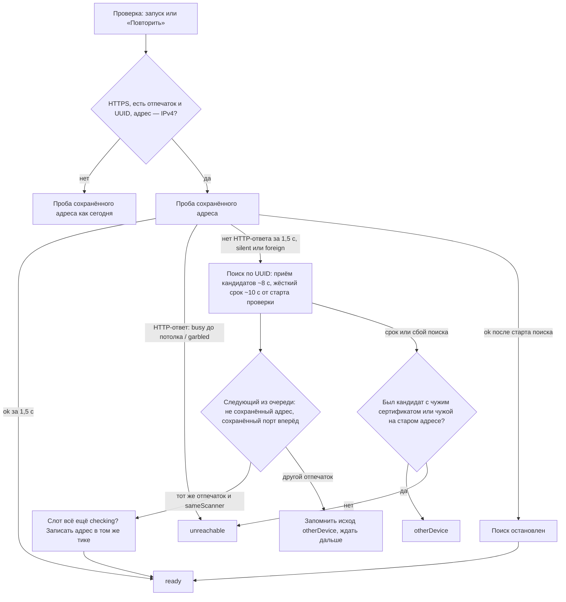

# Устойчивость подключения (M5) - Plan

## Goal Capsule

- **Objective:** роутер выдал сканеру новый адрес — приложение при запуске (или по «Повторить») само находит запомненный сканер и работает с ним без ручных действий; занятый сканер не роняет подключение и проверку; чужое устройство никогда не подменяет запомненное молча.
- **Means:** UUID — ключ поиска по mDNS, отпечаток сертификата — доказательство «то же устройство», новый адрес — в настройки существующей атомарной записью (KTD2–KTD5); классификация исхода пробы «молчит / занят / чужой / наш, но невнятно» (KTD1); ожидание «занят» в пробе (KTD6).
- **Product authority:** роадмап M5; спека `docs/duplexnt.md` → «Подключение сканера»; техбаза `docs/duplexnt-tech.md` §8; ADR 0003 (амендмент 2026-10-02: UUID защитой не является); решения автора при планировании 2026-10-25 (Key Decisions). Брейншторма нет — скоуп утверждён в чате.
- **Stop conditions:**
  - замер U1 показал, что сертификат ET-3850 меняется вместе с адресом — стоп до решения автора (R3 тогда не даёт тихого переезда);
  - адрес или отпечаток запомненного сканера меняется без проверки сертификата на новом адресе;
  - найденное поиском перезаписывает сканер, подключённый вручную, — в состоянии или в настройках;
  - поиск по сети на ответ «занят» или на отмену;
  - новый видимый UI без мока и handoff'а;
  - `src/core/scan/pass-service.ts` растёт сверх ~1000 строк (R21 спеки).
- **Execution profile:** ветка `feat/m5`, три сессии (План по сессиям); U1 требует автора у сканера и роутера; журнал вехи — `docs/solutions/0009-m5-connection-resilience.md`, заводится в сессии 1.

---

## Product Contract

### Summary

При запуске и по «Повторить» проверка запомненного сканера, не дозвавшись до сохранённого адреса, ищет в сети устройство с тем же UUID, проверяет его сертификат и молча запоминает новый адрес. Ответ «занят» при проверке и подключении пережидается повтором и поиск не запускает. Нового интерфейса нет; правило M1 «проверка настройки не меняет» уточняется: проверка меняет только адрес и только для доказанно того же устройства.

### Problem Frame

Профиль сканера хранит UUID и отпечаток с M1, но проверка при запуске идёт только по сохранённому адресу. Роутер выдал ET-3850 новый адрес — приложение показывает «не отвечает», и пользователь подключает сканер заново руками: открывает модалку, ждёт поиск, выбирает устройство. Техбаза называет именно это главным раздражителем штатных утилит («Именно отсутствие этого бесит»). Роадмап закрывает этим MVP: «смена адреса по DHCP не требует ручных действий, занятый сканер не роняет операцию».

Занятость сегодня пережидается только при создании задания и между страницами. Проверка при запуске смешивает «занят» с «не отвечает» (`isSilence`), а ручное подключение показывает на `503` «не сканер». Ответ `503` на `GET ScannerCapabilities` на ET-3850 не наблюдался (при печати статус отвечает `200`), поэтому ожидание здесь — защитное; U1 проверяет это на железе.

Смена адреса делает вероятнее и опасный случай: старый адрес достаётся другому устройству. Сегодня это «другое устройство» с «Подключить заново», подставляющим старый адрес, — один клик привязывает приложение к чужому.

### Requirements

**Тихий повторный поиск**

- R1. При запуске и по «Повторить», если сохранённый адрес молчит, проверка ищет в сети устройство с UUID запомненного сканера и, найдя то же устройство, переводит сканер в «готов» без вопросов.
- R2. Найденный адрес запоминается в настройках; следующий запуск идёт сразу по нему.
- R3. «То же устройство» доказывает отпечаток сертификата; UUID — только ключ поиска. Устройство с тем же UUID и другим сертификатом запомненное не подменяет — состояние «другое устройство», настройки не тронуты.
- R4. Поиск запускается и когда по сохранённому адресу отвечает чужое устройство; на «занят» и на отмену — не запускается.
- R5. Поиск не идёт для сканера по HTTP, для профиля без UUID или без запомненного отпечатка и для адреса, введённого именем, — такие профили проверяются как сегодня.
- R6. Проверка с поиском укладывается в бюджет: выключенный сканер даёт «не отвечает» не позже ~10 с от старта проверки.

**Интерфейс и гонки**

- R7. Поиск идёт под существующим «проверяем…»; новых состояний, строк и модалок нет. Строка «другое устройство» показывает запомненный сканер, как сегодня.
- R8. Сканер, подключённый вручную во время поиска, остаётся — найденное поиском не перезаписывает его ни в состоянии, ни в настройках.
- R9. Закрытие приложения прерывает поиск: сокеты закрыты, настройки после закрытия не пишутся.

**Занятость**

- R10. Ответ «занят» на запрос capabilities — при проверке запомненного сканера и при подключении из модалки — пережидается повтором с потолком.
- R11. Потолок исчерпан — в модалке подключения пользователь видит «занят», а не «не сканер»; текст не называет длительность. Строка устройства при запуске и по «Повторить» остаётся «не отвечает»; причина `scannerBusy` лежит в снимке.

**Данные**

- R12. Журнал сессии и файл незакрытых заданий при смене адреса не переписываются; досканирование прерванного прохода и закрытие незакрытых заданий работают по новому адресу.
- R13. Новый адрес пишется тем же путём, что ручное подключение: атомарно, с валидацией, без новой версии формата настроек.

### Key Decisions

- **HTTP-сканер не ищем.** (session-settled: user-directed — chosen over тихого переключения по совпавшему UUID: UUID объявляется в сеть открыто, без отпечатка проверить устройство нечем.) Governs R5.
- **Чужое устройство на старом адресе — повод искать.** (session-settled: user-directed — chosen over поиска только при молчании: иначе «Подключить заново» подставит старый адрес, и один клик привяжет чужое.) Governs R4.
- **Другой сертификат у найденного по UUID — «другое устройство», без тихой перепривязки.** (session-settled: user-approved — chosen over доверия UUID с записью нового отпечатка: это обесценивает сверку отпечатка.) Governs R3.
- **SerialNumber в профиль не добавляем.** (session-settled: user-approved — chosen over поля в профиле: в объявлении mDNS серийника нет, а поле требует новой версии формата настроек и журнала.) Governs R1, R13.
- **Поиск — только при запуске и по «Повторить».** (session-settled: user-approved — chosen over обработки смены адреса посреди работы: по DHCP это редкость, пункт — в бэклог.) Governs R1.
- **Проба пережидает «занят» и при запуске, и при подключении.** (session-settled: user-approved — chosen over прежнего «не отвечает» / «не сканер».) Governs R10, R11.
- **«Занят» показывается только в модалке; строка устройства остаётся «не отвечает».** (session-settled: user-directed — chosen over причины в строке устройства: это новый UI с моком и handoff'ом, а «занят» на проверке у ET-3850 не наблюдался.) Governs R11.

### Acceptance Examples

- AE1. **Covers** R1, R2. **Given** запомнен ET-3850 на адресе A, сканер теперь на B с тем же сертификатом. **When** запуск. **Then** «проверяем…» → «готов»; в настройках адрес B; следующий запуск идёт сразу на B без поиска.
- AE2. **Covers** R3. **Given** на B отвечает устройство с UUID запомненного и другим сертификатом. **When** запуск. **Then** «другое устройство»; настройки не тронуты.
- AE3. **Covers** R4. **Given** на A отвечает чужое HTTPS-устройство, наш сканер на B. **When** запуск. **Then** «готов» на B; адрес B в настройках.
- AE4. **Covers** R8. **Given** идёт поиск. **When** пользователь подключает сканер в модалке. **Then** подключённый вручную остаётся в состоянии и в настройках, даже если поиск позже нашёл запомненный.
- AE5. **Covers** R6. **Given** сканер выключен. **When** запуск. **Then** «не отвечает» не позже ~10 с; настройки не тронуты.
- AE6. **Covers** R10, R11. **Given** capabilities дважды отвечает `503`, затем `200`. **When** запуск или подключение. **Then** «готов» / подключено; поиска нет. **Given** `503` до потолка. **Then** в строке устройства «не отвечает»; в модалке — текст «занят».
- AE7. **Covers** R5. **Given** профиль HTTP (или адрес-имя, без UUID, без отпечатка), сканер молчит. **When** запуск. **Then** «не отвечает»; сокеты mDNS не открывались.
- AE8. **Covers** R12. **Given** прерванный проход снят на A, сканер переехал на B. **When** запуск находит B, пользователь жмёт «Досканировать». **Then** проход продолжается на B; незакрытое задание с A закрывается запросом на B.

### Success Criteria

- На живом ET-3850 смена адреса (резерв DHCP или статический IP) не требует от автора ничего, кроме запуска приложения.
- Здоровый запуск (сканер на месте) не открывает сокеты mDNS и не медленнее сегодняшнего.

### Scope Boundaries

- Смена адреса, пока приложение открыто и сканер уже «готов», — не в M5 (проход упадёт с «не отвечает», как сегодня).
- Полный словарь состояний устройства (сон, замятие, опустевший лоток) — пост-MVP по роадмапу.
- Показ найденного адреса в строке «другое устройство» и причины «занят» в строке «не отвечает» — нет: это новый UI (R7, R11).
- Опрос `ScannerStatus` между проходами (техбаза, «Подсказка готовности») в коде отсутствует — M5 его не вводит.

#### Deferred to Follow-Up Work

- Повторный поиск для HTTP-профилей — пункт бэклога (Key Decisions).
- Повторный поиск при «не отвечает» посреди сеанса — пункт бэклога.
- «Подключить заново» теряет схему и нестандартный `basePath` запомненного — пункт уже во «Входящих» бэклога, M5 его не берёт.
- Привязка к чужому устройству одним кликом остаётся там, где поиск не помогает: поиск не нашёл сканер, сертификат сменился посреди сеанса, плашка прерванного прохода подставляет адрес из журнала. «Подключить заново» по-прежнему подставляет старый адрес и запоминает то, что там отвечает; укрепление (например, предупреждение о смене отпечатка) — пункт бэклога.

---

## Planning Contract

### Key Technical Decisions

- KTD1. **Классификация исхода пробы — одна функция ядра вместо `isSilence`.** Классы и реакция — таблица в High-Level Technical Design. `silent` — сетевая недоступность (`scannerUnreachable` с любой причиной); `foreign` — ответ чужого (`scannerCertificateChanged`, `notEsclScanner` не по `5xx`, `scannerNoJpeg`, `scanParamsUnsupported`, другой UUID при том же отпечатке); `busy` — `scannerBusy`; `garbled` — `scannerBadResponse` и `notEsclScanner` с `5xx`, кроме `503`, под сверенным отпечатком (ответил наш сканер, но невнятно); `canceled` — только внешний сигнал отмены (закрытие приложения). Поиск — на `silent` и `foreign` (R4), на остальные — нет. Для профиля HTTP `garbled` неотличим от чужого, но HTTP не ищется вовсе (R5), поэтому развилки нет. Состояние слота по классам не меняется: `foreign` → `otherDevice`, остальное → `unreachable` (как сегодня), если поиск ничего не дал.
- KTD2. **Поиск по UUID — функция ядра в `src/core/discovery/` поверх `startDiscovery`.** Объект поиска получает доступ к записям с UUID для ядра; снимок для UI (`DiscoveredScanner`) не меняется — UUID в интерфейс не уходит. Функция отдаёт кандидатов по мере появления, останавливает поиск в `finally`, по сигналу отмены и раньше бюджета при сбое поиска (`noNetwork`, `socket`). UUID сравнивается в нижнем регистре с обеих сторон: TXT приводится к нижнему регистру, а UUID из capabilities хранится как есть.
- KTD3. **Тайминг: поиск стартует, только если старый адрес не дал HTTP-ответа за ~1,5 с или ответил «чужой» / отказал раньше.** «Ответил» — любой HTTP-ответ, включая `503`: проба сообщает проверке о первом ответе (KTD6), и это отменяет запуск поиска; занятый сканер держит «проверяем…» до потолка ожидания (~15 с) и поиска не вызывает (R4). Здоровая проба укладывается в ~0,8 с (полное TLS-рукопожатие ET-3850), поэтому здоровый запуск сокетов mDNS не открывает — и окно файрвола Windows при обычном запуске не появляется. Сроки: жёсткий срок проверки — ~10 с от её старта (R6); новые кандидаты принимаются до ~8 с от старта поиска (худший замер появления ET-3850 — 7,3 с); проба кандидата, начатая до этого, может идти до жёсткого срока. Жёсткий срок прерывает висящую пробу старого адреса (соединение есть, HTTP-ответа нет) и пробу кандидата; такой обрыв — `scannerUnreachable` (`timeout`), а не `canceled`. Альтернатива «поиск параллельно с первой пробой» отвергнута: открывает mDNS на каждом запуске ради экономии 1,5 с в редком случае.
- KTD4. **Выбор кандидата.** Кандидат с адресом и портом, равными сохранённым, пропускается — это старый адрес, его исход уже известен. Кандидаты встают в очередь по мере появления и пробуются по одному; начатая проба не прерывается. Из очереди следующим берётся кандидат на сохранённом порту (ET-3850 объявляет `_uscan` и `_uscans` на одном порту 443; запись на чужом порту для HTTPS-пробы бесполезна). Проба кандидата не пережидает «занят»: `503` — кандидат не подтверждён, поиск идёт дальше; первый, прошедший пробу с запомненным профилем (схема, `basePath`, отпечаток) и `sameScanner`, завершает поиск. Кандидат с чужим сертификатом запоминается как исход `otherDevice` на случай, если до конца бюджета не найдётся настоящий.
- KTD5. **Оркестрация — новый модуль ядра для запомненного сканера, вынесенный из `pass-service.ts`.** Слот сканера, `checkRememberedScanner` службы и `scannerState` (~100 строк) уходят в `src/core/scan/scanner-slot.ts`; `pass-service.ts` опускается ниже ориентира R21. `settings-store.checkRememberedScanner` остаётся чистой (настроек не пишет) и получает поиск как зависимость; исход «готов на новом адресе» несёт признак переезда. Запись нового адреса — в службе, в том же тике, что сверка «слот всё ещё `checking`», до первого `await`: очередь настроек FIFO, поэтому `useScanner`, вызванный позже, всегда побеждает (R8). Повторный вызов проверки во время `checking` возвращает идущую проверку, а не запускает вторую.
- KTD6. **Ожидание «занят» — в `probeScanner`, общей для подключения и проверки.** `503` на capabilities даёт `scannerBusy`, а не `notEsclScanner`; повтор раз в 1 с до потолка ~15 с через шов часов по образцу `ScanJobClock` из `scan-job.ts`; отмена прерывает ожидание. Проба сообщает вызывающему о первом HTTP-ответе с любым кодом — по нему проверка отменяет запуск поиска (KTD3); для кандидатов ожидание выключено (KTD4). `scannerBusy` не повод переходить на HTTP. Петли `scan-job.ts` не объединяются с новой: потолки, причины и уведомления разные (журнал 0002, ревью сессии 4). Текст `scannerBusy` в `locales/ru/common.json` переписывается без «за минуту» — он теперь общий для потолков 15 с и 60 с (R11).
- KTD7. **Запись нового адреса — `settings.rememberScanner(storedScannerOf(connected))`, как у ручного подключения.** Схема настроек (v3) не меняется: `uuid` и `fingerprint` в ней уже есть. Журнал и файл незакрытых заданий не трогаются — они сверяют сканер через `sameScanner` по отпечатку и UUID, а транспорт прохода берёт адрес из `connected.profile` (R12).
- KTD8. **Без ADR.** Стек, ключевые библиотеки и схема данных не меняются; политика идентичности остаётся прежней (ADR 0003, амендмент 2026-10-02: UUID — не защита, доказательство — отпечаток). Уточнение правила M1 «проверка настройки не меняет» фиксируется в спеке и в журнале вехи.
- KTD9. **Тестовые швы.** Поиск попадает в службу через `PassServiceOptions` (по умолчанию — настоящий `startDiscovery`), чтобы интеграционные тесты проверки не открывали сокеты 5353 и не ждали бюджет; порог 1,5 с и сроки проверки идут через тот же шов часов, что ожидание «занят». Эмулятор получает опцию постоянного сертификата (переезд = тот же сертификат на другом порту) и сценарий `503` на capabilities. Один тест остаётся на настоящем классе библиотеки — фейк уже однажды смоделировал ошибку, которой у библиотеки нет (журнал 0002).

### High-Level Technical Design

Исход пробы и реакция проверки (KTD1):

| Класс      | Коды                                                                                                            | Поиск | Слот, если поиск не нашёл |
| ---------- | --------------------------------------------------------------------------------------------------------------- | ----- | ------------------------- |
| `ok`       | проба прошла, `sameScanner`                                                                                     | —     | `ready`                   |
| `silent`   | `scannerUnreachable` (timeout, refused, dns, reset, tls; обрыв по жёсткому сроку)                               | да    | `unreachable`             |
| `foreign`  | `scannerCertificateChanged`, `notEsclScanner` (не `5xx`), `scannerNoJpeg`, `scanParamsUnsupported`, другой UUID | да    | `otherDevice`             |
| `busy`     | `scannerBusy` после потолка ожидания                                                                            | нет   | `unreachable`             |
| `garbled`  | `scannerBadResponse`, `notEsclScanner` с `5xx` кроме `503`                                                      | нет   | `unreachable`             |
| `canceled` | `canceled` по внешнему сигналу (закрытие приложения)                                                            | нет   | без изменений             |

Ход проверки запомненного сканера:

### Assumptions

- Сертификат ET-3850 не меняется при смене адреса и после перезагрузки (перезагрузку журнал 0002 подтвердил, смену адреса — нет). Проверяет U1; при опровержении — стоп (Goal Capsule).
- UUID из TXT и UUID из capabilities — одно значение с точностью до регистра. Проверяет U1; при опровержении (UUID в TXT нет или формат другой) поиск не может сопоставить устройство — стоп и вопрос автору, как с сертификатом.
- Два поиска mDNS в одном процессе (поиск проверки и поиск модалки) оба видят сканер: порт 5353 с `reuseAddr` уже делится с Bonjour и DNS-клиентом Windows. Проверяет U1; при опровержении открытие модалки останавливает поиск проверки (запасной вариант, без нового UI).

---

## Implementation Units

### U1. Замер на живом ET-3850: сертификат и UUID при смене адреса, «занят» на GET, два поиска

**Goal:** подтвердить предпосылки R3, KTD2 и KTD6 на железе до кода.

**Requirements:** R3, R10; Assumptions.

**Dependencies:** нет.

**Files:**

- Modify: `docs/duplexnt-tech.md` (§8 — результаты замера без настоящих значений)
- Create: `docs/solutions/0009-m5-connection-resilience.md` (журнал вехи по `docs/templates/solution.md`)
- Скрипт замера — `temp/` (вне git)

**Approach:**

1. Записать отпечаток SHA-256, SAN сертификата, UUID из TXT и из capabilities на текущем адресе.
2. Автор меняет адрес сканера: резерв DHCP в роутере или статический IP в Web Config МФУ.
3. Повторить шаг 1 на новом адресе; затем перезагрузить МФУ и повторить ещё раз.
4. Автор запускает печать; во время печати — `GET ScannerCapabilities` и `GET ScannerStatus`, записать коды.
5. Два одновременных поиска mDNS в одном процессе — оба ли видят сканер.
6. Итог — в техбазу §8 и в журнал вехи; настоящие UUID и адреса в git не попадают (гейт чистоты идентификаторов).

**Execution note:** нужен автор у МФУ и роутера в начале сессии 1. Если отпечаток сменился — стоп и вопрос автору до U2.

**Test expectation:** none — замер на железе, результат в доках.

**Verification:** техбаза §8 отвечает на три вопроса (сертификат при смене адреса, `503` на GET, два поиска); журнал вехи заведён.

---

### U2. Классификация исхода пробы и ожидание «занят»

**Goal:** проба различает «молчит / занят / чужой / невнятно» и пережидает «занят».

**Requirements:** R4, R10, R11.

**Dependencies:** U1 (коды `503` на GET).

**Files:**

- Modify: `src/core/escl/connect.ts`, `src/core/escl/connect.test.ts`
- Modify: `src/core/storage/settings-store.ts`, `src/core/storage/settings-store.test.ts`
- Modify: `locales/ru/common.json` (текст `scannerBusy`)
- Modify: `test/emulator/scenarios.ts`, `test/emulator/server.ts` (сценарий `503` на capabilities)
- Modify: `test/integration/connect.emulator.test.ts`

**Approach:**

1. Классификатор KTD1 заменяет `isSilence`; проверка запомненного сканера пока даёт те же слоты, что сегодня (поиск подключает U4).
2. `probeScanner` получает шов часов и потолок ожидания (KTD6); `503` → повтор → `scannerBusy`.
3. Подключение из модалки не переходит на HTTP по `scannerBusy`.

**Patterns to follow:** петля `503` и `ScanJobClock` в `src/core/escl/scan-job.ts`; фейк `deviceAt` в `settings-store.test.ts`.

**Test scenarios:**

- Capabilities `503`, `503`, `200` → проба успешна; часы показали две паузы по 1 с.
- `503` до потолка → `scannerBusy`.
- Отмена во время паузы → `canceled`, без дальнейших запросов.
- Ручное подключение без схемы: `503` на HTTPS → `scannerBusy`, попытки HTTP нет.
- Классификатор: каждый код из таблицы KTD1 → свой класс; `notEsclScanner` с `503` больше не встречается (стал `scannerBusy`), с `404` → `foreign`, с `500` → `garbled`.
- Проба сообщает о первом HTTP-ответе: `503` в 0,1 с → уведомление сразу, итог пробы — после повторов.
- Проба с выключенным ожиданием (режим кандидата): `503` → `scannerBusy` сразу, без пауз.
- Проверка запомненного сканера: `scannerBusy` → `unreachable` с причиной `scannerBusy`.
- Интеграция на эмуляторе: сценарий «capabilities занят дважды» → подключение проходит.

**Verification:** тесты зелёные; `isSilence` удалён; текст `scannerBusy` не называет длительность.

---

### U3. Поиск по UUID в обнаружении

**Goal:** ядро умеет за ограниченное время найти в сети записи с заданным UUID.

**Requirements:** R1, R6, R9.

**Dependencies:** нет (параллельно с U2).

**Files:**

- Modify: `src/core/discovery/mdns.ts`, `src/core/discovery/mdns.test.ts`
- Create: `src/core/discovery/find-by-uuid.ts`, `src/core/discovery/find-by-uuid.test.ts`

**Approach:**

1. `Discovery` получает доступ к записям с UUID для ядра; `state()` и снимок для UI не меняются (KTD2).
2. Функция поиска отдаёт кандидатов по мере появления и завершается по бюджету, сигналу, сбою поиска или по команде вызывающего; поиск останавливается в `finally`.

**Patterns to follow:** `startDiscovery` и фейковый backend с `emit` в `src/core/discovery/mdns.test.ts`.

**Test scenarios:**

- Объявление с UUID запомненного → кандидат с адресом, портом, `basePath`.
- UUID в разном регистре → совпадение.
- Объявление с другим UUID и без UUID → не кандидат.
- Один UUID на двух портах → два кандидата.
- Бюджет истёк без совпадений → пусто; поиск остановлен.
- Отмена сигналом → завершение; поиск остановлен.
- Нет внешних интерфейсов (`noNetwork`) → завершение сразу, без ожидания бюджета.
- Исключение в обработчике вызывающего → поиск всё равно остановлен.

**Verification:** тесты зелёные; `DiscoveredScanner` и снимок не изменились.

---

### U4. Повторный поиск в проверке запомненного сканера, запись адреса, вынос слота

**Goal:** проверка при запуске и по «Повторить» находит переехавший сканер и молча запоминает адрес.

**Requirements:** R1–R9, R12, R13.

**Dependencies:** U2, U3.

**Files:**

- Create: `src/core/scan/scanner-slot.ts`, `src/core/scan/scanner-slot.test.ts`
- Modify: `src/core/scan/pass-service.ts` (слот и проверка уходят в новый модуль; зависимость поиска в `PassServiceOptions`)
- Modify: `src/core/storage/settings-store.ts`, `src/core/storage/settings-store.test.ts`
- Modify: `src/main/index.ts` (сигнал отмены стартовой проверки на `will-quit`)
- Modify: `src/core/commands/handlers.ts`, `src/core/commands/handlers.test.ts` (сигнал отмены для «Повторить», прерывается `commands.dispose()`)
- Modify: `test/support/pass-service.ts` (фейковый поиск по умолчанию)
- Test: `test/integration/pass.emulator.test.ts` (блок «проверка запомненного сканера» — с внедрённым поиском)

**Approach:**

1. Вынести слот, проверку и `scannerState` из `pass-service.ts` без изменения поведения; тесты проверки — в новый файл, `pass-service.test.ts` (1076 строк) не растёт.
2. `settings-store.checkRememberedScanner` получает поиск как зависимость и реализует ход из High-Level Technical Design: условия поиска (R5), тайминг (KTD3), выбор кандидата (KTD4); исход «готов» несёт новый адрес.
3. Служба пишет адрес по KTD5: сверка `checking` и постановка записи в очередь — в одном тике.
4. Повторный вызов во время `checking` возвращает идущую проверку.
5. Стартовая проверка получает сигнал от `main`, проверка по «Повторить» — от обработчика команд; оба прерываются при закрытии (`will-quit` и уже вызываемый там `commands.dispose()`) (R9).

**Execution note:** вынос — отдельным коммитом с зелёными тестами до изменения поведения.

**Patterns to follow:** гонка с ручным подключением и `holdingTransport` в `test/integration/pass.emulator.test.ts`; запись настроек в `useScanner` (`pass-service.ts`).

**Test scenarios:**

- Covers AE1. Старый адрес молчит, кандидат с тем же отпечатком → `ready`, `rememberScanner` вызван с новым адресом.
- Covers AE2. Кандидат с другим отпечатком, бюджет истёк → `otherDevice`, записи нет.
- Covers AE3. Старый адрес — `scannerCertificateChanged`, кандидат наш → `ready` на новом адресе.
- Covers AE4. Поиск нашёл сканер после `useScanner` другого устройства → слот и настройки — у ручного.
- Covers AE4. Поиск нашёл сканер, `useScanner` вызван в следующем тике → в настройках итог ручного (FIFO).
- Covers AE5. Сканер выключен, поиск пуст → `unreachable` к концу бюджета; записи нет.
- Covers AE7. Профиль HTTP / без UUID / без отпечатка / адрес-имя молчит → `unreachable`, поиск не вызывался.
- Здоровый адрес отвечает за 0,8 с → поиск не вызывался.
- Covers AE6. Старый адрес: `503` в 0,1 с, `200` в 2,1 с → `ready`, поиск не вызывался.
- Старый адрес `500` → `unreachable`, поиск не вызывался.
- Кандидат появился на 7,3 с и отвечает за 0,8 с → `ready` до жёсткого срока.
- Проба кандидата висит на жёстком сроке → прервана, `unreachable`, записи нет.
- Проба старого адреса висит на жёстком сроке → `unreachable` (`timeout`), не «без изменений».
- Кандидат отвечает `503` → не подтверждён, следующий кандидат пробуется сразу.
- Старый адрес ответил после старта поиска → `ready` на старом адресе, поиск остановлен, записи нет.
- Кандидат равен сохранённому адресу и порту → пропущен.
- Два кандидата пришли до первого выбора, сохранённый порт вторым в объявлениях → проба идёт сначала по сохранённому порту.
- Кандидат на сохранённом порту пришёл, пока идёт проба другого → начатая проба не прерывается, он следующий.
- `busy` и `garbled` на старом адресе → поиска нет.
- Повторный вызов во время `checking` → один поиск, оба вызова видят один исход.
- Отмена сигналом (закрытие приложения) → поиск остановлен, записи нет.
- Проверка по «Повторить», затем `commands.dispose()` → поиск остановлен, записи нет.
- Covers AE8. Журнал с проходом на старом адресе, сканер найден на новом → `canResume` истинно; незакрытое задание закрывается запросом на новый адрес.

**Verification:** тесты зелёные; `pass-service.ts` ниже ~1000 строк; `settings-store.checkRememberedScanner` настроек не пишет.

---

### U5. Эмулятор переезда, сквозные сценарии, CDP-смоук

**Goal:** переезд и занятость проверены сквозь настоящий транспорт и упакованное приложение.

**Requirements:** R1–R4, R6, R8, R10–R13.

**Dependencies:** U4.

**Files:**

- Modify: `test/emulator/server.ts` (опция постоянного сертификата)
- Create: `test/integration/remembered-scanner-move.emulator.test.ts`
- CDP-смоук — `temp/smoke-m5.mjs` (вне git)

**Approach:**

1. Переезд в интеграции: запомнен порт A, эмулятор закрыт на A и поднят на B с тем же сертификатом, фейковый поиск объявляет UUID на `127.0.0.1:B`.
2. Чужой: второй эмулятор с новым сертификатом и тем же UUID.
3. CDP-смоук `built` + `dev` покрывает регрессию запуска: запомненный эмулятор → «готов»; запомненный на закрытом порту → «не отвечает» в пределах бюджета; capabilities занят дважды → «готов». Переезд через настоящий mDNS эмулятор не объявляет — он остаётся на приёмке (U6).

**Patterns to follow:** «второй эмулятор» из M4.5 (`test/integration/added-pair*.emulator.test.ts`); `temp/smoke-m4-5.mjs`, `DUPLEXNT_USER_DATA`, порты по сценарию, закрытие процессов только по PID.

**Test scenarios:**

- Covers AE1. Переезд A → B → `ready`; `settings.json` после записи читается и содержит B.
- Covers AE2. Тот же UUID, другой сертификат на B → `otherDevice`; `settings.json` без изменений.
- Covers AE8. Прерванный проход на A, переезд на B → досканирование идёт на B.
- Covers AE6. Capabilities `503` дважды → проверка `ready` без поиска.
- Covers AE4. Ручное подключение второго эмулятора во время поиска → в `settings.json` второй эмулятор.

**Verification:** `test:all` зелёный; CDP-смоук зелёный в `built` и `dev`; консоль renderer чистая.

---

### U6. Доки, чеклист приёмки, приёмка автора, закрытие вехи

**Goal:** доки соответствуют коду; автор принял веху на живом ET-3850; merge по явному ОК.

**Requirements:** все.

**Dependencies:** U5.

**Files:**

- Modify: `docs/duplexnt.md` («Модель данных» — профиль без SerialNumber; «Подключение сканера» — поведение M5 и уточнённое правило проверки; правило идентичности)
- Modify: `docs/duplexnt-tech.md` (§8 — «UUID и SerialNumber» → UUID)
- Modify: `docs/roadmap.md` (M5 ✅, строка профиля)
- Modify: `docs/design/handoffs/2026-10-m1-states.md` (S2: «проверяем…» покрывает поиск)
- Modify: `docs/backlog.md` (пункты Deferred to Follow-Up Work; заодно — подсеть сохранённого адреса как условие поиска и хранение имени `<name>.local` вместо IP, замечания проверки плана)
- Modify: `docs/solutions/0009-m5-connection-resilience.md` (итог, приёмка, закрытие)
- Чеклист — `docs/output/<дата>-smoke-checklist-m5-acceptance.md` (вне git, по шаблону)

**Approach:**

1. Доки по факту и сверка с кодом.
2. Чеклист приёмки: настоящая смена адреса; сканер выключен — время до «не отвечает»; запуск во время печати; модалка открыта во время поиска; окно файрвола Windows у установленного приложения на чистом профиле, подключённом по ручному адресу.
3. Приёмка автора; правки приёмки — в ветку; merge `feat/m5` → `main` только по явному ОК отдельным вопросом.

**Test expectation:** none — доки и приёмка.

**Verification:** чеклист пройден автором; журнал `status: done`; роадмап M5 ✅ с датой.

---

## План по сессиям

| Сессия | Юниты | Граница                                                                                       |
| ------ | ----- | --------------------------------------------------------------------------------------------- |
| 1      | U1–U3 | замер на железе с автором; классификация и ожидание «занят»; поиск по UUID; журнал заведён    |
| 2      | U4–U5 | вынос слота, повторный поиск и запись адреса; эмулятор переезда, интеграция, CDP-смоук; ревью |
| 3      | U6    | доки, чеклист, приёмка на живом ET-3850, merge по явному ОК                                   |

Каждая сессия кончается зелёным коммитом с U-ID в теме (`feat(m5): U3 …`); возобновление — `git log` + журнал вехи. Ревью (simplify + код-ревью) — в конце сессии 2 по всему коду вехи, правки отдельным `fix(review)`-коммитом.

---

## System-Wide Impact

- **Настройки:** впервые пишутся из проверки, а не из действия пользователя. Путь записи прежний (атомарно, валидация до и после); гонка с ручным подключением закрыта KTD5.
- **Сеть при запуске:** проверка может открыть сокеты mDNS без открытия модалки — окно файрвола Windows может появиться при запуске у того, кто подключал сканер по ручному адресу (Risks).
- **Время до «не отвечает»:** при выключенном сканере ~10 с вместо ~5 с (R6).
- **Тексты:** ручное подключение к занятому сканеру показывает «занят» вместо «не сканер»; текст `scannerBusy` общий.
- **Журнал и незакрытые задания:** не меняются (KTD7).
- **Граница слоёв:** всё — в ядре; renderer не меняется, мост не меняется.

---

## Risks & Dependencies

| Риск                                                                             | Митигирование                                                                                               |
| -------------------------------------------------------------------------------- | ----------------------------------------------------------------------------------------------------------- |
| Сертификат ET-3850 меняется при смене адреса — тихий переезд по HTTPS невозможен | U1 первым; стоп и решение автора до кода                                                                    |
| Окно файрвола при запуске без контекста; «Отмена» блокирует и поиск модалки      | Поиск только при молчании (KTD3); строка чеклиста на установленном приложении; при проблеме — пункт бэклога |
| Два поиска в одном процессе не видят ответов друг друга                          | U1 проверяет; запасной вариант — модалка останавливает поиск проверки                                       |
| UUID из TXT и capabilities расходятся форматом                                   | Сравнение в нижнем регистре (KTD2); U1 сверяет                                                              |
| Тесты на времени флакают (уже было с `pass.emulator`)                            | Шов часов и внедрённый поиск; ожидание по состоянию, не по времени                                          |
| `pass-service.ts` на границе R21                                                 | Вынос слота первым коммитом U4 (KTD5)                                                                       |
| Устройство молчит на первый запрос mDNS                                          | Повторные запросы 1/2/4/8 с уже в `startDiscovery`; бюджет ~8 с покрывает худший замер 7,3 с                |

Зависимость: автор у МФУ и роутера для U1 и приёмки U6.

---

## Documentation / Operational Notes

- Спека, техбаза, роадмап, handoff M1, бэклог — в U6.
- Правило M1 «проверка настройки не меняет ни при каком исходе» уточняется в спеке: проверка меняет только адрес и только при доказанно том же устройстве.
- Гейт чистоты идентификаторов: замер U1 записывается без настоящих UUID, адресов и отпечатков.

---

## Verification Contract

| Проверка                        | Команда / действие                                   | Когда              |
| ------------------------------- | ---------------------------------------------------- | ------------------ |
| Типы                            | `npm run typecheck`                                  | каждый юнит        |
| Линт (граница слоёв)            | `npm run lint`                                       | каждый юнит        |
| Формат                          | `npm run format:check`                               | каждый юнит        |
| Тесты node + jsdom + интеграция | `npm run test:all`                                   | каждый юнит        |
| Сборка                          | `npm run build`                                      | U5, U6             |
| CDP-смоук                       | `temp/smoke-m5.mjs` в режимах `built` и `dev`        | U5, перед приёмкой |
| Страж приватности               | pre-commit hook                                      | каждый коммит      |
| Приёмка на железе               | чеклист U6 на упакованном приложении и живом ET-3850 | U6                 |

---

## Definition of Done

- Все юниты закрыты; typecheck, lint, format:check, `test:all` зелёные; CDP-смоук зелёный в `built` и `dev`.
- AE1–AE8 покрыты тестами; AE1, AE5, AE6 и окно файрвола проверены автором на живом ET-3850.
- `pass-service.ts` и новые файлы — в пределах ориентира R21; `pass-service.test.ts` не вырос.
- Нет кода от брошенных подходов (например, запасного варианта остановки поиска, если U1 его не потребовал).
- Доки долиты, журнал вехи `status: done`, роадмап M5 ✅; merge `feat/m5` → `main` — только по явному ОК автора.

---

## Sources / Research

- `src/core/storage/settings-store.ts` — `isSilence`, `checkRememberedScanner` (чистая, без записи).
- `src/core/scan/pass-service.ts` — `ScannerSlot`, `checkRememberedScanner` службы (сверка `scanner !== checking`), `useScanner` (запись настроек), 998 строк.
- `src/core/escl/connect.ts` — `probeScanner`, общая для подключения и проверки; переход на HTTP только по `refused` / `tls`.
- `src/core/escl/transport.ts` — сверка отпечатка до отправки запроса, `scannerCertificateChanged`; кэш TLS-сессий только проверенных.
- `src/core/discovery/mdns.ts`, `src/core/discovery/txt.ts` — `startDiscovery`, повторные запросы, `ScannerRecord` с UUID в нижнем регистре; один UUID на двух адресах — две записи.
- `src/core/storage/stored-scanner.ts` — `sameScanner` по отпечатку и UUID; адрес — только когда сравнить нечем.
- `docs/solutions/0002-m1-connect-single-pass.md` — замеры mDNS (186 прогонов; худшее появление 7,3 с), `503` на `POST` при печати и после `DELETE`, отпечаток после перезагрузки, гонки проверки (ревью сессий 6 и 9), окно файрвола.
- `docs/decisions/0003-shell-build-delivery.md` — mDNS на чистом JS, `reuseAddr`, экземпляр на интерфейс; UUID защитой не является.
- `test/fixtures/escl/et-3850/traces/busy-printing.json` — `ScannerStatus` `200` во время печати, `503` только на `POST`.
- `test/emulator/server.ts` — новый самоподписанный сертификат на каждый старт, без mDNS.
