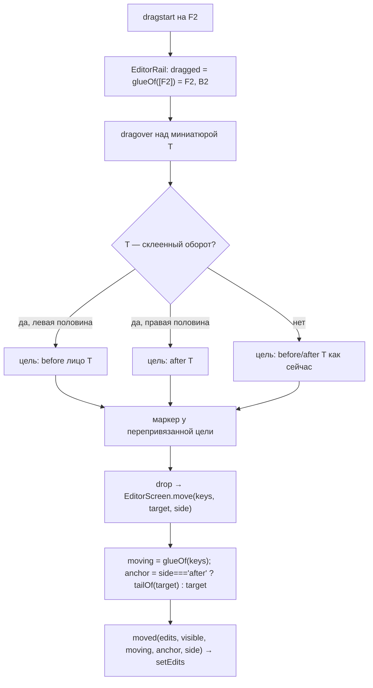

# feat: пустой оборот приклеен к своему листу (B-13)

## Goal Capsule

- **Objective.** Пустой оборот в ленте редактора всегда стоит за своим лицом: его нельзя оторвать жестом, он едет за лицом, уходит с ним, попадает с ним в документ, а досканированные наборы при ручном порядке собираются парами, а не блоками.
- **Means.** Одно правило склейки в renderer для всех жестов (KTD-1, KTD-2) и перерасстановка ключей завершённого прохода в явном порядке в ядре (KTD-6).
- **Authority.** Спека `docs/duplexnt.md` → `docs/design/UI_SPEC.md` → этот план → карточка B-13. Разногласие плана со спекой решает автор.
- **Stop conditions.** Смена схемы `SessionEdits` или журнала; изменение видимого UI (нужен мок); обнаружение, что пара набора не хранится в ядре.

---

## Summary

Пустой оборот становится частью листа. При переносе лица едет и его пустой оборот, при удалении лица уходит и оборот, «Выделить в документ» берёт лист целиком, а якорь «после» такого лица значит «после листа». Так уже работает для скрытых оборотов (хвост R12 M4); теперь то же при показанных «Пустых» и в режиме «Помечать». Сам пустой оборот отдельно не перетаскивается; «Это не пустая страница» делает его обычной страницей. В ядре по завершении прохода оборотов его страницы перерасставляются в ручном порядке так, как их раскладывает сборка, чтобы пары не застывали блоком. Вход — карточка B-13 в бэклоге с разбором 2026-10-27 и тест `test/integration/added-pair-order.emulator.test.ts`. Видимый UI не меняется, мок не нужен.

## Problem Frame

Отзыв пользователя 2026-10-27: пустой оборот логически привязан к лицу и должен двигаться с ним независимо от переключателя «Пустые» и от того, как страницы попали в ленту. Сейчас:

- при включённом переключателе выделение буквальное (решение M4, R12): лицо переезжает, оборот остаётся; якорь «после текущей» на лице ставит набор между лицом и его оборотом — ровно картина скриншота автора (`Д1л Д1о Д1л [Д2…] Д1о`);
- при ручном порядке ленты обороты досканированного набора встают блоком за его лицами: `withRebasedEdits` перебазирует `order` на каждой странице идущего прохода против `settled`-проекции, а она для идущих оборотов — подблоки (решение ревью M3.6 #1, закреплено в ADR 0004 «Явный порядок»). К концу прохода порядок зафиксирован, чередование базовой сборки на него не влияет. Без ручного порядка лента равна сборке — поэтому «сразу после сканирования правильно».

Разбор показал: связь пары в ядре надёжна (`pair` на проходе оборотов набора, чередование в `setBlockOf`), рвётся раскладка. Детали — карточка B-13, `docs/solutions/0020-hidden-tail-cut.md`.

---

## Requirements

**Склейка в ленте**

- R1. Пустой оборот (флаг `hidden` или `marked`) — склеенная часть своего листа при любом состоянии переключателя «Пустые» и в обоих режимах пустых. Правило «свой» — KTD-1.
- R2. Перенос лица везёт его склеенный оборот; бросок «после» лица — после оборота. Выделение с лицом без его оборота добирает оборот; оборот без своего лица в переносе не участвует.
- R3. Удаление лица удаляет и его склеенный оборот одним шагом Ctrl+Z. Выделенный оборот без лица удаляется сам — удаление буквальное.
- R4. «Выделить в документ» берёт лист целиком по правилу R2 (оборот без лица выпадает, лицо добирает оборот). Разрез не ложится между лицом и его склеенным оборотом: сплит-бар и кнопка тулбара «Новый документ с этой страницы» на склеенном обороте недоступны.
- R5. Якорь «+ Добавить → После текущей» на лице или на его склеенном обороте — после оборота. «В конец документа» — как сейчас, по последней странице полной ленты.
- R6. Склеенный оборот не перетаскивается сам; тянется только вместе с лицом (выделение с лицом). На склеенном обороте — обычный курсор и подпись «Оборот идёт вместе со своей страницей» (решение автора 2026-10-27: минимальная подсказка без нового визуала). Бросок на склеенный оборот: левая половина — перед его лицом, правая — после оборота; маркер показывается там же. Бросок лица на свой оборот — ничего.
- R7. «Это не пустая страница» снимает склейку (страница обычная); Ctrl+Z пометки возвращает её.
- R8. Скрытые обороты ведут себя как сейчас (R12 M4, хвост до границы документа) — это частный случай R1–R6.

**Сборка при явном порядке (ядро)**

- R9. Когда проход оборотов — набора или основной пачки — выходит из `running`, его страницы перерасставляются в `edits.order` против итоговой базовой сборки: каждый оборот сразу за своей парой. Остальные ключи `order` не трогаются. Разрезы и граница переезжают вслед за страницами.
- R10. Перерасстановка идемпотентна при сверке и перезапуске (ADR 0004: восстановление без дублей) и срабатывает только на переходе состояния, не на каждом коммите.
- R11. Тесты `it.fails` в `test/integration/added-pair-order.emulator.test.ts` становятся обычными `it` и зелёными: обороты набора при явном порядке — чередованием; якорь на лице со своим оборотом — блок после листа.

---

## Key Technical Decisions

- **KTD-1. «Свой» оборот = соседство + пара.** Склеен пустой оборот (`blank !== null`; флаг ядро ставит только страницам прохода оборотов, поэтому `side` не проверяется — в режиме `assembled` сторона позиционная и после удаления страницы меняет чётность), стоящий в полной ленте сразу за страницей внутри того же документа; цепочка подряд идущих пустых оборотов за одной страницей — все её (как хвост сейчас). Пара уточняет «чей»: в режиме `pairs` у обеих страниц с ненулевым `sheet` должны совпасть `addedSet` и `sheet`, иначе цепочка обрывается; при `sheet: null` хотя бы у одной из них (лишние обороты, подблоки несовпавшего набора) действует одно соседство — как хвост сейчас. В режиме `assembled` `sheet` позиционный (по записи сборки) — пара не проверяется, работает только соседство. В режиме `sets` склейки нет (пар нет; там и скрытия нет). Несоседняя пара — обычная страница: поздний вердикт детектора или сессия до B-13 могли разнести лицо и оборот, и тянуть оборот издалека («после текущей» в другом месте ленты) хуже, чем не склеить. Отклонено: чистая пара без соседства (скачки страниц из другого места); чистая позиция без пары (клеит к чужому лицу после старых перестановок). Уточняет подтверждённое автором направление «по паре из сборки, позиция — запасное правило»: пара решает «чей», соседство — «склеен ли».
- **KTD-2. Одна функция склейки на все жесты, в `state/shown.ts`.** `withHiddenTails` заменяется функцией, которая принимает полную ленту, начала документов и режим сборки и не зависит от переключателя; ветка `reveal ? keys : …` в `EditorScreen.withTails` снимается. Через неё идут перенос, удаление, группировка и якорь — как сейчас (0020: «правило одно на всех»). Рядом — чистые помощники для частичного выделения (R2, R4) и для перепривязки цели броска (R6). `EditorScreen.tsx` ≈ 1000 строк (ориентир R21): новая логика только в `shown.ts`.
- **KTD-3. Частичное выделение — одно правило для переноса и группировки, удаление буквальное.** Оборот без лица выпадает из переноса и группировки (иначе `grouped` поставит разрез между лицом и оборотом — против R4); лицо без оборота его добирает. Удаление: выделенные ключи плюс обороты выделенных лиц; оборот без лица удаляется сам (пользователь может хотеть убрать пустой оборот из вывода в режиме «Помечать»). Счётчики тостов и панели выделения — по страницам пользователя, как сейчас для скрытых хвостов.
- **KTD-4. Лента получает склейку как данные.** `EditorRail` получает карту «оборот → лицо» (или набор склеенных ключей) и: не делает склеенный оборот источником переноса, кроме случая, когда он и его лицо в мультивыделении; включает обороты в `draggedKeys` (подсветка `thumb--dragging`, нет маркера над своим оборотом); перепривязывает цель броска на склеенном обороте (R6) до рисования маркера; не показывает сплит-бар на склеенном обороте. Расчёт — чистой функцией из `shown.ts` (KTD-2), лента только применяет.
- **KTD-5. Разрез между лицом и склеенным оборотом не ставится, существующий — уважается.** Новые разрезы блокируются в UI (R4). Разрез, уже стоящий перед пустым оборотом (поставлен до B-13 или при включённых пустых), остаётся: склейка обрывается на границе документа (правило 0020). Миграция журналов не делается.
- **KTD-6. Перерасстановка ключей завершённого прохода оборотов — в `withRebasedEdits`.** Хранилище уже зовёт `withRebasedEdits(previous, next)` на каждом коммите, и переход `running → completed | interrupted` — отдельный коммит без новых страниц (`endSegment`). Детектор: проход роли `backs` или `addedBacks` с тем же номером, в `previous` — `running`, в `next` — не `running` или отсутствует (`discardSegment` единственного сегмента убирает проход целиком — ключей нет, перестановки нет; мёртвые ключи чистит нормализация). Проходы лиц не трогаются: их блок одинаков в обеих проекциях. Для найденного прохода: убрать все его ключи из `order`, затем расставить их `rebaseOrder` против итоговой базы (`settled = false`), как будто они пришли все сразу; разрезы и граница — `remapCuts`, как в `rebaseEdits`. Ключи других проходов не трогаются. **Оговорка к ADR 0004 «ручная расстановка не переставляется молча»:** страницы прохода оборотов считаются расставленными системой, пока проход не завершён; перестановка его страниц руками в прерванном состоянии (редактор там доступен, `setEdits` отказывает только при идущем сегменте) при досканировании остатка не сохраняется — записать в амендмент и UI_SPEC. Сверка после сбоя передаёт журнал с диска (`running`) как `previous` и усыновлённый (`interrupted`) как `next` — перестановка срабатывает один раз, как при `endSegment('interrupted')`; следующий запуск перехода не видит (R10). `withRebasedEdits(null, …)` (из `setEdits`) перестановку не делает. Переход `interrupted → accepted` базу не меняет — не обрабатывается. Отклонено: не вносить идущие обороты в `order` до конца прохода (лента показывала бы их в конце); перестановка в renderer (ядро нормализует правки, KTD-3a M3); перестановка только ключей завершившегося сегмента (сохраняет ручные позиции первого сегмента, но оставляет его обороты подблоком — половина набора чередуется, половина нет).
- **KTD-7. Амендмент ADR 0004, не новый ADR.** ADR 0004 «Явный порядок» (M4.5) прямо фиксирует подблоки оборотов набора при ручном порядке; KTD-6 это решение переигрывает и добавляет оговорку к правилу «ручная расстановка не переставляется молча». Схема данных не меняется — амендмент с датой, как прежние.
- **KTD-8. Правило «после листа» — в renderer.** Ядро получает ключ якоря и ставит блок за ним буквально (`placeAdded`); какой ключ — хвост листа или лицо — решает renderer (`anchorsOf`, `withTails`), у которого есть флаги пустых. Вызовы службы мимо UI (тесты, автоматизация) правила не получают. Отклонено: правило в ядре — базовой сборке нужны вердикты детектора, которых у `baseAssembly` нет.

## High-Level Technical Design

Поток переноса лица при показанных пустых (R2, R6):



Перерасстановка в ядре (R9, R10):

```mermaid
sequenceDiagram
  participant S as pass-service
  participant St as session-store.commit
  participant R as withRebasedEdits
  S->>St: страница оборотов (сегмент running)
  St->>R: previous running → next running
  R-->>St: rebaseOrder: новый ключ за соседом по settled-проекции (как сейчас)
  S->>St: endSegment(completed)
  St->>R: previous running → next completed, ключи те же
  R-->>St: ключи прохода изъяты из order и расставлены против итоговой базы; remapCuts
  Note over R: при сверке previous уже не running — ничего
```

## Implementation Units

### U1. Склейка как чистые функции (`state/shown.ts`)

- **Что:**
  - заменить `withHiddenTails(keys, order, starts)` функцией склейки по KTD-1 с параметром режима сборки (`pairs` | `sets` | `assembled`); старое имя убрать, вызовы обновить;
  - помощник «обороты по правилу частичного выделения» для переноса и группировки (KTD-3): лицо добирает оборот, оборот без лица выпадает;
  - помощник для удаления: ключи плюс обороты выделенных лиц;
  - помощник перепривязки цели броска на склеенном обороте (R6);
  - карта «оборот → лицо» для ленты (KTD-4);
  - `relocate` в `state/selection.ts` (R8, AE3: текущая после выключения «Пустых» и после удаления листа): если исчезнувшая текущая — склеенный оборот, текущая уходит на его лицо, не на следующую страницу. `pruned` получает `faceOf` из карты KTD-4; единственный вызов — `useEditorEdits.ts`.
- **Файлы:** `src/renderer/src/state/shown.ts`, `src/renderer/src/state/selection.ts`, `src/renderer/src/screens/useEditorEdits.ts`; тесты — `src/renderer/src/state/shown.test.ts`, `src/renderer/src/state/selection.test.ts`.
- **Тесты:**
  - Склейка в режиме `pairs`: `hidden` и `marked` оборот сразу за лицом — склеен; за оборотом ещё пустой (лишний, `sheet: null`) — цепочка; пустой оборот с другим `sheet`/`addedSet` за лицом — не склеен; граница документа между лицом и оборотом — не склеен; `lost` страница не склеивается (`blank: null`); обычный (не пустой) оборот — не склеен.
  - Режим `assembled`: соседство без проверки пары — склеен; скрытая страница на чётной позиции записи (`side: 'front'` после удаления предыдущей) — склеена с предыдущей; режим `sets` — ничего не склеено.
  - Подблок несовпавшего набора в `pairs` (3 лица, 2 оборота, `sheet: null`): оба пустых оборота — цепочка за последним лицом, как хвост сейчас.
  - Частичное выделение: `[F1]` → `[F1, B1]`; `[B1]` → `[]` для переноса и группировки, `[B1]` для удаления; `[F1, B3]` → `[F1, B1]` (B3 выпал); `[F1, B1]` → без дублей.
  - Перепривязка броска: на B2 слева → before F2; на B2 справа → after B2; на лице — без изменений; цель — свой оборот перетаскиваемого — помечается как «ничего».
  - `relocate`: текущая B2 исчезла (переключатель выключен) → текущая F2.
- **Гейт:** typecheck + lint + test зелёные; коммит `feat(b-13): U1 …`.

### U2. Экран редактора: жесты по склейке

- **Что:**
  - `withTails` без ветки `reveal`, с режимом сборки из снимка (`assembly.report.mode`);
  - `move`: перенос по помощнику частичного выделения; якорь `after` — хвост цели; цель — свой оборот — выход;
  - `remove`: удаление по помощнику удаления; `afterRemoval` получает полный список удалённых (со склейкой), иначе текущая прыгает на первую страницу, когда «выживший» на месте удалённого — его же оборот;
  - `group`: по помощнику частичного выделения;
  - `canSplitHere` — `false`, когда текущая — склеенный оборот (кнопка тулбара, R4): кнопка в том же disabled-состоянии, что и в начале документа, нового вида нет;
  - после переноса выделение и текущая — страницы пользователя (перетаскиваемое лицо), оборот в выделение не добавляется (KTD-3);
  - якорь модалки `add`: `after` — хвост текущей и при показанных;
  - ленте — карта склейки (KTD-4).
- **Файлы:** `src/renderer/src/screens/EditorScreen.tsx`; тесты — `src/renderer/src/screens/EditorScreen.blank.test.tsx`, `src/renderer/src/screens/EditorScreen.group.test.tsx`.
- **Тесты:**
  - Перевернуть закреплённое обратное поведение: «при включённом переключателе перенос буквальный — хвост не едет» и «…удаление буквальное» (`EditorScreen.blank.test.tsx` ~236, ~246), тест «AE10: включён — буквально» (`EditorScreen.group.test.tsx` ~254; AE10 — приёмочный пример плана M4, не этого) — теперь оборот едет, удаляется, входит в документ.
  - Режим «Помечать»: перенос F2 «после F5» — порядок `… F5 B5 F2 B2 …`, выделение после переноса — `[F2]`, текущая F2; удаление F2 — ушли F2 и B2, один шаг Ctrl+Z возвращает обоих; выделение после удаления — на следующей за листом странице.
  - Выделение `[F1, B3]` → перенос везёт F1 и B1, B3 остаётся; тост и панель считают 2 страницы пользователя.
  - Удаление выделенного B2 одного — удалён только B2.
  - «Выделить в документ» на `[F1, F3]` — документ из F1 B1 F3 B3; выделение, начатое с оборота `[B1, F2]`, — разрез не между F1 и B1.
  - Якорь `add` «После текущей» на F2 и на B2 при включённом переключателе — `after: B2` (состояние S16 handoff'а M4 теперь и при показанных).
  - `canSplitHere` на B2 — `false`; на F2 — как раньше.
  - «Это не пустая страница» на B2 → перенос F2 едет один; Ctrl+Z пометки → снова вдвоём.
  - Мутационная проверка: без U1/U2 тесты новых правил падают (приём 0020).
- **Гейт:** как U1; коммит `feat(b-13): U2 …`.

### U3. Лента: источник, цель и маркер броска, сплит-бар

- **Что:** в `EditorRail` и `EditorThumb` по карте склейки (KTD-4):
  - `draggable` у склеенного оборота — только когда он и его лицо в мультивыделении; иначе `false`, курсор обычный (не `grab`), `title` из локали «Оборот идёт вместе со своей страницей» (R6);
  - `dragged`/`draggedKeys` — с оборотами перетаскиваемых лиц;
  - `over`: цель на склеенном обороте перепривязывается помощником U1 до расчёта маркера; цель — свой оборот — маркера нет;
  - сплит-бар на склеенном обороте не рисуется.
- **Файлы:** `src/renderer/src/screens/EditorRail.tsx`, `src/renderer/src/screens/EditorThumb.tsx`, локаль `src/renderer/src/i18n/ru.json` (или где лежат строки редактора), стили миниатюры; тесты — `src/renderer/src/screens/EditorScreen.dnd.test.tsx`.
- **Тесты:**
  - `dragstart` на показанном B2 (не выделен с F2) — перенос не начинается; у B2 есть `title` «Оборот идёт вместе со своей страницей»; на B2 при выделении `[F2, B2]` — начинается, тянутся оба, `title` нет.
  - `dragover` над B2 слева — маркер перед F2; справа — после B2; над B2 при переносе F2 — маркера нет.
  - `thumb--dragging` стоит и на B2 при переносе F2.
  - Сплит-бара на B2 нет; на F2 есть; после «Это не пустая страница» на B2 — есть.
  - Чужое перетаскивание и автопрокрутка (B-10) не затронуты — существующие тесты зелёные.
- **Гейт:** как U1; коммит `feat(b-13): U3 …`.

### U4. Ядро: перерасстановка ключей завершённого прохода

- **Что:** в `src/core/storage/rebase.ts` по KTD-6: обнаружить проходы оборотов, вышедшие из `running` между `previous` и `next`; изъять их ключи из `order`; расставить `rebaseOrder` против итоговой базы; перенести разрезы и границу; нормализовать. Логика — чистой функцией рядом с `rebaseEdits` в `src/core/scan/edits.ts` или в `rebase.ts` (файлы `session-store.ts` и `pass-service.ts` не растут, ориентир R21).
- **Файлы:** `src/core/storage/rebase.ts`, `src/core/scan/edits.ts`; тесты — новый `src/core/storage/rebase.test.ts`, `src/core/scan/edits.test.ts`, `src/core/storage/session-store.flags.test.ts`, `test/integration/added-pair-order.emulator.test.ts`.
- **Execution note:** сначала снять `.fails` с теста «набор при явном порядке» в `added-pair-order.emulator.test.ts` и увидеть его красным, затем реализовать.
- **Тесты:**
  - Юнит (`rebase.test.ts`, журналы руками): набор 2+2 при явном порядке — после `completed` оборотов набора `order` содержит чередование; ключи вне прохода на прежних местах.
  - Основная пачка: лица переставлены `[F2, F1]` до оборотов; после `completed` — `[F2, B2, F1, B1]` (характеризация: при равных числах это даёт и постраничный `rebaseOrder`; различающий сценарий — набор).
  - Несовпадение (3 лица, 2 оборота) — результат равен прежнему блочному (режим `sets`): тест `session-store.flags.test.ts` ~311 (ревью M3.6 #1) остаётся зелёным без правки ожиданий.
  - Прерванный проход оборотов набора: `running → interrupted` — перестановка по базе с подблоками; ручной перенос одного оборота в прерванном состоянии; досканирование остатка и `completed` — все обороты прохода чередованием, ручной перенос не сохранён (оговорка KTD-6); `acceptPass` базу не меняет — `order` прежний.
  - Проход лиц `running → completed` при явном порядке — `order` не меняется.
  - «Остановить» на единственном сегменте (`discardSegment`): проход исчез из `next` — без ошибки, `order` без мёртвых ключей.
  - Сверка после сбоя: журнал с диска с сегментом оборотов `running` → `interrupted` — перестановка один раз; повторная сверка над записанным журналом и `withRebasedEdits(adopted, adopted)` `order` не меняют; `withRebasedEdits(null, next)` перестановку не делает.
  - Разрез перед первым оборотом набора до перестановки — после неё перед той же страницей.
  - Интеграция: `it.fails` «набор при явном порядке» → `it`, зелёный; характеризация «два набора, Вернуть» — без изменений.
- **Гейт:** typecheck + lint + test + `test:integration` зелёные; коммит `feat(b-13): U4 …`.

### U5. Доки, журнал, смоук, приёмка

- **Что:**
  - ADR 0004 — амендмент: «Явный порядок»: по завершении прохода его ключи перерасставляются против итоговой базы; подблоки — только пока проход идёт (KTD-7);
  - `docs/duplexnt.md`: «Пустые обороты» (склейка независимо от переключателя), «Добавление к документу → Сборка набора» (снять «обороты набора встают подблоком за лицами… поправить переносом»), «Правило вставки»;
  - `docs/design/UI_SPEC.md`: §6.2 «Скрытые хвосты (M4)» → «Склеенный оборот», §6.6 перетаскивание (источник, цель на обороте), §6.9 «Пустые обороты», §7.2 якорь (снять «при включённом переключателе якорь буквальный»);
  - `docs/design/handoffs/2026-10-m4-states.md`: Behaviour «Скрытый хвост (R12)» → склейка, «Выделить в документ», Decisions про якорь;
  - `docs/backlog.md`: B-13 → «Завершённое»; остаточный риск «Хвосты M3.6» про уравнивание при ручном порядке снять;
  - журнал `docs/solutions/0021-b-13-blank-back-glue.md` по `docs/templates/solution.md`;
  - второй `it.fails` («якорь — лицо набора») переписать в характеризацию: якорь — ключ хвоста `key(4, 1)`, ядро ставит блок после листа (KTD-8); правило «якорь на лице = после листа» защищают тесты U2 (`after: B2`), а не интеграция;
  - чеклист смоука в `docs/output/` по `docs/templates/`; агентский CDP-смоук на эмуляторе: режим «Помечать», перенос лица, удаление, «Выделить в документ», «После текущей», досканирование набора при ручном порядке.
- **Файлы:** `docs/decisions/0004-*.md`, `docs/duplexnt.md`, `docs/design/UI_SPEC.md`, `docs/design/handoffs/2026-10-m4-states.md`, `docs/backlog.md`, `docs/solutions/0021-b-13-blank-back-glue.md`, `test/integration/added-pair-order.emulator.test.ts`.
- **Тесты:** Test expectation: none — документация и смоук; гард зеркала `test/guards/assembly-fixture.test.ts` остаётся зелёным (поле в `AssembledPage` не добавляется).
- **Гейт:** typecheck + lint + format:check + `test:all` зелёные, смоук; коммит `docs(b-13): U5 …`; приёмка автора, merge `feat/b-13` → `main` по явному ОК.

## План по сессиям

| Сессия | Юниты | Граница                                                  |
| ------ | ----- | -------------------------------------------------------- |
| 1      | U1–U3 | renderer целиком; тесты renderer зелёные; журнал заведён |
| 2      | U4–U5 | ядро, доки, смоук, приёмка, merge                        |

Каждая сессия кончается зелёным коммитом с U-ID в теме; возобновление — `git log` + журнал.

---

## Scope Boundaries

- Якорь набора остаётся ключом страницы: после «Вернуть» набор идёт за своим якорем по базовому порядку, не на место в ленте (решение автора 2026-10-27).
- Поворот лица не поворачивает оборот (как сейчас: поворот пустой страницы бессмыслен).
- Поле «ключ пары» в `AssembledPage` не добавляется; зеркало `assembly-fixture.ts` и гард не меняются.
- Миграция старых журналов с разрезом между лицом и оборотом не делается (KTD-5).
- Порядок, уже застывший блоком в завершённых проходах сессий до B-13, не мигрируется: перехода состояния больше нет. Склейка R1–R6 работает на существующей раскладке, порядок правится руками или «Вернуть».
- Правило «после листа» для якоря не доходит до ядра: вызовы службы мимо UI получают буквальный якорь (KTD-8).

### Deferred to Follow-Up Work

- Визуальная подсказка склейки при показанных пустых (оборот подсвечен вместе с выделенным лицом или «скрепка» на миниатюре) — нужен мок Claude Design; в бэклог «Входящие».
- Формулировка сводки `add` «после листа N» вместо «после стр. N» — вместе с подсказкой выше.

## System-Wide Impact

- Поведение жестов меняется для пользователей режима «Помечать»: оборот больше не утащить отдельно. Спека и UI_SPEC правятся в U5.
- `withRebasedEdits` — единственная точка нормализации правок; U4 расширяет её сигнал (переход состояния), не схему журнала. Переопределяет решение ревью M3.6 #1 для момента завершения прохода; на время идущего прохода решение сохраняется.
- История правок (`tapeOf`) очищается при смене состава/состояния проходов — перестановка ядром не оставляет дырявых шагов Ctrl+Z.

## Risks & Dependencies

- **Поздние вердикты детектора.** Оборот мог уехать до оценки; с KTD-1 он просто не склеен. Де-риск — тест U1 на несоседнюю пару; `useLateHidden` не затронут (скрытие после Ctrl+Z не тост).
- **Режим `assembled`.** Пары позиционные; склейка только по соседству и без проверки стороны, поэтому удаление страницы (сдвиг чётности) её не меняет. Де-риск — тест U1.
- **Сбой после последней страницы оборотов и «Оставить как есть».** Переход `interrupted → accepted` не обрабатывается; при равном числе обороты останутся подблоком до «Вернуть» — как сегодня.
- **Разрез внутри чередования после перестановки.** `remapCuts` может оставить разрез между лицом и его оборотом (R4 запрещает ставить такой руками); по KTD-5 он уважается, склейка на нём обрывается.
- **Перевёрнутые тесты R12.** Три теста закрепляли буквальное поведение; переворот осознанный (R1), фиксируется в UI_SPEC и handoff M4.
- **Перестановка и прерывание.** Два перехода (`interrupted`, затем `completed`) — две перестановки; корректность на идемпотентности `rebaseOrder` при изъятых ключах. Де-риск — тесты U4 на прерывание и повтор.
- **Интеграционный флак** («прерван» посреди прохода) известен из бэклога; повтор зелёный — не блокер.

## Acceptance Examples

- AE1. «Помечать», документ 5 листов. Перетащить лицо 2 на правую половину лица 4 — порядок `1 1о 3 3о 4 4о 2 2о 5 5о`; оборот 2 поехал сам.
- AE2. Там же: взять оборот 2 за миниатюру — перенос не начинается. Выделить лицо 2 и оборот 2, взять оборот — тянутся оба.
- AE3. Удалить лицо 3 — ушли лицо и оборот; Ctrl+Z вернул оба на место, текущая — лицо 3.
- AE4. Выделить лица 1 и 2 (без оборотов), «Выделить в документ» — документ из четырёх страниц; разрез перед лицом 3.
- AE5. Текущая — лицо 2, «+ Добавить → После текущей», двусторонний набор на 2 листа — блок после оборота 2: `2 2о Д1л Д1о Д1л Д1о 3`. То же при текущей — оборот 2.
- AE6. «Скрывать», «Пустые» включены, переставить лист 2 в конец, затем «+ Добавить → В конец документа», двусторонний набор — после сканирования оборотов набор чередуется `Д1л Д1о Д1л Д1о`, а не `Д1л Д1л Д1о Д1о`.
- AE7. Сплит-бар на обороте 2 не показывается; «Это не пустая страница» на нём — показывается, оборот тянется сам.
- AE8. Разрез, поставленный до B-13 перед пустым оборотом: перенос «после» последней страницы документа 1 остаётся в документе 1 (0020).

## Documentation / Operational Notes

Все правки доков — U5. Бэклог: B-13 в «Завершённое» с ссылкой на журнал 0021; «Хвосты M3.6» — снять строку про уравнивание при ручном порядке; «Входящие» — подсказка склейки (мок).

## Sources / Research

- Карточка B-13 (`docs/backlog.md`) с разбором 2026-10-27; `test/integration/added-pair-order.emulator.test.ts`.
- `docs/solutions/0020-hidden-tail-cut.md` — одна функция хвостов на все жесты, мутационная проверка, `assemblyWithEditsOf` для разрезов.
- `docs/solutions/0007-m4-blank-backs.md` (U6–U7, ревью 3–4) — хвост по позиции, «показанные — буквально» как решение M4, `useLateHidden`.
- `docs/solutions/0006-m3-6-separate-sets.md` (ревью #1, #4) и ADR 0004 «Явный порядок» — `settled`-проекция и подблоки.
- `docs/solutions/0005-m3-5-add-pages.md` U2 — `rebaseOrder`, одно правило для новых ключей, идемпотентность в `commit`.
- Код: `src/renderer/src/state/shown.ts` (`withHiddenTails`), `src/renderer/src/screens/EditorScreen.tsx` (`move`, `remove`, `group`, `canSplitHere`, `anchors`), `src/renderer/src/screens/EditorRail.tsx` (`over`, `start`, `scrollDrop`), `src/renderer/src/modals/AddModal.tsx` (`anchorsOf`), `src/core/scan/assembly.ts` (`setBlockOf`, `placeAdded`, `assembleSession` → `recordPosition`), `src/core/scan/edits.ts` (`rebaseOrder`, `rebaseEdits`), `src/core/storage/rebase.ts`, `src/core/storage/session-store.ts` (`endSegment`, `commit`), `src/renderer/src/state/screen.ts` (`screenOf`), `src/shared/snapshot.ts` (`AssembledPage`, `PassSnapshot`).
