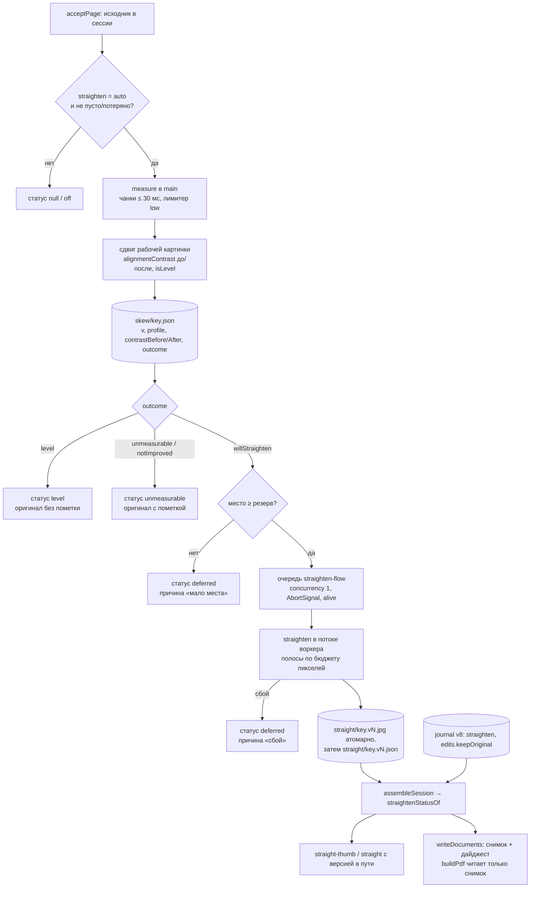

# Выравнивание перекоса подачи (M6) - Plan

## Goal Capsule

- **Objective:** страницы из автоподатчика с «веером» строк (угол меняется по высоте листа) выходят ровными сами, без настройки: детектор меряет профиль наклона по содержимому, плавная коррекция выпрямляет, пометка на миниатюре показывает, что изменено, одно действие возвращает оригинал.
- **Means:** геометрия линейного сенсора — вертикальный сдвиг столбцов на (x − xc)·θ(y) (KTD-1); детектор по проекционным профилям полос на рабочем разрешении, решение «выправлять или нет» принимается там же по независимой метрике (KTD-2, KTD-5); свой ресэмплер на сырых пикселях `sharp`, без новых зависимостей (KTD-3); алгоритм отделён от исполнителя — чистые функции в ядре, измерение в main чанками, коррекция в одном потоке воркера, прямой вызов в тестах (KTD-10, ADR 0008); измерение по ходу прохода, коррекция отдельной очередью с жизненным циклом (KTD-4, KTD-12); производное с одной истиной и одним писателем, записи любой известной версии действительны (KTD-11), решения пользователя в журнале v8, режим в настройках v5 (KTD-6); вариант «выправлено» в протоколе картинок (KTD-7); перекодирование выправленных страниц при сборке PDF из снимка на момент сохранения (KTD-8, амендмент ADR 0007 от 2026-10-28); место на диске проверяется до коррекции (KTD-13).
- **Product authority:** брейншторм `docs/brainstorms/2026-10-28-local-skew-correction-requirements.md` (origin); ADR 0004 (durable / derived), ADR 0007 с амендментом 2026-10-28; спека `docs/duplexnt.md` → «Пустые обороты» как прецедент «авто, видно, откат»; решения автора при планировании 2026-10-28 (Key Decisions).
- **Stop conditions:**
  - спайк U1 показал, что знак, ось или семейство профиля (KTD-1) не ложатся на тестовые листы — стоп до решения автора о модели;
  - страница, которую детектор измерил, становится хуже оригинала (R24) — коррекция не выпускается;
  - исходник страницы меняется в любом сценарии, или невыправленная страница в PDF отличается от исходника байтом;
  - новый видимый UI без мока и handoff'а;
  - воркер нужен по замеру U1, но не грузит `sharp` из `asarUnpack` в собранном приложении — стоп до решения автора о процессной модели;
  - `src/core/scan/pass-service.ts` растёт сверх ~1000 строк (R21 спеки) — новые куски выносятся в модули с первого коммита.
- **Execution profile:** ветка `feat/m6`, шесть сессий (План по сессиям); U1 требует автора у сканера и принтера; журнал вехи — `docs/solutions/0023-m6-straighten.md`, заводится в сессии 1. Калибровка по тестовым листам — отдельная веха M6.5 по тому же брейншторму (Scope Boundaries).

---

## Product Contract

### Summary

Страницы, снятые через ADF, получают автоматическое выравнивание «веера»: детектор оценивает по строкам текста и длинным линиям, как меняется угол по высоте страницы, строит плавный профиль и выправляет изображение; обычный глобальный наклон входит в ту же коррекцию. Выправленная страница помечена на миниатюре и в просмотре, одно действие возвращает оригинал. Страница, на которой не по чему мерить или которой коррекция не помогает, остаётся оригиналом с пометкой. Настройка приложения «Выравнивание: Выравнивать / Не трогать» замораживается в сессии при первом проходе, как режим пустых оборотов. В PDF выправленные страницы вкладываются перекодированным JPEG, остальные — байт в байт. Впереди всего — спайк: зависит ли остановка подачи от приложения, какой формы профиль и сколько стоит коррекция.

### Problem Frame

На ET-3850 подача через ADF чаще, чем нет, останавливается примерно посередине листа и продолжается с небольшим перекосом. Прошивка сглаживает геометрию, поэтому на изображении не излом, а плавная дуга: верх и низ страницы наклонены под разным углом, строки расходятся веером, вертикальные линии почти не смещаются (меньше миллиметра). Величина плавает от едва заметной до явной. Пользователь оставляет такие страницы как есть; текст читается, но рядом с ровной соседкой страница выглядит неровно (брейншторм, Problem Frame).

Глобальный deskew одним углом выпрямит либо верх, либо низ. В коде выравнивания нет: повороты — только 90/180/270 через журнал и `/Rotate`, картинка — `sharp`, который умеет аффинные преобразования и не умеет произвольную сетку. Образец «детектор → производное с версией → решение пользователя в журнале → пометка и откат» уже есть — детектор пустых оборотов M4 (`src/core/detect/blank.ts`, `src/core/storage/blank-scores.ts`, журнал `docs/solutions/0007-m4-blank-backs.md`). Тяжёлых JS-циклов в ядре нет; спека (`docs/duplexnt.md`, «Отдельного процесса или воркера для ядра нет») оставляет этот вопрос до появления замера.

Вопросы origin'а, снятые при планировании: калибровка — отдельная веха M6.5 (решение автора 2026-10-28, см. Key Decisions); режим «Не трогать» замораживается в сессии; измерение и коррекция разнесены по стадиям; защита «не хуже оригинала» по независимой метрике; профиль калибровки привязывается к сканеру прохода, а не к текущему (ляжет в M6.5).

### Requirements

**Детектор** (origin R1–R6)

- R1. Каждая страница из ADF — лица, обороты, добавленные наборы — получает оценку профиля наклона по содержимому и уверенность; детектор работает без профиля устройства (origin R1, R2).
- R2. Профиль наклона — гладкая функция положения по высоте с малым числом параметров: постоянная составляющая плюс плавная дуга; швов нет (origin R3).
- R3. Уверенность ниже порога, сбой декодирования или превышение предела пикселей — коррекции нет, страница помечена «не выровнено» (origin R4).
- R4. Детектор принимает необязательную подсказку устройства (тип профиля в `shared`); в M6 подсказка всегда отсутствует, поведение без неё — полное (origin R5; точка врезки M6.5).
- R5. Измеряется оригинал в исходной ориентации; повороты 90/180/270 и тумблер 180° оборотов на измерение не влияют (origin R6).
- R6. Не измеряются: страницы с вердиктом «пусто» (скрытые и помеченные), потерянные страницы, все страницы сессии в режиме «Не трогать». «Это не пустая страница» ставит страницу в очередь измерения.

**Коррекция** (origin R7–R10)

- R7. Коррекция — вертикальный сдвиг столбцов по профилю наклона с субпиксельной интерполяцией; постоянная составляющая выпрямляет глобальный наклон (origin R7).
- R8. Размер изображения не меняется; открывшиеся у краёв участки заполняются белым бумаги, оценённым по странице, а не 255 (origin R8).
- R9. Исходник не меняется; выправленное изображение — производное в `derived/<сессия>/straight/`, один формат с исходником (серый остаётся серым), плотность DPI сохранена (origin R9).
- R10. Решение «выправлять» принимается в стадии измерения по независимой метрике выровненности: коррекция остаётся, только если метрика после сдвига лучше исходной с запасом (константа — по фикстурам U2); иначе страница остаётся оригиналом с пометкой «не выровнено». Страница с профилем ниже порога движения — «ровная»: оригинал без пометки, байт в байт (origin R29).
- R11. Измерение на рабочем разрешении укладывается в интервал между страницами прохода: p95 ≤ 0,5 с, максимум ≤ 2 с на 300 dpi A4, и никогда не ждёт коррекцию; полноразмерная коррекция одной страницы — ≤ 1,5 с на 300 dpi серый и ≤ 8 с на 600 dpi цвет; в main-процессе ни одна стадия не держит цикл событий дольше 100 мс (p95 ≤ 30 мс) (origin R10).

**Отображение и откат** (origin R11–R14)

- R12. Выправленная страница помечена на миниатюре и в просмотре; миниатюра и превью показывают выправленный вид; смена вида на лету не показывает плашку ошибки и пустоту (origin R11).
- R13. Действие «Оставить оригинал» на текущей странице или выделении пишет ключи выправленных страниц в журнал; «Выровнять» снимает ключи откаченных; это ручная правка — участвует в undo, в плашке «Есть ручные правки» и в «Вернуть». Ключи для ровных, неизмеримых и ещё не обработанных страниц не пишутся (origin R12).
- R14. Настройка приложения «Выравнивание» с режимами «Выравнивать» (по умолчанию) и «Не трогать» — в настройках v5; при первом проходе сессии режим замораживается в журнале; смена настройки действует на следующую сессию («Новое сканирование») (origin R13).
- R15. Сессия, записанная до M6 (журнал ≤ v7), и сессия, пересобранная сверкой без журнала, открываются как «Не трогать»: вчерашний документ не меняется после обновления.
- R16. Пометки, действие отката, ряд настройки, сводки, индикатор обработки, прогресс и тост — по дизайн-системе, по утверждённому handoff'у (origin R14).
- R17. Поздние изменения (досканирование, пересчёт после смены версии) показываются одним тостом на снимок, как поздние вердикты пустых.

**Хранение и восстановление** (origin R22–R23)

- R18. Оценка — производное `derived/<сессия>/skew/<ключ>.json` с версией геометрии; в журнал не пишется; пересчитывается при потере кэша или смене версии (origin R22).
- R19. Восстановление воспроизводит те же выправленные и откаченные страницы из оригиналов, журнала и производного; без дублей и потерь; пересчёт не пишет в журнал (origin R23).
- R25. Статус «выправлена» определяется только записью о коррекции; файл изображения без записи — сирота; запись без файла или с другим размером файла — «оценки нет»; запись любой известной версии действительна для показа и для сохранения, пока не записана новая. Любой потребитель получает путь к выправленному файлу из одной функции.
- R26. Удаление сегмента, «Остановить», «Новое сканирование», закрытие сессии и сверка удаляют оценки, выправленные файлы и их миниатюры по тем же правилам, что миниатюры оригиналов; очередь коррекции и идущие измерения отменяются и дожидаются до удаления каталога.
- R27. Перед коррекцией страницы проверяется свободное место с тем же резервом, что перед проходом; при нехватке или при сбое коррекции страница остаётся оригиналом с видимой причиной, решение не постоянное — при следующем открытии сессии попытка повторяется; такие страницы не блокируют сохранение.

**Сборка PDF** (origin R24–R25)

- R20. Выправленная и не откаченная страница вкладывается перекодированным JPEG (качество и субдискретизация — KTD-3) с плотностью прохода; остальные — байт в байт; `/Rotate` — для всех (origin R24, R25).
- R21. Сохранение отказывает с прогрессом «Выравнивание N из M», пока есть страницы без итога измерения или коррекции; экран `merge` ждёт с тем же счётчиком; байты выправленных страниц берутся из снимка на момент начала сохранения; повтор неудавшегося пакета при изменившемся снимке — отказ «данные изменились», не смешанный пакет.

**Спайк остановки подачи и замер** (origin R26–R27)

- R22. До детектора проводится спайк на живом ET-3850: тестовые листы при разных DPI, цветности и через фирменный софт; фиксируется, когда остановка и веер появляются и исчезают; проверяется семейство профиля; A/B-замер влияния нагрузки в main на забор страниц по протоколу с числом прогонов; замер времени и паузы цикла событий детектора и ресэмплера на 300 dpi серый, 300 dpi цвет и 600 dpi цвет, в main и в воркере; проба воркера с `sharp` в собранном приложении. Результат — в техбазу, ADR 0008 и журнал вехи (origin R26, R27).

**Качество** (origin R28–R29)

- R23. Детектор и коррекция покрыты табличными тестами на настоящих сканах ET-3850 (косые, ровные, без текста, едва косые, таблица, две колонки, тестовые листы); метрика — остаточный веер на полном разрешении: расхождение концов длинной горизонтальной линии ≤ 0,5 мм на ширину A4 (origin R28).
- R24. На контрольном наборе, включая страницы-ловушки для проекционного детектора (две колонки, наклонная графика), нет страницы, у которой строки после коррекции менее параллельны, чем в оригинале (origin R29).

### Key Decisions

- **Калибровка — веха M6.5, не часть M6.** Решение автора 2026-10-28. База обязана работать из коробки (origin, Key Decisions), калибровка — усилитель; отдельная веха даёт раннюю пользу и короткую ветку. M6 закладывает точки врезки: тип подсказки и параметр детектора (R4), геометрия профиля в долях высоты и градусах. Origin R15–R21 и AE4–AE5 переносятся в план M6.5 по тому же брейншторму.
- **Режим «Выравнивание» замораживается в сессии при первом проходе.** Как `blankMode` (UI_SPEC §6.9): PDF предсказуем, старые и пересобранные сессии (R15) получают «Не трогать» без особых веток. По коду заморозка происходит в `beginPass` для нового или вакантного журнала — поэтому смена настройки действует на следующую сессию, не на следующий проход; текст подсказки говорит это прямо. Отклонено: живая настройка — другой паттерн и неясная судьба откатов при выключении.
- **Измерение и коррекция разнесены по стадиям.** Измерение дешёвое (рабочее разрешение) и идёт по ходу прохода в main чанками; там же принимается решение «выправлять». Полноразмерная коррекция — отдельная очередь в воркере, которая не соревнуется с забором страниц и никогда не задерживает измерение. Отклонено: полный warp в main во время прохода — может замедлить забор данных и усилить дефект, который чиним (спайк U1 это проверяет A/B-замером).
- **Защита «не хуже оригинала» — автоматическая, по независимой метрике и до коррекции.** Повторный поиск углов тем же детектором после сдвига по его же углам всегда покажет «помогло» — это круговая проверка. Поэтому «до / после» меряется другой статистикой: контрастом горизонтальной проекции всей рабочей картинки; без роста контраста с запасом страница не попадает в очередь коррекции. Полноразмерный результат сверяется с предсказанием только в тестах. Предел метода: детектор, уверенно зацепившийся не за строки текста, ловится только этой метрикой и фикстурами-ловушками — это честно записывается в техбазу.
- **Не измеряются пустые, потерянные и страницы в режиме «Не трогать».** Иначе каждая пустая страница несёт «не выровнено» — шум. «Это не пустая страница» возвращает страницу в очередь. Для таких страниц статус «не применимо», сводка их не считает.
- **Один вид пометки «не выровнено» для четырёх исходов** — «не по чему мерить», «коррекция не помогла», «мало места» и «сбой»; причина — в подписи для скринридера, в инспекторе и в сводке; у «мало места» подсказка называет действие. Отклонено: отдельные пометки — лишние сущности на карточке.
- **Сохранение ждёт, а не досчитывает молча.** Отказ с числом и прогрессом, как `blankRefusal`; досчёт недостающих файлов идёт при открытии сессии как ожидание с прогрессом, а не внутри сохранения. Страницы, у которых коррекция отложена из-за места или сбоя, сохранение не блокируют — они вкладываются оригиналом с пометкой. Отклонено: тихий досчёт — на 600 dpi это минуты «зависшего» сохранения без обратной связи.
- **Смена версии не блокирует вчерашнюю сессию.** Записи о коррекции любой известной версии геометрии действительны для показа и для снимка на сохранение, пока фоновый пересчёт не запишет новую; старый файл удаляется после нового. Параметры качества JPEG версионируются отдельно и пересчёта не вызывают. Отклонено: «старая версия = нет оценки» — при 100 страницах 600 dpi сохранение отказывало бы минуты сразу после обновления.
- **Откат — ручная правка**, как `notBlank`: undo, плашка, «Вернуть» возвращает коррекцию. Действие — на текущую страницу или выделение, как поворот (UI_SPEC §6.8); на смешанном выделении действует только на страницы подходящего статуса.

### Acceptance Examples

- AE1. Страница с веером строк (origin AE1). **Дано:** текстовая страница, верх и низ под разным углом. **Когда:** страница в редакторе, проход и коррекция закончены. **Тогда:** миниатюра показывает ровные строки с пометкой «выровнено»; в PDF концы длинной строки расходятся ≤ 0,5 мм.
- AE2. Фотография без строк (origin AE2). **Дано:** страница с одной фотографией. **Тогда:** оригинал, пометка «не выровнено»; в PDF байт в байт.
- AE3. Откат восстанавливает байты (origin AE3). **Дано:** выправленная страница. **Когда:** «Оставить оригинал», сохранить. **Тогда:** байты изображения в PDF совпадают с исходником; миниатюра и превью — оригинал.
- AE6. Режим «Не трогать» (origin AE6). **Дано:** настройка «Не трогать» до первого прохода. **Тогда:** пометок нет, все страницы байт в байт, оценок в `derived/` нет.
- AE7. Другой сканер (origin AE7). **Дано:** подключено другое устройство. **Тогда:** выравнивание работает по содержимому так же (подсказки устройства в M6 нет).
- AE8. Восстановление сессии (origin AE8). **Дано:** сессия с выправленными и откаченными страницами, кэш `derived/` потерян целиком или частично. **Когда:** сессия открыта заново. **Тогда:** недостающее досчитано с прогрессом, имеющееся не перезаписано; те же статусы; PDF совпадает с прежним побайтно, включая размер страниц в пунктах; журнал на диске не изменился.
- AE9. Старая сессия. **Дано:** журнал v7, в том числе с открытым проходом. **Когда:** открыт приложением M6. **Тогда:** режим «Не трогать», досканирование идёт без измерений, пометок нет, PDF как раньше.
- AE10. Сохранение ждёт выравнивания. **Дано:** проход закончен, измерения или коррекции ещё идут. **Когда:** сохранить. **Тогда:** отказ с прогрессом «Выравнивание N из M»; после завершения — сохранение; в PDF только файлы из снимка на момент начала сохранения.
- AE11. Ровная страница. **Дано:** страница без перекоса. **Тогда:** пометки нет, байт в байт, статус «ровная», файла в `straight/` нет.
- AE12. Скрытый пустой оборот. **Дано:** режим пустых «Скрывать», оборот пустой. **Тогда:** измерения нет; после «Это не пустая страница» страница измеряется и, если косая, выправляется.
- AE13. Смена версии геометрии. **Дано:** сессия с записями версии 1, приложение с версией 2. **Когда:** сессия открыта. **Тогда:** прежний выправленный вид показывается и сохраняется, пока фоновый пересчёт не запишет новый; сохранение не отказывает из-за пересчёта; старые файлы удалены после записи новых; один тост «Выравнивание пересчитано»; откаты по ключу сохранены; журнал не изменился.
- AE14. Повтор пакета после изменения производного. **Дано:** пакет из двух документов, второй не записался; между попытками выправленный файл первой страницы удалён или поздняя коррекция изменила статус страницы второго документа. **Когда:** «Повторить». **Тогда:** отказ «данные изменились», пакет собирается заново целиком; смешанного пакета нет.
- AE15. Мало места или сбой коррекции. **Дано:** свободного места меньше резерва перед коррекцией, либо коррекция страницы упала. **Тогда:** страница остаётся оригиналом с причиной, журнал и исходники целы, сохранение проходит; после освобождения места и повторного открытия сессии страница выправляется.
- AE16. Закрытие посреди коррекции. **Дано:** очередь коррекции на 50 страницах. **Когда:** «Остановить», «Новое сканирование» или закрытие приложения. **Тогда:** очередь и измерения отменены, временные файлы убраны, каталог `derived/<сессия>` не пересоздан.
- AE17. Смешанное выделение при откате. **Дано:** выделены выправленная, ровная и необработанная страницы. **Когда:** «Оставить оригинал». **Тогда:** ключ записан только для выправленной; ровная и необработанная не получили ключей; подпись действия называет, к скольким страницам оно применилось.

### Success Criteria

- Метрика R23 на тестовых листах ≤ 0,5 мм; R24 — ни одной ухудшенной страницы на контрольном наборе, включая ловушки.
- Откат — байты точно (AE3); режим «Не трогать» и старые сессии — PDF как до M6 (AE6, AE9); повтор пакета не смешивает варианты (AE14); смена версии не блокирует сохранение (AE13).
- Паузы цикла событий и время стадий в пределах R11 на замере U1 и мягком тесте U3; пик памяти одной коррекции 600 dpi цвет < 700 МБ сверх базы.
- Спайк R22 записан в техбазу с условиями появления веера, семейством профиля и цифрами; ADR 0008 записан.
- Гейт зелёный (typecheck, lint, format:check, test:all), смоук на живом ET-3850 пройден, журнал `docs/solutions/0023-m6-straighten.md` закрыт, merge по явному ОК автора.

### Scope Boundaries

**Deferred for later** (origin, Scope Boundaries)

- Автообрезка («Авто»-размер) и подавление просвечивания — отдельные задачи.
- Субмиллиметровая дрожь вертикальных линий.
- Автоматическое предложение калибровки по доле неуверенных страниц.
- Проверка на другом железе — по его появлении.

**Не делаем** (origin)

- Коррекция вслепую типичным углом там, где нечего измерить.
- Изменение исходников страниц. Выравнивание как условие или следствие калибровки. Точность под OCR.

### Deferred to Follow-Up Work

- **M6.5 — калибровка сканера по тестовым листам** (origin R15–R21, AE4–AE5, F3): генератор печатного листа, прогон тестовых листов тем же клиентом мимо сессии и журнала в свой каталог, сравнение профилей, вердикт стабильности, «до / после», профиль в настройках со своей идентичностью (UUID + отпечаток, применяется по сканеру прохода, не по текущему), ряд «Выравнивание» со состоянием калибровки. Точки врезки из M6: `SkewPrior` в `src/shared/skew.ts`, параметр детектора, `spikes/make-calibration-pdf.mjs`. Запись в `docs/backlog.md` при закрытии M6.
- Коррекция in-place по полосам столбцов (экономит половину памяти на 600 dpi) — если замер U1 покажет запас меньше порога.
- Миниатюра выправленной страницы из буфера воркера, без повторного декодирования — необязательное улучшение.
- Общий механизм выноса тяжёлой обработки для миниатюр и детектора пустых (бэклог, «Декодирование изображений страниц в отдельном процессе») — после того как воркер M6 проживёт одну веху.

---

## Planning Contract

### Key Technical Decisions

- **KTD-1. Геометрическая модель — вертикальный сдвиг столбцов.** Линейный сенсор снимает по строке за такт; лист, повёрнутый на θ(y) в момент строки y, даёт точке с колонкой x смещение по вертикали (x − xc)·tan θ(y); колонка почти не смещается. Обратное отображение: `y_src = y − (x − xc)·tan θ(y)`, `x_src = x`. Это одномерный ресэмплинг по столбцам, без двумерной сетки. Профиль θ(u) = a + b·(u − u0) + c·(u − u0)², где u = y/H — доля высоты, u0 = 0,5 — центр страницы: a — угол в середине высоты, b — линейный градиент, c — кривизна дуги; единицы — градусы и доли, не зависят от DPI. Знак, ось xc и семейство профиля проверяются в U1 на тестовых листах: по углам полос с концов линий подгоняется квадратика, максимальный остаток угла должен быть ≤ 0,05° (≈ 0,2 мм на A4); превышение — решение автора о семействе (например, сглаженная ступень a + Δ·s((u − u0)/w)) до U2, интерфейсы не меняются. Отклонено: свободная сетка / thin-plate spline — переобучение на бедных страницах, в origin отклонено.
- **KTD-2. Детектор — проекционные профили по полосам, как в Leptonica `pixFindSkew`, с бюджетом времени.** Серое на рабочем разрешении (как `WORKING_LONG_SIDE` детектора пустых, 1400 px), адаптивная бинаризация по полосе, маска 3 % по краям; в полосе один раз собирается список чернильных пикселей, и перебор углов идёт по нему, а не по площади (выигрыш в 10–20 раз на тексте); полосы ~40–60 мм с перекрытием, грубый перебор ±2° с шагом 0,2° на половинном размере, уточнение ±0,25° с шагом 0,05° и параболической интерполяцией пика; субпиксельное распределение в строковый профиль; ранний выход для полос без чернил или контраста строк. Уверенность полосы — отношение max/min, порог ≈ 3 (подбирается на фикстурах). Устойчивая взвешенная аппроксимация θ(u) квадратикой (Huber); гейт: ≥ 3 валидных полосы, покрывающих ≥ 40 % высоты, экстраполяция за крайние полосы ограничена. Функция принимает уже декодированную серую картинку (как `blank.ts`) и работает чанками ≤ 30 мс с настоящей точкой уступки (макрозадача) между ними — измерение исполняется в main. Отклонено: Hough / компоненты связности — дороже и хрупче на малых полосах; OpenCV WASM — внешняя библиотека ради одной операции.
- **KTD-3. Ресэмплер — свой, на сырых пикселях `sharp`.** `sharp(bytes, {limitInputPixels}).raw().toBuffer({resolveWithObject})` → цикл по столбцам с интерполяцией Catmull-Rom по вертикали, полосами выходных строк с бюджетом 0,5–1 Мпикс на полосу (не фиксированное число строк — 512 строк на 600 dpi цвет превышают порог паузы) и точкой уступки между полосами → `sharp(buf, {raw}).jpeg({quality: 92, chromaSubsampling: '4:4:4'})` с плотностью `dpi` в выходе. Число каналов — из `info.channels` (серый остаётся 1). Предел пикселей — общий `decodePixelLimit`. Порогов ресэмплер не знает: «ровная» и «не помогла» решает детектор (KTD-5). Плотность и ICC: тест U3 проверяет порядок сегментов выхода (APP0 с плотностью сразу после SOI, как читает `jfifDpi`) и фиксирует, вкладывает ли `sharp` sRGB-профиль; если да и это мешает — плотность пишется без профиля. Отклонено: `wasm-vips` (13 МБ, пре-1.0, второй libvips), `@techstark/opencv-js` (14 МБ), `sharp.affine` по полосам со склейкой (швы).
- **KTD-4. Две стадии и один лимитер.** Измерение — в `sink` после `acceptPage` и после вердикта пустоты, без `await` (как `detectBlank`), с низким приоритетом в едином лимитере производного (concurrency 2, две очереди ожидания `normal` / `low`: миниатюры и пустота — `normal`, измерение — `low`). Лимитер создаётся в `main/index.ts` и передаётся через `PassServiceOptions.derivedLimiter` в службу и в `createThumbnails`; без опции служба создаёт свой (тесты). Лимитер ограничивает задачи main-стороны (декоды миниатюр и пустоты, измерение) — сегодня у каждого модуля свой экземпляр, и третий дал бы до шести одновременных декодов на пуле libuv рядом с `fsync` в `acceptPage`. Коррекция — отдельная очередь concurrency 1 в модуле `src/core/scan/straighten-flow.ts` (образец `blank-flow.ts`), принимает только страницы с решением «выправлять»; элемент очереди исполняется при `run === null` (пауза на время прохода, возобновление в `finally` запуска прохода) — если A/B-замер U1 покажет, что коррекция в воркере забор не задерживает, пауза снимается одним флагом с записью в журнал вехи. `straightenPending` считает страницы без итога измерения и страницы с решением «выправлять» без записи о коррекции; отложенные по месту или сбою не считаются; снимок несёт `straightenProgress {done, total}`.
- **KTD-5. Защита «не хуже» и пороги — в детекторе, метрика независимая.** `src/core/detect/skew.ts` экспортирует `isLevel(profile)` (порог движения, стартовая гипотеза 0,1°), `alignmentContrast(gray)` — отношение max/min дисперсии горизонтальной проекции по всей рабочей картинке — и `verdictOf(before, after)` (стартовый запас k = 1,3 по росту контраста, подбирается на фикстурах U2). Стадия измерения применяет сдвиг KTD-1 к рабочей серой картинке (~10 мс), меряет контраст и пишет исход: `unmeasurable | level | notImproved | willStraighten`. В очередь коррекции попадает только `willStraighten`. Отклонено: повторный поиск углов по полосам после сдвига — круговая проверка, которая не ловит детектор, зацепившийся не за строки. В тестах U3 остаток по декодированному полноразмерному результату сверяется с предсказанным в допуске — это ловит ошибку знака или масштаба большого ресэмплера; фикстуры-ловушки (две колонки, наклонная графика) держат R24.
- **KTD-6. Данные и версии.** Настройки v5: `straightenMode: 'auto' | 'off'` (по умолчанию `auto`), лестница схем как у v3/v4; «Сбросить параметры» возвращает `auto` и не трогает открытую сессию. Журнал v8: поле сессии `straighten` (замораживается в `beginPass` для нового и вакантного журнала, как `blankMode`; `upgradeToV8`, `newJournal` и пересобранный сверкой журнал ставят `off`), поле правок `keepOriginal: string[]` (как `notBlank`; `normalizeEdits`, `hasEdits`, `sameEdits`, порядок ключей как у `EMPTY_EDITS`). Две константы версий: `STRAIGHTEN_GEOMETRY_VERSION` (детектор, модель, пороги исхода — её подъём вызывает пересчёт) и `STRAIGHTEN_ENCODING` (качество и субдискретизация JPEG — записывается в запись о коррекции, пересчёта не вызывает). Амендмент ADR 0004 — в U4 (как амендменты 2026-10-22 и 2026-10-23), с инвариантами из U4.
- **KTD-7. Картинки.** `PAGE_IMAGE_VIEWS` получает `straight` и `straight-thumb`; путь вида несёт версию геометрии (`straight/<v>/<ключ>`), грамматика `parsePageImageUrl` расширяется на один сегмент — так откат, пересчёт и смена версии меняют адрес, и `` перезагружается без хаков с `search`. Миниатюры выправленных страниц живут в отдельном каталоге `derived/<id>/straight-thumbs/` с версией в имени. Вид выбирает одна функция `pageImageViewOf(page, size)` в `src/shared/straighten.ts`; три компонента, которые сегодня пишут литералы вида, переходят на неё. Сервер при отсутствии файла для `straight`/`straight-thumb` отдаёт оригинал / обычную миниатюру — истина для пометки только статус в снимке; renderer сегодня на 404 показывает плашку ошибки, не оригинал. При смене адреса прежний вид остаётся на экране до загрузки нового.
- **KTD-8. PDF из снимка.** В начале `writeDocuments` берётся снимок выправленных страниц `{ключ → исход, файл, размер}` и его дайджест; `buildPdf` читает байты только по снимку, последовательно, и подставляет их при исходе «выправлена» и ключе вне `keepOriginal`; отсутствие файла из снимка — ошибка сборки документа с причиной, не молчаливая подмена. Снимок и дайджест живут в `PendingBatch` рядом с `revision`; повтор пакета сверяет дайджест — несовпадение даёт отказ «данные изменились» и пересборку целиком. `PdfPageInput.dpi` — из прохода, плотность продублирована в JFIF перекодированного файла; ветка «DPI из JFIF при отсутствии `origin`» — защитная и недостижима через сверку из-за R15, проверяется юнит-тестом `assemble.ts`. Существующие тесты байтового равенства остаются для невыправленных и откаченных; новые — на размер страницы в пунктах, `/Rotate` и детерминизм. Прирост размера файла замеряется в U3 на худшем случае 600 dpi цвет; при > 2× на 300 dpi цвет качество пересматривается (q88 или 4:2:0 для цвета) до U6; `pdf-worst-case` получает объём после перекодирования.
- **KTD-9. Исход и статус — две сущности.** Исход измерения `SkewOutcome` — производное, живёт в `src/core/detect/skew.ts`. Статус страницы `StraightenStatus` считает чистая функция `straightenStatusOf({mode, outcome, corrected, keepOriginal, blank, lost})` в `src/shared/straighten.ts` (как `blankFlagOf`): `'straightened' | 'kept' | 'unmeasurable' | 'level' | 'pending' | 'deferred' | null`, где `kept` — откат пользователя, `unmeasurable` — «не по чему мерить» и «не помогла», `deferred` — «мало места» или «сбой» (статус из записи очереди, не исход измерения; в `skew/<ключ>.json` не пишется), `null` — не применимо (пусто, потеряно, режим `off`). Вердикты в снимок идут картой `SkewVerdicts` по образцу `BlankVerdicts`; `assembleSession(session, {blank, skew})` принимает объект; зеркало `assembly-fixture.ts` и его страж расширяются. Renderer порогов не знает.
- **KTD-10. Алгоритм отделён от исполнителя; измерение в main, коррекция в одном потоке воркера.** Чистые `measureSkew` и `straighten` в `src/core`; служба получает интерфейс `ImageWorker { measure, straighten }` через опции (образец `blankDetector` в `PassServiceOptions`). Прямой исполнитель выполняет обе функции в вызывающем потоке чанками — он и есть исполнитель измерения в main и исполнитель всего в тестах и эмуляторе. Исполнитель коррекции на `worker_threads` — один поток — живёт в `src/main/image-worker.ts`, путь к скрипту потока передаётся фабрике параметром (`main/index.ts` передаёт импорт `?modulePath` electron-vite); буфер страницы — свежий из `readPage`, передаётся `transfer` (владение переходит потоку; кэш байт страниц, если появится, обязан копировать). Условие: если замер U1 покажет, что коррекция полосами с точками уступки держит паузу ≤ 100 мс (p95 ≤ 30 мс) в main и на 600 dpi цвет, воркер не заводится, файлы `src/main/image-worker.ts` и скрипт потока не создаются, а ADR 0008 фиксирует «прямой исполнитель» с триггерами пересмотра. Это развилка процессной модели (спека: «воркера для ядра нет … появится число — пересматривается»), поэтому ADR 0008 пишется в U1 по результатам замера. Отклонено: `utilityProcess` — Electron API, исполнитель не тестируется вне Electron, буфер копируется через IPC; два потока по операциям — измерение и так дешёвое и идёт в main чанками.
- **KTD-11. Одна истина и один писатель на производное; записи любой известной версии действительны.** `skew/<ключ>.json` пишет только стадия измерения: `{v, profile, confidence, contrastBefore, contrastAfter, outcome, source: {bytes, width, height}}`, иммутабельно для версии. Исход коррекции пишет только `straightened.ts`: сначала JPEG `straight/<ключ>.v<N>.jpg` целиком через `writeFileAtomic`, потом `straight/<ключ>.v<N>.json` с `{v, encoding, file: {name, bytes}}`; файлы разных версий сосуществуют. Статус «выправлена» = есть запись о коррекции любой известной версии, размер файла совпадает; `resolve(ключ)` отдаёт самую новую действительную запись; файл без записи — сирота, запись без файла или с другим размером — «оценки нет». Единственная функция `straightened.resolve(ключ)` отдаёт путь всем потребителям (протокол, миниатюры, снимок PDF); страж-тест запрещает `straightDirIn(` вне модуля, с исключением для `layout.ts` и путей очистки (`removeMarked`, сверка). Версия геометрии поднята — пересчёт идёт фоном без статуса `pending`, старые файлы удаляются после записи новых (AE13).
- **KTD-12. Жизненный цикл очереди и измерений.** Каждая задача очереди перед записью JPEG и записи о коррекции проверяет `alive(ключ, сессия)` и после записи — повторно, с `unlink` обоих файлов при отбросе; измерение делает `mkdir` только после проверки `alive`. `closeSession`, `interrupt(deadline)` и `will-quit` отменяют очередь и измерения `AbortSignal`; хранилище получает `SessionStoreOptions.settleDerived` (по образцу `settleReads`), которую `closeDirectory` ждёт до `removeTree` на обоих путях — закрытие сессии и «Остановить» с нулём оставшихся страниц; служба передаёт в неё отмену очереди и ожидание текущей задачи. Временные файлы `*.tmp` в `derived/*/straight` убираются при открытии сессии. Любой сбой стадии коррекции, кроме отмены — статус `deferred` с причиной `failed`, очередь продолжает остальные; события `error`/`exit` потока отклоняют все промисы в полёте, исполнитель поднимает поток заново один раз на задачу, повторный сбой той же страницы — `deferred` без повторов в сессии. Отменённые страницы остаются без записи — `pending` до следующего `ensureAll`, и сохранение честно отказывает, а не вкладывает оригинал вместо ожидаемого выправленного.
- **KTD-13. Место на диске.** Перед постановкой задачи коррекции — `freeBytes(root) − source.bytes × STRAIGHT_SIZE_RATIO ≥ minFreeBytes` (тот же резерв, что перед проходом; журнал и исходники в приоритете); `STRAIGHT_SIZE_RATIO` — константа конвейера, равная измеренному в U3 максимуму «выход / вход» (до замера — 5). Нехватка — статус `deferred` с причиной «мало места» без постоянного вердикта; `ENOSPC` при записи — временный файл удалён, страница `deferred`, очередь продолжает остальные. `prune` при «Остановить» и «Новое сканирование» освобождает место сразу.

### High-Level Technical Design

Слои: `src/core/detect/skew.ts` и `src/core/image/straighten.ts` — чистые функции без состояния; `src/core/image/image-worker.ts` — интерфейс исполнителя и прямой исполнитель; `src/main/image-worker.ts` — исполнитель коррекции на `worker_threads`, единственное место, знающее о сборке; `src/core/storage/skew-scores.ts` и `straightened.ts` — производное по образцу `blank-scores.ts` / `thumbnails.ts` с одним писателем каждое; `src/core/scan/straighten-flow.ts` — очередь, гарды, прогресс; `pass-service.ts` — только триггеры; `assembly.ts` + `src/shared/straighten.ts` — статус в снимке; `src/main/page-protocol.ts` — виды картинок; renderer — только показ и команды. Все пути единиц измерения — доли высоты и градусы; пересчёт в пиксели — внутри ресэмплера.

### Assumptions

- Веер описывается квадратикой по высоте и вертикальным сдвигом столбцов (KTD-1); семейство, знак и ось проверяются в U1 на тестовых листах. Заметный горизонтальный сдвиг строк или остаток квадратики > 0,05° — расширение модели в U2 без смены интерфейсов (второй ряд коэффициентов или сглаженная ступень), по решению автора.
- JPEG устройства — baseline без APP0/EXIF (M1); перекодированный JPEG от `sharp` (SOF0/SOF2, 1 или 3 канала) `embedJpg` принимает (проверено по `JpegEmbedder` в node_modules).
- Оценки времени и памяти (R11, Success Criteria) — расчётные до замера U1: 300 dpi серый ≈ 0,5 с, 300 dpi цвет ≈ 1,2 с, 600 dpi цвет ≈ 4–6 с на страницу; пик памяти коррекции 600 dpi цвет ≈ 250–350 МБ. U1 заменяет их измеренными.
- Задержки приложения порядка 0,5 с на фоне 10–40 с между страницами вряд ли меняют поведение подачи; это предположение, которое U1 проверяет A/B-замером с числом прогонов, а не принимает.
- Фикстуры с живого ET-3850 снимает автор по списку U1; до их появления интеграционные тесты U2/U3 держатся красными как сигнал (прецедент M4 U1).

---

## Implementation Units

### U1. Спайк: остановка подачи, семейство профиля, фикстуры, замер исполнителя, ADR 0008

- **Goal:** знать, от чего зависит веер и какой формы профиль, сколько стоят измерение и коррекция в main и в воркере, грузится ли `sharp` в воркере собранного приложения; собрать настоящие сканы для тестов; зафиксировать процессную модель.
- **Requirements:** R22, R23 (фикстуры), KTD-1, KTD-10.
- **Dependencies:** автор у ET-3850 и принтера; `spikes/make-calibration-pdf.mjs` (3 листа A4, рамка 10 мм, миллиметровка) — распечатать в масштабе 100 %.
- **Files:** `spikes/straighten-bench.mjs` (новый, вне `src`: прототип цикла детектора по полосам и ресэмплера на raw-буфере; метрики по стадиям), `spikes/straighten-worker-probe/` (новый: минимальный `worker_threads` с `sharp`, собранный electron-vite с `?modulePath`, запуск из `npm run dist`-сборки), `test/fixtures/escl/et-3850/scans/` (новые JPEG), `test/fixtures/README.md` (имена), `docs/duplexnt-tech.md` (раздел «Перекос подачи: спайк»), `docs/decisions/0008-image-worker.md` (новый, по `docs/templates/adr.md`), `docs/duplexnt.md` (строка про «воркера нет» — правка), `docs/solutions/0023-m6-straighten.md` (заводится здесь).
- **Approach:** (а) Прогон тестовых листов через приложение: 300 серый, 300 цвет, 200 серый, 600 серый; тот же лист через Epson Scan 2 в 300 серый; наблюдать остановку подачи и мерить веер по концам горизонтальных линий (пиксели → мм). Проверить знак и ось KTD-1 и семейство профиля: по трём листам снять углы полос с концов линий, подогнать квадратику с u0 = 0,5, записать максимальный остаток угла; порог 0,05°. (б) A/B на реальном проходе по протоколу: не меньше 5 прогонов одного набора листов в каждом плече (без нагрузки / с циклом измерения и ресэмплера в main); метрики — латентность `acceptPage`, время тела GET, положение остановки, веер по концам линий; вывод «зависит от нагрузки» только при разнице больше разброса между прогонами одного плеча, иначе «не различимо при N прогонах». (в) Фикстуры по именованию `<что>-<gray|color>-<dpi>.jpg`: `fan-text-gray-300`, `fan-text-color-300`, `fan-text-gray-200`, `fan-text-gray-600`, `fan-faint-gray-300` (едва косой), `straight-text-gray-300`, `photo-color-300` (без строк), `fan-grid-gray-300` ×3 (тестовые листы), `fan-table-gray-300` (таблица), `fan-twocol-gray-300` (две колонки — ловушка для R24), `fan-graphic-gray-300` (наклонная графика на косой странице — ловушка). Текст на листах — вымышленный (страж приватности). (г) Бенч: входы 2480×3507×1, 2480×3507×3, 4960×7016×3 с профилем ±2°; стадии декод / измерение / warp / энкод раздельно; p50, p95, max паузы цикла событий (`monitorEventLoopDelay` плюс зонд 25 мс, как в `pdf-worst-case`); пик RSS сверх базы; плато RSS после 10 страниц подряд; отношение размера выхода к входу; варианты бюджета полосы 0,5 / 1 / 2 Мпикс; коррекция inline против воркера; латентность измерения при идущей коррекции 600 dpi цвет; время миниатюры из выправленного файла. (д) Проба воркера в собранном приложении: `onlyLoadAppFromAsar`, `asarUnpack` для `sharp`, `?modulePath`. (е) ADR 0008 по результатам: исполнитель коррекции — один поток `worker_threads` в main либо прямой исполнитель, если inline укладывается в пороги; интерфейс в ядре; отклонённые альтернативы; триггеры пересмотра.
- **Execution note:** спайк-первый; цифры фиксируются в техбазе, ADR и журнале; по ним принимаются бюджет полосы, порог чанка, k и порог движения как стартовые значения для U2/U3, решение о воркере (KTD-10) и флаг паузы очереди на время прохода (KTD-4).
- **Test scenarios:**
  - стражи `test/guards/scan-fixtures.test.ts` и `privacy-guard.test.ts` зелёные на новых файлах (нет EXIF/ICC/XMP, нет личных данных);
  - проба воркера в `dist`-сборке: одна коррекция выполняется, `sharp` загружен из `asarUnpack`, результат — JPEG ожидаемого размера;
  - Test expectation для бенча и прогонов: none — разведка; выводы — в документах.
- **Verification:** в техбазе записаны условия, при которых веер появляется и исчезает, результат A/B с числом прогонов, семейство профиля с остатком; знак/ось KTD-1 подтверждены на трёх листах; таблица замеров (стадии, паузы, память, размер) с пороговыми выводами; воркер работает в `dist` (если нужен); ADR 0008 в репо; фикстуры в репо; журнал заведён с картой сессий.

### U2. Детектор перекоса и исход измерения

- **Goal:** чистая функция оценки профиля наклона с уверенностью, независимой метрикой выровненности до/после и исходом; пороги и метрика живут здесь.
- **Requirements:** R1–R5, R10, R11 (измерение), R23, R24, KTD-1, KTD-2, KTD-5.
- **Dependencies:** U1 (фикстуры, знак, ось и семейство, стартовые пороги).
- **Files:** `src/shared/skew.ts` (новый: `SkewProfile`, `SkewMeasure`, `SkewOutcome`, `SkewPrior`, `STRAIGHTEN_GEOMETRY_VERSION`, единицы), `src/core/detect/skew.ts` (новый: `measureSkew(gray, options, prior?)` с точкой уступки, `residualFan`, `alignmentContrast`, `isLevel`, `verdictOf`, `shiftWorking`), `src/core/detect/skew.test.ts` (синтетика), `test/support/synthetic-page.ts` (новый: генератор «страницы» из полос-строк с заданным θ(u) через `sharp` raw), `test/integration/skew-detector.test.ts` (табличный по фикстурам).
- **Approach:** KTD-2 и KTD-5. Вход — декодированная серая картинка рабочего размера (как `blank.ts`), чтобы один декод обслуживал и измерение, и предсказание; обёртка `measureSkewJpeg(bytes, pixelLimit)` для тестов на фикстурах. Сбой → `null`, как `blankRatio`. `prior` принимается и в M6 игнорируется с комментарием «M6.5». Константы (размер полосы, шаги угла, порог уверенности, порог движения, k, бюджет чанка) — именованные, в шапке файла, откалиброваны табличным тестом.
- **Execution note:** сначала синтетический тест знака и оси (сгенерированная страница с известным θ(u) → детектор возвращает коэффициенты в допуске), затем табличный интеграционный тест по фикстурам, включая ловушки, затем подбор констант; итоговые цифры — в журнал вехи.
- **Test scenarios:**
  - синтетика: глобальный наклон 0,5° → a ≈ 0,5°, b, c ≈ 0; дуга с амплитудой 0,8° → коэффициенты в допуске 0,05°; знак: верх ровный, низ по часовой → c положительный по соглашению KTD-1 с u0 = 0,5;
  - синтетика: страница без строк → `unmeasurable`; одна полоса со строками → гейт «мало полос» → `unmeasurable`; ровная страница → `level`; искажённая → `willStraighten` с ростом контраста ≥ k;
  - чанки: на 300 dpi A4 ни один чанк не превышает 30 мс, суммарно ≤ 0,5 с (мягкий тест с выводом цифр);
  - фикстуры: `fan-text-*` → `willStraighten`; `straight-text-gray-300` → `level`; `photo-color-300` → `unmeasurable`; `fan-faint-gray-300` → зафиксировать класс; `fan-table-gray-300` → профиль согласуется с `fan-text` того же прогона в допуске; ловушки `fan-twocol-gray-300` и `fan-graphic-gray-300` → либо `willStraighten` с профилем, согласным с концами строк, либо `notImproved`/`unmeasurable` — никогда ухудшение по концам строк (R24);
  - запас: уверенность измеренных ≥ 2× порога, уверенность неизмеримых ≤ порога / 2 (как у детектора пустых);
  - повреждённый JPEG → `null` без исключения; превышение предела пикселей → `null`;
  - `residualFan` на `fan-grid-gray-300` на полном разрешении даёт расхождение концов линии > 0,5 мм (до коррекции).
- **Verification:** оба теста зелёные; константы, доли и предел метода в журнале и техбазе; `STRAIGHTEN_GEOMETRY_VERSION` экспортирована.

### U3. Коррекция: вертикальный ресэмплер, перекодирование, исполнители

- **Goal:** чистая функция, которая по профилю строит выправленный JPEG того же размера и формата; прямой исполнитель для main и тестов, исполнитель коррекции на воркере — если нужен по U1.
- **Requirements:** R7–R9, R11 (коррекция), R20 (формат), R24, KTD-3, KTD-10.
- **Dependencies:** U1 (бюджет полосы, проба воркера, ADR 0008), U2 (профиль, `residualFan`, `alignmentContrast`).
- **Files:** `src/core/image/straighten.ts` (новый: `straighten(bytes, profile, {pixelLimit, dpi, bandBudget, yield}) → {jpeg, info} | null`, `paperWhiteOf`), `src/core/image/straighten.test.ts`, `src/core/image/image-worker.ts` (новый: интерфейс `ImageWorker`, прямой исполнитель `inlineImageWorker`, протокол сообщений), `src/core/image/image-worker.test.ts` (протокол заглушкой потока без `sharp`), при воркере: `src/main/image-worker.ts` (исполнитель на `worker_threads`, путь к скрипту параметром фабрики), `src/main/straighten.thread.ts` (вход потока), `electron.vite.config.ts` (если `?modulePath` требует входа), `electron-builder.yml` (проверка `asarUnpack`), `test/integration/straighten.test.ts` (фикстуры, метрика до/после, размер файла, сверка с предсказанием, сегменты JFIF), `test/integration/straighten-worker.test.ts` (против `out/main` после `electron-vite build`, один раз на прогон), `test/integration/straighten-worst-case.test.ts` (новый, по образцу `pdf-worst-case`).
- **Approach:** KTD-3 и KTD-10. Белый бумаги — перцентиль, как `PAPER_WHITE_PERCENTILE` в детекторе пустых. Полосы по бюджету пикселей с точкой уступки; окно исходных строк [y − maxShift, y + band + maxShift]. Каналы из `info`. JPEG q92 4:4:4 с плотностью `dpi`. Воркер получает буфер через `transfer`, возвращает JPEG; при `error`/`exit` потока промисы в полёте отклоняются, поток поднимается заново. Тесты исполнителя на воркере идут против собранного артефакта, потому что `?modulePath` и алиасы `@shared`/`@core` вне electron-vite не разрешаются; протокол сообщений — заглушкой в `npm test`. Ранний `dist`-смоук здесь, не в U9: одна коррекция в собранном приложении.
- **Execution note:** сначала синтетический round-trip (искажение известным профилем → `straighten` → остаток ≈ 0), затем фикстуры, затем worst-case.
- **Test scenarios:**
  - синтетика: страница, искажённая профилем P, после `straighten(P)` даёт остаточный веер < 0,05° и совпадает с эталоном в допуске интерполяции; профиль с нулевыми коэффициентами — выход пиксельно равен входу в допуске перекодирования;
  - серый вход → 1 канал на выходе; цветной → 3; размер пикселей сохранён; APP0 с плотностью сразу после SOI (как читает `jfifDpi`), наличие ICC зафиксировано;
  - края: нижние углы после сдвига заполнены белым бумаги, не чёрным и не 255 на кремовом скане;
  - предел пикселей → `null`; сбой декодирования → `null`;
  - фикстуры: `fan-text-*`, `fan-grid-*`: остаток по декодированному результату совпадает с предсказанным в U2 в допуске; на `fan-grid` расхождение концов ≤ 0,5 мм на полном разрешении; ловушки: концы строк не хуже оригинала; размер файла после / до записывается в вывод теста (в журнал) и даёт `STRAIGHT_SIZE_RATIO`;
  - исполнители: прямой и воркер дают побайтно одинаковый JPEG на одном входе (против `out/main`); воркер отменяется по `AbortSignal` без утечки; поток, завершившийся посреди задачи → промис отклонён, следующая задача исполняется на перезапущенном потоке; протокол сообщений — заглушкой;
  - worst-case: одна страница 600 dpi цвет — RSS сверх базы < 700 МБ, max пауза < 100 мс, p95 < 30 мс; серия из 12 страниц 300 dpi серый и 3 страниц 600 dpi цвет при параллельных измерениях в main и миниатюрах — RSS в конце ≤ 1,5× пика одной страницы; пороги — триггеры пересмотра, не «подкрутить».
- **Verification:** тесты зелёные; `dist`-смоук коррекции пройден; цифры размера файла, `STRAIGHT_SIZE_RATIO` и времени — в журнале и техбазе; при > 2× на 300 dpi цвет — решение о качестве записано до U6.

### U4. Схемы: настройки v5, журнал v8, правка `keepOriginal`, амендмент ADR 0004

- **Goal:** место для решений пользователя и режима — в источнике правды, со старыми версиями на чтение; инварианты производного записаны.
- **Requirements:** R13–R15, R18, R25, KTD-6, KTD-11.
- **Dependencies:** нет по коду (можно параллельно U2/U3); перед U5.
- **Files:** `src/shared/straighten.ts` (новый: `STRAIGHTEN_MODES`, `StraightenMode`, `DEFAULT_STRAIGHTEN_MODE`; расширяется в U12), `src/core/storage/settings-store.ts` (+ `settings-store.test.ts`), `src/shared/edits.ts`, `src/core/scan/edits.ts` (+ `edits.test.ts`), `src/core/storage/edits-schema.ts`, `src/core/storage/journal.ts` (`JOURNAL_VERSION = 8`, `journalV7Schema`, `upgradeToV8`, `newJournal` → `off`), `src/core/storage/journal.v8.test.ts` (новый), `src/core/storage/journal.test.ts` (проверка «версия новее» → 9), `src/core/storage/session-store.ts` (ветка вакантного журнала в `beginPass` — `straighten` из настроек), `src/core/storage/reconcile.ts` (пересобранный журнал → `off`), `src/renderer/src/state/edits.ts` (+ тест), `src/renderer/src/state/assembly-fixture.ts`, `test/guards/assembly-fixture.test.ts`, `src/shared/snapshot.ts` (`straightenMode` в снимке setup, `straighten` сессии), `docs/decisions/0004-data-model.md` (амендмент 2026-10-28).
- **Approach:** лестница схем как v3→v4 (`seenHints`, B-4) и v5→v6 (`notBlank`, M4 U3). Сид-журналы старых версий в тестах строятся вычитанием новых полей. Амендмент ADR 0004 фиксирует: журнал v8 (поля, дефолты `off` для v7, `newJournal` и пересборки, сброс в вакантном журнале, несовместимость для версий новее и неизвестных полей, переписывание v7 → v8 без копии); настройки v5 (чтение v4 с дефолтом `auto`, старое приложение видит v5 как несовместимые и работает на дефолтах без записи); производное `skew/` и `straight/` — не источник правды, одна истина, порядок записи и действительность записей любой известной версии (KTD-11); пересчёт идемпотентен и не пишет в журнал; PDF — из снимка на момент сохранения, повтор при изменении снимка — отказ; очистка производного по сегменту и сверкой; нехватка места не лишает журнал и исходники резерва.
- **Test scenarios:**
  - настройки: файл v4 читается, `straightenMode = auto`; запись v5 атомарна; файл v6 (будущий) не переписывается (`frozen`); «Сбросить параметры» возвращает `auto` и не трогает `seenHints` и `saveFolder` без нужды;
  - журнал: v7 → v8 с `straighten: 'off'` и `keepOriginal: []`, в том числе v7 с открытым проходом и незакрытым заданием; `newJournal` и пересобранный сверкой → `off`; вакантный журнал при «Новом сканировании» берёт режим из настроек, `keepOriginal` пуст; v8 с незнакомым полем — несовместимость; `parse({version: 9})` — «новее»; сверка не переписывает файл при неизменных правках (порядок ключей);
  - правки: `normalizeEdits` выбрасывает ключи мёртвых страниц из `keepOriginal`; `hasEdits`/`sameEdits` видят поле; удаление страницы и undo сохраняют ключ отката (как `notBlank`);
  - `beginPass` первого прохода пишет режим из настроек; смена настройки после — журнал не меняет.
- **Verification:** `test:all` зелёный с обновлёнными сидами; амендмент ADR 0004 в репо; стражи фикстур снимка зелёные.

### U5. Лимитер с приоритетами, оценки перекоса, измерение по ходу прохода

- **Goal:** измерение каждой подходящей страницы по ходу прохода через общий лимитер, исход в кэше оценок.
- **Requirements:** R1, R6, R10, R11 (измерение), R18, KTD-4, KTD-11 (оценки), KTD-12 (отмена измерений).
- **Dependencies:** U2, U4.
- **Files:** `src/core/storage/limiter.ts` (`limited(task, priority: 'normal' | 'low')` с двумя очередями; + `limiter.test.ts`), `src/core/storage/thumbnails.ts` и `blank-scores.ts` (принимают лимитер), `src/core/storage/layout.ts` (`skewDirIn`, шаблон `SKEW_FILE`), `src/core/storage/skew-scores.ts` (новый, по `blank-scores.ts`: `ensure`, `load`, `verdicts`, `prune`, `alive` до `mkdir`, отмена), `src/core/scan/pass-service.ts` (+ `pass-service.straighten.test.ts`: `derivedLimiter` и `imageWorker` в опциях, триггер в `sink` без `await`, `notBlank` → измерение, режим `off` — без измерений), `src/main/index.ts` (создание лимитера и передача в службу и `createThumbnails`), `test/integration/skew-scores.test.ts`.
- **Approach:** KTD-4 и KTD-11. В `sink` после `acceptPage` и вердикта пустоты — `skew.ensure(key)` без `await` при `straighten === 'auto'` и странице не «пусто»/не потерянной; `notBlank` → `ensure`. Измерение через прямой исполнитель в main чанками. Кэш `skew/<ключ>.json` иммутабелен для версии; версия геометрии не совпала — пересчёт.
- **Test scenarios:**
  - лимитер: две очереди, `low` стартует только когда `normal` пуста; concurrency 2 суммарно; существующие тесты миниатюр и пустоты зелёные с инжектированным лимитером;
  - кэш оценок: версия не совпала → пересчёт; мусор → пересчёт; `prune` удаляет ушедшие ключи; гонка — файл удалён; `mkdir` после `alive`;
  - служба: принятая страница лица/оборота/добавленного набора измеряется; пустой оборот в «Скрывать» — нет; «Это не пустая страница» → измерена; режим `off` — ни оценок, ни файлов; потерянная — нет; измерение не блокирует приём следующей страницы; «Остановить» посреди измерения — каталог `skew/` не пересоздан;
  - интеграция (эмулятор + фикстуры `fan-*` в лотке): после прохода у страниц записи в `skew/` с ожидаемыми исходами.
- **Verification:** юнит и интеграция зелёные; `pass-service.ts` ≤ ~1000 строк (триггеры тонкие).

### U11. Выправленные файлы, очередь коррекции, жизненный цикл, место, уборка

- **Goal:** коррекция отдельной очередью с отменой, ожиданием и проверкой места; выправленные файлы с одной истиной; уборка производного по сегменту.
- **Requirements:** R9, R25–R27, KTD-11, KTD-12, KTD-13.
- **Dependencies:** U3, U5.
- **Files:** `src/core/storage/layout.ts` (`straightDirIn`, `straightThumbsDirIn`, шаблоны `STRAIGHT_FILE`, `STRAIGHT_THUMB_FILE`), `src/core/storage/straightened.ts` (новый: `resolve`, `ensure`, `ensureAll`, `prune`, запись «JPEG, затем запись о коррекции», версии, сверка размера), `src/core/scan/straighten-flow.ts` (новый: очередь concurrency 1, `AbortSignal`, пауза на время прохода, проверка места, сбои → `deferred`, прогресс, `straightenRefusal` по образцу `blank-flow.ts`), `src/core/storage/session-store.ts` (`SessionStoreOptions.settleDerived`, `removeMarked` по новым шаблонам, `closeDirectory` ждёт, уборка `*.tmp`), `src/core/storage/reconcile.ts` (чистка новых каталогов по сегменту), `src/main/index.ts` (`will-quit` отменяет очередь), `src/main/window-close.ts`, `test/guards/straight-paths.test.ts` (новый страж: `straightDirIn(` только в `straightened.ts`, `layout.ts` и путях очистки), `test/integration/straightened.test.ts`, `test/integration/straighten-flow.test.ts`.
- **Approach:** KTD-11, KTD-12, KTD-13. Исход `willStraighten` ставит страницу в очередь; очередь работает при `run === null` (флаг по U1), проверяет место, `alive` до и после, пишет JPEG, затем запись о коррекции. При открытии сессии — `ensureAll` для недостающих. Смена версии геометрии: записи старой версии действительны, пересчёт фоном, старые файлы удаляются после записи новых.
- **Test scenarios:**
  - `straightened`: JPEG без записи — сирота, не отдаётся, убирается `prune`; запись с размером ≠ файлу — «оценки нет»; две записи разных версий — `resolve` отдаёт новейшую действительную; `*.tmp` после «краха» не принимается и чистится при открытии;
  - очередь: принимает только `willStraighten`; не стартует во время прохода (при включённой паузе); concurrency 1; отмена по `closeSession`/`interrupt`/`will-quit` прерывает текущую задачу, `closeDirectory` дожидается на обоих путях (закрытие сессии и «Остановить» с нулём страниц), `derived/<id>` не пересоздаётся (AE16); отменённые страницы — `pending`;
  - сбои: сбой записи не по `ENOSPC` → `deferred` с причиной `failed`, очередь продолжает; поток воркера упал → промисы отклонены, поток перезапущен, повторный сбой той же страницы → `deferred` без повторов;
  - место: свободное место ниже резерва (с `STRAIGHT_SIZE_RATIO`) → `deferred` без постоянного вердикта, после освобождения и `ensureAll` — выправлена (AE15); `ENOSPC` при записи → tmp удалён, очередь продолжает остальные;
  - уборка: удаление сегмента (`removeMarked`) и сверка удаляют `skew/`, `straight/`, `straight-thumbs/` по префиксу; «Остановить» посреди коррекции — каталог пуст или отсутствует;
  - страж: прямой доступ к `straightDirIn(` вне разрешённых мест — красный тест;
  - смена версии: до записи новой — показывается и отдаётся прежняя; после — старый файл удалён.
- **Verification:** юнит и интеграция зелёные; `test/guards/*` зелёные.

### U12. Статусы в снимке, команды моста, снимок на сохранение, прогресс

- **Goal:** статус страницы и сводка в снимке, гарды сохранения с прогрессом, снимок и дайджест на сохранение, команды режима и отката.
- **Requirements:** R13, R14, R17, R19, R21, KTD-8 (снимок), KTD-9.
- **Dependencies:** U11.
- **Files:** `src/shared/straighten.ts` (расширяется: `straightenStatusOf`, `SkewVerdicts`, сводка, `pageImageViewOf`), `src/core/scan/assembly.ts` (+ `assembly.straighten.test.ts`), `src/core/scan/pass-service.ts` (+ тест: `straightenRefusal`, снимок и дайджест в `PendingBatch`, `retry`), `src/shared/snapshot.ts` (статус, сводка, `straightenProgress`), `src/shared/bridge.ts` (`setStraightenMode`, `setEdits` с `keepOriginal`), `src/preload/api.ts`, `src/core/commands/schemas.ts`, `src/core/commands/handlers.ts` (+ тесты `bridge.test.ts`, `api.test.ts`, `schemas.test.ts`, `handlers.test.ts`), `src/renderer/src/state/assembly-fixture.ts`, `test/guards/assembly-fixture.test.ts`.
- **Approach:** KTD-8, KTD-9. `assembleSession(session, {blank, skew})` → статус и сводка `{straightened, unmeasurable, deferred, pending, total}`; `writeDocuments`: `straightenRefusal` при незаконченных измерениях или коррекциях (отложенные не считаются); затем снимок `{ключ → исход, файл, размер}` и дайджест в `PendingBatch`; `retry` сверяет дайджест. Смена версии: `notify()` на снимок — renderer показывает тост по сводке (R17).
- **Test scenarios:**
  - снимок: статусы для всех исходов, `null` для пустых/потерянных/`off`; сводка не считает `null`; `deferred` не входит в `pending`; renderer-фикстура снимка обновлена;
  - сохранение: `straightenPending` → отказ с прогрессом; после завершения — успех; `retry` после удаления файла из снимка или поздней коррекции другой страницы → отказ «данные изменились» (AE14); два сохранения подряд — побайтно одинаковые PDF; страницы `deferred` не блокируют сохранение (AE15);
  - команды: `setStraightenMode` валидирует значение, пишет настройки, не трогает открытую сессию; `setEdits` с `keepOriginal` проходит схему и нормализацию;
  - интеграция (эмулятор): после прохода и очереди у страниц статус `straightened`; восстановление без кэша (целиком и частично) даёт те же статусы, журнал на диске не изменился (AE8); смена версии геометрии не даёт отказа сохранения (AE13).
- **Verification:** юнит и интеграция зелёные; `pass-service.ts` ≤ ~1000 строк; снимок несёт статусы, сводку и прогресс.

### U6. PDF из снимка, миниатюры и протокол картинок

- **Goal:** выправленная страница видна в ленте и превью и попадает в PDF; оригинал и откат — байт в байт.
- **Requirements:** R9, R12, R19, R20, R21, KTD-7, KTD-8.
- **Dependencies:** U12.
- **Files:** `src/core/scan/pass-service.ts` (`buildPdf` читает только снимок, последовательно), `src/core/pdf/assemble.ts` (+ `assemble.test.ts`: новые тесты, включая защитную ветку DPI из JFIF; старые без изменений), `src/core/storage/thumbnails.ts` (вариант `straight` из `straightened.resolve`, каталог `straight-thumbs/`; + `test/integration/thumbnails.test.ts`), `src/shared/bridge.ts` (`PAGE_IMAGE_VIEWS`, грамматика с версией в пути, + `bridge.test.ts`), `src/main/page-protocol.ts` (+ тест: фолбэк на оригинал при отсутствии файла), `src/main/index.ts` (подключение `straightened.resolve`), `test/integration/editor-save.emulator.test.ts` (сценарии AE3, AE6, AE14), `test/integration/pdf-worst-case.test.ts` (объём после перекодирования), `src/core/scan/pass-service.assemble.test.ts`.
- **Approach:** KTD-8: подстановка байт из снимка при исходе «выправлена» и ключе вне `keepOriginal`; `dpi` из прохода. KTD-7: миниатюра варианта `straight` строится лениво из файла по `resolve` существующим путём; адрес вида несёт версию; протокол отдаёт оригинал / обычную миниатюру, если файла нет.
- **Test scenarios:**
  - PDF: выправленная страница — поток не равен исходнику, размер страницы в пунктах совпадает с исходной (DPI сохранён), `/Rotate` как у остальных; откаченная и невыправненная — поток байт в байт (старые тесты); режим `off` — весь PDF байт в байт с M5; отсутствие файла из снимка — ошибка сборки с причиной, не подмена;
  - юнит `assemble.ts`: страница с флагом «выправлена» и без `origin` берёт DPI из JFIF (защитная ветка);
  - worst-case: 50 выправленных страниц объёмом из U3 — RSS сверх базы < 2,5 ГБ, пауза < 1,5 с (пороги существующего теста);
  - миниатюры: варианты в разных каталогах; откат меняет вид и адрес — старый файл не отдаётся за новый; смена версии — новый адрес;
  - протокол: `parsePageImageUrl` принимает новые виды с версией, отвергает `search` и лишние сегменты; `straight` без файла → оригинал, `straight-thumb` без файла → обычная миниатюра.
- **Verification:** тесты зелёные, включая неизменённые тесты байтового равенства; AE3, AE6, AE8 (PDF), AE14 покрыты интеграцией.

### U7. Мок и handoff: пометки, откат, ряд настройки, индикатор, прогресс, тост

- **Goal:** утверждённый автором handoff для всего нового UI до реализации.
- **Requirements:** R12–R14, R16, R17, R21 (прогресс), R27 (причины и подсказка действия), AE17.
- **Dependencies:** U4 (режимы) и KTD-9 (набор статусов) — мок и handoff готовятся параллельно сессиям 2–3, утверждение автора — до сессии 5; правки по факту U12 — минимальные.
- **Files:** `docs/design/mock/` (мок состояний), `docs/design/handoffs/2026-10-m6-straighten.md` (по `docs/design/handoff-template.md`, образец `2026-10-m4-states.md`), `docs/design/UI_SPEC.md` (черновик правок §2, §6.2, §6.4, §6.8, §6.9-аналог), `docs/design/DESIGN_SYSTEM.md` (пометка миниатюры, если нужен новый токен — только через `tokens.css`).
- **Approach:** что покрыть: пометка «выровнено» / «не выровнено» на карточке и её иерархия с «ПУСТО», «Д1», «об»; причина в подписи («не по чему мерить», «не помогло», «мало места» с подсказкой действия, «сбой»); ненавязчивый индикатор «в обработке» для `pending` на карточке и счётчик в сводке ПРОВЕРКИ; действие «Оставить оригинал» / «Выровнять» в инспекторе (на текущую или выделение) с правилами смешанного выделения — доступность по статусам, к скольким страницам применится, повторное действие; ряд «Выравнивание» на `setup` сегментами «Выравнивать / Не трогать» с подсказками (ряд приложения, доступен без сканера, сбрасывается «Сбросить параметры», действует на следующую сессию); отказ сохранения с прогрессом «Выравнивание N из M» и ожидание на `merge`; смена вида миниатюры и превью на лету без плашки и мигания, без анимации при `prefers-reduced-motion`; сводка в ПРОВЕРКЕ и сохранении; тост на поздние изменения; подпись для скринридера. Handoff генерирует Claude Design от референса (`npm run design:snapshot`), утверждает автор.
- **Test scenarios:** Test expectation: none — артефакт дизайна; критерий — явное «утверждаю» автора в журнале вехи.
- **Verification:** handoff утверждён; список состояний закрывает все статусы KTD-9, индикатор и прогресс.

### U8. Renderer: ряд настройки, пометки, откат, индикатор, прогресс, сводка, тост

- **Goal:** пользователь видит, что выправлено и что в обработке, и управляет этим.
- **Requirements:** R12–R14, R16, R17, R21, AE17.
- **Dependencies:** U6, U7.
- **Files:** `src/renderer/src/screens/SetupScreen.tsx` (+ `SetupScreen.test.tsx`), `src/renderer/src/screens/EditorThumb.tsx`, `EditorInspector.tsx`, `EditorPreview.tsx`, `ScanScreen.tsx` (все три перестают писать литералы вида — `pageImageViewOf`), `EditorRailFooter.tsx` (сводка), `src/renderer/src/state/edits.ts` (`keepOriginal`, undo), хук по образцу `useEditorAssemble` для тоста и прогресса, `src/renderer/src/components/useImageLoad.ts` (смена вида без плашки: прежний кадр до загрузки нового), `src/renderer/src/screens/EditorScreen.straighten.test.tsx` (новый), `App.straighten.test.tsx` (новый), `locales/ru/common.json` (+ `i18n.test.tsx`), `editor-screen.css`, `setup-screen.css`.
- **Approach:** по handoff'у U7. Вид картинки выбирается общей функцией по статусу (KTD-7). Откат — как поворот: на выделение, один шаг undo, участвует в плашке правок и «Вернуть»; «Оставить оригинал» пишет ключи только для `straightened`, «Выровнять» снимает ключи только у `kept`. Тост — один на снимок, «ключи, никогда не бывшие выправленными» не считаются изменением (урок M4 про ложные тосты при undo). Отказ сохранения и ожидание на `merge` показывают прогресс из снимка. `EditorScreen.tsx` не растёт сверх ~1000 строк — новые куски в хуки.
- **Test scenarios:**
  - `setup`: ряд показывает текущий режим, клик шлёт команду, «Сбросить параметры» возвращает «Выравнивать», ряд доступен без сканера;
  - карточка: `straightened` → пометка и адрес вида `straight-thumb` с версией; `kept` → без пометки, вид `thumb`; `unmeasurable` и `deferred` → пометка «не выровнено» с причиной в подписи; `level` → без пометки; `pending` → индикатор обработки; `null` (скрытая пустая) — пометка пустоты, без пометки выравнивания; aria-label содержит «, выровнена»;
  - инспектор: «Оставить оригинал» на выделении из трёх выправленных → три ключа в правках, undo снимает, «Вернуть» снимает все; смешанное выделение (AE17) → ключи только для выправленных, подпись называет число; на выделении без подходящих статусов действие недоступно; «Выровнять» снимает ключи только у откаченных;
  - превью: выправленная страница показывает вид `straight`; после отката — `page`; смена адреса перезагружает картинку, прежний кадр остаётся до загрузки, плашки нет;
  - прогресс: отказ сохранения показывает «Выравнивание N из M»; на `merge` ожидание с тем же счётчиком; сводка ПРОВЕРКИ показывает число в обработке;
  - тост: поздняя оценка после досканирования → один тост; undo отката → без тоста;
  - сводка в ПРОВЕРКЕ и перед сохранением: «Выровнено N», «Не выровнено M», `null` не считаются.
- **Verification:** jsdom-тесты зелёные; i18n-страж зелёный; визуальный прогон по handoff'у в `dev`.

### U9. Эмулятор, сквозные сценарии, CDP-смоук

- **Goal:** сквозное подтверждение на эмуляторе с настоящими сканами и в живом окне.
- **Requirements:** AE1–AE3, AE6–AE17.
- **Dependencies:** U8.
- **Files:** `test/emulator/scenarios.ts` (сценарии `fan-*` с фикстурами U1 в лотках), `test/integration/straighten.emulator.test.ts` (новый), `temp/smoke-m6.mjs` (вне git, по образцу `smoke-m4`), `test/support/until.ts` (`untilStraightened`).
- **Approach:** сценарии: пачка из косых, ровной, фото, ловушки и пустого оборота; режим `off`; откат и сохранение; восстановление без кэша и с частичным кэшем; журнал v7 с открытым проходом; версия геометрии поднята (подмена константы в тесте); повтор пакета с изменением производного; закрытие посреди очереди. CDP-смоук в `built` и `dev` с чистой консолью, с воркером из сборки (если заведён).
- **Test scenarios:**
  - AE1: после прохода и очереди косые страницы `straightened`, PDF с подстановкой, метрика ≤ 0,5 мм на `fan-grid`; AE7: подсказки устройства нет, поведение то же (тот же сценарий без профиля);
  - AE2/AE12: фото `unmeasurable`, скрытый пустой не измерен; «не пустая» → измерен; AE11: ровная страница → `level`, без пометки, файла в `straight/` нет, PDF байт в байт;
  - AE3: откат → байты PDF равны исходнику; AE6: `off` → PDF байт в байт; AE17: смешанное выделение → ключи только для выправленных;
  - AE8: удалить `derived/` целиком и частично, открыть сессию → те же статусы, тот же PDF, журнал не изменился; AE9: журнал v7 с открытым проходом → `off`;
  - AE10: сохранение при незавершённых коррекциях → отказ с прогрессом, затем успех; AE13: смена версии → прежний вид и сохранение без отказа, затем новый вид, один тост, откаты на месте; AE14: повтор пакета → отказ «данные изменились»; AE15: мало места или сбой → `deferred`, сохранение проходит, затем выправлена; AE16: закрытие посреди очереди — каталог не воскресает;
  - CDP: прогон AE1–AE3 в окне `built` и `dev`, консоль без ошибок.
- **Verification:** интеграция зелёная; смоук прошёл в обеих сборках; результаты в журнале.

### U10. Доки, чеклист приёмки, приёмка автора, закрытие вехи

- **Goal:** веха закрыта по правилам: доки долиты, смоук пройден, merge по явному ОК.
- **Requirements:** Success Criteria, Documentation / Operational Notes.
- **Dependencies:** U9.
- **Files:** `docs/duplexnt.md` («Возможности», раздел «Выравнивание» рядом с «Пустыми оборотами», «Команды», абзац про процессную модель ядра), `docs/duplexnt-tech.md` (разделы «Перекос подачи: спайк» из U1, «Детектор перекоса» с пределом метода, «Геометрия коррекции», «Исполнитель», константы, размер файла и время), `docs/design/UI_SPEC.md` (финальные правки), `docs/roadmap.md` (M6 ✅, M6.5 во «Входах», граф зависимостей), `docs/backlog.md` (пункт «Обрезка и выравнивание страницы» → deskew закрыт, автообрезка остаётся; карточка M6.5; строка в «Завершённом»), `docs/solutions/0023-m6-straighten.md` (`status: done`), `docs/output/<дата>-smoke-checklist-m6.md` (вне git, по `docs/templates/smoke-checklist.md`), `docs/plans/README.md` при необходимости.
- **Approach:** чеклист по AE1–AE3, AE6–AE17 на живом ET-3850 (стекло протереть); остановка на точке приёмки; merge `feat/m6` → `main` только после явного ОК (память: «всё ок» про смоук ≠ добро на merge).
- **Test scenarios:** Test expectation: none — доки и приёмка; гейт `typecheck + lint + format:check + test:all` зелёный перед точкой приёмки.
- **Verification:** все доки-хвосты в ветке до влития; журнал закрыт с хэшем merge; роадмап и бэклог обновлены.

---

## План по сессиям

| Сессия | Юниты   | Граница                                                                                                                                 |
| ------ | ------- | --------------------------------------------------------------------------------------------------------------------------------------- |
| 1      | U1–U2   | спайк, семейство профиля, A/B и замеры в техбазе, ADR 0008, проба воркера, фикстуры в репо, стражи зелёные; детектор откалиброван       |
| 2      | U3–U4   | ресэмплер и исполнители с метрикой до/после, worst-case, `dist`-смоук коррекции; настройки v5, журнал v8, амендмент ADR; мок U7 запущен |
| 3      | U5, U11 | лимитер с приоритетами, измерение по ходу прохода; выправленные файлы, очередь с жизненным циклом, место, уборка                        |
| 4      | U12, U6 | статусы, снимок и дайджест на сохранение, прогресс, команды; PDF и миниатюры; интеграция                                                |
| 5      | U7, U8  | handoff утверждён (правки по факту U12); ряд настройки, пометки, откат, индикатор, прогресс, тост; jsdom                                |
| 6      | U9–U10  | эмулятор, CDP-смоук `built` + `dev`; доки, чеклист, приёмка на живом ET-3850, merge по ОК                                               |

Сессия 1 начинается с рук автора: печать тестовых листов и сканирование по списку U1. Мок и handoff U7 готовятся параллельно сессиям 2–4, утверждение автора — между сессиями. Каждая сессия кончается зелёным коммитом с U-ID в теме (`feat(m6): U11 …`); возобновление — `git log` + журнал вехи. Ревью (simplify + код-ревью) — по парам сессий, как в M4.

---

## System-Wide Impact

- **Форматы:** настройки v5, журнал v8 — старые читаются, новые старым приложением не открываются (ADR 0004); файл v7 после первого открытия переписывается как v8 без копии — как все прошлые апгрейды, записать в амендменте и в заметках к выпуску. Производное получает три новых каталога с шаблонами имён в `layout.ts`; `removeMarked`, сверка и `closeDirectory` обязаны их чистить и дожидаться очереди.
- **Процессная модель:** первый воркер в приложении, если замер его потребует (ADR 0008): отдельная единица сборки в `out/main`, `sharp` из `asarUnpack` внутри потока, `will-quit` отменяет очередь, тесты исполнителя — против собранного артефакта. Абзац спеки про «воркера нет» правится в любом исходе.
- **Нагрузка:** измерение добавляет работу на каждую страницу (не только обороты) в main чанками; единый лимитер с приоритетами заменяет три независимых и затрагивает миниатюры и пустоту; очередь коррекции не соревнуется с забором страниц (пауза по флагу из U1) и не задерживает измерение.
- **PDF:** первое в проекте перекодирование при вложении (амендмент ADR 0007); размер файла растёт у выправленных страниц в 2–5× на страницу по оценке — цифра из U3 в техбазу и спеку, тот же замер даёт `STRAIGHT_SIZE_RATIO`; `pdf-worst-case` получает новый объём; сохранение ждёт очереди с прогрессом; `PendingBatch` несёт снимок и дайджест.
- **Пустые обороты:** детектор пустых считает по оригиналу; порядок «пустота → выравнивание» фиксирован (R6); страницы с пустотой не получают пометок выравнивания.
- **Протокол картинок:** новые виды с версией в пути; грамматика адреса расширяется; все компоненты берут вид из одной функции; сервер даёт фолбэк на оригинал; `useImageLoad` держит прежний кадр до загрузки нового.
- **Будущая M6.5:** подсказка устройства входит через параметр детектора и тип в `shared`; схема настроек получит профиль отдельной версией.

---

## Risks & Dependencies

- **Модель KTD-1 не ложится на листы** (семейство профиля, горизонтальный сдвиг) → U1 проверяет до кода с порогом остатка 0,05°; расширение модели внутри тех же интерфейсов по решению автора; при принципиальном расхождении — стоп.
- **Детектор уверенно цепляется не за строки** (две колонки, наклонная графика, рукопись) → независимая метрика контраста до коррекции, фикстуры-ловушки под R24, голосование по полосам, гейт по уверенности; предел метода записан в техбазу честно — это проверка, а не гарантия на любой странице.
- **Детектор или ресэмплер блокируют интерфейс** → чанки с бюджетом времени, воркер для коррекции по замеру, worst-case тест с порогами-триггерами; прямой исполнитель только в тестах, эмуляторе и для измерения.
- **Воркер не собирается или не грузит `sharp` в asar** → проба в U1 на `dist`-сборке до того, как от него зависит код; стоп-условие.
- **Нагрузка усиливает остановку подачи** → A/B-замер U1 с числом прогонов; пауза очереди на время прохода по флагу; измерение без `await` в `sink` и с низким приоритетом.
- **Три носителя одного факта расходятся** (запись измерения, запись о коррекции, файл) → KTD-11: один писатель, порядок записи, `resolve` как единственный путь, страж на прямые пути, сверка размера.
- **Смена версии блокирует сохранение вчерашней сессии** → записи любой известной версии действительны, пересчёт фоном без `pending`, параметры JPEG версионируются отдельно (AE13).
- **Повтор пакета смешивает варианты страниц** → снимок и дайджест в `PendingBatch`, отказ «данные изменились» (AE14).
- **Очередь переживает закрытие сессии и воскрешает каталог** → `AbortSignal`, `settleDerived` на обоих путях `closeDirectory`, `alive` до и после, `mkdir` после `alive` в измерении, тест AE16.
- **Воркер падает с задачами в полёте** → промисы отклоняются, поток перезапускается, страница → `deferred`, сохранение не блокируется (AE15).
- **Диск заканчивается на коррекции** → проверка резерва с измеренным множителем, `deferred` без постоянного вердикта, `ENOSPC` не роняет очередь (AE15).
- **Кэш миниатюр и `` показывают устаревший вид** → версия в адресе, отдельный каталог, тест на откат и смену версии.
- **Подъём журнала задевает ~25 тестовых файлов** → сид старых версий вычитанием, `tsc` ловит типизированные, сверка — остальные (урок M4).
- **Рост размера PDF** → измерить в U3 на 600 dpi цвет; если > 2× на 300 dpi цвет — пересмотреть качество до U6; `pdf-worst-case` обновить.
- **Фикстуры задерживают U1** (прецедент M4) → список заказывается в начале сессии 1; красные интеграционные тесты как сигнал.
- **Старые сессии «вдруг выровнены»** → R15 (v7 и пересборка → `off`), тесты AE9.
- **`pass-service.ts` и `EditorScreen.tsx` у потолка строк** (905 и 980) → очередь, гарды и снимок живут в `straighten-flow.ts`, UI — в хуках с первого коммита.

---

## Documentation / Operational Notes

- ADR 0008 (U1): процессная модель тяжёлой обработки — один поток `worker_threads` для коррекции в main или прямой исполнитель по замеру, интерфейс исполнителя в ядре, отклонённые альтернативы, триггеры пересмотра. Амендмент ADR 0004 (U4): журнал v8, настройки v5, инварианты производного, действительность записей любой версии, снимок на сохранение.
- Техбаза: спайк подачи (условия, A/B с протоколом, цифры), семейство профиля, детектор (алгоритм, константы, независимая метрика, предел метода, таблица фикстур с ловушками), геометрия коррекции (формула, знак, ось, u0), исполнитель, размер файла и `STRAIGHT_SIZE_RATIO`, время, пороги-триггеры пересмотра.
- Спека: раздел «Выравнивание» рядом с «Пустыми оборотами» (режимы, пометки, откат, ожидание с прогрессом, PDF), «Команды» (новые команды моста), абзац про процессную модель ядра; заметка к выпуску про переписывание журнала v7 → v8.
- UI_SPEC: ряд настройки, пометка карточки с причинами, индикатор обработки, действие инспектора с правилами выделения, прогресс, тост, сводки; DESIGN_SYSTEM — пометка миниатюры.
- Роадмап: M6 ✅ со ссылками; M6.5 с цитатой «Входы» (брейншторм, точки врезки). Бэклог: карточка M6.5, пункт «Обрезка и выравнивание» переписан (автообрезка остаётся), пункт про отдельный процесс обновлён ссылкой на ADR 0008.
- Решения автора по ходу (константы, флаг паузы очереди, качество JPEG, `STRAIGHT_SIZE_RATIO`) — в журнал вехи, не в план (план заморожен).

---

## Verification Contract

- Юнит (`npm test`): детектор и ресэмплер на синтетике, включая знак/ось и чанки; схемы v5/v8; правки; статусы и сводка; лимитер с приоритетами; очередь (отмена, место, сбои, `alive`); снимок и дайджест; команды; протокол исполнителя заглушкой; протокол картинок; renderer.
- Интеграция (`npm run test:integration`): табличные тесты на фикстурах с метрикой остаточного веера на полном разрешении, ловушками и запасом 2×; сверка полноразмерного остатка с предсказанием; worst-case коррекции и PDF; исполнитель на воркере против собранного артефакта; производное (сироты, размер, версии, tmp); PDF (подстановка из снимка, байтовое равенство, DPI, детерминизм, повтор пакета); эмуляторные сценарии AE1–AE3, AE6–AE17.
- Стражи: фикстуры (метаданные, приватность), проекты тестов, границы слоёв, фикстуры снимка, прямые пути к `straight/`.
- Смоук: `dist`-проба воркера (U1) и коррекции (U3); CDP в `built` и `dev`; ручной чеклист на живом ET-3850 по AE.

## Definition of Done

- `typecheck`, `lint`, `format:check`, `test:all` зелёные; `pass-service.ts` и `EditorScreen.tsx` в пределах ~1000 строк.
- Метрика ≤ 0,5 мм на тестовых листах; ни одной ухудшенной страницы на контрольном наборе с ловушками; откат байт в байт; `off` и старые сессии — PDF как до M6; повтор пакета не смешивает варианты; смена версии не блокирует сохранение.
- Паузы и время в пределах R11 на замере; память в пределах Success Criteria.
- ADR 0008 и амендмент ADR 0004 записаны; техбаза, спека, UI_SPEC, роадмап, бэклог долиты в ветку; журнал `0023` закрыт.
- Ручной смоук пройден автором; merge в `main` — по явному ОК.

---

## Sources / Research

- Origin: `docs/brainstorms/2026-10-28-local-skew-correction-requirements.md`; ADR `docs/decisions/0004-data-model.md`, `docs/decisions/0007-pdf-library.md` (амендмент 2026-10-28); `docs/duplexnt.md` (абзац «Отдельного процесса или воркера для ядра нет»).
- Прецедент детектора: `src/core/detect/blank.ts`, `src/core/storage/blank-scores.ts` (версия, `prune`, гонка `alive`), `src/core/scan/blank-flow.ts` (`blankRefusal`), `src/core/scan/pass-service.ts` (`PassServiceOptions.blankDetector` как образец инъекции; sink → `acceptPage` → `detectBlank` без `await`; `blankPending`; `retry` по `revision`), `src/shared/blank.ts`; журнал `docs/solutions/0007-m4-blank-backs.md` (U1–U4, приёмка прогон 1, ревью).
- Миниатюры и протокол: `src/core/storage/thumbnails.ts` (кэш без версии — ловушка), `src/main/page-protocol.ts`, `src/shared/bridge.ts` (`PAGE_IMAGE_VIEWS`, `parsePageImageUrl` без `search`), `src/renderer/src/components/useImageLoad.ts` (на 404 — плашка, не фолбэк).
- Журнал и правки: `src/core/storage/journal.ts` (v7, `upgradeToV6` как образец, `newJournal`), `src/core/storage/session-store.ts` (`beginPass` с веткой вакантного журнала, `removeMarked`, `closeDirectory` на двух путях, `settleReads` как образец ожидания), `src/core/storage/reconcile.ts` (пересобранный журнал, чистка по шаблонам), `src/core/storage/layout.ts` (`PAGE_FILE`, `BLANK_FILE`), `src/core/storage/edits-schema.ts`, `src/shared/edits.ts`, `src/core/scan/edits.ts` (`normalizeEdits`, порядок ключей); настройки `src/core/storage/settings-store.ts` (v4, `frozen`), `docs/solutions/0014-b-4-motion.md` (сессия 3).
- PDF: `src/core/pdf/assemble.ts` (DPI из `origin`, иначе JFIF), `assemble.test.ts` (байтовое равенство), `src/core/pdf/save-batch.ts`, `test/integration/pdf-worst-case.test.ts` и `docs/solutions/0003-m2-two-passes-merge.md` U5 (замер как метод решения про воркер).
- Единицы и лимиты: `src/core/escl/region.ts` (1/300 дюйма), `src/core/escl/scan-settings.ts` (`InputSource` = Feeder), `src/core/storage/limiter.ts` (сегодня — FIFO по экземпляру на модуль, без приоритетов).
- Сборка: `electron.vite.config.ts` (входы по умолчанию; `?modulePath` для воркеров), `electron-builder.yml` (`asarUnpack` для `sharp`, fuses), `eslint.config.ts` (ядру запрещён Electron, Node разрешён).
- Фикстуры и стражи: `test/fixtures/escl/et-3850/scans/`, `test/fixtures/README.md`, `test/guards/scan-fixtures.test.ts`, `test/guards/privacy-guard.test.ts`, `test/guards/assembly-fixture.test.ts`, `test/emulator/scenarios.ts`.
- Внешнее: Leptonica `skew.c` (проекционные профили, уверенность max/min ≈ 3, шаги углов) — https://tpgit.github.io/Leptonica/skew_8c.html; `sharp` output API (JPEG q80 / 4:2:0 по умолчанию, `withMetadata`, ICC по умолчанию) — https://sharp.pixelplumbing.com/api-output/; `node_modules/sharp/lib/index.d.ts` (`affine` без remap), `node_modules/@cantoo/pdf-lib/cjs/core/embedders/JpegEmbedder.js` (SOF0/SOF2, 1/3/4 канала). Отклонённые библиотеки: `wasm-vips` 0.0.19 (`mapim`, 13 МБ, пре-1.0), `@techstark/opencv-js` 5.0 (14 МБ).
- Дизайн: `docs/design/UI_SPEC.md` §2, §6.2, §6.4, §6.8, §6.9; `docs/design/DESIGN_SYSTEM.md` «Миниатюра страницы», «Сегментированный выбор»; `docs/design/handoffs/2026-10-m4-states.md`.
