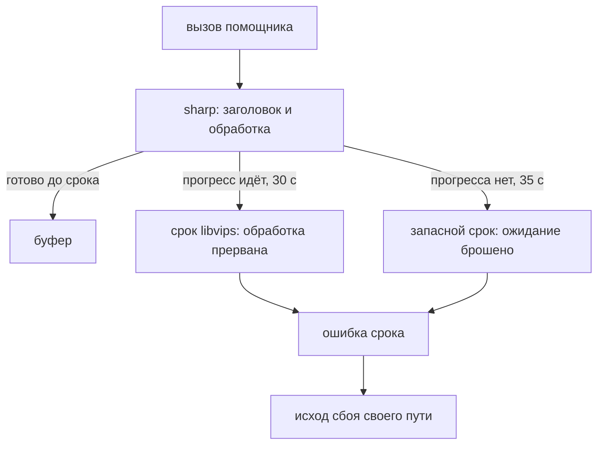

# fix: срок обработки картинки (B-21)

## Summary

Каждая обработка страницы в `sharp` внутри ядра идёт через одного помощника с двумя сроками.
Срок libvips в 30 с по-настоящему прерывает обработку, которая идёт. Запасной срок приложения в
35 с перестаёт ждать обработку, застрявшую без прогресса. Сработавший срок становится обычным
сбоем своего пути: оценки пустых и наклона, выпрямление, миниатюры. Страница остаётся в
документе, ничего не ждёт вечно и не выбрасывается. Исход «не успели» в кэш не пишется:
следующее открытие сессии оценит страницу заново. Новых состояний и текстов в интерфейсе нет.

## Problem Frame

Карточка B-21 описывала зависание только оценки пустоты. Разбор 2026-11-01 показал, что срока
нет ни у одного вызова `sharp` в ядре, а последствия зависания шире карточки:

- `merge` ждёт оценок пустых без потолка (решение автора M4), «Сохранить» недоступно, пока
  оценка пустых или выравнивание в ходу (`blankPending`, `straightenPending`);
- общий лимитер производного — две ячейки на миниатюры, оценки и коррекцию: одна зависшая
  задача вдвое замедляет остальные, две останавливают всё;
- `settleDerived` перед удалением каталога сессии ждёт конца всех оценок — зависшая держит
  «Новое сканирование».

Исключение и битый файл уже обработаны: каждый путь превращает их в исход сбоя. Дыра —
обработка внутри libvips, которая не кончается. Живьём не наблюдалась; закрывается как дешёвая
страховка от тяжёлого последствия (решение автора 2026-11-01, широкий объём).

Срок `sharp` кооперативный (ревью плана): он проверяется в колбэке прогресса libvips и
прерывает обработку между кусками вывода. Медленную, но идущую обработку он останавливает.
Зацикливание внутри одного вызова, например разбор прогрессивного JPEG целиком, событий
прогресса не даёт — его закрывает только запасной срок приложения.

Решения автора 2026-11-01: исход «не успели» не кэшируется; срок libvips один на все операции —
30 с; запасной срок приложения есть.

---

## Requirements

**Срок**

- R1. Каждый вызов `sharp` над страницей в `src/core` — от чтения заголовка до готового буфера —
  идёт через помощника: срок libvips 30 с и запасной срок приложения 35 с. Пути: декод рабочей
  серой картинки детекторов, декод и кодирование выпрямления, миниатюра.
- R2. Новый вызов `sharp` в ядре мимо помощника — красный тест, в том числе через динамический
  импорт и `require`.

**Исход**

- R3. Сработавший срок любого из двух слоёв — существующий исход сбоя своего пути: пустота —
  «не пусто», наклон — «не померить», выпрямление — отложено со сбоем, миниатюра —
  `thumbnailFailed`.
- R4. Страница с исходом «не успели» не держит `merge`, «Сохранить» и `settleDerived` дольше
  запасного срока — и при застрявшей обработке; из документа не исчезает.
- R5. Исход «не успели» у оценок пустоты и наклона живёт только в памяти: кэш не пишется,
  следующее открытие сессии оценивает страницу заново. Прочие сбои кэшируются, как раньше.

**Граница**

- R6. Интерфейс не меняется: ни новых состояний, ни текстов, ни моста.

---

## Key Technical Decisions

- KTD-1. **Один помощник обработки картинки** в `src/core/image/`: принимает входные байты (JPEG
  с пределом пикселей или сырые пиксели) и функцию обработки над экземпляром `sharp`, ставит
  срок libvips и оборачивает весь вызов запасным сроком. Плюс распознаватель ошибки срока. Довод:
  срок нельзя забыть в новом месте, страж R2 проверяет одно правило. Отклонено: `.timeout()` в
  каждом месте вручную — новый вызов его потеряет. Предел пикселей помощник получает уже
  вычисленным: `decodePixelLimit` живёт в `storage/thumbnails.ts`, который сам станет
  потребителем помощника, — цикл импортов не нужен.
- KTD-2. **Срок libvips 30 с, одна константа.** Декод страницы 600 dpi цвет — до секунды
  (`straighten.ts`), запас ×30 и для медленной машины. Часы `sharp` идут от начала обработки,
  ожидание потока libuv не считается — очередь в лимитере срок не съедает. `sharp` принимает
  только целые секунды 0…3600, и 0 срок выключает: подмена для тестов — целое ≥ 1. Отклонено:
  срок от размера страницы — точнее, но сложнее при малом выигрыше (автор).
- KTD-3. **Два слоя срока.** Срок libvips (`timeout({ seconds })`) — настоящая отмена:
  `vips_image_set_kill` между кусками вывода, поток освобождается. Запасной срок приложения —
  `Promise.race` с таймером на 35 с от начала вызова помощника: обещание отвергается своей
  ошибкой срока, ячейка лимитера, `merge` и `settleDerived` освобождаются. Застрявший поток
  libvips при этом остаётся занятым до своего конца или перезапуска — платим этим за R4. Входы —
  байты в памяти, поэтому брошенная обработка не держит файлов каталога сессии, и удалять его
  после запасного срока безопасно. Запасной срок заодно покрывает чтение заголовка
  (`metadata()`), которое срок libvips не видит. Отклонено: изоляция в `worker_threads` или
  процесс — перестройка исполнителя по триггерам ADR 0008, не страховка.
- KTD-4. **Распознавание срока — по тексту и по часам.** Срок libvips приходит ошибкой с текстом
  `timeout: N% complete`; буфер ошибок libvips общий на процесс и чистится после каждой
  обработки, так что при двух-трёх одновременных обработках текст может оказаться не первым или
  стереться. Распознаватель признаёт сроком: собственную ошибку запасного срока; ошибку, в
  сообщении которой где угодно есть `timeout: <число>% complete` (так распознаёт и документация
  `sharp`); любой отказ `sharp`, пришедший не раньше срока libvips по часам помощника.
  Интеграционный тест на настоящем `sharp` держит текстовую часть честной.
- KTD-5. **Декод детекторов пробрасывает срок исключением.** `decodeWorkingGray` сейчас
  превращает любую ошибку в `null`; срок он пробрасывает, прочее — по-прежнему `null`.
  `blankRatio` и `measureSkewJpeg` пропускают исключение. Отклонено: отдельный исход в
  возвращаемом типе — меняет `BlankDetector`, исполнитель картинок и десятки тестов ради одной
  ветки.
- KTD-6. **«Не успели» у оценок ловится в обработке исключения детектора, исход — как у
  временного сбоя чтения.** В `blank-scores` исключение детектора сейчас ловит `ratioOf` и
  отдаёт `null`, который уходит в кэш; в `skew-scores` исключение измерителя ловит `catch`
  вокруг вызова и пишет запись «не померить» с причиной в кэш. Срок распознаётся в этих местах и
  получает исход, который у обоих модулей уже есть для сбоя чтения страницы: вердикт только в
  памяти, без кэша. Сама ветка сбоя чтения не меняется. Прочие исключения — как сейчас.
  Выпрямлению и миниатюрам менять нечего: отложенный сбой выпрямления живёт в памяти, сбой
  миниатюры не кэшируется.
- KTD-7. **Страж — тест по исходникам, не правило lint.** Блок `no-restricted-imports` для
  `sharp` в плоском конфиге перекрыл бы ограничения слоёв для тех же файлов. Образец —
  `test/guards/straight-paths.test.ts`; формы импорта — как у `dynamicImportSelectors` в
  `eslint.config.ts`: статический, `import()`, `require()`. Разрешены помощник и проба окружения
  (`imaging-probe.ts`, синтетическая картинка при запуске).

## High-Level Technical Design

Слои срока:

Сработавший срок по путям:

| Путь                     | Где ловится                | Исход для пользователя       | Кэш                   |
| ------------------------ | -------------------------- | ---------------------------- | --------------------- |
| Оценка пустоты           | `blank-scores`, исключение | «не пусто», страница в ленте | нет — оценка повторно |
| Измерение наклона        | `skew-scores`, исключение  | «не померить», без коррекции | нет — замер повторно  |
| Выпрямление (декод, код) | `straighten.ts` → `null`   | отложено со сбоем, оригинал  | нет (как сейчас)      |
| Миниатюра                | `thumbnails.ts` → `failed` | `thumbnailFailed`, как битая | нет (как сейчас)      |

---

## Implementation Units

### U1. Помощник обработки картинки с двумя сроками

- **Что:** модуль в `src/core/image/` — обработка картинки из JPEG-байтов с пределом пикселей и
  из сырых пикселей; срок libvips 30 с и запасной срок 35 с с подменой для тестов (целые
  секунды ≥ 1 у libvips); распознаватель срока по KTD-4.
- **Файлы:** новый `src/core/image/sharp-image.ts`; тесты `test/integration/sharp-image.test.ts`
  (настоящий `sharp`) и `src/core/image/sharp-image.test.ts` (запасной срок и распознаватель без
  тяжёлой обработки, если модуль позволит; иначе всё в integration).
- **Тесты:**
  - срок libvips с подменой 1 с прерывает тяжёлую обработку в каждой форме, которую использует
    ядро: серый `resize` в сырой буфер, JPEG в сырой одноканальный буфер, сырой вход в JPEG; отказ
    распознаётся как срок; без срока та же обработка идёт кратно дольше секунды;
  - запасной срок: обработка, которая не завершается, отвергается ошибкой срока по подменённому
    запасному сроку, распознаватель её признаёт;
  - распознаватель: текст срока не первым в сообщении — срок; отказ `sharp` после срока по часам
    — срок; битый JPEG до срока — не срок; посторонние ошибки, строка, `null` — не срок;
  - скан ET-3850 со сроками по умолчанию обрабатывается как раньше.
- **Гейт:** typecheck + lint + test + `test:integration` зелёные; коммит `fix(b-21): U1 …`.

### U2. Все вызовы `sharp` ядра — через помощника; страж

- **Что:** декод рабочей серой (`detect/gray.ts`) — через помощника и с пробросом срока
  (KTD-5); декод и кодирование выпрямления (`image/straighten.ts`); миниатюра
  (`storage/thumbnails.ts`). Комментарии про исход сбоя у `decodeWorkingGray`, `blankRatio` и
  `measureSkewJpeg` дополнить сроком. Страж импорта `sharp`.
- **Файлы:** `src/core/detect/gray.ts`, `src/core/detect/blank.ts` (комментарий),
  `src/core/detect/skew.ts` (комментарий), `src/core/image/straighten.ts`,
  `src/core/storage/thumbnails.ts`; новый `test/guards/sharp-entry.test.ts`.
- **Тесты:** страж — импорт `sharp` в `src/` (без тестов) статически, через `import()` и
  `require()` только у помощника и пробы; синтетический случай с динамическим импортом ловится;
  прочие наборы (детекторы, выпрямление, миниатюры, worst-case) — зелёные без правок ожиданий.
- **Гейт:** typecheck + lint + test + `test:integration` + worst-case зелёные; коммит
  `fix(b-21): U2 …`.

### U3. Оценки пустоты и наклона: «не успели» — в памяти, без кэша

- **Что:** в `blank-scores` (`ratioOf`) и `skew-scores` (`catch` вокруг измерителя) исключение
  срока распознаётся и получает исход только в памяти (KTD-6): «не пусто» / «не померить», кэш
  не пишется. Прочие исключения — как сейчас, в кэш.
- **Файлы:** `src/core/storage/blank-scores.ts`, `src/core/storage/skew-scores.ts`; тесты
  `test/integration/blank-scores.test.ts`, `test/integration/skew-scores.test.ts`,
  эмуляторный сценарий в `test/integration/blank-backs.emulator.test.ts`.
- **Тесты:**
  - детектор пустоты отвергается сроком — вердикт «не пусто», файла кэша нет, `settle`
    разрешается; новые оценки над теми же каталогами — детектор зовётся снова;
  - то же для измерителя наклона — «не померить», кэша нет, повторное открытие меряет заново;
  - исключение не-срок — по-прежнему «не померить» / `null` в кэше (существующие тесты);
  - эмулятор: детекторы, отвергающиеся сроком, — снимок без ожидающих оценок пустоты и
    выравнивания, страница в ленте не скрыта, «Сохранить» не отказывает по ожиданию.
- **Гейт:** typecheck + lint + test + `test:integration` зелёные; коммит `fix(b-21): U3 …`.

### U4. Доки, журнал, закрытие

- **Что:** техбаза — два слоя срока, исходы по путям, что не кэшируется, цена застрявшего
  потока; бэклог B-21 — в «Завершённое» на закрытии; журнал
  `docs/solutions/0032-b-21-image-timeout.md` по шаблону.
- **Файлы:** `docs/duplexnt-tech.md`, `docs/backlog.md`, `docs/solutions/0032-b-21-image-timeout.md`.
- **Тесты:** нет — документация.
- **Гейт:** format:check; смоук — обычная сессия со сканером или эмулятором проходит как
  раньше (регрессия); ОК автора на merge отдельным вопросом.

---

## Scope Boundaries

- Сроки на `settleDerived` и на задачи лимитера не вводятся: после R1 внутри `sharp` им зависать
  не на чем. Ввод-вывод внутри задач (чтение страницы, запись кэша) на медленном или сетевом
  диске относится к B-23, «Только по жалобам».
- Чистые вычисления на JS (полосы детектора, ресэмплер) — ограничены по построению, срок не нужен.
- Изоляция обработки в `worker_threads` или процессе — нет, триггеры пересмотра в ADR 0008.
- Отдельная причина «не успели» в интерфейсе или в `thumbnailFailed` — нет (R6).

### Deferred to Follow-Up Work

- Второй признак пустоты — B-37, «Только по жалобам».

## System-Wide Impact

- Формат кэша оценок не меняется; версии детекторов не поднимаются — исходы прежние.
- Исполнитель картинок (`image-worker`) не меняется: исключение измерения он уже пробрасывает.
- Проба окружения (`imaging-probe.ts`) остаётся на прямом `sharp`: синтетическая картинка при
  запуске, вне страниц пользователя.

## Risks & Dependencies

- **Застрявший поток libvips после запасного срока.** Поток остаётся занятым до перезапуска;
  пул libuv общий с файловыми операциями. Одна такая страница не мешает, несколько — замедлят
  ввод-вывод. Принято (автор): случай гипотетический, а без запасного срока он вешал бы
  приложение целиком.
- **«Новое сканирование» при сработавшем сроке.** `abort` оценок не прерывает уже идущую
  обработку `sharp`, поэтому в худшем случае `settleDerived` ждёт до запасного срока — до 35 с
  без отдельного текста (R6).
- **Страница, которая всегда не успевает.** При каждом открытии сессии она держит ячейку
  лимитера и ожидание до срока и получает «не пусто» / «не померить»; объяснения в интерфейсе
  нет (R6). Безопасное направление: страница в документе.
- **Повторная оценка меняет вид.** Страница, которая не успела и была «не пусто», при следующем
  открытии может оказаться пустой и в режиме скрытия уйти из ленты штатным путём поздних оценок.
- **Тест срока медленный или нестабильный.** Тяжёлая обработка должна стабильно идти кратно
  дольше секунды; подбор — при реализации.
- **Текст ошибки `sharp` сменится в новой версии.** Интеграционный тест U1 покраснеет при
  обновлении зависимости; правило по часам подстрахует распознавание.

## Acceptance Examples

- AE1. Оценка пустоты страницы не укладывается в срок — `merge` не ждёт её, страница остаётся
  в ленте не пустой, «Сохранить» доступно; после перезапуска страница оценивается заново.
- AE2. Измерение наклона не укладывается в срок — страница «не выравнивается», сохранение не
  ждёт; следующее открытие измеряет заново.
- AE3. Обработка застряла без прогресса — через запасной срок исход тот же, что в AE1 и AE2.
- AE4. Обычная сессия со сканами ET-3850 — исходы оценок, выравнивания и миниатюр прежние.

## Documentation / Operational Notes

- `docs/duplexnt-tech.md`: два слоя срока — значения, исходы по путям, что не кэшируется, цена
  застрявшего потока.
- `docs/backlog.md`: B-21 — в «Завершённое» с хэшем merge; релизный гейт — B-29, B-26.

## Sources / Research

- `node_modules/sharp/lib/index.d.ts` — `timeout({ seconds })`, целые 0…3600, часы от начала
  обработки.
- `node_modules/sharp/src/common.cc` — `VipsProgressCallBack`: проверка по событию `eval`,
  `vips_image_set_kill`, ошибка `timeout: N% complete`.
- `node_modules/sharp/src/pipeline.cc` — `SetTimeout` только в конвейере (не в `metadata()`),
  `vips_error_clear` после каждой обработки.
- `docs/solutions/0007-m4-blank-backs.md` — ожидание `merge` без потолка (решение автора).
- `test/guards/straight-paths.test.ts` — образец стража по исходникам.
- Ревью плана 2026-11-01 (связность, выполнимость, состязательный): кооперативность срока,
  формы конвейеров в тестах, распознавание по тексту и часам, динамический импорт в страже.
