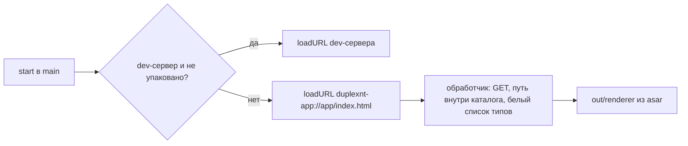
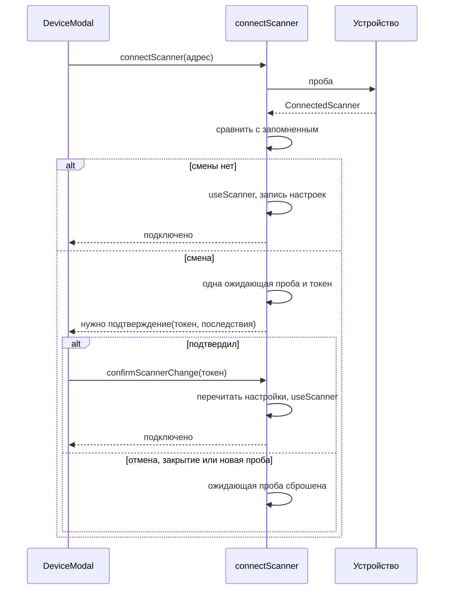

# fix: Hardening оболочки перед публичным релизом (B-29)

## Summary

Закрываем гейт роадмапа «Перед первым публичным релизом установщика»: своя схема для интерфейса
вместо `file://`, оставшиеся fuses, отладка закрыта в упакованном приложении, подтверждение при
смене устройства в профиле сканера, страж приватности в git worktree и приёмка на настоящем
установщике. Подтверждение — новый интерфейс, поэтому идёт через бриф, мок и handoff. Входы:
карточка B-29, решения автора 2026-11-02, амендмент ADR 0003 (внесён при планировании), ADR 0005 и
ADR 0008.

## Problem Frame

Установщик ещё не публиковался, но после открытия репозитория и релиза его запустят чужие люди на
чужих машинах. Снимок «до», сверен с кодом 2026-11-02:

- интерфейс грузится через `loadFile` (`src/main/index.ts`), а `file://` чеклист безопасности
  Electron советует избегать;
- в `electron-builder.yml` нет `enableCookieEncryption`, `enableEmbeddedAsarIntegrityValidation` и
  `grantFileProtocolExtraPrivileges: false`;
- упакованное приложение открывает `--remote-debugging-port`, а `webPreferences.devTools` не
  выключен;
- любая ручная проба (`fingerprint: null`) и `use()` в `src/core/scan/scanner-slot.ts` записывают
  новый отпечаток без сверки со старым. Откат на HTTP при переподключении без схемы снимает
  привязку совсем: `sameScanner` сравнивает только то, что знают обе стороны;
- страж приватности в worktree не находит список значений и пропускает проверку.

Карточка неточна в двух местах: кликов два, а не один (кнопка и «Подключить»), и путей больше, чем
«Подключить заново» и плашка. Сюда же ведут экран `flip`, отказ запуска в `setup`, ручной адрес и
выбор из поиска.

Решения автора 2026-11-02: подтверждение через мок; порт и DevTools закрыты только в упакованном
приложении; страж — только починка worktree, без `pre-push`; чистка идентификаторов остаётся в
B-40.

---

## Requirements

**Схема и fuses**

- R1. Вне dev-сервера интерфейс грузится со своей схемы, упакованное приложение не загружает ни
  одной страницы по `file://`.
- R2. Схема интерфейса отдаёт только файлы своего каталога, известных типов и только на `GET`.
- R3. CSP собранного интерфейса остаётся строгой, без `bypassCSP` и без ослабления схемы страниц.
- R4. В собранном exe включены `enableCookieEncryption` и
  `enableEmbeddedAsarIntegrityValidation`, выключен `grantFileProtocolExtraPrivileges`.
- R5. Приложение с подменённым `app.asar` не запускается, `sharp` в установленном приложении
  работает.

**Отладка**

- R6. Упакованное приложение с `--remote-debugging-port` или `--remote-debugging-pipe` завершается
  и порт не слушает; DevTools в нём не открываются.
- R7. Запуск из `out/` и dev-сервер сохраняют порт и DevTools.

**Смена устройства**

- R8. Если у пробы совпал с запомненным хост или UUID, но устройство не доказано тем же, слот и
  настройки не меняются до подтверждения пользователя.
- R9. Первое подключение, тот же отпечаток с тем же UUID, переезд по mDNS и устройство с другим хостом
  и другим UUID идут без подтверждения.
- R10. Переход с отпечатка на HTTP при совпавшем хосте или UUID считается сменой устройства и закрывает
  досканирование прохода, начатого с отпечатком.
- R11. Подтверждается именно показанная проба: renderer передаёт только одноразовый токен.
- R12. Отмена оставляет слот и настройки прежними; журнал прохода не меняется, прерванный проход
  после подтверждения честно перестаёт быть доступным для досканирования.

**Страж и процесс**

- R13. Страж находит список значений в worktree с установленными зависимостями; путь `--staged` и код
  выхода под тестом (B-28). В worktree без установки git-хука нет, и эта граница записана в журнал.
- R14. Условия ADR 0008 проверены и записан итог по `sharp` в main-процессе.
- R15. Приёмка пройдена на собранном установщике, включая меню, браузерные клавиши и масштаб.

---

## Key Technical Decisions

- KTD-1. **Вторая схема `duplexnt-app`, отдельная от `duplexnt-page`.** Схема страниц по ADR 0005
  намеренно минимальна и навигацией не является, в этом плане её привилегии не меняются. Обе
  регистрируются одним вызовом `registerSchemesAsPrivileged` до `ready`. Привилегии — `standard` и то,
  что потребует спайк U1, без `bypassCSP`, `corsEnabled` и `stream`. `secure` не берём по умолчанию:
  он создаёт риск смешанного контента с картинками, а безопасный контекст интерфейсу нужен, только если
  спайк покажет такой API.
- KTD-2. **Файлы отдаёт свой обработчик с белым списком типов, через `fs`.** `net.fetch` к `file:`
  оставил бы зависимость от той схемы, которую убираем, и от неподтверждённого определения MIME.
  Отклонён экспериментальный `protocol.registerSource`. SPA-фолбэка нет: документ один, неизвестный
  путь — 404.
- KTD-3. **Порядок: сначала схема, потом fuses.** `grantFileProtocolExtraPrivileges: false` без схемы
  проверял бы не ту конфигурацию.
- KTD-4. **`enableCookieEncryption` включаем сейчас.** Переход необратим, поэтому единственный дешёвый
  момент — до первого релиза. Cookie приложение не пишет, `localStorage` и `indexedDB` не использует,
  значит смена origin и шифрование ничего не теряют.
- KTD-5. **Порт закрывает проверка ключа в начале запуска, не fuse.** Fuse для него нет (ответ
  сопровождающих `electron/fuses`). Упакованное приложение при `remote-debugging-port` и
  `remote-debugging-pipe` выходит. Успевает ли Chromium открыть порт до JS, документация не говорит —
  это меряется в U3. Гейт — `app.isPackaged`, как в `shortcuts.ts` и `data-root.ts`.
- KTD-6. **Решение о смене устройства — в ядре, в `connectScanner`, до `useScanner`.** `use()` делает
  слот `ready` раньше записи, поэтому гейт вокруг `rememberScanner` опоздал бы. Сигнатура `useScanner`
  не меняется. Решает новая чистая функция, а не `sameScanner`: тот намеренно снисходителен и нужен
  проверке при запуске. `resumeTarget` в `pass-service.ts` тоже на нём: проход с отпечатком при текущем
  сканере без отпечатка дал бы «то же устройство», поэтому эту пару он отклоняет сам.
- KTD-7. **Токен вместо отпечатка в мосте.** Ядро держит одну ожидающую пробу в памяти. Удержанного
  соединения нет, повторная проба не нужна: запишется показанная проба, а последующую подмену отклонит
  сверка транспорта перед заданием. Перед записью настройки читаются заново: стартовая проверка могла
  записать переезд, и тогда это отказ, а не перезапись.
- KTD-8. **Отпечаток пользователю не показываем.** Показ отнесён к пост-MVP решением автора
  (ADR 0003), `ScannerInfo` намеренно без него. Текст говорит «отвечает не то устройство, что
  запомнено», причину не утверждает: смена сертификата после прошивки или сброса не измерена. UUID
  успокоением не служит.
- KTD-9. **Шаг внутри `DeviceModal`, а не вторая модалка.** `UI_SPEC` разрешает одну модалку, Esc и
  очистка там уже есть, а все кнопки подключения (`setup`, `flip`, плашка) и так ведут в эту модалку через
  `App.openDevice`. Фокус по умолчанию — на отмене.
- KTD-10. **Прерванный проход: журнал не трогаем.** Источник правды неизменен, поэтому после
  подтверждения досканировать нельзя, а страницы на месте. Подтверждение заранее говорит об этом.
  Проход считается заменённым, когда сканер готов, `canResume` ложь и хост сканера прохода совпадает с
  текущим: тогда плашка объясняет причину без ссылки, иначе остаётся прежний текст со ссылкой. Признак
  считает функция в `state/scanner-address.ts`, новых полей снимка нет. Отдельного правила «вернулись к
  сканеру из журнала» нет: подтверждение и там верно и стоит один клик.
- KTD-11. **`flip` не блокируем.** Обороты с другого устройства не задевают источник правды и ничего
  не теряют. Подтверждение на этом экране предупреждает о смешанном документе.
- KTD-12. **Вынос `sharp` не делаем, если условия ADR 0008 не сработали.** На M6 они не сработали, а
  пороги держит `straighten-worst-case.test.ts`. Открытым остаётся только «заметное отставание UI на
  приёмке» — его подтверждает автор в U9.
- KTD-13. **Страж: корень файлов и корень значений раздельно.** Список ищется через
  `git rev-parse --git-common-dir`. Отсутствие списка на чистом клоне остаётся законным пропуском.

## High-Level Technical Design

Загрузка интерфейса:

Подключение со сменой устройства:

Правила решения. Значения сравниваются, только когда известны обеим сторонам. «Совпал» — хост или UUID
запомненного; порт и схема не сравниваются, иначе откат с 443 на 80 при вводе хоста без порта обошёл бы
подтверждение:

| Запомнено     | Проба                               | Совпал хост или UUID | Исход             |
| ------------- | ----------------------------------- | -------------------- | ----------------- |
| ничего        | любая                               | —                    | без подтверждения |
| отпечаток A   | отпечаток A, UUID тот же или неясен | —                    | без подтверждения |
| отпечаток A   | отпечаток A, другой UUID            | —                    | подтверждение     |
| отпечаток A   | отпечаток B                         | да                   | подтверждение     |
| отпечаток A   | без отпечатка (HTTP)                | да                   | подтверждение     |
| без отпечатка | отпечаток, UUID тот же или неясен   | да                   | без подтверждения |
| без отпечатка | отпечаток или HTTP, другой UUID     | да                   | подтверждение     |
| без отпечатка | HTTP, UUID тот же или неясен        | да                   | без подтверждения |
| что угодно    | всё другое                          | нет                  | без подтверждения |

UUID здесь подсказка, а не доказательство: устройство объявляет его само. Строки с UUID нужны потому, что у
HTTP-устройства другого признака нет. Принятые риски: другой хост с другим UUID считается выбором
пользователя, защиты от подмены там нет; строки «без отпечатка» — доверие при первой привязке, как и первое
подключение.

Переезд по mDNS идёт через `scanner-slot.ts` мимо этого гейта: отпечаток там уже сверил транспорт.

## Implementation Units

### U1. Схема интерфейса

- **Что:** схема `duplexnt-app`, обработчик и загрузка через неё вне dev-сервера; журнал заводится здесь.
  Первым шагом — спайк на `out/`: работают ли без `secure` картинки `duplexnt-page`, модульные скрипты Vite с
  `crossorigin`, шрифты, и нужен ли интерфейсу API безопасного контекста. Если для работы пришлось бы менять
  привилегии `duplexnt-page` — стоп и обсуждение с автором.
- **Требования:** R1, R2, R3, R7.
- **Файлы:** `src/main/app-protocol.ts` и тест, `src/main/index.ts`, `src/main/shell/guards.test.ts`,
  `tooling/csp.ts` (если потребует спайк), новый интеграционный тест сборочного CSP рядом с образцом
  `test/tooling/csp.test.ts`, журнал `docs/solutions/0035-b-29-shell-hardening.md`.
- **Образец:** `src/main/page-protocol.ts` и его тест; инъекция чтения файла, как там.
- **Тесты:**
  - `/index.html` и `/` → документ, `text/html`; `.js`, `.css`, `.woff2` → свои типы;
  - `POST`, чужой хост, неизвестное расширение, отсутствующий файл → отказ;
  - `../`, `%2e%2e`, `%252e%252e`, `%00`, обратный слеш, абсолютный путь, `index.html::$DATA`, хвостовая точка
    или пробел в имени, файл рядом с каталогом с общим префиксом → отказ; проверки идут после полного
    декодирования и нормализации;
  - привилегии схемы — точным литералом, `bypassCSP` нет; привилегии `duplexnt-page` не изменились;
  - сборка во временный каталог из самого теста (проект `integration`, не зависит от устаревшего `out/`):
    `renderer/index.html` несёт сборочный профиль CSP, профиль dev в неё не попал (B-28).
- **Гейт:** живьём на `out/` через CDP: адрес страницы на схеме, стартовый экран, шрифты, миниатюры и
  страницы показываются, ошибок CSP в консоли нет; dev-сервер работает как раньше. Коммит `fix(b-29): U1 …`.

### U2. Оставшиеся fuses

- **Что:** три fuse из R4 в `electron-builder.yml`, тест, что конфиг держит полный набор.
- **Требования:** R4, R5. **Зависит от:** U1.
- **Файлы:** `electron-builder.yml`, новый тест в `test/tooling/`.
- **Тесты:** в конфиге заданы все ожидаемые fuses с нужными значениями, `disableAsarIntegrity` нет;
  удаление любого из них роняет тест.
- **Гейт:** `npm run dist`, `npx @electron/fuses read` по `release/win-unpacked/duplexnt.exe` показывает
  ожидаемое (версия 1.8.0 не называет новый слот, это не ошибка). Запуск `win-unpacked` только с
  `--user-data-dir=<временный каталог>`: настоящий `%APPDATA%\duplexnt` сверяется до и после и не должен
  измениться; если ключ не сработал — стоп и выбор данных автором. Порт ещё открыт, поэтому через CDP: адрес на
  схеме, шрифты и миниатюры из asar, живая миниатюра через `sharp`, ошибок CSP нет. Копия каталога с изменённым
  `app.asar` не запускается. Коммит `fix(b-29): U2 …`.

### U3. Закрытие отладки в упакованном приложении

- **Что:** проверка ключей отладки в самом начале запуска и `devTools` в `webPreferences` по признаку
  упаковки.
- **Требования:** R6, R7. **Зависит от:** U1 (код); гейт на упакованном exe — после U2.
- **Файлы:** `src/main/shell/debug-guard.ts` и тест, `src/main/shell/web-preferences.ts` и тест,
  `src/main/index.ts`, `docs/templates/smoke-checklist.md`, журнал.
- **Образец:** `installShortcutGuard` с инъекцией `app`.
- **Тесты:**
  - упаковано + порт или pipe → выход, дальше запуск не идёт;
  - упаковано без ключей, не упаковано с ключами → запуск идёт;
  - `devTools` — `false` упакованному и `true` иначе; тест закрытого набора ключей обновлён.
- **Гейт:** упакованный exe с портом и с `=0` завершается, порт не слушает все время запуска — результат
  замера записан в журнал. Ложный успех исключён: перед замером нет другого экземпляра,
  `ELECTRON_RUN_AS_NODE` снят, то же приложение без ключа открывает окно. Запуски — с тем же
  `--user-data-dir`, что в U2. На `out/` порт работает. В шаблоне
  смоука консоль и CDP — только для `out/`. Коммит `fix(b-29): U3 …`.

### U4. Страж приватности в worktree

- **Что:** раздельные корни файлов и значений, поиск списка через общий git-каталог; покрытие `--staged`
  и кода выхода.
- **Требования:** R13.
- **Файлы:** `scripts/privacy-guard.ts`, `test/guards/privacy-guard.test.ts`.
- **Тесты:**
  - настоящий временный репозиторий с worktree: список в основном дереве, значение в файле worktree →
    находка, код выхода не ноль;
  - чистый клон без списка → законный пропуск, код 0;
  - `--staged` видит только застейдженное, значение в незастейдженном файле не срабатывает;
  - вне git-репозитория страж не падает необъяснимо.
- **Гейт:** в новом worktree после `npm install` (без него `.husky/_` нет и хук не запускается) коммит с тестовым
  значением блокируется; `node:*`-ограничение
  скрипта соблюдено. Коммит `fix(b-29): U4 …`.

### U5. Условия ADR 0008 по `sharp`

- **Что:** свериться с порогами, записать итог в журнал и ADR 0008, поправить его противоречие: раздел
  «Последствия» говорит о паузе очереди, текст условий — что она снята. Условия покрывают только
  производительность, поэтому отдельной строкой: разбор байтов чужого устройства в main ограничен пределом
  пикселей и сроком `processImage`, но не изоляцией. Этот остаточный риск автор принимает или откладывает явно.
- **Требования:** R14.
- **Файлы:** `docs/decisions/0008-image-worker.md`, журнал.
- **Test expectation:** none — проверка уже есть в `test/integration/straighten-worst-case.test.ts`.
- **Гейт:** worst-case зелёный на текущем коде; если сработало — стоп и обсуждение с автором отдельной
  задачей. Коммит `docs(b-29): U5 …`.

### U6. Бриф, мок и handoff подтверждения

- **Что:** бриф по `docs/templates/brief.md` от свежего `npm run design:snapshot`; мок и handoff делает
  Claude Design, автор утверждает. Покрыть: шаг в `DeviceModal`; варианты с прерванным проходом и с
  лицами на `flip`; текст плашки после подтверждения; ожидание после нажатия; отказы подтверждения
  (устаревший токен, идущий проход, переезд записан стартовой проверкой, сбой записи настроек). «Отмена»
  возвращает к вводу адреса, Esc и закрытие закрывают модалку. Новых слов про «пачку» и отпечаток в тексте нет.
- **Требования:** R8, R12. **Зависит от:** решений KTD-8…KTD-11.
- **Файлы:** `docs/design/briefs/`, `docs/design/handoffs/`, `docs/design/mock/`.
- **Test expectation:** none — проектная работа.
- **Гейт:** handoff утверждён автором. Без него U7 и U8 не начинаются. Коммит `docs(b-29): U6 …`.

### U7. Ядро: решение, токен, команда моста

- **Что:** чистая функция сравнения по таблице выше; гейт в `connectScanner`; объединённый ответ
  «подключено» или «нужно подтверждение» с токеном и последствиями; команда `confirmScannerChange`;
  сброс ожидающей пробы; отказ `resumeTarget` на паре «отпечаток прохода, текущий без отпечатка». В renderer
  только сужение типа и заглушка команды, шаг интерфейса — в U8.
- **Требования:** R8–R12. **Зависит от:** U6 (набор последствий).
- **Файлы:** `src/core/storage/stored-scanner.ts` и тест, `src/core/commands/handlers.ts` и тест,
  `src/core/commands/schemas.ts`, `src/core/scan/pass-service.ts`, `src/shared/bridge.ts`, `src/preload/api.ts`,
  `src/shared/errors.ts`, `src/renderer/src/modals/DeviceModal.tsx` и тест, `src/renderer/src/app-fixture.ts`,
  `test/support/` (фикстуры), `test/emulator/` (опция другого UUID), новый
  `test/integration/scanner-change.emulator.test.ts`.
- **Образец:** `pass.emulator.test.ts` — смена сертификата перезапуском эмулятора на том же порту.
- **Тесты:**
  - функция сравнения — каждая строка таблицы и случаи неизвестного UUID;
  - смена → настройки и слот не изменены, ответ несёт токен и не несёт отпечатка;
  - подтверждение → `ready`, запись в настройки, токен погашен; повтор и чужой токен → отказ;
  - новая проба заменяет токен; отмена и `cancelConnect` сбрасывают его;
  - стартовая проверка записала переезд между пробой и подтверждением → отказ, запись не перетёрта;
  - идущий проход отклоняет подтверждение;
  - эмулятор: новый сертификат на том же адресе; HTTP на том же адресе; другой UUID на том же адресе;
    первое подключение; отказ записи настроек оставляет сканер в памяти, после перезапуска снова смена;
  - запомнен отпечаток на `host:443`, проба — HTTP на том же хосте и порту 80 с другим UUID → подтверждение;
  - прерванный проход после подтверждения нового сертификата и после подтверждения HTTP с тем же UUID:
    `canResume` ложь, журнал и страницы не тронуты.
- **Гейт:** typecheck, lint, test и `test:integration` зелёные; lint подтверждает отсутствие Electron в
  ядре. Коммит `fix(b-29): U7 …`.

### U8. Интерфейс подтверждения

- **Что:** шаг в `DeviceModal` по handoff'у, тексты в локали, плашка прерванного прохода, `flip`;
  `UI_SPEC` и `design:snapshot`.
- **Требования:** R8, R12. **Зависит от:** U6, U7.
- **Файлы:** `src/renderer/src/modals/DeviceModal.tsx` и тест, `src/renderer/src/screens/EditorPassBanner.tsx`,
  `src/renderer/src/screens/FlipScreen.tsx`, `src/renderer/src/state/scanner-address.ts` и тест,
  `src/renderer/src/App.test.tsx`, `locales/ru/common.json`,
  `docs/design/UI_SPEC.md`, `docs/design/reference/`.
- **Тесты:**
  - ответ «нужно подтверждение» открывает шаг, фокус на отмене;
  - подтверждение шлёт только токен, успех закрывает модалку и возвращает фокус;
  - «Отмена» возвращает к вводу адреса, Esc и закрытие закрывают модалку; во всех случаях проба сброшена, а
    прежний сканер на месте;
  - во время ожидания кнопки заблокированы; каждый отказ подтверждения показывает свой текст и возвращает к
    вводу адреса;
  - вариант прерванного прохода и вариант `flip` несут свои строки;
  - заменённый проход: объяснение без ссылки; другой сканер на другом хосте и `otherDevice`: прежняя ссылка;
  - двойной клик не шлёт второе подтверждение.
- **Гейт:** живьём на `out/` с эмулятором: подмена сертификата на том же адресе, сценарии AE1–AE3.
  Коммит `fix(b-29): U8 …`.

### U9. Приёмка на установщике

- **Что:** чеклист по `docs/templates/smoke-checklist.md` в `docs/output/`, прогон на собранном
  установщике и на живом сканере. Автоматическую часть (fuses, подмена asar, ключи отладки) выполняю я,
  интерфейс и физику — автор: консоли и CDP на упакованном больше нет.
- **Требования:** R5, R6, R15, а также последний пункт KTD-12.
- **Файлы:** `docs/output/` (локально), журнал.
- **Test expectation:** none — ручная приёмка.
- **Гейт:** AE1–AE7 пройдены; изменение масштаба `Ctrl` + колесо, если воспроизводится, заводится в `docs/bugs.md`.
  Установщик и `win-unpacked` делят `%APPDATA%\duplexnt`, dev и `out/` живут в `duplexnt-dev`: автор решает заранее,
  на каких данных прогон. AE6 идёт на машине автора. AE7 — в Windows Sandbox через
  `spikes/make-sandbox-config.mjs` (после очистки `release/` конфиг создаётся заново, сети в Sandbox нет). Коммит `docs(b-29): U9 …`.

### U10. Документы и закрытие

- **Что:** спека, роадмап, ADR 0005, бэклог, журнал; затребовать приёмку и отдельный вопрос о merge.
- **Требования:** все. **Зависит от:** U9.
- **Файлы:** `docs/duplexnt.md`, `docs/duplexnt-tech.md`, `docs/roadmap.md`, `docs/decisions/0005-*`,
  `docs/backlog.md` (B-29 в «Завершённое», строка CSP и `--staged` из B-28, упоминание `pre-push`),
  журнал `docs/solutions/0035-b-29-shell-hardening.md`.
- **Test expectation:** none — документы.
- **Гейт:** typecheck, lint, format:check, `test:all` зелёные. Merge — только после явного ОК.

## План по сессиям

| Сессия | Юниты  | Граница                                                                    |
| ------ | ------ | -------------------------------------------------------------------------- |
| 1      | U1–U5  | Оболочка, страж и ADR 0008 зелёные; журнал заведён; бриф U6 передан автору |
| —      | U6     | Вне сессий: Claude Design и утверждение автора; дальше без него не идём    |
| 2      | U7–U8  | Подтверждение работает на `out/` с эмулятором, `test:all` зелёный          |
| 3      | U9–U10 | Приёмка на установщике, документы, вопрос о merge                          |

Каждая сессия кончается зелёным коммитом с U-ID в теме; возобновление — `git log` и журнал.

## Scope Boundaries

Вне этого плана:

- показ отпечатка и управление доверенными устройствами — пост-MVP (ADR 0003);
- перенос `sharp` в поток или процесс, пока условия ADR 0008 не сработали;
- хук `pre-push` — решение автора;
- подпись кода и автообновления.

### Deferred to Follow-Up Work

- Чистка идентификаторов и истории git → B-40, прямо перед открытием репозитория.
- Деинсталлятор → B-26. Локаль → B-41: новые строки U8 просто войдут в перевод.
- Потеря нестандартного `basePath` при «Подключить заново» → хвост M5 в бэклоге. На таблицу решения не
  влияет: такая проба падает отказом, а не сменой устройства.
- Остальные пункты B-28 → «попутно».

## System-Wide Impact

- **Живые проверки.** На упакованном приложении больше нет CDP и консоли: чеклисты M6 и новые смоуки
  опираются на `out/`, поведение только упакованного проверяет автор.
- **Контракт моста.** `connectScanner` меняет тип ответа: это затрагивает все вызовы и фикстуры `stubApi`.
- **Прежние данные.** Профиль сканера и настройки не мигрируют. Смена origin ничего не теряет: renderer не
  хранит данных в браузерном хранилище.
- **Фаервол.** Правило привязано к пути exe и переживает удаление, поэтому прежнее «разрешить» у автора
  скроет запрос. Проверка появления запроса — на чистой машине, не на машине автора.

## Risks & Dependencies

| Риск                                                          | Де-риск                                                                                                                                                   |
| ------------------------------------------------------------- | --------------------------------------------------------------------------------------------------------------------------------------------------------- |
| Картинки `duplexnt-page` заблокируются как смешанный контент  | Спайк в начале U1, до остального кода                                                                                                                     |
| Проверка целостности asar конфликтует с распакованным `sharp` | Живая миниатюра в гейте U2; документация молчит, решает только прогон                                                                                     |
| Chromium открывает порт раньше кода приложения                | Замер в U3; если окно есть, R6 и AE5 в этой формулировке невыполнимы, и решение с вариантами идёт автору                                                  |
| Сборка без подписи и fuse целостности несовместимы            | Подтверждений в документах нет, поэтому гейт U2 на настоящем exe                                                                                          |
| Handoff задерживается                                         | Сессия 1 от него не зависит; U7 и U8 ждут, остальное не блокируется                                                                                       |
| Необратимость `enableCookieEncryption`                        | Cookie нет, релиза ещё не было; выключать потом не планируется                                                                                            |
| Ложный успех проверки порта                                   | В гейте U3 контрольный запуск без ключа, снятие переменной, один экземпляр                                                                                |
| Подтверждение станет привычкой, и его будут прожимать         | Довод проверен только на ET-3850: сертификат переживает смену адреса и перезагрузку. Для других устройств и для прошивки данных нет, риск принят до жалоб |

Зависимости: Electron 44.4.3, electron-builder 26.15.3 с генерацией ресурса целостности. В Electron 45
дескрипторы файлов внутри asar станут работать только через `fs` — это учесть при его обновлении.

## Acceptance Examples

- AE1. Сертификат на том же адресе сменился, «Подключить заново» → подтверждение; «Отмена» → прежний
  сканер запомнен, состояние «другое устройство» остаётся.
- AE2. То же, подтвердил → «готов», скан идёт, после перезапуска приложение подключается без вопроса.
- AE3. Прерванный проход со старого устройства, подтверждение → страницы на месте, сохранить можно,
  досканирование недоступно, плашка объясняет почему.
- AE4. На установленном приложении нет меню, браузерных клавиш, DevTools и масштаба.
- AE5. Установленное приложение с ключом отладки не открывается и порт не слушает.
- AE6. Установленное приложение на живом сканере: подключение, два прохода, миниатюры, выравнивание,
  сохранение PDF; интерфейс без задержек, шрифты на месте.
- AE7. Чистая машина: установка, запуск, первый экран; подменённый `app.asar` приложение не запускает.

## Documentation / Operational Notes

- `docs/duplexnt.md`: подключение — запоминание нового отпечатка после подтверждения; раздел безопасности.
- ADR 0003 — амендмент 2026-11-02 внесён при планировании. ADR 0005 — схема интерфейса заведена, результат
  спайка. ADR 0008 — итог проверки.
- `docs/roadmap.md`: гейт установщика закрыт.
- `docs/backlog.md`: B-29 в «Завершённое», карточка B-40 про общую ветку уточняется решением ниже.

**Вопрос к старту реализации:** B-40 просит вести B-29, B-26 и B-40 одной веткой. По умолчанию B-29 идёт
своей веткой `feat/b-29-hardening` и вливается отдельно после приёмки: приёмка на установщике самостоятельна,
а B-40 зависит от финального дерева. Автор может объединить ветки перед стартом.

## Sources / Research

- Карточки `docs/backlog.md` (B-28, B-29, B-40), `docs/roadmap.md`, `docs/duplexnt.md`, `docs/duplexnt-tech.md`.
- ADR 0003, 0005, 0008; журналы 0001, 0002, 0023, 0034.
- Fuses: https://www.electronjs.org/docs/latest/tutorial/fuses
- Целостность asar: https://www.electronjs.org/docs/latest/tutorial/asar-integrity
- Протоколы: https://www.electronjs.org/docs/latest/api/protocol
- Чеклист безопасности: https://www.electronjs.org/docs/latest/tutorial/security
- Порт без fuse: https://github.com/electron/fuses/issues/6 (найдено поиском, страница не открывалась)
- Ресурс целостности в electron-builder 26.15.3 — исходник `electron/electronWin.js`, `addWinAsarIntegrity`.
