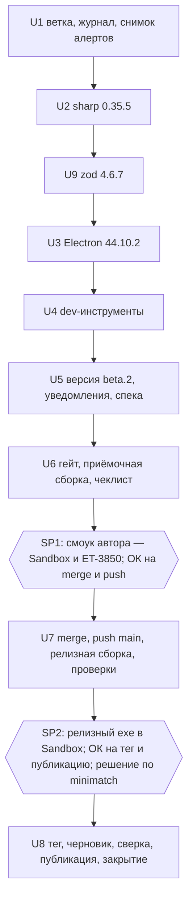

# chore: Обновление зависимостей по алертам Dependabot и релиз 1.0.0-beta.2 (B-46)

## Summary

Поднимаем зависимости так, чтобы закрыть 29 из 30 открытых алертов Dependabot и уязвимость
`zod`, которую пока показывает только `npm audit`, и выпускаем установщик `1.0.0-beta.2` по
релизной процедуре спеки. К пользователю уходят Electron 44.10.2, `sharp` 0.35.5 и `zod` 4.6.7;
dev-инструменты поднимаются точечно, без мажоров. Один алерт (`minimatch`) без мажорного прыжка
не закрывается и остаётся с записанной причиной. Входы: карточка B-46 (решения автора а–г) и
ответы автора при планировании 2026-11-06 — в сборку идут только зависимости, приёмка включает
сканирование на живом ET-3850, `zod` 4.6.7 входит в сборку.

## Problem Frame

После открытия репозитория (B-40, 2026-11-05) Dependabot показывает 30 открытых алертов по
`package-lock.json`. `npm audit` показывает то же и сверх этого — `zod` и три новых уведомления
по `undici` с теми же исправленными версиями. В установщике `1.0.0-beta.1` едут три уязвимых
пакета:

- `electron` 44.4.3 — high GHSA-jr5w-w6x2-84p9 (исправлено в 44.9.1) и medium
  GHSA-x562-297c-g43g (44.5.0);
- `sharp` 0.35.4 — high GHSA-wq5f-xc86-pv6w (0.35.5); SVG приложение не обрабатывает, но пакет
  лежит в `app.asar.unpacked`;
- `zod` 4.6.5 — high GHSA-mrhx-c7xc-m3w5, исчерпание памяти при проверке слишком больших
  коллекций (4.6.6); вшит в бандл main, проверяет файлы сессий и ответы сканера.

Остальные алерты — dev-инструменты, в сборку не попадают. Опубликованный тег `v1.0.0-beta.1` не
двигается, поэтому исправления выходят отдельной сборкой.

Снимок «до», сверен 2026-11-06 (`gh api …/dependabot/alerts?state=open`, `npm audit`, `npm ls`,
`npm view`):

| Пакет            | Установлено              | Кто тянет                                                                                       | Исправлено в             | Алертов Dependabot    |
| ---------------- | ------------------------ | ----------------------------------------------------------------------------------------------- | ------------------------ | --------------------- |
| `electron`       | 44.4.3                   | прямая, точная версия                                                                           | 44.9.1 (ветка — 44.10.2) | 2                     |
| `sharp`          | 0.35.4                   | прямая, точная версия                                                                           | 0.35.5                   | 1                     |
| `zod`            | 4.6.5                    | прямая, точная версия                                                                           | 4.6.6 (ветка — 4.6.7)    | 0, только `npm audit` |
| `vite`           | 7.3.6                    | прямая, точная версия                                                                           | 7.3.7                    | 5                     |
| `@vitest/mocker` | 5.0.1                    | `vitest` 5.0.1, точная версия внутри                                                            | 5.0.3                    | 2                     |
| `undici`         | 6.28.1 / 7.29.1 / 8.10.2 | `node-gyp` 12.4.0 — `^6.25.0`; `@electron/get` 5.1.0 — `^7.24.4`; `jsdom` 30.1.0 — `^8.10.2`    | 6.29.1 / 7.30.1 / 8.12.2 | 14                    |
| `source-map-js`  | 1.2.1                    | `css-tree`, `postcss` — `^1.2.1`                                                                | 1.2.2                    | 1                     |
| `fast-uri`       | 3.1.8                    | `ajv` 8.x — `^3.0.1`                                                                            | 3.1.9                    | 4                     |
| `minimatch`      | 9.0.9 / 10.2.6           | `@electron/universal` `^9.0.3`; `eslint`, `@eslint/config-array`, `typescript-estree` — `^10.x` | только 11.0.1            | 1                     |

Диапазоны в столбце «Кто тянет» — то, что родитель объявляет для пакета из первого столбца, а не
версия самого родителя.

После тега `v1.0.0-beta.1` код приложения не менялся: в `main` — лендинг, README и два теста.

---

## Requirements

**Что уходит пользователю**

- R1. Установщик `1.0.0-beta.2` несёт Electron 44.10.2 — оба алерта `electron` закрыты.
- R2. Установщик несёт `sharp` 0.35.5 и `@img/sharp-win32-x64` 0.35.5.
- R13. Установщик несёт `zod` 4.6.7.
- R3. Поведение приложения не меняется; `src/` правится только там, где этого требует
  совместимость с новой версией.

**Dev-инструменты**

- R4. Закрыты алерты `vite`, `@vitest/mocker`, `undici` (три ветки), `source-map-js`, `fast-uri`
  — без мажорных подъёмов.
- R5. Алерт, который без мажора не закрывается, записан с причиной в карточке-наследнике бэклога.
- R6. Изменения `package-lock.json` ограничены пакетами из таблицы «до» и тем, что они сами
  требуют; общего освежения зависимостей нет.

**Релиз**

- R7. Версия `1.0.0-beta.2` стоит в `package.json`, `package-lock.json` и
  `THIRD-PARTY-NOTICES.txt`; `notices --check` проходит.
- R8. Релиз идёт по процедуре спеки («Публичный репозиторий»); тег `v1.0.0-beta.1` и его релиз
  не меняются.
- R9. Приёмка автора: установщик в Windows Sandbox (чистая установка, установка поверх beta.1,
  деинсталляция) и двусторонний скан на живом ET-3850 из установленной сборки.
- R10. Merge с push `main` и публикация тега с релизом — каждое после явного ОК автора отдельным
  вопросом. ОК на публикацию покрывает и push доков закрытия в `main`.

**Закрытие**

- R11. После релиза сверены открытые алерты Dependabot и `npm audit`: пусто либо остаток
  объяснён; `dependabot_security_updates` остаются выключенными.
- R12. Журнал, бэклог, спека и память агента отражают результат.

---

## Key Technical Decisions

- KTD-1. **Electron — 44.10.2, последняя в ветке 44.x, а не минимальная 44.9.1.** Ветка несёт все
  исправления после 44.9.1; следующий алерт по 44.x с меньшей вероятностью потребует ещё одной
  сборки. Electron 45 — мажор, вне решения (б) карточки.
- KTD-2. **Прямые зависимости поднимаются `npm install -E <пакет>@<версия>`, транзитивные —
  `npm update <имя>` по одному имени.** В `package.json` версии точные, `.npmrc` нет. `npm update`
  без аргументов и `npm audit fix` не используются: они меняют lock шире, чем требует R6.
- KTD-3. **`vitest` — 5.0.5, последний патч 5.0.x; `vite` — 7.3.7.** `@vitest/mocker` закреплён
  точной версией внутри `vitest`, поэтому закрывается только подъёмом самого `vitest`. Минор 5.1.0
  ради алерта не нужен.
- KTD-4. **`minimatch` остаётся с открытым алертом.** Исправление есть только в 11.0.1.
  `eslint` 10.14.0, `@eslint/config-array` 0.23.5 и `@typescript-eslint/typescript-estree` 8.72.1
  в последних версиях объявляют `^10.x`; `@electron/universal` 2.0.3 — `^9.0.3`, и последний
  `app-builder-lib` держит именно его. `overrides` на 11.x под родителем, объявившим `^9`/`^10`,
  отвергнут: это мажорный прыжок ради алерта (решение (в) карточки) в линтере и сборщике
  установщика.
- KTD-5. **Порядок: `sharp` → `zod` → Electron → dev-инструменты → версия, каждый шаг отдельным
  коммитом с полным гейтом.** Регрессия привязывается к одному пакету; то, что уходит
  пользователю, проверяется раньше.
- KTD-6. **Две сборки, как в B-40: приёмочная с головы ветки, релизная с `main` после merge.**
  Процедура требует `npm run dist` при `HEAD == origin/main`, а merge в `main` возможен только
  после приёмки. Соответствие: `git diff` между приёмочным коммитом и merge-коммитом затрагивает
  только пути вне сборки — `docs/` и README; в установщик идёт белый список `files` из
  `electron-builder.yml`. Иное расхождение — остановка и вопрос автору. Сканирование на релизном
  exe не повторяется; он проходит автоматические проверки и короткую установку в Sandbox.
- KTD-7. **Живой сканер проверяется из установленной на хост сборки.** Ядро работает в
  main-процессе Electron и ходит к сканеру через `https.Agent` с `rejectUnauthorized: false`
  (`src/core/escl/transport.ts`); при подъёме Electron меняется именно этот стек. Sandbox не
  годится — сеть в шаблоне выключена. Live-тесты vitest не годятся — они гоняют ядро под
  системным Node, а не под Node из Electron.
- KTD-8. **Лендинг и README не меняются.** История версий лендинга ведётся на уровне «1.0»;
  beta.2 функций не добавляет, описание уходит в заметки релиза. Пример версии в форме
  `bug.yml` обновляется на `1.0.0-beta.2`.
- KTD-9. **Ветка `feat/b-46-deps-beta-2` в `origin` не пушится.** Dependabot смотрит только
  ветку по умолчанию; `main` пушится после merge.
- KTD-10. **Остаток `minimatch` на вкладке Security вручную не закрывается без решения автора.**
  Вопрос задаётся на второй остановке: закрыть алерт как допустимый риск с комментарием или
  оставить открытым.
- KTD-11. **`zod` — 4.6.7, последний патч 4.6.x (решение автора 2026-11-06).** Мерило рамки —
  `npm audit` на старте работы, а не только список Dependabot: тот отстаёт от базы уведомлений.
- KTD-12. **`THIRD-PARTY-NOTICES.txt` перегенерируется в том же коммите, что и подъём пакета из
  перечня.** Тест `test/tooling/third-party-notices.test.ts` сверяет закоммиченный перечень с
  `node_modules`; без перегенерации гейт юнита красный. Это касается `sharp` и `zod`; Electron и
  dev-инструменты в перечень не входят.

---

## High-Level Technical Design

До SP1 всё обратимо и локально. После SP1 меняется публичный `main`. После SP2 появляются
публичный тег и релиз, которые не двигаются.

---

## Implementation Units

### U1. Ветка, журнал и исходный снимок

- **Goal:** рабочая ветка заведена, исходное состояние зафиксировано, гейт зелёный до правок.
- **Requirements:** R12.
- **Dependencies:** нет.
- **Files:** `docs/solutions/0045-b-46-deps-beta-2.md` (по `docs/templates/solution.md`),
  `docs/plans/2026-11-06-001-chore-b-46-deps-beta-2-plan.md` (статус → `в работе`),
  `docs/backlog.md` (пометка «в работе» в карточке), `docs/output/` (снимки и лог гейта, вне git).
- **Approach:** ветка `feat/b-46-deps-beta-2` от `main`. Два снимка в `docs/output/`: открытые
  алерты Dependabot (`gh api` с явным репозиторием `gyuiltylizard/duplexnt`) и `npm audit`. Если
  `npm audit` показывает пакет, которого нет в таблице «до», — остановка и вопрос автору. Полный
  гейт до правок с логом в файл: падение после подъёма отличается от уже существовавшего. Своё
  dev-приложение перед `npm install` закрыто; чужие процессы Electron не трогаются.
- **Patterns to follow:** журнал `docs/solutions/0044-b-40-repo-opening.md` («Окружение», карта
  сессий, «На чём встали»).
- **Test scenarios:** `Test expectation: none` — заведение ветки и журнала; исходный гейт зелёный.
- **Verification:** журнал несёт число алертов «до» и ссылку на лог гейта; коммит
  `chore(b-46): U1 …`.

### U2. `sharp` 0.35.5

- **Goal:** `sharp` и его бинарник для Windows — на 0.35.5.
- **Requirements:** R2, R3, R6.
- **Dependencies:** U1.
- **Files:** `package.json`, `package-lock.json`, `THIRD-PARTY-NOTICES.txt`; тесты и `src/` —
  только при несовместимости.
- **Approach:** `npm install -E sharp@0.35.5`. В diff lock — `sharp`, `@img/sharp-*` и то, что
  `sharp` 0.35.5 сам объявляет; лишнее — повод остановиться. Затем `npm run build` и
  `npm run notices` (KTD-12): шапка остаётся `1.0.0-beta.1`, меняются версии `sharp`, носителя
  libvips и, возможно, состав компонентов — diff просматривается глазами. Полный гейт. Если
  падают тесты с точными значениями пикселей или оценок — причина разбирается, пороги вслепую не
  ослабляются. Если меняются оценки детекторов пустоты или перекоса — остановка и вопрос автору:
  это затрагивает версию детектора (`src/core/detect/skew-version.ts`) и производные данные
  существующих сессий.
- **Patterns to follow:** `electron-builder.yml` (`asarUnpack`, `npmRebuild: false` — пересборка
  не нужна); журнал 0044 U2.
- **Test scenarios:** существующий набор без новых тестов — `test/integration/imaging-probe.test.ts`,
  тесты воркера изображений, детекторов, выравнивания и сохранения PDF, сверка перечня
  уведомлений с `node_modules` остаются зелёными.
- **Verification:** `npm ls sharp` показывает 0.35.5; typecheck + lint + format:check + `test:all`
  зелёные; коммит `chore(b-46): U2 …`.

### U9. `zod` 4.6.7

- **Goal:** `zod` в бандле приложения — 4.6.7.
- **Requirements:** R13, R3, R6.
- **Dependencies:** U2.
- **Files:** `package.json`, `package-lock.json`, `THIRD-PARTY-NOTICES.txt`; `src/core/` — только
  при несовместимости.
- **Approach:** `npm install -E zod@4.6.7`; в diff lock — только `zod`. `npm run build` и
  `npm run notices` (KTD-12). Полный гейт. `zod` проверяет журнал сессии, правки, настройки,
  команды моста и ответы сканера (`src/core/storage/`, `src/core/commands/`, `src/core/escl/`).
  Если новая версия отклоняет то, что раньше принималось, — остановка и вопрос автору: схемы под
  новую версию молча не ослабляются и не ужесточаются, уже записанные сессии должны читаться.
- **Patterns to follow:** KTD-2, KTD-12.
- **Test scenarios:** существующий набор без новых тестов — тесты схем хранилища, восстановления
  сессии, валидации команд моста и разбора ответов eSCL остаются зелёными без правок ожиданий.
- **Verification:** `npm ls zod` показывает 4.6.7 одной версией; в перечне уведомлений `zod@4.6.7`;
  гейт зелёный; коммит `chore(b-46): U9 …`.

### U3. Electron 44.10.2

- **Goal:** приложение работает на Electron 44.10.2.
- **Requirements:** R1, R3, R6.
- **Dependencies:** U9.
- **Files:** `package.json`, `package-lock.json`; `src/main/`, `src/preload/` — только при
  несовместимости.
- **Approach:** до подъёма — заметки выпусков 44.5.0…44.10.2: изменения в sandbox и preload,
  обработчиках собственной схемы, CSP, fuses, правах сессии, версии встроенного Node. Затем
  `npm install -E electron@44.10.2`; бинарник качается лениво — `npx install-electron --no`.
  Полный гейт, запуск приложения из `out/` на эмуляторе: подключение, двусторонний скан,
  выравнивание, сохранение PDF, консоль без необработанных ошибок. npm-скрипта запуска из `out/`
  нет: свой скрипт запуска снимает `ELECTRON_RUN_AS_NODE`, которую наследует терминал редактора.
  Изменение поведения, которое требует правки `src/` шире пары строк, — остановка и вопрос
  автору.
- **Patterns to follow:** `test/tooling/electron-builder.test.ts` (полный набор fuses),
  `test/integration/build-csp.test.ts`; CDP-смоуки из журналов 0002–0004.
- **Test scenarios:** существующий набор; отдельно смотрятся `build-csp`, `imaging-probe`
  (версии из `process.versions`) и сценарии на эмуляторе.
- **Verification:** запущенное из `out/` приложение сообщает Electron 44.10.2; гейт зелёный;
  смоук на эмуляторе записан в журнал; коммит `chore(b-46): U3 …`.

### U4. Dev-инструменты

- **Goal:** закрыты алерты dev-зависимостей, кроме `minimatch`.
- **Requirements:** R4, R5, R6.
- **Dependencies:** U3.
- **Files:** `package.json`, `package-lock.json`.
- **Approach:** `npm install -E vite@7.3.7 vitest@5.0.5`; `npm update` по одному имени для
  `undici`, `source-map-js`, `fast-uri`. По диапазонам родителей все три ветки `undici`
  сдвигаются одним `npm update undici`; если ветка не сдвинулась — поднять родителя в пределах
  его мажора (`jsdom` с 30.1.0 до последнего 30.1.x). `vitest` 5.0.5 приводит свои транзитивные
  подъёмы — diff lock шире двух пакетов, это ожидаемо. Сверка по таблице «до»: для каждого пакета
  установленные версии вне уязвимых диапазонов; в `npm audit` остаются только записи через
  GHSA-g3hv-75wg-m249 (`minimatch` и цепочка зависящих от него). Причина по `minimatch` — в
  журнал словами KTD-4; в бэклог она попадает карточкой B-47 в U8.
- **Patterns to follow:** KTD-2.
- **Test scenarios:** существующий набор; `npm run build` проходит на `vite` 7.3.7; dev-сервер
  стартует.
- **Verification:** таблица «после» в журнале; гейт зелёный; коммит `chore(b-46): U4 …`.

### U5. Версия `1.0.0-beta.2`, уведомления и спека

- **Goal:** дерево готово к сборке `1.0.0-beta.2`.
- **Requirements:** R7, R12.
- **Dependencies:** U4.
- **Files:** `package.json`, `package-lock.json`, `THIRD-PARTY-NOTICES.txt`,
  `.github/ISSUE_TEMPLATE/bug.yml`, `docs/duplexnt.md`.
- **Approach:** версия — в `package.json` и lock без git-тега. `npm run build`, затем
  `npm run notices`: меняется только шапка. В `bug.yml` пример и placeholder версии →
  `1.0.0-beta.2`. В спеку, раздел «Публичный репозиторий» — правило: уязвимости зависимостей
  закрываем сами, отдельной сборкой `beta.N`, сверяясь с `npm audit` и алертами Dependabot;
  авто-PR выключены; мажор ради алерта не берём.
- **Patterns to follow:** `scripts/third-party-notices.ts`.
- **Test scenarios:** `test/tooling/package-metadata.test.ts`,
  `test/tooling/third-party-notices.test.ts`, `test/tooling/github-templates.test.ts` зелёные;
  `notices --check` проходит.
- **Verification:** первая строка `THIRD-PARTY-NOTICES.txt` несёт `1.0.0-beta.2`; гейт зелёный;
  коммит `chore(b-46): U5 …`.

### U6. Гейт, приёмочная сборка и смоук автора

- **Goal:** приёмочный установщик собран, проверен автоматически и принят автором.
- **Requirements:** R1, R2, R13, R7, R9, R10.
- **Dependencies:** U5.
- **Files:** `docs/output/2026-11-DD-smoke-checklist-b-46.md` (по
  `docs/templates/smoke-checklist.md`, вне git), `docs/output/` (логи гейта и сборки),
  `docs/solutions/0045-b-46-deps-beta-2.md`, `release/` (вне git).
- **Approach:** полный гейт с логом в файл; падение по времени разбирается как баг, не
  перегоняется. Очистить `release/`, `npm run dist` (при `EPERM` на `win-unpacked.tmp` —
  повторить), затем `node spikes/make-sandbox-config.mjs`: скрипт ждёт ровно один `*-setup.exe` в
  `release/` и пересоздаёт `release/sandbox-share`. Установщик beta.1 из стабильной папки (путь —
  в локальной заметке `docs/output/b-40-local-paths.md`) кладётся в `release/sandbox-share` после
  скрипта. Автоматические проверки: имя `duplexnt-1.0.0-beta.2-setup.exe`, версии в свойствах exe
  и установщика, четыре лицензионных файла рядом с exe, в `app.asar` нет
  `third-party-packages.json`, в сборке Electron 44.10.2, `sharp` 0.35.5 и `zod` 4.6.7. Чеклист
  автору — по AE1–AE4. Остановка **SP1**: после смоука — вопрос кнопками «вливать в `main` и
  пушить?».
- **Patterns to follow:** журнал 0044 U7; `docs/solutions/0041-b-26-installer.md` (EPERM, Sandbox).
- **Test scenarios:** автоматическая часть — весь набор; ручная — AE1 на приёмочном exe, AE2, AE3,
  AE4.
- **Verification:** лог гейта без падений; чеклист пройден автором; журнал несёт хэш приёмочного
  коммита и SHA-256 приёмочного установщика.

### U7. Merge, push и релизная сборка

- **Goal:** `main` на GitHub несёт обновления; релизный установщик собран и проверен.
- **Requirements:** R8, R10.
- **Dependencies:** U6, ОК автора на SP1.
- **Files:** `release/` (вне git), стабильная папка релиза вне репозитория,
  `docs/solutions/0045-b-46-deps-beta-2.md`.
- **Approach:** merge-коммит `merge: B-46 — …` по конвенции прошлых вех; проверка KTD-6 — diff
  между приёмочным коммитом и merge-коммитом только вне сборки; push `main`; ветка удаляется
  локально. Повторный `npm audit`: новая запись по пакету из установщика — остановка и вопрос
  автору до сборки. Предусловия сборки: рабочее дерево чистое, `HEAD == origin/main`, `release/`
  очищен. `npm run dist`; exe копируется в стабильную папку и больше не пересобирается.
  `SHA256SUMS.txt` пишется через Node: UTF-8 без BOM, LF, `<hash>  <file>`. Те же автоматические
  проверки, что в U6, и перегенерация конфига Sandbox. Тег и релиз на этом шаге не создаются:
  репозиторий публичный, тег виден сразу. Остановка **SP2**: автор ставит релизный exe в Sandbox
  (AE1, AE2 коротко); затем два вопроса кнопками — «ставить тег, публиковать релиз и пушить доки
  закрытия?» и решение по алерту `minimatch` (KTD-10).
- **Patterns to follow:** журнал 0044 U10; спека → «Закрытие вехи».
- **Test scenarios:** `Test expectation: none` — операции; проверки: diff приёмочного и
  merge-коммита не задевает пути сборки, `sha256sum -c` по `SHA256SUMS.txt` проходит, первые байты
  файла — не BOM.
- **Verification:** журнал несёт merge-хэш, build-SHA и SHA-256 релизного установщика; путь к
  стабильной папке — только в локальной заметке.

### U8. Тег, релиз, публикация и закрытие

- **Goal:** pre-release `v1.0.0-beta.2` опубликован, алерты сверены, пункт закрыт.
- **Requirements:** R8, R10, R11, R12.
- **Dependencies:** U7, ОК автора на SP2.
- **Files:** `docs/solutions/0045-b-46-deps-beta-2.md` (`status: done`, «Закрытие вехи»),
  `docs/backlog.md`, `docs/plans/2026-11-06-001-chore-b-46-deps-beta-2-plan.md` (статус → `done`),
  память агента.
- **Approach:** аннотированный тег `v1.0.0-beta.2` на build-SHA, теггер — noreply; push тега.
  `gh release create` с явным репозиторием: `--draft --prerelease --verify-tag`, два ассета,
  заметки по-английски с русским абзацем — что обновлено (Electron 44.10.2, `sharp` 0.35.5,
  `zod` 4.6.7, идентификаторы уведомлений), на чём проверено, «не подписан» и SmartScreen,
  команда сверки хэша и сам хэш, куда писать о проблемах, строка про исходники под GPL.
  `gh release download` в чистую папку → `sha256sum -c`; при расхождении —
  `gh release upload --clobber` и повторная сверка, тег не двигается. Публикация:
  `gh release edit --draft=false`. Анонимные проверки без токена: страница Releases, скачивание
  `SHA256SUMS.txt`. Алерты: повторный запрос открытых; ожидание — только `minimatch` либо пусто,
  если автор выбрал закрыть его как допустимый риск. Dependabot пересчитывает список не мгновенно
  — при несовпадении проверка повторяется позже. Бэклог: B-46 → строка в «Завершённом», строка
  «Релиз beta.2» убирается из таблицы кластеров с перенумерацией, новая карточка B-47 в «Средних»
  с кластером «Попутно». Доки закрытия — коммитом в `main` и push по ОК, полученному на SP2;
  спека просит доливать доки до влития, но итог релиза известен только после публикации — так же
  закрывался B-40.
- **Patterns to follow:** журнал 0044 U9–U11; формат строки «Завершённого» в `docs/backlog.md`.
- **Test scenarios:** `Test expectation: none` — операции; проверки: `gh release view` —
  `isDraft: false`, `isPrerelease: true`, два ассета; хэш скачанного exe равен строке
  `SHA256SUMS.txt`; `git ls-remote --tags` показывает прежний объект у `v1.0.0-beta.1`.
- **Verification:** AE5 и AE6 выполнены; журнал закрыт; рабочее дерево чистое, `main` равен
  `origin/main`.

---

## План по сессиям

| Сессия | Юниты          | Граница                                                                                 |
| ------ | -------------- | --------------------------------------------------------------------------------------- |
| 1      | U1, U2, U9, U3 | всё, что уходит пользователю, поднято; гейт зелёный; смоук на эмуляторе; журнал заведён |
| 2      | U4, U5, U6     | dev-инструменты, версия, приёмочная сборка, чеклист; остановка SP1 — смоук автора       |
| 3      | U7, U8         | после ОК на SP1: merge, релизная сборка, SP2, тег, публикация, закрытие                 |

Каждая сессия кончается зелёным коммитом с U-ID в теме; возобновление — `git log` + журнал.
Сессии 1 и 2 можно пройти подряд, если контекст позволяет: между ними нет остановки на автора.

---

## Scope Boundaries

- Новых функций и правок интерфейса нет; «Версия приложения в интерфейсе» остаётся во «Входящих».
- Electron 45 и другие мажоры не берутся.
- Лендинг, README и релиз `v1.0.0-beta.1` не меняются.
- Подпись кода, автообновление, CI и авто-PR Dependabot не заводятся.
- Общего освежения зависимостей нет: что не в таблице «до», остаётся на прежних версиях.

### Deferred to Follow-Up Work

- **B-47 (новая карточка, «Попутно»):** `minimatch` ≥ 11.0.1, когда `eslint`,
  `typescript-eslint` и `@electron/universal` перейдут на 11.x; проверять при следующей сборке
  наружу.
- **Во «Входящие»:** переход на следующую мажорную ветку Electron до того, как 44.x выйдет из
  поддержки, — отдельным решением.

---

## System-Wide Impact

- **Пользователи beta.1:** обновление — установкой beta.2 поверх; данные сессий деинсталлятор и
  установщик не трогают (B-26). Это первая установка поверх предыдущей версии — сценарий AE3.
- **Сохранённые сессии:** `zod` проверяет журнал и правки при чтении. Сессии, записанные beta.1,
  должны открываться в beta.2 — тесты хранилища в U9 и рабочие данные автора в AE4.
- **Производные данные:** новая версия libvips может сдвинуть пиксели; оценки детекторов —
  производное, источник правды не затронут. Сдвиг оценок — повод для остановки в U2.
- **Уведомления о сторонних компонентах:** версии в `THIRD-PARTY-NOTICES.txt` меняются в U2, U9
  и U5; `dist` падает, если файл не перегенерирован.
- **Вкладка Security:** после push `main` Dependabot сам закрывает исправленные алерты.

---

## Risks & Dependencies

| Риск                                                           | Чем снимается                                                               |
| -------------------------------------------------------------- | --------------------------------------------------------------------------- |
| Electron 44.10.2 меняет поведение sandbox, схемы или TLS-стека | заметки выпусков до подъёма; гейт; эмулятор в U3; живой ET-3850 в SP1 (AE4) |
| `sharp` 0.35.5 сдвигает пиксели и оценки детекторов            | отдельный коммит U2 с полным гейтом; остановка при сдвиге оценок            |
| `zod` 4.6.7 отклоняет уже записанные файлы сессий              | тесты хранилища в U9 без правок ожиданий; остановка при отказе; AE4         |
| `npm update` меняет lock шире нужного                          | только по имени пакета; diff lock просматривается в каждом юните            |
| Новая уязвимость появляется между стартом и релизом            | `npm audit` в U1 и повторно в U7 перед релизной сборкой                     |
| Установка поверх beta.1 ломает запуск или ярлыки               | AE3 в Sandbox до merge                                                      |
| Падение по времени сразу после `npm install`                   | гейт после завершения установки; падение разбирается, не перегоняется       |
| Dependabot закрывает алерты с задержкой                        | повторная проверка в U8; закрытие пункта не ждёт пустого списка дольше часа |
| Релизный exe отличается от приёмочного                         | критерий KTD-6, автоматические проверки и установка в Sandbox на SP2        |

Зависимости: `gh` авторизован и закреплён за `gyuiltylizard/duplexnt`; установщик beta.1 лежит в
стабильной папке; ET-3850 в сети автора на момент SP1.

---

## Acceptance Examples

- AE1. Свойства и состав установщика
  - **Covers:** R1, R2, R13, R7.
  - **Given:** `release/` после `npm run dist` (приёмочный в U6, релизный в U7).
  - **When:** открыть свойства `duplexnt-1.0.0-beta.2-setup.exe` и `duplexnt.exe`, папку
    установки, список `app.asar`.
  - **Then:** версия `1.0.0-beta.2`, издатель `gyuiltylizard`; в папке — `LICENSE.txt`,
    `THIRD-PARTY-NOTICES.txt`, `LICENSE.electron.txt`, `LICENSES.chromium.html`; в asar нет
    `third-party-packages.json`.
- AE2. Чистая установка и удаление в Sandbox
  - **Covers:** R9.
  - **Given:** свежий Windows Sandbox, установщик beta.2.
  - **When:** установить, запустить, закрыть, удалить через «Установленные приложения».
  - **Then:** приложение открывается на экране подключения; деинсталлятор задаёт вопрос о данных,
    галочка снята; после удаления ярлыков нет.
- AE3. Установка поверх beta.1
  - **Covers:** R9.
  - **Given:** свежий Sandbox, установлен и один раз запущен beta.1.
  - **When:** запустить установщик beta.2 поверх.
  - **Then:** в «Установленных приложениях» одна запись с версией `1.0.0-beta.2`; приложение
    запускается; каталог данных на месте. Сохранность настоящих сессий Sandbox не показывает —
    её проверяет AE4.
- AE4. Скан на живом ET-3850
  - **Covers:** R1, R13, R3, R9.
  - **Given:** beta.2 установлен на хост поверх рабочей установки; перед установкой записано
    число сессий в списке.
  - **When:** открыть одну из прежних сессий; подключиться к сканеру, отсканировать несколько
    листов в два прохода, выровнять, сохранить PDF.
  - **Then:** прежние сессии на месте и открываются; сканер подключается по HTTPS, оба прохода
    собираются, PDF открывается.
- AE5. Алерты
  - **Covers:** R4, R5, R11.
  - **Given:** `main` с обновлённым lock на GitHub.
  - **When:** запросить открытые алерты Dependabot и прогнать `npm audit`.
  - **Then:** открыт только `minimatch` (GHSA-g3hv-75wg-m249) либо список Dependabot пуст по
    решению автора; в `npm audit` — только записи через то же уведомление; авто-PR Dependabot
    выключены.
- AE6. Релиз
  - **Covers:** R8.
  - **Given:** релиз опубликован.
  - **When:** открыть страницу Releases без входа в аккаунт, скачать оба ассета.
  - **Then:** `v1.0.0-beta.2` помечен pre-release, хэш exe равен строке `SHA256SUMS.txt`; тег
    `v1.0.0-beta.1` указывает на прежний коммит.

---

## Documentation / Operational Notes

- Спека, «Публичный репозиторий»: правило обработки уязвимостей зависимостей (U5).
- Бэклог: B-46 в «Завершённое», карточка B-47, идея про мажор Electron во «Входящие» (U8).
- Память агента: запись о релизах — добавить beta.2.
- Журнал заводится в U1 и дополняется в конце каждой остановки разделом «На чём встали».

## Open Questions

Отложено до реализации:

- Каким способом надёжнее прочитать версии Electron и `zod` из собранного `win-unpacked` —
  выбрать в U6.
- Меняет ли `sharp` 0.35.5 состав компонентов libvips в уведомлениях — видно в U2.

## Sources / Research

- Карточка B-46 в `docs/backlog.md`; спека `docs/duplexnt.md` → «Публичный репозиторий»,
  «Закрытие вехи».
- Журнал `docs/solutions/0044-b-40-repo-opening.md` — U7, U10, U9 (сборка, тег, черновик,
  публикация, грабли).
- `electron-builder.yml`, `scripts/third-party-notices.ts`, `spikes/make-sandbox-config.mjs`,
  `test/tooling/third-party-notices.test.ts`, `test/support/live-device.ts`.
- `npm audit`, 2026-11-06: 24 записи; сверх списка Dependabot — `zod` GHSA-mrhx-c7xc-m3w5.
- Реестр npm, 2026-11-06: `electron` 44.10.2 (последняя 44.x), `sharp` 0.35.5, `zod` 4.6.7,
  `vite` 7.3.7, `vitest` 5.0.5 и 5.1.0, `jsdom` 30.1.3, `eslint` 10.14.0.
